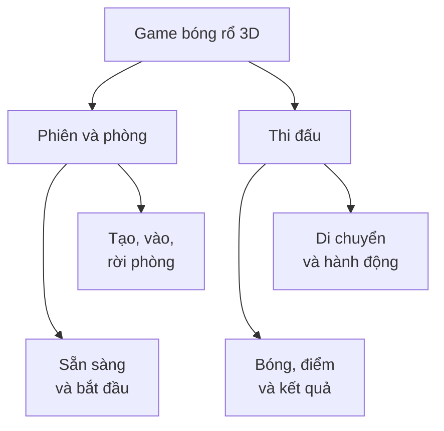
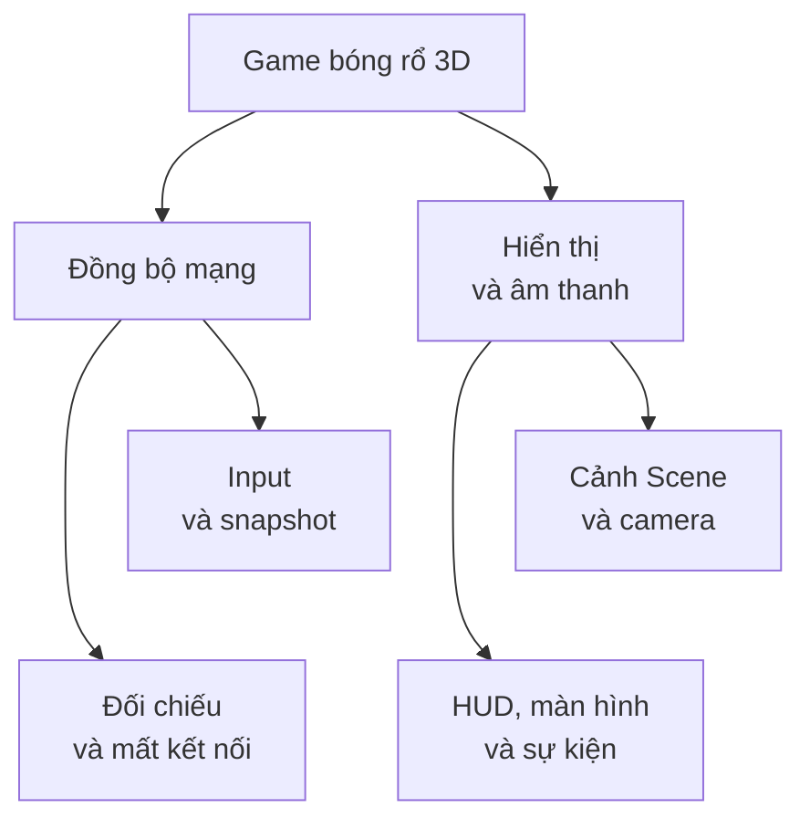
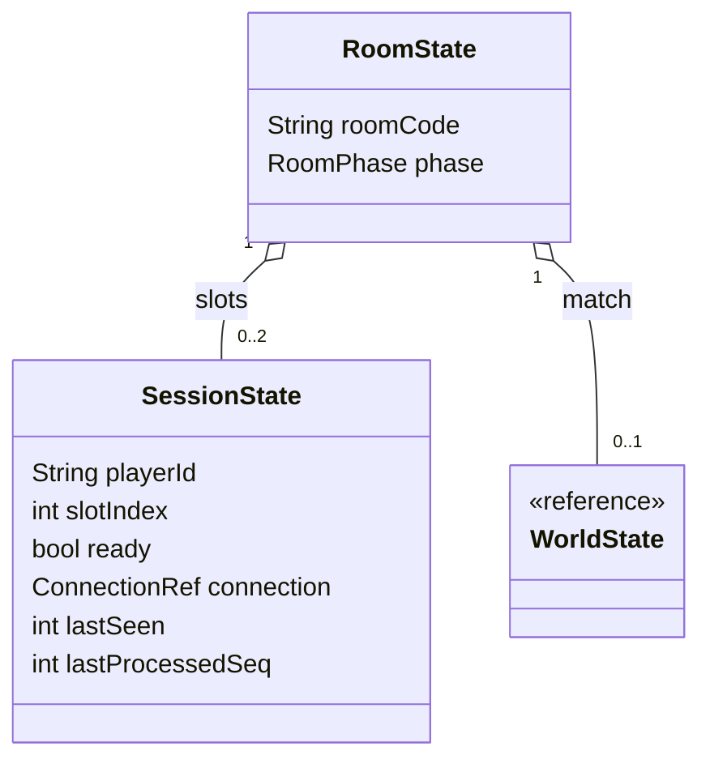
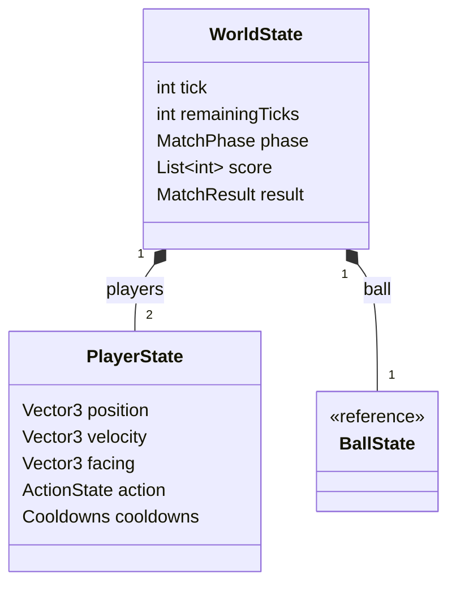
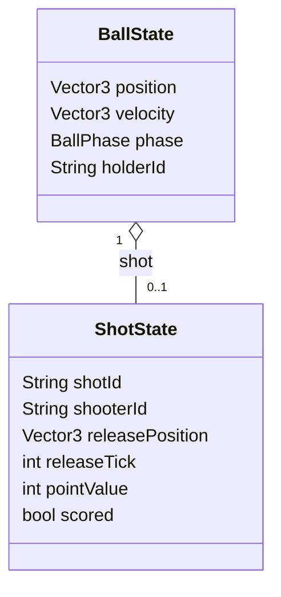
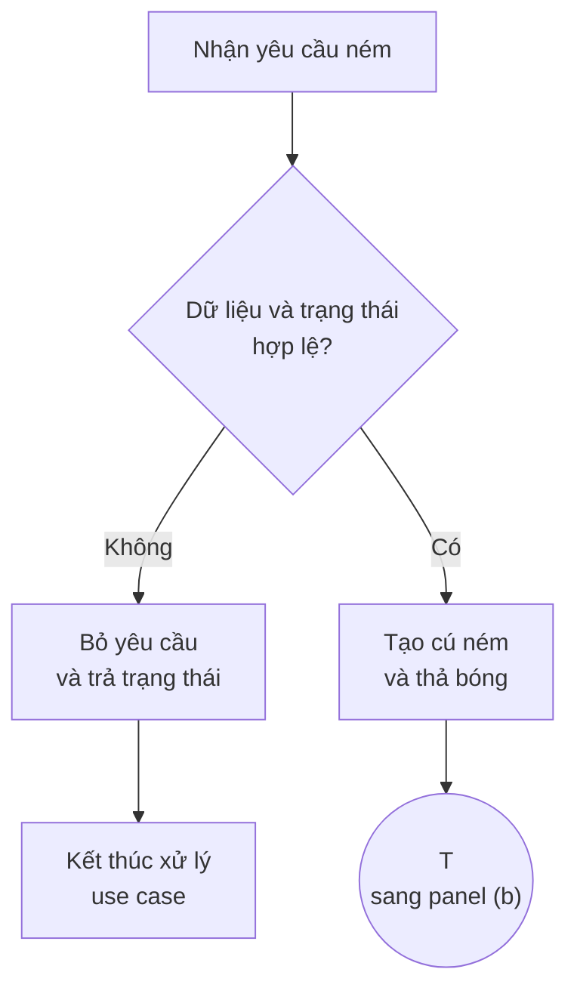
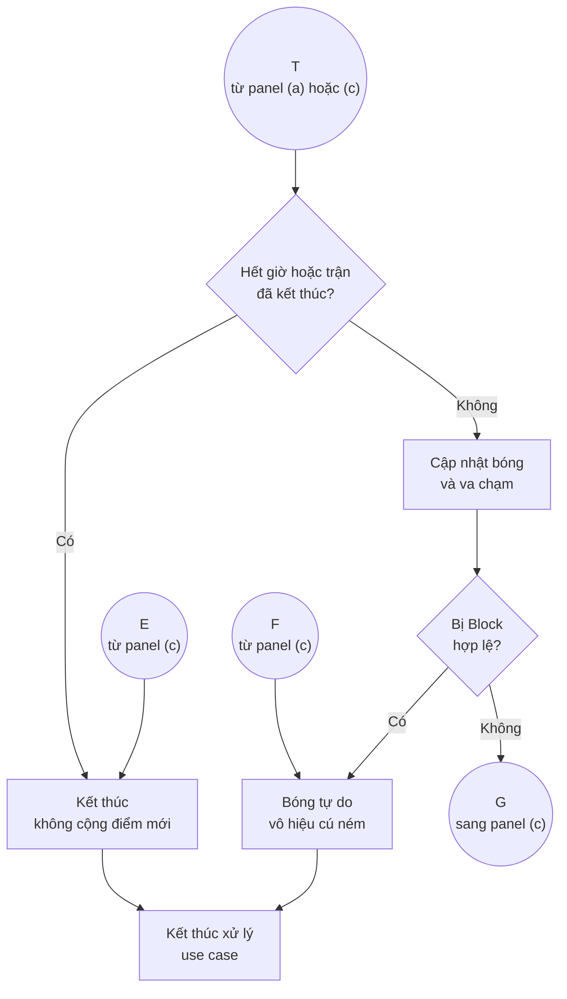
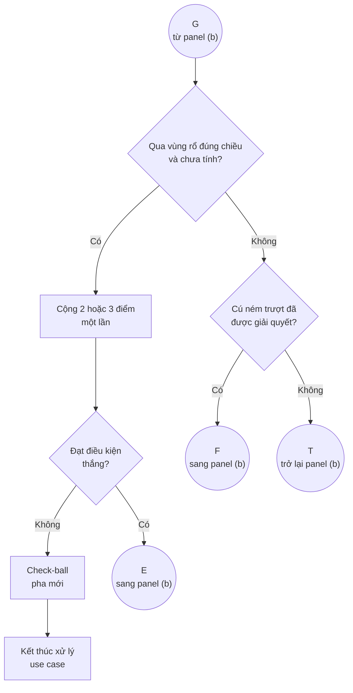

Ghi chú Lead ngày 06/11/2026: phần dưới lưu đề xuất 11 panel của Orca Worker diagrams. Sau render, bản hiện hành đã chia thêm thành 15 panel: 3.1(a,b), 3.4(a,b,c), 3.6(a,b1,b2,c1,c2), 3.7(a,b1,b2,c1,c2). Các khối Mermaid trong Chương 3 là danh sách nguồn hiện hành chính xác; tên đề xuất không xuất hiện trong đó là bản trung gian. Nguồn cũ được giữ để đối chiếu.

Q1 nối (a) với vòng tick ở (b1); Q4 mở nhánh không Block ở (b2); Q2 khai triển ghi điểm ở (c1); Q3 gửi snapshot ở (c2), kể cả tick kết thúc cú ném. Các đoạn quay về khung gọi được nêu trong caption/chú giải. Hoạt động dùng connector T/V/G/L/E/F để giữ đủ đường rẽ và vòng quay lại. Chú giải và bất biến lớp nằm trong văn bản cạnh panel. Năm panel sequence có SVG chỉnh sửa được, dựng từ Mermaid bằng tools/render-sequence-panels.cjs; các panel còn lại dùng cấu hình tools/publication-mermaid.json. Không thay đổi luật, bội số hoặc guard.

Đề xuất ban đầu: 11 panel cho bốn nhóm hình. Hình 3.1 gồm hai panel, Hình 3.4/3.6/3.7 mỗi nhóm gồm ba panel. Các nguồn dưới đây giữ nguyên nội dung thiết kế, chỉ thay cách chia và bố trí.

Không ghi tệp, render hoặc sửa manuscript. UML Hình 3.2 giữ nguyên. Tên tệp mới dùng hậu tố `v06`; nguồn cũ giữ làm lịch sử.

## Hình 3.1. Phân rã chức năng

Hai panel cùng biểu diễn một gốc `G`. Các cạnh `~~~` chỉ ràng buộc bố trí để các chức năng con xếp dọc, không phải quan hệ chức năng mới.

### `3-1a-chuc-nang-v06.mmd`



Caption: Hình 3.1(a). Phân rã chức năng phiên, phòng và thi đấu.

### `3-1b-chuc-nang-v06.mmd`



Caption: Hình 3.1(b). Phân rã chức năng đồng bộ, hiển thị và âm thanh.

Đoạn nối bắt buộc: “Hai panel thuộc cùng một sơ đồ phân rã; nút Game bóng rổ 3D được lặp lại để nối các nhóm chức năng.”

### Đối chiếu Hình 3.1

| Node/cạnh gốc | Panel mới | Bảo toàn |
|---|---|---|
| `G` | (a), (b) | Một gốc được lặp để tham chiếu, không phải hai hệ thống |
| `P`, `P1`, `P2` | (a) | Giữ nguyên chức năng |
| `M`, `M1`, `M2` | (a) | Giữ nguyên chức năng |
| `N`, `N1`, `N2` | (b) | Giữ nguyên chức năng |
| `V`, `V1`, `V2` | (b) | Giữ nguyên chức năng |
| `G→P`, `G→M` | (a) | Hai cạnh gốc |
| `P→P1`, `P→P2` | (a) | Hai cạnh gốc |
| `M→M1`, `M→M2` | (a) | Hai cạnh gốc |
| `G→N`, `G→V` | (b) | Hai cạnh gốc |
| `N→N1`, `N→N2` | (b) | Hai cạnh gốc |
| `V→V1`, `V→V2` | (b) | Hai cạnh gốc |

## Hình 3.4. Mô hình lớp trạng thái

Nguồn hiện hành chỉ có sáu lớp trạng thái. Không thêm lớp điều phối hoặc thành phần client chưa có trong thiết kế. Thay vào đó, ba panel phân biệt dữ liệu phòng/phiên, trạng thái trận/nhân vật và trạng thái bóng/cú ném.

Lớp có stereotype `reference` chỉ là tham chiếu đến cùng lớp được khai triển ở panel khác, không phải lớp mới hoặc lớp không có thuộc tính.

### `3-4a-phong-phien-v06.mmd`



Caption: Hình 3.4(a). Cấu trúc phòng và phiên kết nối trong mô hình đề xuất.

### `3-4b-tran-nhan-vat-v06.mmd`



Caption: Hình 3.4(b). Trạng thái trận và hai nhân vật trong mô hình đề xuất.

### `3-4c-bong-cu-nem-v06.mmd`



Caption: Hình 3.4(c). Trạng thái bóng và dữ liệu cú ném trong mô hình đề xuất.

Chú giải đặt sau nhóm hình, thay các note dài trong ảnh:

> Các lớp mang nhãn `reference` được khai triển ở panel kế tiếp. `slotIndex` ổn định trong phòng, có giá trị 0 hoặc 1 và không trùng; chỉ số này còn dùng phân xử nhặt bóng khi bằng khoảng cách. `score` có hai phần tử theo `slotIndex`; `result` biểu diễn thắng/thua/hòa và lý do kết thúc, chỉ có nghĩa khi trận kết thúc. `pointValue` được chốt từ `releasePosition` tại `releaseTick`; vị trí trên vạch tính 2 điểm. `scored` ngăn cộng điểm lặp. `holderId` chỉ có nghĩa khi bóng được giữ và `shot` có thể vắng. Kiểu giá trị và đơn vị thời gian còn cần cụ thể hóa khi triển khai.

### Đối chiếu Hình 3.4

| Thành phần gốc | Panel mới | Bảo toàn |
|---|---|---|
| `RoomState`: `roomCode`, `phase` | (a) | Đủ hai thuộc tính |
| `SessionState`: `playerId`, `slotIndex`, `ready`, `connection`, `lastSeen`, `lastProcessedSeq` | (a) | Đủ sáu thuộc tính |
| `WorldState`: `tick`, `remainingTicks`, `phase`, `score`, `result` | Khai triển (b); tham chiếu (a) | Đủ năm thuộc tính |
| `PlayerState`: `position`, `velocity`, `facing`, `action`, `cooldowns` | (b) | Đủ năm thuộc tính |
| `BallState`: `position`, `velocity`, `phase`, `holderId` | Khai triển (c); tham chiếu (b) | Đủ bốn thuộc tính |
| `ShotState`: `shotId`, `shooterId`, `releasePosition`, `releaseTick`, `pointValue`, `scored` | (c) | Đủ sáu thuộc tính |
| `RoomState "1" o-- "0..2" SessionState : slots` | (a) | Giữ loại quan hệ, chiều diamond và bội số |
| `RoomState "1" o-- "0..1" WorldState : match` | (a) | Giữ nguyên; WorldState không phải lớp khác |
| `WorldState "1" *-- "2" PlayerState : players` | (b) | Giữ composition và bội số |
| `WorldState "1" *-- "1" BallState : ball` | (b) | Giữ composition và bội số |
| `BallState "1" o-- "0..1" ShotState : shot` | (c) | Giữ aggregation và bội số |
| Note `SessionState` | Chú giải sau hình | Không bỏ bất biến chỉ số phòng |
| Note `WorldState` | Chú giải sau hình | Không bỏ ánh xạ điểm/kết quả |
| Note `ShotState` | Chú giải sau hình | Không bỏ chốt giá trị điểm/chống lặp |
| Note `BallState` | Chú giải sau hình | Không bỏ điều kiện holder/shot và giới hạn kiểu |

## Hình 3.6. Tuần tự xử lý cú ném

Ba panel sử dụng nhãn nối:

- `Q1`: từ panel (a) sang vòng tick ở (b).
- `Q2`: khai triển nhánh ghi điểm tại panel (c).
- `Q3`: khai triển bước gửi snapshot tại panel (c).

`Q2` và `Q3` là hai đoạn khai triển độc lập trong cùng panel (c), không phải hai bước luôn thực hiện liên tiếp. Đây là ký hiệu tham chiếu giữa panel, không thêm API hoặc thông điệp mạng.

### `3-6a-nhan-input-v06.mmd`

```mermaid
sequenceDiagram
  actor P as Người chơi
  participant A as Client A
  participant S as Máy chủ

  P->>A: Giữ rồi thả ACTION
  A->>A: Phản hồi hoạt ảnh
  A->>S: Input seq và hành động ném
  S->>S: Kiểm seq, dữ liệu và trận
  S->>S: Kiểm giữ bóng, trạng thái và hồi chiêu

  alt Input cũ/trùng/sai hoặc không được ném
    S-->>A: Trạng thái hợp lệ và ackSeq
  else Chấp nhận
    S->>S: Tạo shotId
    S->>S: Lưu releasePosition và releaseTick
    S->>S: Chốt pointValue và tạo quỹ đạo
    S->>S: Thả bóng; scored = false
    S->>S: resolved = false
    Note over S: Q1: tiếp tục tại Hình 3.6(b)
  end
```

Caption: Hình 3.6(a). Nhận input và kiểm tra điều kiện tạo cú ném.

Việc chia một thông điệp kiểm tra hoặc khởi tạo dài thành nhiều dòng tự xử lý chỉ để đọc nhãn; không xác lập thêm giao thức hoặc giai đoạn xác nhận.

### `3-6b-tick-v06.mmd`

```mermaid
sequenceDiagram
  participant S as Máy chủ

  Note over S: Q1: tiếp nhận cú ném từ panel (a)

  loop Các tick khi resolved = false
    alt Trận đã kết thúc hoặc hết giờ tại tick này
      S->>S: Giữ tỷ số cuối
      S->>S: Xác định kết quả nếu chưa có
      S->>S: Không cộng điểm mới; resolved = true
    else Trận còn chạy và còn thời gian
      S->>S: Cập nhật bóng và va chạm tại tick

      alt Block hợp lệ chạm bóng đang bay
        S->>S: Đổi vận tốc; bóng tự do
        S->>S: Vô hiệu cú ném; resolved = true
      else Qua vùng rổ từ trên xuống hợp lệ với shotId hiện hành
        Note over S: Q2: khai triển nhánh ghi điểm ở panel (c)
        Note over S: Trở về đây sau khi Q2 hoàn tất
      else Sự kiện ghi điểm cũ hoặc khác shotId hiện hành
        S->>S: Bỏ sự kiện; không cộng điểm
        S->>S: Tiếp tục xử lý cú ném hiện hành
      else Cú ném trượt đã được giải quyết
        S->>S: Bóng tự do; vô hiệu cú ném
        S->>S: resolved = true
      else Bóng còn bay, chưa có kết quả cú ném
        S->>S: Giữ resolved = false
      end
    end

    Note over S: Q3: gửi snapshot theo panel (c), rồi trở về
  end

  Note over S: resolved = true dừng vòng xử lý cú ném
  Note over S: Máy chủ quyết định điểm, quyền bóng và kết quả
```

Caption: Hình 3.6(b). Vòng tick xử lý cú ném và các nhánh kết thúc.

### `3-6c-diem-snapshot-v06.mmd`

```mermaid
sequenceDiagram
  participant A as Client A
  participant S as Máy chủ
  participant B as Client B

  Note over A,B: Q2 và Q3 là hai đoạn được tham chiếu độc lập

  opt Q2: từ nhánh qua rổ hợp lệ của panel (b)
    alt scored = false
      S->>S: Cộng pointValue cho người ném
      S->>S: scored = true

      alt Người ném đạt ít nhất 11 điểm
        S->>S: Kết thúc trận; xác nhận kết quả
      else Chưa đạt điều kiện thắng
        S->>S: Check-ball
        S->>S: Cấp bóng cho người bị ghi điểm
        S->>S: Đặt lại vị trí hai nhân vật
      end
    else Cú ném hiện hành đã tính
      S->>S: Bỏ sự kiện; không cộng lặp
    end

    S->>S: resolved = true
    Note over S: Kết thúc Q2; trở về nhánh gọi ở panel (b)
  end

  opt Q3: cuối mỗi tick của panel (b)
    S-->>A: Snapshot và ackSeq của A
    S-->>B: Snapshot và ackSeq của B
    Note over A,B: Kèm sự kiện có eventId nếu có
    Note over S: Kết thúc Q3; trở về kiểm tra guard loop ở panel (b)
  end
```

Caption: Hình 3.6(c). Khai triển xử lý ghi điểm và gửi trạng thái cho hai client.

Chú giải bắt buộc sau nhóm hình:

> Client A là client người ném, Client B là client đối thủ. Q2 và Q3 khai triển các đoạn xử lý được tham chiếu từ panel (b); khung `opt` chỉ đánh dấu điều kiện đi vào từng đoạn tham chiếu. Q3 được thực hiện cuối mỗi tick, kể cả tick làm `resolved = true`, trước khi kiểm tra lại guard của vòng lặp. `ackSeq` thuộc riêng từng phiên; dữ liệu sai định dạng hoặc sai phiên không làm tiến `ackSeq`. Các điểm này giữ cách hiểu của bản thảo hiện hành.
>
> Thứ tự hết giờ trước ghi điểm được giữ từ thiết kế gốc. Thứ tự Block trước kiểm tra qua rổ trong cùng tick vẫn là đề xuất cần xác nhận hoặc thay bằng đối chiếu thời điểm va chạm; việc chia panel không phê duyệt quy tắc phân xử đó.

### Đối chiếu Hình 3.6

| Thành phần/nhánh gốc | Panel mới | Bảo toàn |
|---|---|---|
| Actor `P` | (a) | Người chơi |
| Lifeline `A` | (a), (c) | Rút nhãn thành Client A, định nghĩa rõ là người ném |
| Lifeline `S` | (a), (b), (c) | Cùng một máy chủ |
| Lifeline `B` | (c) | Rút nhãn thành Client B, định nghĩa rõ là đối thủ |
| `P→A` giữ/thả ACTION | (a) | Giữ nguyên |
| `A→A` hoạt ảnh | (a) | Giữ nguyên |
| `A→S` input seq/hành động | (a) | Giữ nguyên |
| Kiểm seq, dữ liệu, trận, giữ bóng, trạng thái, hồi chiêu | (a), hai self-message | Đủ sáu nội dung; không thêm gói tin |
| `alt` input cũ/trùng/sai/không được ném | (a) | Giữ guard và phản hồi |
| Nhánh chấp nhận, tạo shot/lưu vị trí-tick/chốt điểm | (a) | Tách dòng, không đổi dữ liệu |
| Tạo quỹ đạo, thả bóng, `scored=false`, `resolved=false` | (a) | Tách dòng; nối Q1 |
| `loop resolved=false` | (b) | Bao trùm cả Q2 và Q3 theo quy ước khai triển |
| `alt` đã kết thúc/hết giờ | (b) | Giữ điểm cuối, kết quả nếu thiếu, không điểm mới, resolved |
| `else` còn chạy/còn thời gian | (b) | Giữ cập nhật bóng và va chạm |
| `alt` Block hợp lệ | (b) | Giữ đổi vận tốc, tự do, vô hiệu shot, resolved |
| `else` qua rổ đúng chiều và đúng shotId | (b) gọi Q2 ở (c) | Guard không bị rút bỏ |
| `alt scored=false` | Q2, (c) | Giữ cộng pointValue và đánh dấu scored |
| `alt ≥11 điểm` | Q2, (c) | Giữ kết thúc và xác nhận kết quả |
| `else` chưa thắng | Q2, (c) | Đủ check-ball, cấp bóng, đặt lại hai người |
| `else` shot hiện hành đã tính | Q2, (c) | Giữ bỏ sự kiện/không cộng lặp |
| `resolved=true` sau nhánh qua rổ | Cuối Q2, (c) | Áp dụng cho cả hai nhánh scored |
| `else` sự kiện cũ/khác shotId | (b) | Bỏ sự kiện, không điểm; không kết thúc shot hiện hành |
| `else` trượt đã giải quyết | (b) | Tự do, vô hiệu shot, resolved |
| `else` còn bay | (b) | Giữ resolved=false |
| Hai snapshot trong mỗi tick | Q3, (c) | Hai mũi tên, ack riêng từng client |
| Sự kiện `eventId` nếu có | Note Q3, (c) | Rút khỏi nhãn mũi tên nhưng áp dụng cả hai snapshot |
| Note dừng xử lý/quyền quyết định server | Cuối (b) | Giữ nguyên nghĩa |
| Giới hạn phân xử cùng tick trong manuscript | Chú giải sau nhóm hình | Không biến thành quyết định mới |

## Hình 3.7. Luồng xử lý cú ném

Giữ cách gọi “luồng xử lý”, vì nguồn gốc dùng ký pháp flowchart. Không đổi tên thành sơ đồ hoạt động UML chuẩn.

Các vòng tròn là connector giữa panel:

- `T`: vào bước kiểm tra hết giờ ở panel (b).
- `G`: vào bước kiểm tra qua rổ ở panel (c).
- `E`: đến xử lý kết thúc ở panel (b).
- `F`: đến xử lý bóng tự do ở panel (b).

Connector không phải hành động mới. `Z` lặp ở các panel là cùng ý nghĩa kết thúc xử lý use case, không phải kết thúc trận trong mọi trường hợp.

### `3-7a-nhan-yeu-cau-v06.mmd`



Caption: Hình 3.7(a). Tiếp nhận và kiểm tra yêu cầu ném.

### `3-7b-thoi-gian-va-cham-v06.mmd`



Caption: Hình 3.7(b). Kiểm tra thời gian, cập nhật bóng và xử lý Block.

### `3-7c-ghi-diem-truot-v06.mmd`



Caption: Hình 3.7(c). Kiểm tra ghi điểm, xử lý trượt và quay lại vòng cập nhật.

Chú giải bắt buộc sau nhóm hình:

> Đi theo connector cùng nhãn để tiếp tục luồng. Nhánh L–Không quay về T ở panel (b), tạo vòng lặp kiểm tra thời gian và cập nhật bóng. “Trượt đã được giải quyết” nghĩa là cú ném không còn khả năng ghi điểm theo mô phỏng, không chỉ là chưa đến rổ ở tick hiện tại. Thứ tự kiểm tra Block và qua rổ giữ theo hình gốc, vẫn chịu giới hạn phân xử cùng tick đã nêu trong phần thiết kế.

### Đối chiếu Hình 3.7

| Node/cạnh gốc | Panel mới | Bảo toàn |
|---|---|---|
| `A`, `B`, `R`, `C` | (a) | Giữ nguyên bốn node |
| `T`, `M`, `K`, `E`, `F` | (b) | Giữ nguyên năm node |
| `G`, `H`, `I`, `J`, `L` | (c) | Giữ nguyên năm node |
| `Z` | (a), (b), (c) | Lặp cùng node kết thúc use case |
| `A→B` | (a) | Giữ nguyên |
| `B–Không→R` | (a) | Giữ guard |
| `B–Có→C` | (a) | Giữ guard |
| `C→T` | (a) `C→XT`, (b) `XT→T` | Connector T thay đường cắt panel |
| `T–Có→E` | (b) | Giữ guard/kết thúc |
| `T–Không→M` | (b) | Giữ guard |
| `M→K` | (b) | Giữ nguyên |
| `K–Có→F` | (b) | Giữ guard/vô hiệu shot |
| `K–Không→G` | (b) `K→XG`, (c) `XG→G` | Connector G |
| `G–Có→H` | (c) | Giữ guard, đúng chiều/chưa tính |
| `H→I` | (c) | Giữ nguyên |
| `I–Có→E` | (c) `I→XE`, (b) `XE→E` | Connector E |
| `I–Không→J` | (c) | Giữ check-ball |
| `G–Không→L` | (c) | Giữ guard |
| `L–Có→F` | (c) `L→XF`, (b) `XF→F` | Connector F |
| `L–Không→T` | (c) `L→XT`, (b) `XT→T` | Bảo toàn cạnh quay lại, không biến thành kết thúc |
| `R→Z` | (a) | Giữ nguyên |
| `E→Z`, `F→Z` | (b) | Giữ nguyên |
| `J→Z` | (c) | Giữ nguyên |

## Bố trí và giới hạn xuất bản

- Dùng A4 portrait; đặt từng panel theo chiều dọc trong luồng văn bản, không ghép ba panel cạnh nhau.
- Chiều rộng chèn tối đa khoảng 15 cm. Panel hẹp, đặc biệt sequence chỉ có máy chủ, có thể dùng chiều rộng nhỏ hơn thay vì phóng đầy trang.
- Giữ mỗi panel cùng caption tương ứng; nếu vượt vùng in còn lại thì chuyển nguyên panel sang trang sau.
- Số nhóm vẫn là 3.1–3.8. Các phần (a), (b), (c) không tạo nhóm hình 3.9 trở đi.
- Chú giải dài được đưa ra ngoài ảnh để không ép thu nhỏ chữ. Đây là phần nội dung đi kèm bắt buộc, không phải ghi chú nội bộ.
- Hình 3.6(b) là panel có nguy cơ cao nhất về chiều cao. Nếu render cho thấy không vừa trang với chữ đọc được, phương án dự phòng là tách riêng nhánh hết giờ/Block và nhánh qua rổ/trượt thành panel (b1)/(b2), giữ Q2/Q3 cùng guard loop. Chưa có căn cứ để xác nhận cần bước này hoặc chuyển sang trang ngang.
- Chưa xác nhận font thực tế, kích thước sau render hoặc pagination. Các nguồn ở trên là bố trí mới để Lead kiểm tra, không phải tuyên bố đã đạt chất lượng bản in.

Gates thực chạy:

- `Get-Content` AGENTS.md, PROJECT_BRIEF.md, docs/CONTEXT_HANDOFF.md, thesis/OUTLINE.md | PASS, chỉ đọc | logpath=none.
- `Get-Content` Chương 3 và bốn nguồn Mermaid được giao | PASS; đọc lại riêng các nguồn để tránh giới hạn output tổng hợp | logpath=none.
- Parser/render/Word pagination | không chạy | logpath=none.

Sản phẩm bàn giao: 11 nguồn Mermaid, caption và bảng đối chiếu node, cạnh, thuộc tính, association, nhánh và vòng lặp.

Bằng chứng: đối chiếu trực tiếp nguồn hiện hành và nội dung Chương 3; không thêm lớp, luật hoặc chính sách.

Điểm chưa rõ: kích thước thực tế sau render, độ đọc chữ ở 15 cm và ngắt trang cần Lead kiểm tra.

Bước tiếp theo: Lead lưu nguồn mới, render và rà bản in trước khi tích hợp v0.6; giữ nguyên nguồn cũ và Hình 3.2.
