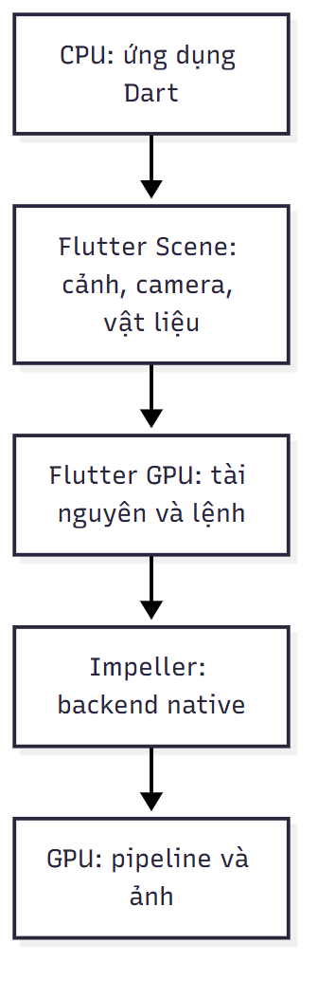
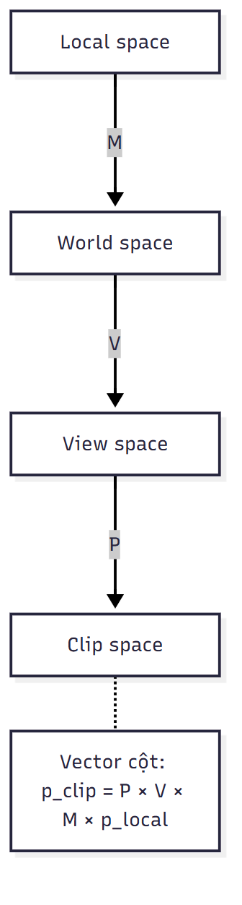
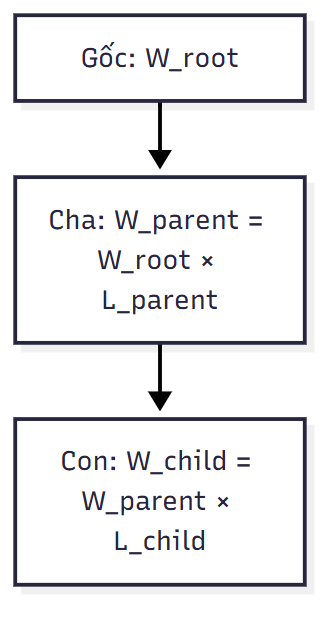
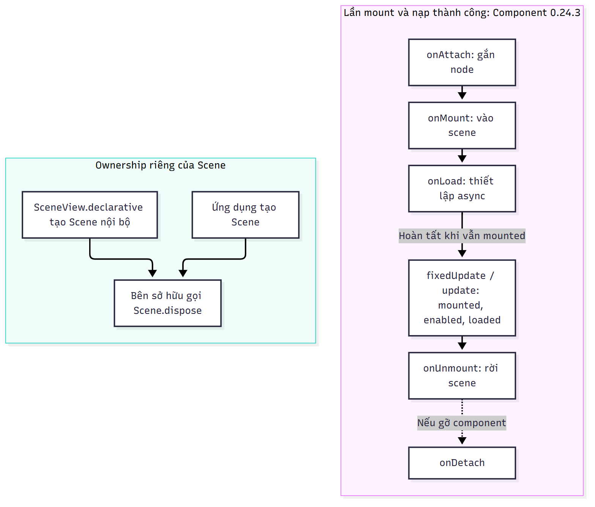
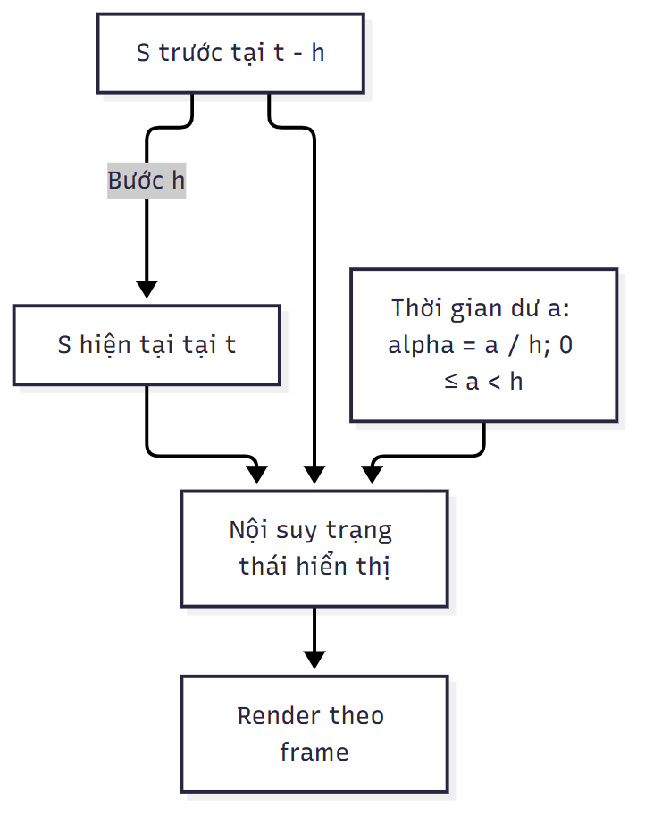
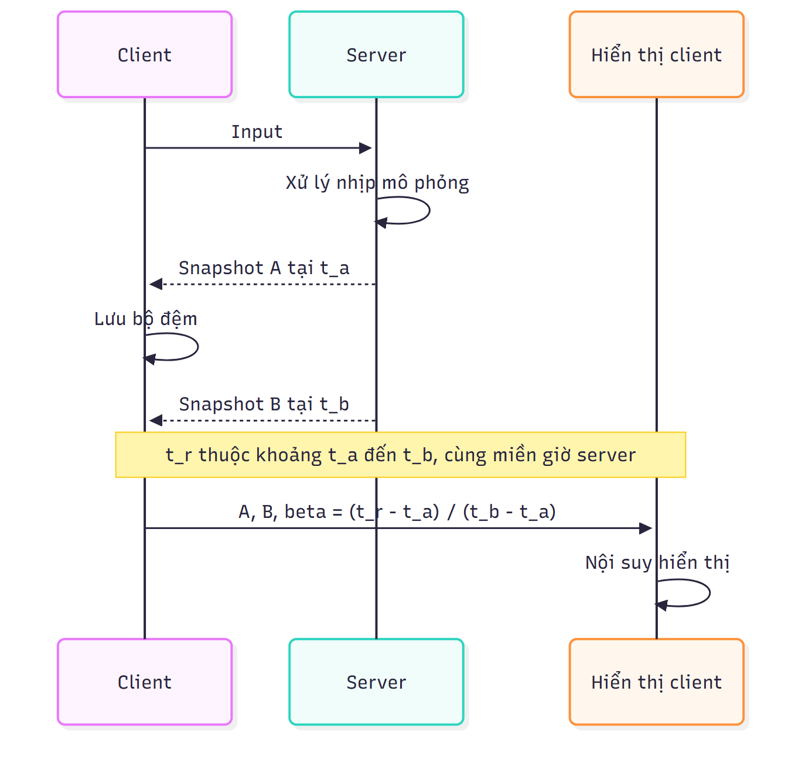

Bàn giao thesis R3, 05/11/2026. Chỉ đọc; không sửa root, Word v0.3/v0.4 hoặc mã nguồn. Đã áp dụng research-paper-writing/humanizer. Các nhãn Vị trí/Thao tác ở dưới là chỉ dẫn tích hợp, không đưa vào manuscript. Mỗi khối “Nội dung” là toàn văn sẵn để Lead chèn/thay; không viết lại toàn chương.

1. Ví dụ TR và RT

Vị trí: cuối 2.3.2. Thay đoạn bắt đầu “Thứ tự tác động phụ thuộc quy ước vector và phép nhân; row-major/column-major…” cho đến hết ví dụ cộng vị trí (3,0,0). Giữ các định nghĩa M=TRS và world/local ở phía trên.

Nội dung:

Ví dụ sau dùng vector cột, hệ trục tay phải, phép quay chủ động quanh trục z và góc dương theo quy tắc bàn tay phải. Lấy p = (1,0,0) với tọa độ thuần nhất p̃ = (1,0,0,1)ᵀ. Cho S = I₄, R là phép quay 90° quanh z và T là phép tịnh tiến (2,0,0):

\[
R=
\begin{bmatrix}
0&-1&0&0\\
1&0&0&0\\
0&0&1&0\\
0&0&0&1
\end{bmatrix},
\qquad
T=
\begin{bmatrix}
1&0&0&2\\
0&1&0&0\\
0&0&1&0\\
0&0&0&1
\end{bmatrix}.
\]

Với M = TRS = TR, điểm được quay trước rồi tịnh tiến:

\[
TR=
\begin{bmatrix}
0&-1&0&2\\
1&0&0&0\\
0&0&1&0\\
0&0&0&1
\end{bmatrix},
\qquad
TR\widetilde p=
\begin{bmatrix}2\\1\\0\\1\end{bmatrix}.
\]

Ngược lại, RT tịnh tiến điểm thành (3,0,0) rồi quay quanh gốc:

\[
RT=
\begin{bmatrix}
0&-1&0&0\\
1&0&0&2\\
0&0&1&0\\
0&0&0&1
\end{bmatrix},
\qquad
RT\widetilde p=
\begin{bmatrix}0\\3\\0\\1\end{bmatrix}.
\]

Hai kết quả (2,1,0) và (0,3,0) cho thấy thứ tự hợp thành ảnh hưởng vị trí cuối. Vector tịnh tiến cũng bị quay trong tích RT. Quy ước vector và chiều nhân quyết định thứ tự tác động; row-major hoặc column-major chỉ mô tả bố trí phần tử trong bộ nhớ. Ví dụ tính toán này minh họa nguyên lý biến đổi, không phải kết quả render hay quy ước clip-space của Scene. [28]

2. Định lượng FOV và aspect ratio

Vị trí: cuối 2.6.1, sau đoạn kết thúc “…những cách quản lý camera khác nhau. [13]”. Chèn trước 2.6.2.

Nội dung:

Gọi θᵥ là góc nhìn dọc, a = W/H là tỷ lệ chiều rộng trên chiều cao của viewport. Xét mặt phẳng vuông góc trục nhìn tại khoảng cách d > 0 tính dọc theo trục camera. Hình học tam giác vuông cho chiều cao vùng nhìn h và chiều rộng w:

\[
h=2d\tan(\theta_v/2),\qquad
w=ah,\qquad
\theta_h=2\arctan\!\left(a\tan(\theta_v/2)\right).
\]

Tương đương, nếu biết góc nhìn ngang θₕ thì w = 2d tan(θₕ/2). Khoảng cách d ở đây không phải khoảng cách Euclid đến mọi điểm trong ảnh. Công thức xét một lát cắt của thể tích nhìn đối xứng; các mặt phẳng cắt gần và xa tiếp tục giới hạn miền có thể kết xuất.

Ví dụ chọn θᵥ = 60°, d = 5 đơn vị cảnh và a = 16/9. Khi đó h ≈ 5,77, w ≈ 10,26 và θₕ ≈ 91,49°. Nếu chỉ đổi viewport thành a = 1 mà giữ góc dọc và d, h vẫn khoảng 5,77 nhưng w còn khoảng 5,77. Vì vậy, một vật ở gần mép ngang có thể ra khỏi khung khi tỷ lệ màn hình thay đổi, dù camera không di chuyển. Những số này là kết quả hình học, không phải kích thước sân hoặc cấu hình đã đo.

Trong Scene 0.24.3, PerspectiveCamera dùng fovRadiansY cho góc dọc tính bằng radian; góc ngang được xác định từ góc dọc và aspect của render target. Hai thuộc tính fovNear và fovFar là khoảng cắt, không phải góc nhìn. Ví dụ trên giải thích các đại lượng của camera; hướng dẫn cuối chương có thể chọn tham số khác mà không thay đổi quan hệ hình học này. [13], [28], [35]

3. So sánh roughness và metallic trong điều kiện kiểm soát

Vị trí: cuối 2.5.2, sau đoạn “…không khẳng định một biến thể BRDF cụ thể của shader Scene 0.24.3. [31]”. Chèn trước 2.5.3.

Nội dung:

Để phân biệt tác dụng của roughness và metallic, có thể xét bốn cấu hình của cùng một mesh dưới cùng camera, nguồn sáng, môi trường, exposure và tone mapping. Giữ base color tuyến tính ở (0,8; 0,3; 0,1), không dùng texture hoặc normal map và chỉ thay hai tham số sau:

| Cấu hình | Metallic | Roughness | Đặc điểm dự kiến theo mô hình metallic–roughness |
|---|---:|---:|---|
| A | 0 | 0,2 | Điện môi có phản xạ specular tập trung hơn |
| B | 0 | 0,8 | Điện môi có phản xạ specular phân tán hơn A |
| C | 1 | 0,2 | Kim loại có phản xạ tập trung, mang màu base color |
| D | 1 | 0,8 | Kim loại có phản xạ phân tán hơn C |

So sánh A–B hoặc C–D làm rõ roughness; so sánh A–C hoặc B–D làm rõ metallic. Metallic không phải hệ số làm vật sáng lên, còn roughness không chỉ là độ mờ màu nền. Phản xạ thực tế còn phụ thuộc môi trường. Bảng nêu dự đoán lý thuyết, chưa có ảnh render đối chứng hoặc số đo của bốn cấu hình. [12], [31]

4. Chuyển đoạn sRGB và normal map

Thao tác chính xác: cắt toàn bộ đoạn đang nằm ngay dưới tiêu đề “## 2.6. Camera, ánh sáng và môi trường”, bắt đầu “Ảnh màu base color cần được diễn giải…” và kết thúc “…không thêm tam giác silhouette. [21]”. Đặt nguyên đoạn đó trong 2.5.3, ngay sau đoạn kết “…cách xuất từ công cụ tạo mô hình. [12]” và trước đoạn “Chi phí vật liệu không chỉ phụ thuộc số lượng mesh…”. Không sao chép để tránh lặp.

Nội dung đoạn chuyển, không thay câu:

Ảnh màu base color cần được diễn giải theo quy ước màu của asset; tham số roughness/metallic là dữ liệu số. Tính chiếu sáng cần miền tuyến tính, vì cộng trực tiếp giá trị mã hóa sRGB không tương đương cộng năng lượng. Tangent-space normal map mô tả hướng trong cơ sở tangent–bitangent–normal trên bề mặt; nó bổ sung chi tiết chiếu sáng mà không thêm tam giác silhouette. [21]

5. Bảng nguồn sáng và liên hệ PointLight trong tutorial

Vị trí: 2.6.2. Giữ đoạn cosine diffuse đầu mục. Thay đoạn tiếp theo bắt đầu “Nguồn sáng có hướng mô phỏng chùm tia gần song song…” bằng khối dưới.

Nội dung:

Ba loại nguồn sáng được phân biệt bởi vị trí, hướng và miền tác động. Những khác biệt này quyết định tham số nào có ý nghĩa khi di chuyển hoặc xoay node:

| Loại | Mô hình không gian | Tác động của node trong Scene 0.24.3 | Tham số cần phân biệt |
|---|---|---|---|
| Directional | Các tia có hướng gần song song, dùng để xấp xỉ nguồn ở rất xa | Với DirectionalLightComponent thông thường, hướng dựa trên phép xoay thế giới của node; tịnh tiến node không đưa nguồn sáng tới gần bề mặt | Hướng và intensity; không điều chỉnh khoảng cách bằng position |
| Point | Nguồn tại một vị trí, phát theo các hướng xung quanh và suy giảm theo khoảng cách | PointLightComponent lấy vị trí thế giới từ node sở hữu | intensity, range và falloffExponent |
| Spot | Nguồn tại một vị trí với miền phát hình nón | SpotLightComponent lấy vị trí từ node và biến đổi hướng cục bộ của light sang thế giới | direction, range, innerConeAngle và outerConeAngle |

Trong mã 0.24.3, PointLight mặc định dùng falloffExponent = 2; range là khoảng cách để ảnh hưởng giảm về 0, còn range = 0 biểu diễn không cắt hữu hạn theo range. Với SpotLight, hai góc nón là nửa góc tính bằng radian: vùng trong có cường độ đầy đủ theo mô hình góc, giảm về 0 ở biên nón ngoài. Các tham số này được đọc từ mã nguồn phiên bản, không suy ra từ tên biến trong một ví dụ. [35]

Nguồn sáng trong hướng dẫn 2.12 là PointLight(intensity: 25, range: 10) gắn vào node tại (−2,3,−2). Vì thế, nó minh họa nguồn có vị trí và tầm tác động hữu hạn, không phải directional light. Di chuyển node làm đổi vị trí nguồn so với bề mặt; không thể diễn giải intensity = 25 là độ sáng đo được hoặc range = 10 là thông số đã hiệu chỉnh cho thiết bị.

Ảnh môi trường biểu diễn đóng góp chiếu sáng từ nhiều hướng, còn skybox là phần nền nhìn thấy. Đổi nền không mặc nhiên thay đổi năng lượng tới bề mặt. Môi trường, nguồn sáng trực tiếp và vật liệu cần được xét cùng nhau khi giải thích hình ảnh. [14]

6. Ví dụ skinning hai joint, một đỉnh

Vị trí: cuối 2.7.4, sau đoạn kết “…không chứng minh mọi asset hoặc extension đã chạy trong demo. [33]”. Không thay công thức J_j hiện tại.

Nội dung:

Xét một đỉnh ở tư thế gốc p = (1,1,0), chịu joint 0 với trọng số 0,25 và joint 1 với trọng số 0,75. Ở bind pose, node mesh có biến đổi đơn vị, joint 0 ở gốc và joint 1 tịnh tiến (0,1,0). Khi đó B₀ = I và B₁ = T(0,−1,0). Đây là một ví dụ số tự xây dựng theo mô hình skinning, không phải dữ liệu được đọc từ một asset đã chạy. [33]

Ở thời điểm xét, đặt cả hệ tại vị trí thế giới (5,0,0). Node mesh có M = T(5,0,0), joint 0 có G₀ = T(5,0,0), còn joint 1 quay 90° quanh z tại khớp:

\[
G_1=T(5,0,0)\,T(0,1,0)\,R_z(90^\circ).
\]

Các ma trận tác động lên đỉnh trong hệ mesh hiện tại là:

\[
J_0=M^{-1}G_0B_0=I,\qquad
J_1=M^{-1}G_1B_1
=T(0,1,0)R_z(90^\circ)T(0,-1,0).
\]

Joint 0 giữ p tại (1,1,0). Với joint 1, ba bước đưa p thành (1,0,0), quay thành (0,1,0), rồi cộng vị trí khớp để được (0,2,0). Nội suy trọng số trong cùng hệ mesh cho:

\[
p'_{\mathrm{mesh}}
=0{,}25(1,1,0)+0{,}75(0,2,0)
=(0{,}25;1{,}75;0).
\]

Đưa kết quả qua M cho vị trí thế giới (5,25;1,75;0). Không được trộn một vị trí thế giới với một vị trí trong hệ mesh, hoặc nhân M thêm lần nữa nếu ma trận skinning đã tạo đầu ra thế giới. Ví dụ làm rõ vai trò của inverse bind matrix và hệ tọa độ; nó chưa kiểm chứng importer hoặc animation runtime của Scene.

7. Caption và đoạn dẫn/giải thích cho sáu hình có sẵn

Thao tác: với từng dòng ảnh cũ tương ứng, thay bằng khối dưới. Giữ đường dẫn PNG hiện hành, không tạo hình mới; tiêu đề caption là một dòng văn bản riêng để Lead gán style Caption khi dựng Word. Alt text chỉ chứa mô tả tiếng Việt, không dùng tên file làm tên hình. Số 2.1–2.6 theo thứ tự xuất hiện hiện hành.

7a. Thay dòng ảnh 2-rendering-layers-r2.png ở 2.2.2:

Hình 2.1 phân biệt lớp tổ chức cảnh với lớp lệnh đồ họa và backend native khi nội dung 3D được kết xuất trong ứng dụng Flutter.

Hình 2.1. Các lớp kết xuất nội dung 3D trên nền tảng native. Nguồn: tác giả tổng hợp theo [7], [9], [10].

Các mũi tên biểu diễn quan hệ giữa những lớp trách nhiệm; chúng không mô tả lịch thực thi thread hoặc độ dài từng giai đoạn. Hình giới hạn ở đường kết xuất native, không đại diện cho backend web.

7b. Thay dòng ảnh 2-mvp-spaces-r2.png ở cuối 2.3.4:

Chuỗi đổi hệ tọa độ của một đỉnh được tóm tắt ở Hình 2.2 theo quy ước vector cột.

Hình 2.2. Chuỗi biến đổi từ hệ mô hình đến tọa độ clip. Nguồn: tác giả tổng hợp theo [28].

M, V và P lần lượt nối hệ mô hình với thế giới, hệ camera và tọa độ clip. Sau đầu ra clip còn có chia cho w và ánh xạ viewport; hình không quy định miền depth cụ thể của Scene bằng quy ước OpenGL.

7c. Thay dòng ảnh 2-scenegraph-transform-r2.png ở 2.4.1:

Quan hệ truyền transform giữa node cha và node con được biểu diễn trong Hình 2.3.

Hình 2.3. Tích lũy biến đổi trong cây node. Nguồn: tác giả tổng hợp theo [11].

Biến đổi thế giới của node con được tính từ biến đổi thế giới của cha và biến đổi cục bộ của con. Node gốc được ký hiệu bằng W_root, không mặc định bằng ma trận đơn vị. Quan hệ này giải thích vì sao đổi transform của cha có thể đổi vị trí thế giới của con dù dữ liệu cục bộ của con giữ nguyên.

7d. Thay dòng ảnh 2-lifecycle-ownership-r2.png ở 2.4.2:

Hình 2.4 thể hiện đường gắn và nạp thành công của Component theo mã nguồn Scene 0.24.3, cùng trách nhiệm sở hữu Scene.

Hình 2.4. Vòng đời Component và trách nhiệm sở hữu Scene trong Scene 0.24.3. Nguồn: tác giả tổng hợp từ mã nguồn gói phiên bản 0.24.3 [35].

Mã mount gọi onMount trước khi khởi động onLoad. update chỉ được gọi khi component đồng thời mounted, enabled và loaded; việc nạp hoàn tất sau unmount không tự đặt loaded trong nhánh kiểm tra này. Nhánh sở hữu Scene là trách nhiệm riêng, không phải bước tiếp nối của mọi component. Hình không bao quát mọi trường hợp lỗi hoặc remount và không khẳng định mọi tài nguyên GPU dùng chung được hủy đồng bộ khi gọi dispose.

7e. Thay dòng ảnh 2-fixed-render-interpolation-r2.png ở 2.8.1:

Hình 2.5 tách bước mô phỏng cố định khỏi trạng thái được dùng để hiển thị nội suy.

Hình 2.5. Bước mô phỏng cố định và nội suy hiển thị. Nguồn: tác giả tổng hợp theo [22].

Phần thời gian chưa đủ một bước h xác định hệ số nội suy giữa hai trạng thái mô phỏng gần nhau. Trạng thái nội suy chỉ phục vụ hiển thị; ghi ngược nó vào mô phỏng làm thay đổi bài toán tính bước cố định. Cách tổ chức này không tự chứng minh tất định giữa các nền tảng.

7f. Thay dòng ảnh 2-network-snapshot-timeline-r2.png ở 2.10.3:

Hình 2.6 minh họa việc đệm hai snapshot để tạo trạng thái hiển thị tại một thời điểm ở giữa.

Hình 2.6. Đệm snapshot và nội suy trạng thái qua mạng. Nguồn: tác giả tổng hợp theo [26].

Các mốc t_a, t_b và t_r phải được diễn giải trong cùng miền thời gian, với t_a ≤ t_r ≤ t_b. Hình không giả định mỗi input sinh đúng một snapshot hoặc client nhận gói theo nhịp đều. Khi không có hai mẫu bao quanh thời điểm cần vẽ, hệ phải áp dụng chính sách khác; hình không chứng minh độ trễ hoặc chất lượng kết nối thực tế.

8. Bảng khảo sát 2.1

8a. Vị trí: cuối 2.1.1, sau đoạn kết “…đối chiếu kiến trúc và quy trình.” Chèn bảng và đoạn ngắn dưới:

| Tiêu chí công cụ | Godot | Flame và flame_3d | Flutter Scene |
|---|---|---|---|
| Vai trò khảo sát | Engine và môi trường biên tập game riêng | Framework trong Flutter; tách gói cốt lõi và gói 3D thử nghiệm | Tổ chức và kết xuất nội dung 3D trong Flutter |
| Cấu trúc cần đối chiếu | Scene/node và quy trình biên tập | Thành phần game và phạm vi riêng của flame_3d | Scene/node/component, mesh/material và camera |
| Quan hệ với ứng dụng Android | Quy trình xuất Android theo tài liệu | Cần xét gói và điều kiện phiên bản Flutter | Cần xét Flutter GPU, backend và phiên bản Scene |
| Mức bằng chứng hiện có | Tài liệu giới thiệu và export [3], [4] | Trang dự án và README gói 3D [5], [6] | Tài liệu khái niệm và gói Scene [7], [10] |
| Nội dung chưa được bảng chứng minh | Hiệu năng trên cùng điện thoại | Độ ổn định và hiệu năng 3D trên cùng điện thoại | Hiệu năng game hoàn chỉnh trên thiết bị đích |

Bảng sử dụng tiêu chí về cơ chế phát triển. Các tiêu chí của game cùng thể loại ở mục tiếp theo tập trung vào sản phẩm và tương tác, nên không dùng chung thang đánh giá với engine.

8b. Vị trí: 2.1.2, sau đoạn giới thiệu Basketball Stars kết thúc “[8]”. Chèn đoạn sau nếu Lead chấp nhận bổ sung nguồn M-GAME2 vào REFERENCES, không tự cấp số [36]:

Basketball Arena được trang Miniclip giới thiệu là game bóng rổ nhiều người chơi, có khả năng thách đấu người chơi khác. Trang cung cấp liên kết tới kho ứng dụng, nhưng chưa đủ để xác định phương pháp mô phỏng hoặc đồng bộ của sản phẩm. Nguồn này mở rộng đối tượng khảo sát ở mức hình thức chơi do nhà phát hành công bố; chưa có quan sát chơi hoặc phân tích video trong phạm vi khảo sát. [M-GAME2]

| Tiêu chí sản phẩm | Basketball Stars | Basketball Arena |
|---|---|---|
| Chủ đề được công bố | Bóng rổ trên mobile [8] | Bóng rổ nhiều người chơi [M-GAME2] |
| Hình thức tương tác theo giới thiệu | Nhiều người chơi; các thao tác dẫn bóng, ném và ghi điểm [8] | Thách đấu người chơi khác [M-GAME2] |
| Giá trị tham khảo | Xác định các nhóm thao tác cần khảo sát tiếp | Bổ sung ví dụ sản phẩm có tương tác giữa người chơi |
| Chưa có bằng chứng trong khảo sát này | Trải nghiệm sử dụng, độ trễ, thuật toán ném và kiến trúc mạng | Trải nghiệm sử dụng, độ trễ, thuật toán ném và kiến trúc mạng |

--- Kết thúc các đoạn manuscript; phần dưới là bàn giao nguồn và kiểm tra, không chèn vào luận văn ---

Nguồn thực đọc trong lượt R3:
- [28] https://learnopengl.com/Getting-started/Coordinate-Systems — đã mở web, đọc các mục hệ tọa độ, projection, PVM. Ma trận TR/RT và kết quả số là tính toán mới theo quy ước nêu rõ; không sao chép phép đo.
- [31] https://learnopengl.com/PBR/Theory — đã mở web. Dùng nguyên lý roughness/metallic; bảng bốn cấu hình là ví dụ do tác giả đặt, chưa render.
- [33] https://github.khronos.org/glTF-Tutorials/gltfTutorial/gltfTutorial_020_Skins.html — đã mở web, đọc inverse bind, joint matrices, JOINTS/WEIGHTS và đầu ra thế giới của ví dụ nguồn. Phần chèn giữ J=M⁻¹GB trong hệ mesh rồi nhân M đúng một lần; số liệu một đỉnh là ví dụ mới, không dùng nguyên kết quả nguồn.
- [35] đã đọc trực tiếp cache flutter_scene-0.24.3: lib/src/components/component.dart, point_light_component.dart, spot_light_component.dart, directional_light_component.dart; các đoạn PointLight/SpotLight ở lib/src/light.dart và PerspectiveCamera ở lib/src/camera.dart. Package_config của tutorial-r2 trỏ tới đúng cache này. Không tải package, không chạy API.
- [M-GAME2] Miniclip, Basketball Arena: https://www.miniclip.com/games/basketball-arena/ . Đọc ngày 05/11/2026, trang công bố multiplayer/challenge real players. Đây là nguồn primary thực đọc; chưa xem ảnh/video hoặc chơi. Không dùng tìm kiếm App Store để bổ sung các khẳng định không có trong đoạn manuscript.
- [11], [12], [13], [14], [21], [22], [26] dùng theo hồ sơ nguồn đã có, không nhận đã mở lại tất cả trong R3. Nguồn caption bám tài liệu và source Mermaid hiện hành, không nhận đã rà ảnh PNG hoặc pagination.
- Cần Lead mở rộng mô tả bibliographic [35] hiện chỉ ghi component.dart thành “mã nguồn phân phối flutter_scene 0.24.3, component.dart, camera.dart, light.dart và các light component” hoặc cấp mục source-version riêng theo quy tắc hiện hành. Không tự gán chi tiết PointLight cho riêng component.dart.
- Không thay ngày truy cập kế thừa của [28]/[31]/[33]/[35], cùng ngày 05/11/2026; nguồn mới M-GAME2 chờ Lead cấp số liên tục, không phá refs cũ.

Rà khẳng định và giới hạn:
- TR/RT: đúng vector cột, góc dương tay phải, S=I; kết quả khác nhau và w=1.
- FOV: θ_v theo radian khi dùng API; θ_h và ví dụ độ chỉ phục vụ giải thích; d theo trục nhìn, không lấy chiều dài camera-target một cách vô điều kiện.
- Skinning: p_bind có tọa độ mesh; B1 đưa về hệ joint bind; J đầu ra mesh; M chỉ đưa ra world một lần. Mọi trọng số tổng bằng 1. Không trộn world và mesh.
- Roughness/metallic: giữ cùng hình học, camera, ánh sáng, môi trường, exposure và màu; chỉ nêu dự đoán, không tạo hình giả.
- PointLight: vị trí node lấy world transform; range không đồng nghĩa bán kính collider; intensity không phải kết quả đo. Không suy từ bảng rằng các loại shadow đã được kiểm tra.
- Caption 2.4 không lặp sai lifecycle R1; mount trước load theo source 0.24.3.
- Caption là sơ đồ nguyên lý do tác giả tổng hợp, không nhận là ảnh chụp engine; chưa kiểm tra pagination, cỡ chữ hoặc vị trí caption trong Word.

Gates thực chạy:
- Get-Content/rg tại project và cache package (đường dẫn tuyệt đối) | PASS cho đọc tài liệu, refs, Mermaid, package_config, component/camera/light source | logpath: none; nhiệm vụ chỉ đọc, không lưu log.
- rg với đối số lib/src/light* ban đầu | FAIL: Windows wildcard path os error 123; corrected to recursive lib plus literal light.dart reads | logpath: none. Không dùng lỗi tìm kiếm làm bằng chứng không tồn tại API.
- web.open [28], [31], [33], Miniclip Basketball Arena | PASS, có nội dung | logpath: none; tool transcript, không lưu web cache vào project.
- JS in-memory matrix/FOV/skinning calculation | PASS: TRp=(2,1,0,1), RTp=(0,3,0,1); h=5.7735026919, w=10.2640047856, hFOV=91.4928445197 degrees; p_mesh=(0.25,1.75,0), p_world=(5.25,1.75,0) | logpath: none; chỉ tính trong bộ nhớ.
- Android/render/Internet/full-game/Word-pagination/git/commit/push | NOT RUN | logpath: none.

Sản phẩm bàn giao: tám nhóm patch chính xác ở trên, gồm ví dụ ma trận, định lượng FOV, bảng nguồn sáng, vật liệu, skinning, chuyển đoạn texture, sáu caption và hai bảng khảo sát.
Bằng chứng: bốn nguồn web thực đọc, source cache đúng 0.24.3, Mermaid hiện có và tính toán số trong bộ nhớ; không ghi bất kỳ root nào.
Điểm chưa rõ: ảnh render vật liệu, kiểm chứng runtime PointLight/GLB/Android, pagination; nhãn M-GAME2 và mở rộng mô tả mục [35] chờ Lead tích hợp.
Bước tiếp theo: Lead ghép các patch vào nguồn v0.5, giữ nguyên v0.3/v0.4, cấp số nguồn mới và chạy các gate biên tập/build Word thuộc quyền Lead.
