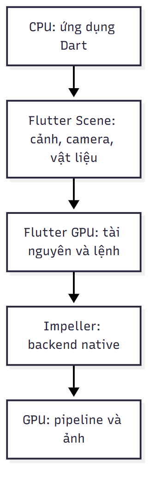
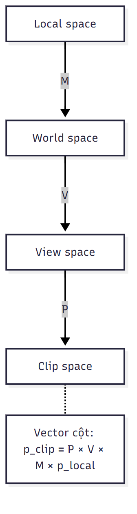
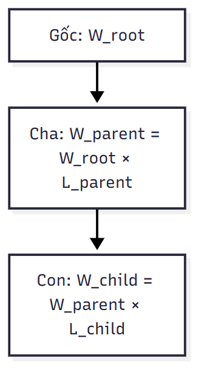
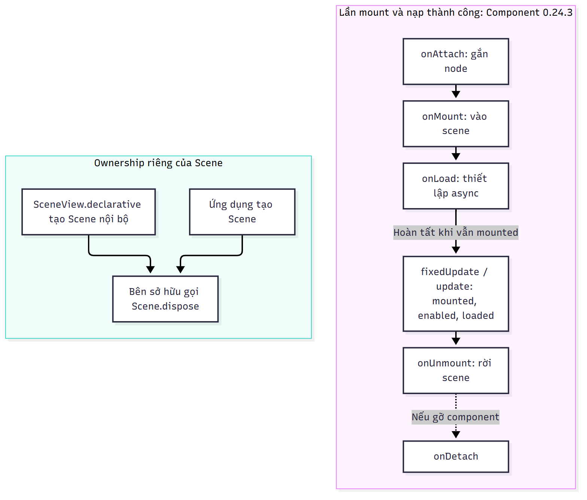
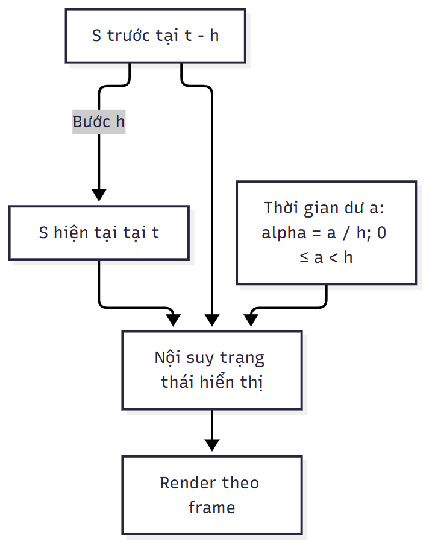
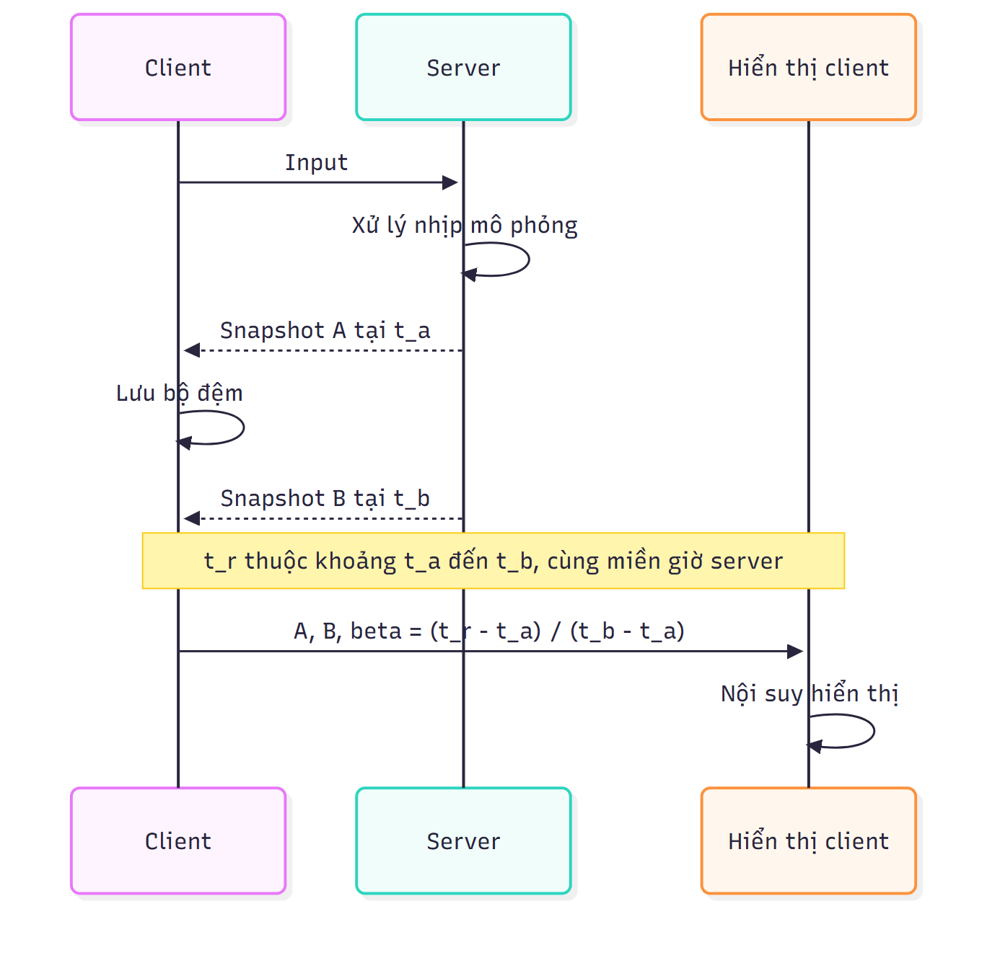

# Chương 2. Cơ sở lý thuyết

## 2.1. Các hệ thống tương tự

### 2.1.1. Engine và framework phát triển game

Game engine cung cấp những cơ chế dùng chung để tổ chức đối tượng, kết xuất, cập nhật trạng thái và xử lý tài nguyên. Framework thường cung cấp các thành phần để lập trình viên phối hợp thành ứng dụng. Ranh giới hai khái niệm phụ thuộc mức tích hợp của từng công cụ: một bộ công cụ có API dựng cảnh chưa nhất thiết đi kèm trình biên tập, hệ vật lý hoặc dịch vụ mạng. Vì vậy, khảo sát công cụ cần xét từng trách nhiệm thay vì chỉ so sánh tên gọi.

Godot là engine mã nguồn mở hỗ trợ nội dung 2D và 3D, với môi trường biên tập tích hợp. Cảnh và các node là thành phần tổ chức dự án; tài liệu cũng mô tả quy trình xuất ứng dụng Android cùng các điều kiện SDK. Godot đại diện cho hướng phát triển game trong một môi trường chuyên dụng, nơi biên tập cảnh và đóng gói sản phẩm thuộc cùng hệ công cụ. Điều này tạo một đối tượng đối chiếu về quy trình phát triển, nhưng chưa cung cấp cơ sở để kết luận hiệu năng cao hơn một giải pháp khác trên cùng điện thoại. [3], [4]

Flame thuộc hệ sinh thái Flutter và được dùng để xây dựng game dựa trên các thành phần. Bên cạnh hướng 2D của Flame cốt lõi, dự án có gói flame_3d ở trạng thái thử nghiệm. Khảo sát cần tách phạm vi của hai gói và điều kiện phiên bản tương ứng. Nhận định Flame chỉ có khả năng giả lập 2.5D bỏ qua sự tồn tại của gói 3D này. [5], [6]

Flutter Scene tổ chức nội dung 3D trong ứng dụng Flutter thông qua cảnh, node, mesh, vật liệu và camera. Flutter tiếp tục cung cấp lớp giao diện ứng dụng, còn Scene cung cấp mô hình biểu diễn và kết xuất thế giới ba chiều. Quan hệ này phù hợp với mục tiêu nghiên cứu sự kết hợp giữa mã Dart, giao diện Flutter và đồ họa 3D. Mức độ phù hợp với một sản phẩm cụ thể còn phụ thuộc việc tích hợp mô phỏng, tài nguyên, mạng và giới hạn thiết bị. [1], [7], [10]

Ba hướng trên khác nhau về môi trường phát triển, trách nhiệm tích hợp và phạm vi API. Một đánh giá công bằng phải xác định tiêu chí: khả năng biểu diễn cảnh, quy trình đưa tài nguyên vào ứng dụng, công cụ quan sát lỗi, nền tảng đích và khả năng tái hiện kết quả. Nếu so sánh hiệu năng, các bên cần dùng cảnh, độ phân giải, thiết bị và chế độ đo tương đương. Các mô tả tính năng hiện có chỉ hỗ trợ đối chiếu kiến trúc và quy trình.

### 2.1.2. Game bóng rổ trên thiết bị di động

Basketball Stars của Miniclip là sản phẩm cùng chủ đề trên thiết bị di động. Trang giới thiệu của nhà phát hành mô tả hình thức nhiều người chơi và các hoạt động như dẫn bóng, ném, ghi điểm. Nguồn này xác nhận chủ đề và những tương tác được công bố; nó không công bố đủ thuật toán mô phỏng, cấu trúc máy chủ hoặc phương pháp đồng bộ để suy ra cách hiện thực bên trong. [8]

Khảo sát game cùng thể loại có giá trị ở mức tương tác: người chơi nhận biết quyền điều khiển qua đâu, hành động được phản hồi như thế nào và thông tin nào cần hiện trong một trận đấu. Những nội dung này khác với khảo sát engine, vốn giải thích cách xây dựng hệ thống. Hình ảnh quảng bá có thể cho thấy thành phần giao diện, nhưng chưa phản ánh thời gian đáp ứng, khả năng sử dụng khi thao tác thực tế hoặc tính nhất quán giữa hai thiết bị.

### 2.1.3. Nhận xét và phạm vi đối chiếu

Đối chiếu công cụ và đối chiếu sản phẩm giải quyết hai câu hỏi khác nhau. Công cụ cung cấp cơ chế kỹ thuật; sản phẩm cho thấy một cách tổ chức trải nghiệm. Mục tiêu nghiên cứu Flutter Scene yêu cầu làm rõ các cơ chế của engine trước khi lựa chọn cách áp dụng vào game. Các phần tiếp theo trình bày những nguyên lý dùng chung cho ứng dụng 3D thời gian thực; luật chơi và các lựa chọn riêng của hệ thống được dành cho chương thiết kế.

## 2.2. Nền tảng Flutter Scene và pipeline kết xuất

### 2.2.1. Phân lớp trách nhiệm

Trong ứng dụng tích hợp nội dung 3D, lớp giao diện, mô hình cảnh và API đồ họa có trách nhiệm khác nhau. Flutter quản lý cây widget, bố cục và tương tác của ứng dụng. Scene quản lý cấu trúc nội dung 3D cùng những thành phần phục vụ kết xuất. Flutter GPU cung cấp khả năng làm việc với tài nguyên và lệnh đồ họa ở mức thấp hơn. Tài liệu Scene xác định Flutter GPU và Impeller là nền tảng cho backend native; không nên đồng nhất các lớp này thành một đối tượng duy nhất. [7], [10]

Sự phân lớp cho phép một vùng 3D cùng tồn tại với văn bản, nút bấm và thông báo Flutter. Tuy nhiên, trạng thái của widget và trạng thái của thế giới 3D có nhịp thay đổi khác nhau. Bố cục giao diện có thể chỉ đổi khi người dùng chuyển màn hình, trong khi vị trí đối tượng được cập nhật liên tục. Nếu mọi thay đổi trong thế giới đều kéo theo xây dựng lại toàn bộ giao diện, chi phí điều phối có thể vượt nhu cầu hiển thị.

### 2.2.2. Từ dữ liệu cảnh đến ảnh

Pipeline kết xuất chuyển hình học thành ảnh. Trong rasterization, dữ liệu đỉnh tạo primitive; primitive được cắt và chuyển thành fragment. Fragment shader tính đầu ra, còn các phép kiểm tra và ghi framebuffer quyết định giá trị lưu. Fragment là ứng viên đóng góp vào ảnh, chưa phải pixel cuối cùng. [20]

CPU thường đảm nhiệm cập nhật logic, chuẩn bị danh sách đối tượng và lệnh vẽ; GPU xử lý những phép tính có tính song song trên đỉnh và fragment. Phân công cụ thể phụ thuộc engine và backend. Tăng số đối tượng có thể làm nặng phần quản lý và phát lệnh; tăng độ phân giải hoặc độ phức tạp shader có thể làm nặng phần xử lý fragment. Vì vậy, giảm số tam giác chưa chắc cải thiện một cảnh đang bị giới hạn bởi tải giao diện hoặc diện tích tô nhiều lần.

Đối với nội dung 3D trong Flutter, kết quả kết xuất còn tham gia quá trình trình bày của ứng dụng. Thời gian hoàn tất phép mô phỏng và thời điểm ảnh được đưa lên màn hình là hai mốc khác nhau. Sự tách biệt này giải thích vì sao trạng thái logic cập nhật đúng vẫn có thể xuất hiện giật hình hoặc chậm phản hồi.



Clipping giữ phần primitive nằm trong thể tích nhìn; nó có thể tạo đỉnh mới ở giao tuyến thay vì chỉ bỏ cả tam giác. Depth test so sánh độ sâu fragment với giá trị đã lưu để giải quyết che khuất. Blending kết hợp màu nguồn và màu đích, chẳng hạn theo alpha; nó không thay thế depth test. Bề mặt trong suốt có thể cần thứ tự vẽ riêng vì kết quả phép trộn phụ thuộc thứ tự. Ba cơ chế giải quyết ba vấn đề khác nhau trong quá trình tạo ảnh. [20]

### 2.2.3. Backend và điều kiện tương thích

Theo nguồn cài đặt đã khảo sát, Scene yêu cầu Flutter từ 3.47 và có cấu hình bật Flutter GPU trên Android. Đây là điều kiện phần mềm ban đầu. Tài liệu Flutter mô tả Impeller mặc định trên Android API 29 trở lên và cơ chế sử dụng bộ kết xuất OpenGL cũ trong những trường hợp không đáp ứng điều kiện backend. Bật Flutter GPU và sử dụng Impeller là hai vấn đề cần kiểm tra riêng. [2], [9]

Một backend dự phòng cho giao diện Flutter không tự chứng minh Flutter GPU hoặc toàn bộ Scene hoạt động trên thiết bị đó. Khả năng tương thích phải xét cùng phiên bản SDK, gói Scene, Android API, GPU và driver. Phần mô tả API trong chương đối chiếu với mốc Scene 0.24.3; các trang tài liệu trực tuyến không gắn tag vẫn cần được kiểm tra khi thay phiên bản. [7]

## 2.3. Cơ sở toán học của không gian 3D

Cơ sở hệ tọa độ và phép biến đổi tham khảo [28]; không áp miền depth OpenGL trực tiếp cho Scene.

### 2.3.1. Điểm, vector và hệ quy chiếu

Điểm mô tả vị trí, còn vector mô tả độ dời hoặc đại lượng có hướng. Trong một hệ trục Descartes, điểm p có các tọa độ (x, y, z). Hiệu của hai điểm tạo vector độ dời d = p₂ − p₁. Độ dài vector d = (dₓ, dᵧ, d_z) được tính bởi:

||d|| = √(dₓ² + dᵧ² + d_z²).

Vector đơn vị d̂ = d/||d|| biểu diễn hướng độc lập với độ lớn khi ||d|| khác 0. Trường hợp vector bằng 0 cần xử lý riêng vì phép chia không xác định. Phân biệt hướng với độ lớn cần thiết khi biến thao tác điều khiển thành vận tốc: hướng cho biết đi đâu, còn tốc độ quy định quãng đường trong một đơn vị thời gian.

Tích vô hướng a·b = ||a||||b||cosθ liên hệ hai vector với góc giữa chúng. Với hai vector đơn vị, kết quả trực tiếp bằng cosθ. Tích có hướng a×b tạo vector vuông góc với cả hai trong không gian ba chiều; thứ tự hai toán hạng quyết định chiều. Những phép tính này được dùng để biểu diễn hướng nhìn, xác định mặt trước và xây dựng cơ sở camera.

Một bộ tọa độ chỉ có ý nghĩa khi biết hệ quy chiếu và đơn vị. Vị trí trong hệ cục bộ của đối tượng khác vị trí trong hệ thế giới; cả hai lại khác tọa độ camera. Quy ước trục đứng, hướng phía trước và tỷ lệ cần nhất quán giữa mô hình nhập vào, mô phỏng và kết xuất. Tài liệu scene graph phân biệt transform cục bộ và transform thế giới; không thể thay thế hai loại giá trị cho nhau tùy ý. [11]

### 2.3.2. Ma trận biến đổi và tọa độ thuần nhất

Tọa độ thuần nhất biểu diễn điểm ba chiều bằng vector bốn thành phần p̃ = (x, y, z, 1)ᵀ. Nhờ đó, tịnh tiến có thể được viết bằng phép nhân ma trận giống phép xoay và co giãn. Với vector chỉ hướng, thành phần cuối bằng 0 để phép tịnh tiến không làm thay đổi hướng.

Trong quy ước vector cột, một phép biến đổi cục bộ có thể viết:

M = T R S,

trong đó T là ma trận tịnh tiến, R là ma trận xoay và S là ma trận co giãn. Khi tính p̃' = M p̃, phép ở bên phải tác động trước. Phép nhân ma trận không giao hoán; đổi thứ tự xoay và tịnh tiến có thể khiến đối tượng quay quanh chính nó hoặc quay quanh một điểm khác. Công thức phải được hiểu cùng quy ước vector và phép nhân của API.

Nếu một node có ma trận cục bộ M_local và node cha có ma trận thế giới M_parent, thì:

M_world = M_parent M_local.

Công thức thể hiện sự kế thừa không gian của cây cảnh. Một đối tượng con có thể giữ tọa độ cục bộ không đổi nhưng thay đổi vị trí thế giới khi cha di chuyển. Đây là cơ sở toán học của việc gắn vật thể vào một bộ phận đang chuyển động. Ngược lại, muốn đổi một điểm thế giới về hệ cục bộ, cần phép nghịch đảo M_world⁻¹ nếu ma trận khả nghịch. Co giãn bằng 0 theo một trục có thể khiến phép nghịch đảo không tồn tại.

Thứ tự tác động phụ thuộc quy ước vector và phép nhân; row-major/column-major chỉ mô tả bố trí phần tử trong bộ nhớ. Chẳng hạn, cha tịnh tiến (2, 0, 0) và con có vị trí cục bộ (1, 0, 0), không xoay/co giãn, cho vị trí thế giới (3, 0, 0). Đây là phép cộng độ dời trong một trường hợp riêng của tích ma trận, không phải quy tắc áp dụng khi cha có phép xoay.

### 2.3.3. Biểu diễn phép xoay

Góc Euler biểu diễn phép xoay qua các góc quanh những trục theo thứ tự xác định. Cách biểu diễn này trực quan khi thiết lập tư thế, nhưng thứ tự trục ảnh hưởng kết quả và một số cấu hình làm mất một bậc tự do trong tham số hóa. Quaternion đơn vị biểu diễn hướng xoay bằng bốn thành phần với ràng buộc chuẩn bằng 1, phù hợp cho phép hợp thành và nội suy hướng. [34]

Nội suy tuyến tính từng góc Euler có thể tạo chuyển động không mong muốn khi góc đi qua ranh giới biểu diễn, chẳng hạn từ gần một vòng đầy trở về gần 0. Nội suy quaternion cần xử lý tính chất q và −q biểu diễn cùng một hướng xoay, đồng thời duy trì chuẩn. Các công thức hướng trong phần này là mô hình toán học; tên hàm chuyển đổi hoặc nội suy phải được đối chiếu với thư viện toán của phiên bản triển khai.

### 2.3.4. Chuỗi biến đổi để tạo ảnh

Một điểm từ mô hình được đưa qua ma trận thế giới M, ma trận nhìn V và ma trận chiếu P:

p_clip = P V M p_model.

Ma trận nhìn đổi tọa độ thế giới sang hệ camera; ma trận chiếu tạo tọa độ clip. Với phép chiếu phối cảnh, bước chia cho thành phần w tạo tọa độ chuẩn hóa. Phép ánh xạ viewport tiếp tục đổi tọa độ đó sang vùng hiển thị. Điều kiện cắt và miền độ sâu phụ thuộc quy ước backend, nên không được dùng nguyên ma trận của một hệ đồ họa khác mà bỏ qua quy ước này.

Chuỗi biến đổi giải thích những lỗi hiển thị khác nhau: sai M làm đối tượng lệch vị trí hoặc tỷ lệ; sai V khiến camera nhìn sai hướng; sai P hoặc mặt phẳng cắt có thể loại đối tượng khỏi vùng quan sát. Việc phân tách các hệ tọa độ cũng là cơ sở chuyển một điểm chạm trên màn hình thành tia chọn đối tượng trong thế giới.



## 2.4. Đồ thị cảnh, thành phần và vòng đời

### 2.4.1. Cấu trúc phân cấp của cảnh

Đồ thị cảnh tổ chức các đối tượng theo quan hệ không gian và trách nhiệm. Trong cây node của Scene, node có thể chứa node con cùng các thành phần liên quan đến hiển thị hoặc hành vi. Quan hệ cha–con xác định cách truyền biến đổi; nó không tự xác định quan hệ sở hữu logic của mọi dữ liệu trong ứng dụng. Hai đối tượng dùng chung một mesh hoặc vật liệu vẫn có thể thuộc các nhánh khác nhau. [10], [11]

Mô hình phân cấp làm giảm số phép cập nhật trực tiếp khi nhiều đối tượng cùng di chuyển. Tuy nhiên, phân cấp sâu cũng làm việc truy vết tọa độ và phụ thuộc phức tạp hơn. Một node được tổ chức thuận tiện cho hình ảnh chưa chắc tương ứng một thực thể mô phỏng độc lập. Vì vậy, trạng thái dùng cho luật có thể được lưu riêng rồi ánh xạ sang cây cảnh để hiển thị.



### 2.4.2. Component và vòng đời

Component đóng gói hành vi hoặc trách nhiệm được gắn vào node. Mã Scene 0.24.3 gọi onMount trước onLoad trên đường mount thành công, sau onAttach khi gắn node; update/fixedUpdate chờ mounted, enabled và loaded. Thứ tự này khác cách liệt kê trên web hiện hành. Khi _loaded chưa được đặt, mount gọi onLoad; tác vụ hoàn tất lúc còn mounted mới đặt _loaded = true. Do đó không suy ra chỉ có đúng một lời gọi trong mọi trường hợp unmount/remount khi đang tải. onMount và onUnmount liên quan việc tham gia hoặc rời cảnh, còn onAttach và onDetach liên quan quan hệ gắn với node. update theo nhịp khung hình, fixedUpdate theo bước mô phỏng vật lý. [35]

Phân biệt các thời điểm này giúp tránh sử dụng tài nguyên chưa sẵn sàng hoặc giữ callback sau khi đối tượng rời cảnh. Một tác vụ bất đồng bộ có thể hoàn tất sau khi màn hình đã bị đóng; khi đó, dữ liệu trả về không mặc nhiên còn được phép cập nhật giao diện. Đây là bài toán vòng đời tài nguyên và người sở hữu, cần được xét cùng vòng đời của Flutter.



### 2.4.3. Quyền cập nhật và tài nguyên dùng chung

Một thuộc tính chuyển động cần có nguồn cập nhật được xác định. Nếu widget khai báo, component và hệ vật lý cùng ghi transform, kết quả phụ thuộc thứ tự cập nhật. Cách tổ chức khai báo trong Flutter có thể áp dụng lại giá trị khi rebuild; cách thao tác trực tiếp trên node lại duy trì thay đổi trong đối tượng cảnh. Hai cách có thể phối hợp nếu phạm vi sở hữu được phân định. [10]

Theo README Scene 0.24.3, các getter thành phần biến đổi trả về bản sao. Thay đổi thành phần của giá trị nhận được không phải cách cập nhật node; cần gán lại giá trị theo API tương ứng. Chi tiết này cho thấy mô hình toán học của transform và cách ghi trạng thái của thư viện là hai lớp cần phân biệt. [7], [11]

Tài nguyên dùng chung có vòng đời khác với một node hiển thị. Hủy một đối tượng không đồng nghĩa mọi tài nguyên nó từng dùng đều có thể giải phóng nếu đối tượng khác còn tham chiếu. Ngược lại, giữ tài nguyên không còn dùng làm tăng bộ nhớ. Kiến trúc cần xác định đơn vị nạp, sử dụng lại và giải phóng thay vì tạo tài nguyên đồ họa liên tục trong hàm cập nhật.

## 2.5. Hình học, vật liệu và shader

### 2.5.1. Dữ liệu hình học và cấu trúc mesh

Hình học bề mặt thường được biểu diễn bằng các đỉnh và primitive. Một đỉnh có thể gồm vị trí, pháp tuyến, tọa độ texture và những thuộc tính khác phục vụ kết xuất. Index buffer cho phép primitive tham chiếu dữ liệu đỉnh thay vì lặp lại toàn bộ dữ liệu. Khi cùng một vị trí có pháp tuyến hoặc tọa độ texture khác nhau ở hai mặt, biểu diễn kết xuất có thể cần nhiều bản ghi đỉnh.

Mesh kết hợp dữ liệu hình học với vật liệu để tạo nội dung có thể vẽ. Geometry quyết định bề mặt nằm ở đâu, còn material quy định cách bề mặt tương tác với ánh sáng hoặc xuất hiện trong ảnh. Một geometry có thể được dùng lại với nhiều vật liệu; vật liệu cũng có thể dùng chung cho nhiều mesh. Scene biểu diễn các trách nhiệm này bằng những thành phần riêng. [10], [12]

Pháp tuyến biểu diễn hướng của bề mặt tại vị trí xét và ảnh hưởng phép tính chiếu sáng. Khi co giãn không đều, biến đổi pháp tuyến bằng cùng ma trận vị trí có thể làm sai hướng vuông góc. Với phần tuyến tính A khả nghịch của phép biến đổi, hướng pháp tuyến được biến đổi theo (A⁻¹)ᵀ rồi chuẩn hóa. Công thức này bắt nguồn từ yêu cầu pháp tuyến sau biến đổi vẫn vuông góc với tiếp tuyến bề mặt. [29]

### 2.5.2. Shader và mô hình vật liệu

Shader là chương trình thực hiện một phần công việc của pipeline trên GPU. Vertex shader xử lý dữ liệu theo đỉnh, còn fragment shader xác định các đại lượng đầu ra cho fragment. Material cung cấp tham số và lựa chọn biểu diễn bề mặt cho hệ shader; việc thay màu vật liệu thường là thay dữ liệu đầu vào, không phải viết lại một thuật toán kết xuất. Khả năng tùy biến shader được cung cấp tới đâu phải đối chiếu API của engine. [20], [12]

Vật liệu dựa trên vật lý, thường gọi PBR, mô tả phản xạ theo những tham số có ý nghĩa bề mặt. Tài liệu Scene có PhysicallyBasedMaterial với màu cơ sở, độ kim loại và độ nhám. Độ nhám thay đổi độ phân tán của phản xạ; độ kim loại ảnh hưởng cách phân chia phản xạ và màu bề mặt. UnlitMaterial biểu diễn nội dung không phụ thuộc mô hình chiếu sáng của cảnh. PBR tạo cơ sở để vật liệu phản ứng với môi trường, nhưng không bảo đảm hình ảnh giống thực tế nếu dữ liệu texture, tỷ lệ hoặc chiếu sáng sai. [12]

BRDF, ký hiệu f_r, mô tả quan hệ phản xạ theo hướng tới ω_i và hướng ra ω_o tại điểm x. Với bề mặt không phát sáng, phương trình phản xạ có dạng L_o(x,ω_o) = ∫_Ω f_r(x,ω_i,ω_o)L_i(x,ω_i)max(0,n·ω_i)dω_i. L_i và L_o là độ chói bức xạ tới/ra, n là pháp tuyến đơn vị, Ω là bán cầu phía trên bề mặt, dω_i là phần tử góc khối. Phương trình kết hợp ánh sáng môi trường với tính chất bề mặt. [31]

Trong mô hình vi bề mặt, roughness mô tả phân bố hướng phản xạ nhỏ. Nhánh diffuse mô tả ánh sáng tán xạ; nhánh specular mô tả phản xạ có hướng. Điện môi thường có cả hai, trong khi mô hình kim loại lý tưởng không có nhánh diffuse tương ứng. Metallic điều khiển quy ước vật liệu này, không phải độ sáng tổng thể. Đây là cơ sở PBR, không khẳng định một biến thể BRDF cụ thể của shader Scene 0.24.3. [31]

### 2.5.3. Texture và không gian biểu diễn

Texture là dữ liệu lấy mẫu trên một miền tọa độ. Tọa độ UV liên hệ điểm trên bề mặt với vị trí trong ảnh. Bộ lọc quyết định cách lấy giá trị giữa các texel; cách xử lý biên quyết định điều xảy ra khi tọa độ vượt miền texture. Texture có thể mô tả màu, pháp tuyến hoặc tham số vật liệu, nên các kênh không có cùng ý nghĩa.

Tài liệu Scene phân biệt các slot texture như base color, normal và metallic–roughness. Ảnh màu chứa thông tin phục vụ cảm nhận thị giác, trong khi ảnh tham số thường lưu đại lượng số. Đưa dữ liệu vào sai slot hoặc xử lý màu không phù hợp có thể làm vật liệu sai dù đường dẫn tài nguyên đúng. Bên cạnh độ phân giải, cần xét ý nghĩa kênh, UV và cách xuất từ công cụ tạo mô hình. [12]

Chi phí vật liệu không chỉ phụ thuộc số lượng mesh. Shader phức tạp, nhiều lần lấy mẫu và bề mặt trong suốt chồng lớp có thể làm tăng công việc trên cùng một vùng ảnh. Tái sử dụng tài nguyên giảm sự lặp lại ở mức dữ liệu, nhưng mức giảm lệnh vẽ hoặc tải GPU phải được đo theo engine và cách tổ chức cảnh thực tế.

## 2.6. Camera, ánh sáng và môi trường

Ảnh màu base color cần được diễn giải theo quy ước màu của asset; tham số roughness/metallic là dữ liệu số. Tính chiếu sáng cần miền tuyến tính, vì cộng trực tiếp giá trị mã hóa sRGB không tương đương cộng năng lượng. Tangent-space normal map mô tả hướng trong cơ sở tangent–bitangent–normal trên bề mặt; nó bổ sung chi tiết chiếu sáng mà không thêm tam giác silhouette. [21]

### 2.6.1. Camera và phép chiếu

Camera xác định hệ quy chiếu quan sát cùng thể tích có thể nhìn thấy. Vị trí và hướng tạo ma trận nhìn; phép chiếu quy định cách không gian ba chiều được đưa lên mặt phẳng. Với phối cảnh, kích thước biểu kiến của một đối tượng giảm khi khoảng cách tăng. Quan hệ giản lược x' = f x/z cho thấy vai trò của khoảng cách z và tiêu cự quy đổi f khi xét trong hệ camera theo quy ước minh họa chọn z > 0 theo hướng nhìn và f cùng hệ đơn vị ảnh quy đổi; đây không phải ma trận camera Scene.

Phép chiếu trực giao không tạo sự thu nhỏ theo khoảng cách. Hai phép chiếu phục vụ những cách biểu diễn khác nhau: phối cảnh cung cấp dấu hiệu chiều sâu, còn trực giao giữ tỷ lệ biểu kiến theo mặt phẳng quan sát. Lựa chọn phép chiếu ảnh hưởng nhận biết khoảng cách, mức che khuất và cách chuyển thao tác màn hình sang không gian.

Góc nhìn, tỷ lệ khung hình và mặt phẳng cắt cùng quyết định vùng quan sát. Mặt phẳng gần quá sát camera trong một khoảng nhìn rất rộng có thể làm phân bố độ chính xác chiều sâu kém thuận lợi. Camera có thể bỏ sót một vật thể vì nằm ngoài vùng cắt dù vị trí trong thế giới của nó hợp lệ. Tài liệu Scene mô tả PerspectiveCamera, cameraBuilder và CameraComponent cho những cách quản lý camera khác nhau. [13]

### 2.6.2. Ánh sáng và phản xạ

Chiếu sáng xác định cách năng lượng tới bề mặt đóng góp vào ảnh. Trong mô hình khuếch tán giản lược, một thành phần độ sáng phụ thuộc max(0, n·l), với n là pháp tuyến đơn vị và l là hướng đơn vị tới nguồn sáng. Công thức diễn tả việc bề mặt nhận ít ánh sáng trực tiếp hơn khi quay lệch khỏi hướng nguồn; nó chưa mô tả toàn bộ phản xạ PBR.

Nguồn sáng có hướng mô phỏng chùm tia gần song song. Chiếu sáng dựa trên ảnh môi trường biểu diễn đóng góp từ nhiều hướng xung quanh. Skybox tạo nền quan sát được; nền và nguồn chiếu sáng có thể liên quan nhưng là hai trách nhiệm khác nhau. Đổi ảnh nền không mặc nhiên thay năng lượng chiếu tới vật liệu. Tài liệu Scene mô tả môi trường, nguồn sáng có hướng và các tham số điều chỉnh đầu ra. [14]

### 2.6.3. Bóng đổ và chuyển đổi màu đầu ra

Bóng đổ biểu diễn việc một bề mặt bị vật khác che khỏi nguồn sáng. Nó bổ sung thông tin tiếp xúc và vị trí tương đối, đồng thời có thể yêu cầu thêm dữ liệu hoặc lượt kết xuất. Độ phân giải bóng và phạm vi bao phủ ảnh hưởng chất lượng; tăng chất lượng có thể làm tăng chi phí, vì vậy cần xét cùng ngân sách khung hình.

Exposure điều chỉnh mức sáng biểu diễn, còn tone mapping ánh xạ miền cường độ rộng sang miền hiển thị. Các thao tác này nằm sau hoặc quanh quá trình tính chiếu sáng tùy pipeline. Chúng giúp kiểm soát ảnh đầu ra nhưng không thay cho dữ liệu vật liệu và ánh sáng đúng. Những lựa chọn chất lượng như bóng đổ hoặc hậu xử lý cần được kiểm tra trên thiết bị thay vì suy ra từ ảnh chụp tĩnh. [14]

## 2.7. Tài nguyên, mô hình và hoạt ảnh

### 2.7.1. Mô hình dữ liệu tài nguyên

Tài nguyên 3D có thể gồm phân cấp node, mesh, vật liệu, texture, dữ liệu xương và hoạt ảnh. Một mô hình nhìn như một vật thể duy nhất có thể tham chiếu nhiều phần dữ liệu với vòng đời khác nhau. glTF là định dạng trao đổi cho nội dung 3D; GLB là dạng đóng gói nhị phân. Việc hỗ trợ định dạng cần được xét cùng tập extension mà công cụ nhập thực sự xử lý. [21]

Scene có đường nạp GLB tại thời điểm chạy và đường tiền xử lý tài nguyên khi build. Nạp tại runtime linh hoạt theo luồng ứng dụng; tiền xử lý chuyển một phần công việc sang giai đoạn chuẩn bị sản phẩm. Cả hai đều cần giữ mối liên hệ giữa dữ liệu nguồn, cấu hình chuyển đổi và phiên bản đầu ra để tái hiện nội dung. [15]

Trong glTF, buffer chứa byte; bufferView chọn một vùng byte; accessor bổ sung kiểu thành phần, số phần tử và dạng scalar/vector/matrix. Primitive tham chiếu accessor cho vị trí, pháp tuyến hoặc chỉ số. Vì vậy đọc được byte chưa đồng nghĩa đã hiểu dữ liệu hình học: cần cả layout và kiểu dữ liệu. [32]

### 2.7.2. Nạp bất đồng bộ và quản lý bộ nhớ

Nạp tài nguyên là quá trình chuyển dữ liệu từ lưu trữ sang cấu trúc mà ứng dụng và GPU sử dụng. Nó có thể gồm đọc tệp, phân tích, giải mã ảnh và tạo tài nguyên đồ họa; thời gian hoàn tất các giai đoạn không nhất thiết trùng nhau. Vì thế, hoàn thành đọc tệp chưa đồng nghĩa đối tượng đã sẵn sàng để kết xuất.

Một tài nguyên nên có trạng thái chưa nạp, đang nạp, sẵn sàng hoặc lỗi để ứng dụng phản hồi có kiểm soát. Bộ nhớ cũng không được ước lượng chỉ từ dung lượng tệp nén. Chẳng hạn, một ảnh W×H với bốn kênh 8 bit có dữ liệu nền W×H×4 byte trước khi xét các mức ảnh phụ, cách nén GPU và chi phí quản lý. Công thức này cho thấy vì sao một tệp ảnh nhỏ trên đĩa vẫn có thể chiếm bộ nhớ đáng kể khi sử dụng.

Tài liệu Scene phân biệt nạp tài nguyên và xây dựng cấu trúc cảnh, đồng thời có bước chuẩn bị tài nguyên dùng chung trong ví dụ cơ bản. Với mốc 0.24.3, Scene.initializeStaticResources() cần được xem xét trong quy trình khởi tạo, trước khi tạo những tài nguyên mà ví dụ yêu cầu. Đây là điều kiện API, không phải một phép đo tốc độ nạp. [7], [15]

### 2.7.3. Dữ liệu hoạt ảnh và trạng thái phát

Hoạt ảnh mô tả thuộc tính thay đổi theo thời gian. Keyframe ghi giá trị tại những thời điểm mốc; phép nội suy xác định giá trị giữa các mốc. Với hai giá trị vị trí a và b, nội suy tuyến tính có dạng p(α) = (1−α)a + αb, trong đó 0 ≤ α ≤ 1. Đối với phép xoay hoặc dữ liệu xương, phương pháp nội suy phải phù hợp kiểu dữ liệu để tránh biến dạng không mong muốn.

Dữ liệu Animation và trạng thái AnimationClip có vai trò khác nhau trong Scene. Animation mô tả nội dung, còn clip quản lý việc phát như thời gian, tốc độ và lặp. Việc tìm hoạt ảnh theo tên cần xử lý trường hợp không tồn tại. Theo tài liệu, clip không lặp tự tạm dừng ở keyframe cuối; vòng lặp do SceneView quản lý đã tiến clip đang phát, nên không cập nhật cùng clip lần thứ hai. [16]

Hòa trộn kết hợp ảnh hưởng của nhiều hoạt ảnh để chuyển tư thế. Kết quả phụ thuộc sự tương thích của mô hình và cách xác định trọng số. Một chuyển động được kết xuất không tự xác nhận một sự kiện logic: thời điểm hoàn tất clip và thời điểm một hành động được hệ mô phỏng chấp nhận có thể khác nhau. Tách hai loại trạng thái giúp giữ kết quả nhất quán khi ảnh hiển thị được nội suy hoặc điều chỉnh qua mạng.

### 2.7.4. Skeleton và skinning

Skeleton là phân cấp joint; skin liên kết mesh với các joint và dữ liệu trọng số trên từng đỉnh. Inverse bind matrix B_j đưa đỉnh từ tư thế gốc sang hệ joint j. Nếu G_j(t) là world transform joint hiện tại và M(t) là world transform node chứa mesh, ma trận joint trong hệ mesh là J_j(t) = M(t)⁻¹G_j(t)B_j. Phép nghịch đảo yêu cầu M khả nghịch. [33]

Với tọa độ thuần nhất p và trọng số w_j có tổng bằng 1, linear blend skinning tính p′ = Σ_j w_j J_j(t)p. Joint index chỉ định ma trận; weight chỉ định mức ảnh hưởng. Sau đó M đặt kết quả vào thế giới. Skinning khác việc gắn cả mesh vào một node: các đỉnh có thể chịu các joint khác nhau. Sai bind pose hoặc trọng số có thể gây biến dạng dù clip vẫn phát. Công thức là mô hình dữ liệu glTF, không chứng minh mọi asset hoặc extension đã chạy trong demo. [33]

## 2.8. Vòng lặp, nhập liệu và giao diện hiển thị

### 2.8.1. Thời gian mô phỏng và thời gian kết xuất

Mô phỏng cập nhật trạng thái thế giới, còn kết xuất tạo ảnh từ trạng thái đó. Hai công việc có thể chạy ở tần suất khác nhau. Nếu mỗi frame cộng một độ dời cố định, vận tốc thực sẽ phụ thuộc số frame trong một giây. Với vận tốc không đổi v và khoảng thời gian Δt, độ dời cần có là vΔt.

Bước thời gian biến thiên sử dụng thời gian đo giữa các frame. Bước cố định h tiến mô phỏng theo những khoảng bằng nhau, thường phối hợp một bộ tích lũy thời gian. Khi bộ tích lũy còn ít nhất h, mô phỏng thực hiện thêm một bước rồi giảm phần thời gian tương ứng. Cách tổ chức này tách nhịp mô phỏng khỏi nhịp vẽ, nhưng có nguy cơ quá tải nếu việc tính các bước bù chậm hơn thời gian thực. [22]

Giới hạn số bước bù hoặc giới hạn khoảng thời gian đầu vào làm thay đổi cách ứng dụng phản ứng khi quá tải. Những lựa chọn này cần được nêu rõ vì có thể ảnh hưởng tốc độ thế giới hoặc độ trễ. Bước cố định giúp kiểm soát điều kiện tính toán, nhưng tính tất định còn phụ thuộc số thực, thứ tự xử lý, dữ liệu đầu vào và trạng thái ngẫu nhiên.



Ví dụ bộ tích lũy dùng h = 0,02 s. Nếu đang dư 0,005 s và frame mới kéo dài 0,032 s, tổng 0,037 s cho phép một bước, còn dư 0,017 s. Hệ số nội suy a/h = 0,85 đặt ảnh giữa hai trạng thái gần nhất; cách này chấp nhận hiển thị trễ một bước để không ngoại suy. Các số chỉ minh họa tính toán, không phải tick của game. [22]

### 2.8.2. Từ sự kiện thiết bị đến lệnh

Sự kiện thiết bị là dữ liệu thô như chạm, di chuyển ngón tay hoặc thả nút. Lệnh biểu diễn ý định ở mức ứng dụng, ví dụ một vector hướng hoặc yêu cầu hành động. Việc ánh xạ qua lớp lệnh giúp tách phương thức nhập với mô phỏng, đồng thời thuận lợi khi ghi lại thao tác hoặc truyền qua mạng.

Cần phân biệt trạng thái giữ và sự kiện cạnh. Một nút đang giữ có thể duy trì nhiều bước mô phỏng; một lần nhấn chỉ nên tạo một sự kiện nếu chức năng yêu cầu như vậy. Khi nhiều pointer cùng tồn tại, ứng dụng phải xác định pointer nào điều khiển thành phần nào. Mất chạm hoặc chuyển xuống nền cần kết thúc trạng thái giữ để tránh lệnh tồn tại ngoài ý muốn.

Với một điểm màn hình, picking đổi tọa độ đó thành tia trong thế giới. Tia có dạng r(t) = o + td, t ≥ 0, với o là gốc và d là hướng. Tài liệu Scene mô tả screenPointToRay và Scene.raycast cho truy vấn hình học render. Truy vấn này khác truy vấn collision shapes trong thế giới vật lý; vùng viewport và hệ tọa độ đầu vào phải tương ứng nhau. [18]

Với vector cột và w khác 0, p_ndc = p_clip.xyz/p_clip.w. Nếu viewport rộng W, cao H, gốc ảnh ở trên trái và trục NDC y hướng lên, ánh xạ 2D là x_pixel = (x_ndc+1)W/2 và y_pixel = (1−y_ndc)H/2. Chẳng hạn tâm NDC (0,0) ứng với (W/2,H/2). W,H cùng đơn vị tọa độ viewport, không trộn logical pixel với physical pixel. [28]

Chiều ngược bắt đầu bằng tọa độ chạm cục bộ: x_ndc = 2x/W−1, y_ndc = 1−2y/H. Chọn hai giá trị depth near/far theo backend, nhân các điểm thuần nhất với (PV)⁻¹ rồi chia w để thu hai điểm thế giới a,b. Tia có gốc a, hướng normalize(b−a). Cách dựng còn cần ma trận khả nghịch, viewport khác 0 và hai điểm phân biệt; miền depth OpenGL không mặc định là miền Scene. Với camera trực giao, hướng tia vẫn chung nhưng gốc thay đổi theo điểm chạm. [28]

### 2.8.3. HUD và quyền quản lý vòng lặp

HUD biểu diễn những thông tin lớp trên như trạng thái, thông báo và chỉ báo điều khiển. Nó thường cần dữ liệu đã rút gọn từ thế giới thay vì tham chiếu trực tiếp mọi đối tượng cảnh. Phân tách dữ liệu hiển thị giúp giới hạn phạm vi rebuild và tránh việc một thay đổi vị trí gây dựng lại những thành phần không liên quan.

SceneView quản lý vòng kết xuất trong cách tích hợp bằng widget. Khi dùng vòng lặp thủ công, ứng dụng phải chịu trách nhiệm tiến cảnh và render theo phương thức tương ứng. Ghép cả hai cách mà không phân định trách nhiệm có thể cập nhật trạng thái hai lần. Tài liệu Scene và ví dụ backend vật lý sử dụng các cách tổ chức cần được đọc trong đúng ngữ cảnh, không ghép những đoạn mã chỉ vì chúng cùng thao tác lên Scene. [10], [17]

## 2.9. Chuyển động và mô phỏng vật lý

### 2.9.1. Động học và động lực học

Động học mô tả vị trí, vận tốc và gia tốc mà chưa xét nguyên nhân lực. Với gia tốc không đổi, chuyển động tịnh tiến có dạng:

p(t) = p₀ + v₀t + ½at²,
v(t) = v₀ + at.

Đây là nghiệm lý tưởng của một mô hình với giả thiết gia tốc không đổi. Nó phù hợp để giải thích chuyển động quỹ đạo đơn giản; sau một tiếp xúc làm thay đổi vận tốc hoặc khi có lực biến thiên, phải xét mô hình tiếp theo.

Động lực học liên hệ chuyển động với lực. Đối với chuyển động tịnh tiến của vật có khối lượng không đổi, F = ma. Trong mô phỏng thời gian rời rạc, một cách tích phân là cập nhật vₙ₊₁ = vₙ + aₙh rồi pₙ₊₁ = pₙ + vₙ₊₁h. Đây là Euler bán ẩn cho phần chuyển động xét ở đây. [30] Sai số phụ thuộc bước h và tính chất hệ; giảm h tăng số lần tính chứ không tự loại hết sai số.

### 2.9.2. Rigid body, collider và loại điều khiển

Rigid body lưu trạng thái động học hoặc động lực học; collider mô tả hình dạng dùng cho tiếp xúc. Trong Rapier, rigid body đứng riêng không có hình dạng để phát hiện tiếp xúc. Vật dynamic chịu tác động lực và tiếp xúc, fixed đứng yên, còn kinematic được điều khiển theo quỹ đạo hoặc vận tốc do ứng dụng quy định. Điều khiển kinematic không tự tạo khả năng tránh mọi vật cản. [23]

Hình dạng va chạm có thể là gần đúng của mesh hiển thị. Gần đúng đơn giản giảm công việc tính nhưng có thể làm vùng tiếp xúc khác với bề mặt người chơi nhìn thấy. Với một hệ tương tác, cần xác định sai khác nào chấp nhận được thay vì dùng toàn bộ hình học render làm mặc định cho mọi collider.

Gói flutter_scene_rapier cung cấp backend vật lý cho hợp đồng trong hệ sinh thái Scene. Tài liệu phiên bản 0.5.2 mô tả khởi tạo RapierWorld, PhysicsWorld, body và collider. Những lời gọi này cho biết cách nối hệ vật lý với cảnh, chưa quyết định mô hình mô phỏng cuối cùng của ứng dụng. [17]

### 2.9.3. Phát hiện va chạm và xử lý tiếp xúc

Phát hiện va chạm thường tách thành tìm những cặp có thể tiếp xúc và kiểm tra hình học chi tiết của các cặp đó. Tiếp theo, bộ giải tiếp xúc điều chỉnh chuyển động theo mô hình và ràng buộc. Đối tượng có thể dùng vùng kích hoạt chỉ để báo giao nhau mà không tạo phản lực. Vai trò truy vấn, phát sự kiện và giải phản lực cần được phân biệt khi thiết kế tương tác.

Lấy mẫu rời rạc có thể bỏ qua tiếp xúc nếu đối tượng vượt qua một vùng hẹp giữa hai thời điểm cập nhật. Nguy cơ này phụ thuộc vận tốc, bước thời gian và hình dạng. Giảm bước hoặc dùng phát hiện liên tục là những hướng cần đánh giá theo backend; sự tồn tại của một kỹ thuật trong lý thuyết không chứng minh binding của một phiên bản đã cung cấp đủ API cần thiết.

Restitution biểu diễn mức phục hồi vận tốc theo pháp tuyến sau va chạm trong mô hình tiếp xúc; friction chống chuyển động tương đối theo tiếp tuyến. Hai tham số ảnh hưởng phản lực do solver tính, không phải chỉ thay màu hoặc phát sự kiện collider. Vùng trigger không tạo đáp ứng này. Việc kết hợp hệ số giữa hai vật và giới hạn giá trị phải theo backend cụ thể; BasicSimulation của ví dụ chỉ xử lý truy vấn/trigger, không minh họa solver đàn hồi. [23]

### 2.9.4. Sự kiện vật lý và quy tắc ứng dụng

Một tiếp xúc chỉ xác nhận quan hệ hình học hoặc phản ứng mô phỏng. Ứng dụng còn phải xác định nó có tạo sự kiện hợp lệ hay không, sự kiện đã xử lý chưa và những điều kiện logic nào đang có hiệu lực. Cùng một cặp collider có thể được báo ở nhiều bước liên tiếp; nếu mỗi thông báo đều tạo một tác dụng không kiểm soát thì kết quả có thể bị lặp.

Thiết kế có thể dùng trạng thái trước, trạng thái sau và định danh sự kiện để quyết định tác dụng. Đối với một vật đi qua một mặt có hướng, xét dấu khoảng cách có hướng ở hai thời điểm giúp phân biệt đi xuyên qua với chỉ nằm gần mặt. Điều kiện không gian còn cần kết hợp trạng thái của hành động và giới hạn thời gian. Đây là nguyên lý xây dựng luật trên kết quả vật lý, không phải chức năng mà engine tự biết cho mọi loại ứng dụng.

## 2.10. Kết nối và đồng bộ trạng thái thời gian thực

### 2.10.1. Mô hình phân quyền trạng thái

Một hệ nhiều người chơi phải xác định thành phần được quyền quyết định trạng thái. Trong mô hình máy chủ có thẩm quyền, client gửi ý định, máy chủ kiểm tra và cập nhật thế giới rồi truyền kết quả. Cách phân quyền này giảm việc tin dữ liệu kết quả do client tự khai báo. Nó vẫn cần kiểm tra đầu vào và bảo vệ máy chủ; không thể suy ra khả năng chống mọi hình thức gian lận. [24]

Mô hình phân quyền khác với lựa chọn giao thức. Một kết nối WebSocket, UDP hoặc cơ chế truyền khác chỉ giải quyết một phần việc trao đổi dữ liệu. Quyền sở hữu đối tượng, trình tự áp dụng lệnh và điều kiện kết thúc phiên vẫn phải được ứng dụng định nghĩa.

### 2.10.2. Lệnh, snapshot và trình tự xử lý

Lệnh mô tả ý định cùng thông tin cần kiểm tra; snapshot mô tả trạng thái tại một mốc mô phỏng. Số thứ tự giúp liên hệ phản hồi với những lệnh đã gửi. Việc nhận một lệnh và việc áp dụng nó là hai thời điểm khác nhau, nên xác nhận xử lý cần phản ánh đúng mốc được dùng.

Tần suất mô phỏng, tần suất gửi snapshot và tần suất vẽ độc lập về vai trò. Tăng tần suất gửi có thể giảm khoảng trống giữa các mẫu nhưng làm tăng lượng dữ liệu và công việc xử lý. Với payload trung bình S byte và tần suất f lần/giây, tải payload của một luồng đầy đủ xấp xỉ Sf byte/giây, chưa gồm header, mã hóa và truyền lại. Công thức ước lượng này cho phép so sánh cấu hình mà không coi một tần suất cụ thể là tối ưu.

Một quy ước có thể dùng ackSeq làm mốc đã xử lý dứt điểm, gồm cả chấp nhận lẫn từ chối. Khi server trả trạng thái cùng ackSeq = 12 và client còn các input 10–15, client bỏ 10–12, khôi phục trạng thái xác nhận rồi phát lại 13–15. Ack đã xử lý không đồng nghĩa hành động được chấp nhận. Nếu input 11 bị thiếu, hệ thống phải quy định chờ, bỏ qua hay xử lý lại; không tăng mốc liên tục qua lỗ chưa giải quyết mà vẫn gọi đó là xác nhận liên tục. Đây là ví dụ giao thức khái niệm, không gán ý nghĩa này cho smoke vốn chỉ kiểm tra seq lớn hơn mốc cũ. [25]

Snapshot nên mang trạng thái cần duy trì như vị trí và kết quả; event chỉ kích hoạt tác dụng tức thời như âm thanh. Mất event không được làm mất trạng thái cuối; phát lại event cần nhận diện trùng. Seq/ack còn phải thuộc phiên hiện hành để dữ liệu trận trước không tác động phiên mới. [24], [25]

### 2.10.3. Prediction, reconciliation và interpolation

Prediction áp dụng lệnh cục bộ trước khi có phản hồi để giảm cảm giác chờ. Khi máy chủ trả trạng thái cùng mốc lệnh đã xử lý, reconciliation khôi phục trạng thái được xác nhận rồi áp dụng lại những lệnh còn chờ. Cơ chế này cần mô hình phía client đủ tương thích với máy chủ và phải quản lý các hiệu ứng để việc phát lại lệnh không tạo tác dụng lặp. [25]

Interpolation dùng các trạng thái đã nhận để hiển thị một thời điểm nằm giữa chúng. Với hai mẫu tại t₀ và t₁, hệ số α = (t_render − t₀)/(t₁ − t₀) xác định vị trí nội suy khi t₀ ≤ t_render ≤ t₁. Bộ đệm cho phép chờ đủ mẫu, đổi lại hình hiển thị chậm hơn trạng thái mới nhất. Nếu thiếu mẫu, hệ cần chính sách chờ hoặc ngoại suy; ngoại suy có thể sai khi chuyển động thay đổi bất ngờ. [26]

Gói flutter_scene_net mô tả replica gắn với node và nội suy transform. Những cơ chế này hỗ trợ biểu diễn trạng thái cảnh qua mạng; chúng chưa tự xác định toàn bộ luật, quyền điều khiển hoặc cách xử lý tranh chấp của ứng dụng. Tài liệu cũng mô tả SceneHost trong ứng dụng native, nhưng host chạy được trên một thiết bị chưa đồng nghĩa nó có địa chỉ mà mạng khác truy cập được. [19]



### 2.10.4. Độ trễ, kết nối và tính nhất quán

RTT là thời gian khứ hồi đo tại một phía; nó khác thời gian từ thao tác đến khi kết quả xuất hiện trên màn hình. Jitter mô tả sự biến thiên thời gian truyền hoặc nhận, ảnh hưởng lượng dữ liệu cần đệm. Lấy hiệu timestamp từ hai máy đòi hỏi xử lý sai lệch đồng hồ; chia RTT cho hai chỉ tạo ước lượng trong giả thiết thích hợp về hai chiều.

Heartbeat có thể giúp phát hiện một kết nối không còn đáp ứng, nhưng ngưỡng timeout là chính sách của hệ thống. Mất phản hồi có thể do đường truyền hoặc ứng dụng xuống nền chứ chưa đủ phân biệt ngay mọi nguyên nhân. Định danh phiên và sự kiện giúp kiểm tra lệnh đến muộn, yêu cầu lặp và tác dụng đã thực hiện.

Kết nối qua Internet còn liên quan địa chỉ truy cập, NAT, firewall và vòng đời máy chủ. Việc thử trên loopback chỉ xác nhận trao đổi trong môi trường cục bộ của phép thử. Nó không chứng minh khả năng đi qua hai mạng thực, tính ổn định của phiên dài hoặc đồng bộ đúng toàn bộ game.

## 2.11. Hiệu năng và giới hạn đánh giá

### 2.11.1. Ngân sách khung hình

Tốc độ khung hình liên hệ với thời gian bằng quan hệ T = 1000/f khi T tính bằng mili giây và f tính bằng frame/giây. Ví dụ, 60 frame/giây tương ứng khoảng 16,67 ms mỗi frame. Đây là phép đổi đơn vị, không phải ngưỡng nghiệm thu đã được chọn.

CPU và GPU có thể chồng lấp công việc giữa các frame nên không luôn được mô hình hóa bằng phép cộng đơn giản mọi thời gian thành phần. Cần xác định phần việc đang giới hạn tiến độ: cập nhật logic, chuẩn bị lệnh, rebuild giao diện, xử lý GPU, nạp tài nguyên hay đồng bộ. Tối ưu một phần không nằm trên đường giới hạn có thể không làm thay đổi tốc độ quan sát được.

### 2.11.2. Các nguồn chi phí

Số đối tượng ảnh hưởng quản lý trạng thái và duyệt cảnh; số đỉnh ảnh hưởng dữ liệu và phép tính hình học; số fragment ảnh hưởng tô bóng và đọc texture. Kích thước màn hình lớn làm tăng số vị trí ảnh cần xử lý. Overdraw xảy ra khi nhiều bề mặt đóng góp công việc cho cùng vùng hiển thị, nên cảnh ít tam giác vẫn có thể nặng nếu nhiều lớp phủ hoặc hiệu ứng toàn màn hình.

Bộ nhớ gồm dữ liệu phía ứng dụng, tài nguyên GPU và các bộ đệm. Tạo đối tượng ngắn hạn liên tục có thể gây công việc cấp phát hoặc thu gom rác; nạp ảnh và mô hình trong lúc tương tác có thể tạo độ trễ khác với tải ổn định. Vì vậy, cần phân biệt thời gian khởi động, lần mở cảnh đầu, giai đoạn đã làm nóng và quá trình sử dụng kéo dài.

Draw call là một yêu cầu vẽ hình học với trạng thái kết xuất tương ứng. Nhiều draw call có thể tăng chi phí chuẩn bị phía CPU; một draw call vẫn có thể đắt ở GPU nếu tô quá nhiều fragment hoặc dùng shader nặng. Khi đọc metric cần phân biệt thời gian UI/raster của Flutter với thời gian GPU thực: một biểu đồ không tự mô tả toàn bộ pipeline Scene. [27]

### 2.11.3. Nguyên tắc đo và diễn giải

Tài liệu Flutter khuyến nghị phân tích hiệu năng trên thiết bị thật và dùng chế độ profile; các công cụ như DevTools và Performance Overlay hỗ trợ quan sát tải giao diện và kết xuất. Kết quả debug không đại diện trực tiếp cho hiệu năng bản phát hành. [27]

Một báo cáo cần nêu thiết bị, hệ điều hành, backend, phiên bản phần mềm, độ phân giải, chế độ build và tình huống đo. Giá trị trung bình cần đi cùng phân bố hoặc những frame chậm để tránh che khuất giật ngắn. Trên mobile, thời gian chạy và điều kiện nhiệt có thể ảnh hưởng trạng thái quan sát, nên những lần so sánh phải kiểm soát điều kiện tương ứng.

Phép phân tích tĩnh xác định một nhóm lỗi mã; build xác nhận quá trình biên dịch hoặc đóng gói; chạy và quan sát xác nhận những hành vi trong môi trường cụ thể. Ba loại bằng chứng hỗ trợ những kết luận khác nhau. Một bản build thành công chưa cho biết ảnh có hiển thị đúng, tương tác có nhất quán hoặc tốc độ có phù hợp khi nhiều hệ cùng hoạt động.

Các phần trên tạo cơ sở giải thích việc tổ chức và đánh giá ứng dụng 3D thời gian thực. Phần hướng dẫn thực hành tiếp theo áp dụng các khái niệm vào một cảnh tối thiểu, tách các thao tác cụ thể khỏi định nghĩa và nguyên lý của chúng.

## 2.12. Hướng dẫn xây dựng một cảnh mẫu xuyên suốt

### 2.12.1 Mục tiêu và điều kiện thực hiện

Ví dụ xây dựng một cảnh nhỏ gồm mặt nền, quả cầu di chuyển, khối hộp quay, nguồn sáng và vùng phát hiện giao nhau. Giao diện Flutter cung cấp nút điều khiển và hiển thị vị trí quả cầu. Các bước sau bổ sung mô hình GLB, hoạt ảnh và chương trình kiểm tra đồng bộ cục bộ trong cùng project.

Ví dụ minh họa cách kết hợp các thành phần; chưa xây dựng luật bóng rổ, phòng đấu, prediction hoặc kết nối Internet.

Bộ phiên bản tham chiếu lấy từ lockfile của probe R1:

| Thành phần | Phiên bản |
|---|---|
| Flutter | 3.47.8 stable |
| Dart | 3.13.7 |
| `flutter_scene` | 0.24.3 |
| `scene` | 0.4.1, dependency gián tiếp |
| `vector_math` | 2.4.4 |

Máy phát triển cần Flutter và Android toolchain hoạt động. Muốn quan sát cảnh trên điện thoại phải có Android được Flutter nhận diện và hỗ trợ backend đồ họa cần thiết. Analyze hoặc build bundle không thay cho việc chạy cảnh trên thiết bị.

Trạng thái kiểm chứng: probe R1 với khối hộp đơn giản đã qua analyze và build bundle. Mã cơ sở đã qua analyze, build bundle và smoke loopback ngày 05/11/2026; chưa chạy giao diện Android hoặc nhánh asset ngoài.

Bộ source đã kiểm tra bundle chưa chứa runner Android. Khi dùng source có sẵn, cần tạo runner trước khi sửa manifest hoặc cài APK; quy trình tạo runner–manifest chưa được chạy trong lần kiểm tra bundle.

### 2.12.2 Tạo project và bật Flutter GPU

Tạo project riêng để giữ nguyên probe và bằng chứng cũ. Các lệnh dưới đây dành cho lần thực hiện sau, chưa chạy trong lượt soạn hướng dẫn:

```powershell
flutter create --platforms=android --project-name=scene_tutorial_r2 game/tutorial-r2
Set-Location game/tutorial-r2
```

Thay `pubspec.yaml` bằng:

```yaml
name: scene_tutorial_r2
description: Vi du hoc Flutter Scene, khong phai game hoan chinh.
publish_to: none

environment:
  sdk: '>=3.13.0 <4.0.0'

dependencies:
  flutter:
    sdk: flutter
  flutter_scene: 0.24.3
  vector_math: 2.4.4

flutter:
  uses-material-design: true
```

Chạy:

```powershell
flutter pub get
```

Kiểm tra `pubspec.lock`: Scene phải là 0.24.3 và `vector_math` là 2.4.4. Dependency gián tiếp có thể thay đổi khi resolve mới; muốn tái lập toàn bộ bộ dependency R1 cần dùng lockfile R1 làm cơ sở và kiểm tra diff sau resolve. Không khẳng định cùng bộ dependency chỉ từ hai dòng ghim phiên bản trực tiếp.

Trong `android/app/src/main/AndroidManifest.xml`, thêm metadata vào bên trong `<application>` hiện có:

```xml
<meta-data
    android:name="io.flutter.embedding.android.EnableFlutterGPU"
    android:value="true" />
```

Không tạo thêm một phần tử `<application>` thứ hai. Metadata này thuộc cấu hình Android; bật Impeller không tự thay thế bước bật Flutter GPU.

README của package 0.24.3 cũng cung cấp cách bật khi chạy phát triển:

```powershell
flutter run --enable-flutter-gpu
```

Trong project mẫu đã cấu hình manifest, có thể dùng `flutter run` và chọn đúng Android. Chưa thực hiện lệnh chạy trên điện thoại trong hướng dẫn này.

Dấu hiệu đúng: resolve dependency hoàn tất; manifest có metadata đúng vị trí. Việc xác nhận GPU hoạt động còn cần lần chạy thực tế.

### 2.12.3 Tổ chức tệp của ví dụ

Project sử dụng các tệp sau:

```text
lib/
  main.dart
  assets_step.dart
tool/
  sync_smoke.dart
assets/                 chỉ thêm khi có asset thật
  model.glb
  surface.png
```

`main.dart` chứa cảnh, component và giao diện. `assets_step.dart` là bước nạp tài nguyên tùy chọn. `tool/sync_smoke.dart` sử dụng nguyên chương trình smoke R1, không đưa một server thử nghiệm vào ứng dụng Android.

Tên `model.glb` và `surface.png` là tên quy ước cần cung cấp, không phải các tệp đã có trong repository.

### 2.12.4 Dựng scene, node, mesh và component

Lưu nội dung sau vào `lib/main.dart`. Mã cơ sở đã qua analyze/build bundle; chưa quan sát runtime Android.

```dart
import 'dart:async';
import 'dart:typed_data';

import 'package:flutter/material.dart';
import 'package:flutter_scene/scene.dart' as fs;
import 'package:flutter_scene/physics.dart' as ph;
import 'package:vector_math/vector_math.dart' as vm;

import 'assets_step.dart';

void main() {
  runApp(const MaterialApp(home: TutorialPage()));
}

fs.PhysicallyBasedMaterial makeMaterial(vm.Vector4 color) {
  return fs.PhysicallyBasedMaterial()
    ..baseColorFactor = color
    ..metallicFactor = 0.0
    ..roughnessFactor = 0.7;
}

class DriveComponent extends fs.Component {
  DriveComponent(this.onChanged);

  final VoidCallback onChanged;
  double direction = 0.0;

  @override
  void update(double deltaSeconds) {
    final dt = deltaSeconds.clamp(0.0, 0.05).toDouble();
    final p = node.position;
    final x = (p.x + direction * 1.2 * dt)
        .clamp(-2.0, 2.0)
        .toDouble();

    node.position = vm.Vector3(x, p.y, p.z);
    onChanged();
  }
}

class SpinComponent extends fs.Component {
  double angle = 0.0;

  @override
  void update(double deltaSeconds) {
    final dt = deltaSeconds.clamp(0.0, 0.05).toDouble();
    angle += 0.8 * dt;
    node.rotation = vm.Quaternion.axisAngle(
      vm.Vector3(0.0, 1.0, 0.0),
      angle,
    );
  }
}

class TutorialPage extends StatefulWidget {
  const TutorialPage({super.key});

  @override
  State<TutorialPage> createState() => _TutorialPageState();
}

class _TutorialPageState extends State<TutorialPage> {
  fs.Scene? _scene;
  fs.Node? _world;
  fs.Node? _ball;
  DriveComponent? _drive;

  final ValueNotifier<String> _hud =
      ValueNotifier<String>('Đang khởi tạo');

  StreamSubscription<ph.CollisionEvent>? _collisionSubscription;
  late final Future<void> _ready;
  int _entries = 0;

  @override
  void initState() {
    super.initState();
    _ready = _initialize();
  }

  Future<void> _initialize() async {
    await fs.Scene.initializeStaticResources();
    if (!mounted) return;

    final physics = ph.PhysicsWorld(ph.BasicSimulation());
    final world = fs.Node(name: 'world')
      ..addComponent(physics);

    final floor = fs.Node(
      name: 'floor',
      mesh: fs.Mesh(
        fs.CuboidGeometry(vm.Vector3(5.0, 0.1, 3.0)),
        makeMaterial(vm.Vector4(0.25, 0.35, 0.3, 1.0)),
      ),
    )..position = vm.Vector3(0.0, -0.05, 0.0);
    world.add(floor);

    final checker = fs.Texture2D.fromPixels(
      Uint8List.fromList([
        240, 120, 30, 255,
        80, 30, 10, 255,
        80, 30, 10, 255,
        240, 120, 30, 255,
      ]),
      2,
      2,
    );

    final ballMaterial =
        makeMaterial(vm.Vector4(1.0, 1.0, 1.0, 1.0))
          ..baseColorTexture = checker;

    final ball = fs.Node(
      name: 'ball',
      mesh: fs.Mesh(
        fs.SphereGeometry(
          radius: 0.25,
          segments: 24,
          rings: 12,
        ),
        ballMaterial,
      ),
    )..position = vm.Vector3(-1.5, 0.35, 0.0);

    ball.addComponent(ph.RigidBody(
      type: ph.BodyType.kinematic,
      useGravity: false,
    ));
    ball.addComponent(ph.Collider(
      shape: const ph.SphereShape(radius: 0.25),
    ));

    final drive = DriveComponent(_refreshHud);
    ball.addComponent(drive);
    world.add(ball);

    final gate = fs.Node(
      name: 'gate',
      mesh: fs.Mesh(
        fs.CuboidGeometry(vm.Vector3(0.3, 0.7, 0.7)),
        makeMaterial(vm.Vector4(0.2, 0.5, 0.9, 1.0)),
      ),
    )..position = vm.Vector3(0.0, 0.35, 0.0);

    gate.addComponent(ph.Collider(
      shape: ph.BoxShape(
        halfExtents: vm.Vector3(0.15, 0.35, 0.35),
      ),
      isTrigger: true,
    ));
    world.add(gate);

    final pivot = fs.Node(name: 'pivot')
      ..position = vm.Vector3(0.0, 1.2, 1.0)
      ..scale = vm.Vector3(1.0, 0.7, 1.0)
      ..addComponent(SpinComponent());

    pivot.add(fs.Node(
      name: 'orbitingCube',
      mesh: fs.Mesh(
        fs.CuboidGeometry(vm.Vector3(0.4, 0.4, 0.4)),
        makeMaterial(vm.Vector4(0.8, 0.7, 0.2, 1.0)),
      ),
    )..position = vm.Vector3(0.6, 0.0, 0.0));
    world.add(pivot);

    final lamp = fs.Node(name: 'lamp')
      ..position = vm.Vector3(-2.0, 3.0, -2.0)
      ..addComponent(fs.PointLightComponent(
        fs.PointLight(
          intensity: 25.0,
          range: 10.0,
          castsShadow: false,
        ),
      ));
    world.add(lamp);

    await addOptionalAssets(world, ballMaterial);
    if (!mounted) {
      physics.simulation.dispose();
      return;
    }

    final scene = fs.Scene();
    _scene = scene;
    _world = world;
    _ball = ball;
    _drive = drive;

    _collisionSubscription = physics.collisions.listen((event) {
      if (!mounted || event is! ph.TriggerEntered) return;

      final matches =
          (identical(event.nodeA, ball) &&
              identical(event.nodeB, gate)) ||
          (identical(event.nodeA, gate) &&
              identical(event.nodeB, ball));

      if (matches) {
        _entries++;
        _refreshHud();
      }
    });

    scene.add(world);
    _refreshHud();
  }

  void _refreshHud() {
    if (!mounted || _ball == null) return;
    final x = _ball!.position.x.toStringAsFixed(2);
    _hud.value = 'x = $x | Số lần vào vùng: $_entries';
  }

  @override
  void dispose() {
    final subscription = _collisionSubscription;
    if (subscription != null) {
      unawaited(subscription.cancel());
    }

    // Gỡ con trước để hủy body/collider trước physics world.
    _world?.removeAll();
    final world = _world;
    if (world != null) _scene?.remove(world);
    _scene?.dispose();
    _hud.dispose();
    super.dispose();
  }

  @override
  Widget build(BuildContext context) {
    return Scaffold(
      body: FutureBuilder<void>(
        future: _ready,
        builder: (context, snapshot) {
          if (snapshot.hasError) {
            return Center(
              child: Text(
                'Không thể khởi tạo cảnh: ${snapshot.error}',
              ),
            );
          }

          if (snapshot.connectionState != ConnectionState.done) {
            return const Center(
              child: CircularProgressIndicator(),
            );
          }

          final scene = _scene;
          if (scene == null) {
            return const SizedBox.shrink();
          }

          return Stack(
            fit: StackFit.expand,
            children: [
              fs.SceneView(
                scene,
                camera: fs.PerspectiveCamera(
                  position: vm.Vector3(3.0, 3.0, -6.0),
                  target: vm.Vector3(0.0, 0.5, 0.0),
                  fovNear: 0.1,
                  fovFar: 50.0,
                ),
              ),
              SafeArea(
                child: Column(
                  children: [
                    ValueListenableBuilder<String>(
                      valueListenable: _hud,
                      builder: (context, value, child) {
                        return Card(
                          child: Padding(
                            padding: const EdgeInsets.all(12.0),
                            child: Text(value),
                          ),
                        );
                      },
                    ),
                    const Spacer(),
                    Wrap(
                      spacing: 8.0,
                      children: [
                        ElevatedButton(
                          onPressed: () {
                            _drive?.direction = -1.0;
                          },
                          child: const Text('Trái'),
                        ),
                        ElevatedButton(
                          onPressed: () {
                            _drive?.direction = 0.0;
                          },
                          child: const Text('Dừng'),
                        ),
                        ElevatedButton(
                          onPressed: () {
                            _drive?.direction = 1.0;
                          },
                          child: const Text('Phải'),
                        ),
                      ],
                    ),
                  ],
                ),
              ),
            ],
          );
        },
      ),
    );
  }
}
```

Ở bước chưa dùng asset ngoài, tạo `lib/assets_step.dart` với nội dung đầy đủ ở mục 2.12.9. Khi không truyền tham số asset, hàm đó không nạp tệp nào.

### 2.12.5 Quan sát cấu trúc node và transform

Scene chứa node `world`. Node này chứa nền, quả cầu, vùng trigger, nguồn sáng và node `pivot`. Khối hộp `orbitingCube` là con của `pivot`; vị trí `(0.6, 0, 0)` của nó được hiểu trong hệ tọa độ của cha.

`SpinComponent` thay đổi rotation của `pivot`. Vì vậy, khối hộp vừa nhận biến đổi quay của cha, vừa giữ độ lệch cục bộ. Scale `(1, 0.7, 1)` của cha làm thay đổi hình dạng hiển thị của node con. Quan sát này giúp phân biệt biến đổi cục bộ với vị trí cuối cùng trong cảnh.

Trong Scene 0.24.3, getter `position`, `rotation` và `scale` trả bản sao. Cách cập nhật đúng là gán lại:

```dart
final p = node.position;
node.position = vm.Vector3(p.x + 0.1, p.y, p.z);
```

Không dùng cách sau:

```dart
node.position.x += 0.1;
```

Mã sau chỉ sửa đối tượng được trả về; source còn có kiểm tra debug phát hiện việc sửa transform thông qua bản sao.

Dấu hiệu cần quan sát khi chạy: khối hộp chuyển động quanh pivot, không quay cùng một vị trí như khi đặt hộp trực tiếp ở tâm. Đây là kết quả dự kiến, chưa phải quan sát thực nghiệm.

### 2.12.6 Mesh, material và texture

Mesh kết hợp hình học và vật liệu:

```dart
fs.Mesh(
  fs.SphereGeometry(radius: 0.25),
  fs.PhysicallyBasedMaterial(),
)
```

Trong ví dụ, `SphereGeometry` dùng bán kính 0.25, 24 segment và 12 ring. Các giá trị này chỉ xác định độ phân giải hình học của ví dụ, chưa được chọn theo phép đo trên Redmi Note 11.

Hàm `makeMaterial` đặt:

- `baseColorFactor`: màu RGBA nhân với màu texture.
- `metallicFactor = 0`: vật liệu phi kim.
- `roughnessFactor = 0.7`: độ nhám của bề mặt.

`baseColorFactor` được đặt trắng cho quả cầu để không làm lệch màu texture. Texture mặc định gồm bốn pixel RGBA8888, được tạo bởi `Texture2D.fromPixels`. Bước này không cần tải ảnh hoặc giả định asset đã có.

Nền là khối hộp dày 0.1, đặt tâm ở `y = -0.05`; mặt trên nằm tại `y = 0`. Quả cầu có tâm ở `y = 0.35`, nên đáy nằm cao hơn nền 0.1 đơn vị. Không có trọng lực hoặc cơ chế giữ bóng trên nền trong ví dụ này.

Dấu hiệu cần quan sát: quả cầu có biến thiên màu từ texture, khối hộp và nền có màu vật liệu khác nhau. Không thấy texture có thể do camera quá xa, texture rất nhỏ hoặc điều kiện ánh sáng; cần kiểm tra trên thiết bị trước khi kết luận.

### 2.12.7 Camera và nguồn sáng

Camera trong ví dụ đặt tại `(3, 3, -6)`, nhìn về `(0, 0.5, 0)`. Các tham số `fovNear` và `fovFar` lần lượt là khoảng cắt gần và xa, không phải vị trí camera.

```dart
fs.PerspectiveCamera(
  position: vm.Vector3(3, 3, -6),
  target: vm.Vector3(0, 0.5, 0),
  fovNear: 0.1,
  fovFar: 50,
)
```

`SceneView` chỉ nhận một trong các lựa chọn `camera`, `cameraBuilder` hoặc `viewsBuilder`. Ví dụ dùng camera cố định.

Nguồn sáng được gắn qua component:

```dart
final lamp = fs.Node()
  ..position = vm.Vector3(-2, 3, -2)
  ..addComponent(fs.PointLightComponent(
    fs.PointLight(intensity: 25, range: 10),
  ));
```

Vị trí của PointLight lấy từ world transform của node sở hữu. Thay đổi vị trí node sẽ di chuyển nguồn sáng. Cường độ 25 và tầm ảnh hưởng 10 là giá trị minh họa, không phải thông số đã hiệu chỉnh cho game.

Ví dụ tắt bóng đổ để giảm số biến cần kiểm tra. Không lấy cảnh chưa bật shadow để kết luận hiệu năng khi game có shadow.

### 2.12.8 Vòng lặp, nhập liệu và HUD

`SceneView` sở hữu ticker và quá trình vẽ cảnh. Các component ghi đè `update(double deltaSeconds)` để cập nhật hành vi theo thời gian.

`DriveComponent` tính quãng đường bằng tốc độ nhân thời gian:

```dart
final x = p.x + direction * 1.2 * dt;
```

Ba nút Flutter thay đổi `direction` thành −1, 0 hoặc 1. Nút “Trái” và “Phải” làm quả cầu tiếp tục di chuyển đến khi chọn “Dừng” hoặc chạm biên, không phải cơ chế nhấn giữ.

Ví dụ giới hạn:

- Tốc độ: 1.2 đơn vị cảnh/giây.
- Biên di chuyển: `[-2, 2]`.
- Delta dùng cho chuyển động minh họa: tối đa 0.05 giây.

Giới hạn delta ngăn một bước chuyển động quá lớn sau khung hình chậm, nhưng làm chuyển động mất một phần thời gian khi bị chậm lâu. Đây không phải giải pháp đồng bộ thời gian cho multiplayer.

HUD dùng `ValueNotifier` và `ValueListenableBuilder`. Thay đổi giá trị chỉ xây dựng lại phần văn bản theo dõi; không tạo Scene mới ở mỗi frame.

Không đồng thời thêm ticker riêng để gọi `scene.update` mà vẫn để cơ chế cập nhật tự động hoạt động không kiểm soát. Nếu cần chủ động timestep, phải thiết kế rõ một nơi duy nhất chịu trách nhiệm cập nhật cảnh.

Dấu hiệu cần quan sát: chọn hướng làm tọa độ x đổi, chọn “Dừng” giữ vị trí; counter chỉ đổi khi đi vào vùng trigger. Việc ứng dụng trở lại foreground và điều khiển đa chạm chưa được xử lý trong ví dụ.

### 2.12.9 Nạp model, texture ngoài và animation

Để sử dụng asset ngoài, cần chuẩn bị thực tế:

1. Một GLB hợp lệ, có quyền sử dụng và ghi nguồn.
2. Nếu thử animation, GLB phải chứa ít nhất một animation clip.
3. Nếu thử texture ảnh riêng, cần tệp PNG/JPEG đọc được và có giấy phép phù hợp.

Có thể tự tạo model/animation bằng công cụ dựng hình và xuất GLB. Hướng dẫn không giả định đã có nhân vật, tên clip `Idle` hoặc bộ tài nguyên được tải về.

Chỉ sau khi có tệp thật, thêm đường dẫn vào `pubspec.yaml`:

```yaml
flutter:
  uses-material-design: true
  assets:
    - assets/model.glb
    - assets/surface.png
```

Nếu chỉ có model thì chỉ khai báo model. Không khai báo các tệp chưa tồn tại vì Flutter sẽ báo lỗi asset.

Nội dung `lib/assets_step.dart`:

```dart
import 'package:flutter_scene/scene.dart' as fs;
import 'package:vector_math/vector_math.dart' as vm;

const modelAsset = String.fromEnvironment('MODEL_ASSET');
const textureAsset = String.fromEnvironment('TEXTURE_ASSET');
const clipName = String.fromEnvironment('CLIP_NAME');

Future<void> addOptionalAssets(
  fs.Node world,
  fs.PhysicallyBasedMaterial ballMaterial,
) async {
  if (textureAsset.isNotEmpty) {
    ballMaterial.baseColorTexture = await fs.Texture2D.fromAsset(
      textureAsset,
      maxSize: 1024,
    );
  }

  if (modelAsset.isEmpty) return;

  final model = await fs.Node.fromGlbAsset(
    modelAsset,
    maxTextureSize: 1024,
  );

  model.position = vm.Vector3(-1.0, 0.0, 1.0);
  model.scale = vm.Vector3(1.0, 1.0, 1.0);
  world.add(model);

  final animations = model.parsedAnimations;
  if (animations.isEmpty) {
    if (clipName.isNotEmpty) {
      throw StateError(
        'Có yêu cầu clip nhưng GLB không chứa animation.',
      );
    }
    return;
  }

  final animation = clipName.isEmpty
      ? animations.first
      : model.findAnimationByName(clipName);

  if (animation == null) {
    throw StateError('Không tìm thấy clip: $clipName');
  }

  final clip = model.createAnimationClip(animation)
    ..loop = true
    ..playbackTimeScale = 1.0;

  clip.play();
}
```

Các lệnh chạy dự kiến:

```powershell
flutter run --dart-define=MODEL_ASSET=assets/model.glb
```

```powershell
flutter run --dart-define=MODEL_ASSET=assets/model.glb --dart-define=CLIP_NAME=TenClipThucTe
```

```powershell
flutter run --dart-define=TEXTURE_ASSET=assets/surface.png
```

`TenClipThucTe` phải lấy từ model. Có thể xem danh sách tên trong debugger qua:

```dart
model.parsedAnimations.map((animation) => animation.name).toList()
```

Khi không truyền `CLIP_NAME`, ví dụ chọn animation đầu tiên nếu có. Khi không có animation và cũng không yêu cầu tên clip, model được hiển thị tĩnh.

`createAnimationClip` tạo clip ở trạng thái dừng; `play()` bắt đầu phát. Các API điều khiển đã có trong source:

```dart
clip.pause(); // Giữ thời điểm hiện tại.
clip.play();  // Tiếp tục phát.
clip.stop();  // Dừng và trở về đầu.
```

Scene cập nhật animation player trong vòng lặp của nó; không tự gọi thêm một animation ticker cho clip này.

Giá trị 1024 giới hạn kích thước texture khi nạp, không phải ngân sách bộ nhớ đã được đo. Model có kích thước hoặc gốc tọa độ khác sẽ cần chỉnh placement, scale hoặc camera. Không dùng một scale tùy ý để kết luận model đã hiển thị đúng đơn vị.

Trạng thái kiểm chứng: đã đối chiếu chữ ký `fromGlbAsset`, `fromAsset`, `parsedAnimations`, `findAnimationByName`, `createAnimationClip` và điều khiển clip trong source 0.24.3; nhánh asset đã qua phân tích tĩnh và biên dịch, nhưng chưa thực thi với GLB, texture hoặc animation thực.

### 2.12.10 Vật lý và phát hiện giao nhau

Ví dụ import phần vật lý riêng:

```dart
import 'package:flutter_scene/physics.dart' as ph;
```

`PhysicsWorld` quản lý subtree. `RigidBody` của quả cầu có loại `kinematic`, còn `Collider` xác định thể tích hình cầu. Vùng `gate` có collider hình hộp với `isTrigger: true`.

```dart
final world = fs.Node()
  ..addComponent(ph.PhysicsWorld(ph.BasicSimulation()));
```

`BasicSimulation` trong `scene` 0.4.1 hỗ trợ truy vấn và trigger cho chuyển động kinematic. Source nêu rõ backend này không có solver, contact response hoặc joints; tạo dynamic body không phải cách mô phỏng bóng rơi bằng backend này.

Do đó, hành vi dự kiến của ví dụ là:

- Quả cầu đi xuyên vùng hộp.
- `TriggerEntered` phát ra khi bắt đầu giao nhau.
- Counter tăng một lần khi vào vùng, không tăng liên tục khi còn ở trong.
- Ra khỏi vùng rồi quay lại có thể tạo lần vào tiếp theo.

Vùng trigger trong ví dụ có mesh hộp đục để nhìn thấy vị trí. Sự che khuất một phần quả cầu là kết quả vẽ hình học, không phải phản lực va chạm.

Kích thước `CuboidGeometry` là kích thước đầy đủ, còn `BoxShape` dùng `halfExtents`; vì vậy hộp `(0.3, 0.7, 0.7)` tương ứng half extents `(0.15, 0.35, 0.35)`.

Component di chuyển cập nhật theo frame; body kinematic chuyển pose sang mô phỏng ở bước vật lý. Không mặc định event và HUD xuất hiện đúng cùng một frame với thao tác nút.

Counter này chỉ đếm sự kiện vào thể tích, chưa phải tính điểm bóng rổ. Ghi điểm qua rổ còn cần xác định hướng đi qua, thứ tự giao cắt, trạng thái cú ném và quyền quyết định kết quả. Chưa chọn Rapier hoặc backend solver cho toàn game.

### 2.12.11 Networking sample trong cùng project

Trong bộ source đi kèm, dùng `tool/sync_smoke.dart`, có cùng nội dung với probe R1; đây là executable độc lập, chưa đồng bộ node Scene. Giữ nguyên source để đối chiếu với bằng chứng R1; không viết một phiên bản rút gọn rồi gán cho nó kết quả đã chạy của bản cũ.

Chương trình dùng thư viện chuẩn:

```dart
import 'dart:async';
import 'dart:convert';
import 'dart:io';
```

Mẫu tạo server loopback tại cổng được hệ điều hành cấp:

```dart
final server = await HttpServer.bind(
  InternetAddress.loopbackIPv4,
  0,
);
```

Hai client kết nối đến cùng địa chỉ `ws://127.0.0.1:<port>`. Mỗi client gửi số thứ tự riêng. Phần xử lý cốt lõi trong source R1 là:

```dart
final seq = data['seq'] as int;
if (seq > lastSeq[socket]!) {
  lastSeq[socket] = seq;
  x += data['dx'] as int;
  tick++;
}

for (final peer in sockets) {
  peer.add(jsonEncode({
    'x': x,
    'tick': tick,
    'ack': lastSeq[peer],
  }));
}
```

Trình tự kiểm tra:

1. Client A gửi `seq = 1`, `dx = 1`.
2. Chờ cả hai client nhận trạng thái đầu tiên.
3. A gửi lại `seq = 1`, nhưng `dx = 100`.
4. Chờ cả hai client quan sát phản hồi input trùng.
5. Client B gửi `seq = 1`, `dx = 2`.
6. Kiểm tra cả hai nhận `x = 3`, `tick = 2`, `ack = 1`.

Lệnh dự kiến trong project hướng dẫn:

```powershell
dart tool/sync_smoke.dart
```

Dòng thành công của source R1:

```text
PASS: two loopback clients share x=3/tick=2; duplicate input ignored; per-client ack=1.
```

`tick` trong mẫu là bộ đếm input được chấp nhận, không phải tần số mô phỏng. Các timeout 5 giây trong chương trình chỉ giới hạn thời gian chờ của smoke check, không phải ngưỡng độ trễ gameplay.

Mẫu kiểm tra seq trùng với payload hợp lệ; chưa kiểm tra validation dữ liệu không tin cậy, bỏ sót seq, phân xử luật hoặc input bị từ chối. Nó chưa kết nối với SceneView; việc gán `x` nhận từ mạng vào node cần được thiết kế và kiểm tra riêng.

Chương trình chạy trong Dart VM và dùng `dart:io`; không chạy như chương trình trình duyệt. Không thay loopback bằng public bind rồi coi đó là giải pháp Internet. Chưa có TLS, xác thực, NAT/relay, hosting hoặc reconnect cho sản phẩm.

### 2.12.12 Kiểm tra theo từng mức và xử lý lỗi

Trong thư mục project ví dụ, kiểm tra lần lượt:

```powershell
flutter pub get
flutter analyze
flutter build bundle --debug --target-platform android-arm64
dart tool/sync_smoke.dart
```

Chỉ khi có Android được nhận diện mới chạy:

```powershell
flutter devices
flutter run
```

Dấu hiệu đạt của từng mức:

| Mức | Dấu hiệu | Chưa chứng minh |
|---|---|---|
| Resolve | Có lockfile, đúng Scene 0.24.3 | API dùng đúng hoặc render được |
| Analyze | Không có lỗi phân tích tĩnh | GPU, asset và hành vi runtime |
| Build bundle | Tạo kernel/assets thành công | APK, cài đặt hoặc render Android |
| Smoke mạng | Đúng state, duplicate và ack | Hai Android hoặc Internet |
| Chạy Android | Quan sát cảnh, điều khiển và trigger | Hiệu năng đạt hoặc game hoàn chỉnh |
| GLB/animation | Model và clip thực hiển thị đúng | Tương thích mọi asset hoặc nhân vật game |

Các lỗi cần phân biệt:

| Hiện tượng | Cách kiểm tra |
|---|---|
| Không tìm thấy package hoặc member | Kiểm tra lockfile, `flutter pub get`, tên import và source đúng 0.24.3 |
| Flutter GPU chưa bật | Kiểm tra metadata trong `<application>` hoặc cờ chạy theo README package |
| Không có thiết bị Android | Kiểm tra cáp, USB debugging, ủy quyền thiết bị và ADB; không lấy web/desktop thay kết quả Android |
| Asset không tồn tại | Kiểm tra tên tệp, chữ hoa/thường và khai báo `pubspec.yaml` |
| GLB không có clip | Kiểm tra `parsedAnimations`; chỉ thử animation khi asset chứa animation thật |
| Model không thấy | Kiểm tra camera, scale, vị trí và warning importer; chưa kết luận lỗi engine |
| Node không di chuyển | Gán lại `node.position`; kiểm tra component đã mount/load và direction khác 0 |
| Quả cầu không bật nảy | Đây không phải hành vi của `BasicSimulation`; ví dụ chỉ có trigger |
| Counter không tăng | Kiểm tra world ở ancestor, collider/trigger, thể tích giao nhau và listener |
| Smoke timeout | Đọc exception và thứ tự chờ; không kết luận Internet có độ trễ quá cao từ phép thử loopback |

Phân tích tĩnh, biên dịch bundle và quan sát trên thiết bị là ba mức kiểm chứng riêng. Kết quả của mã cơ sở không chứng minh nhánh asset hoặc giao diện Android đã hoạt động.
