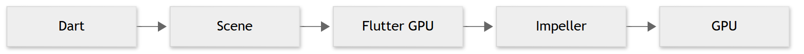
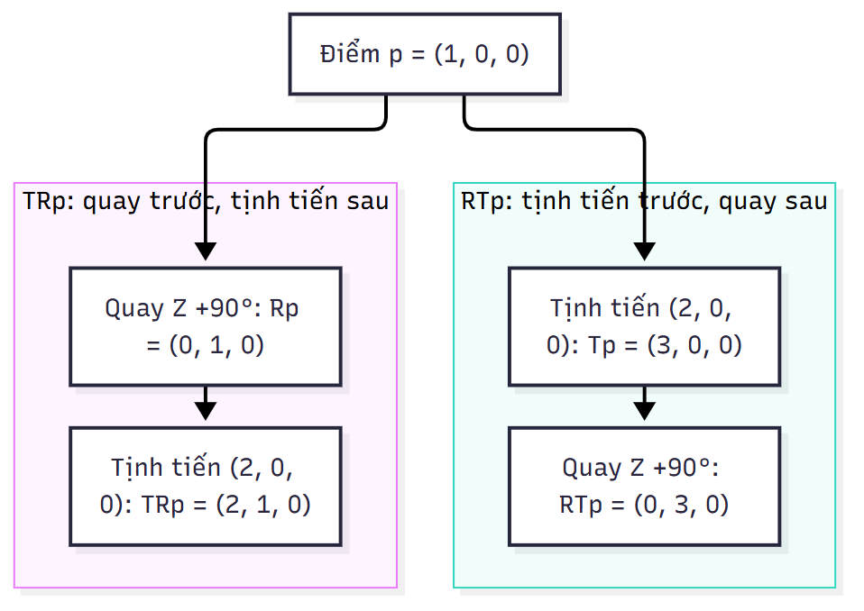
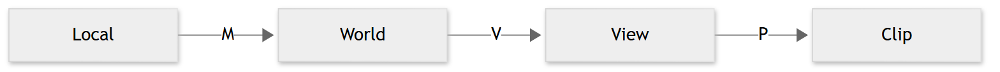
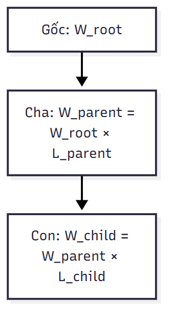
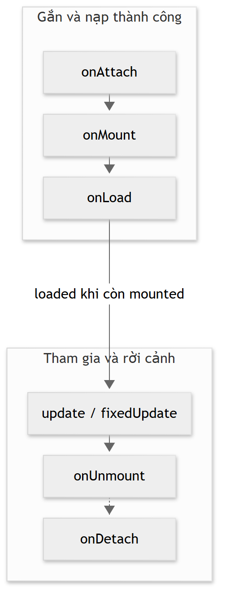
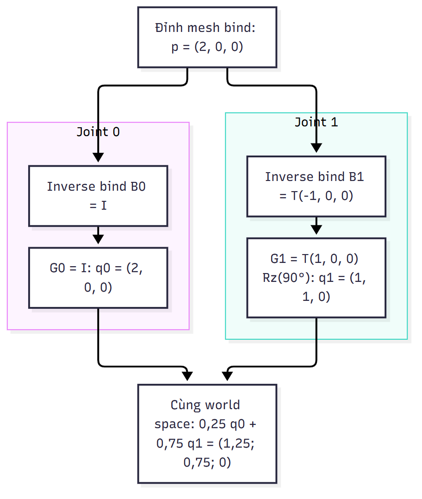
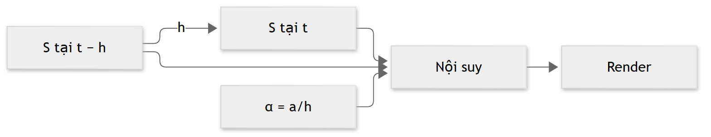
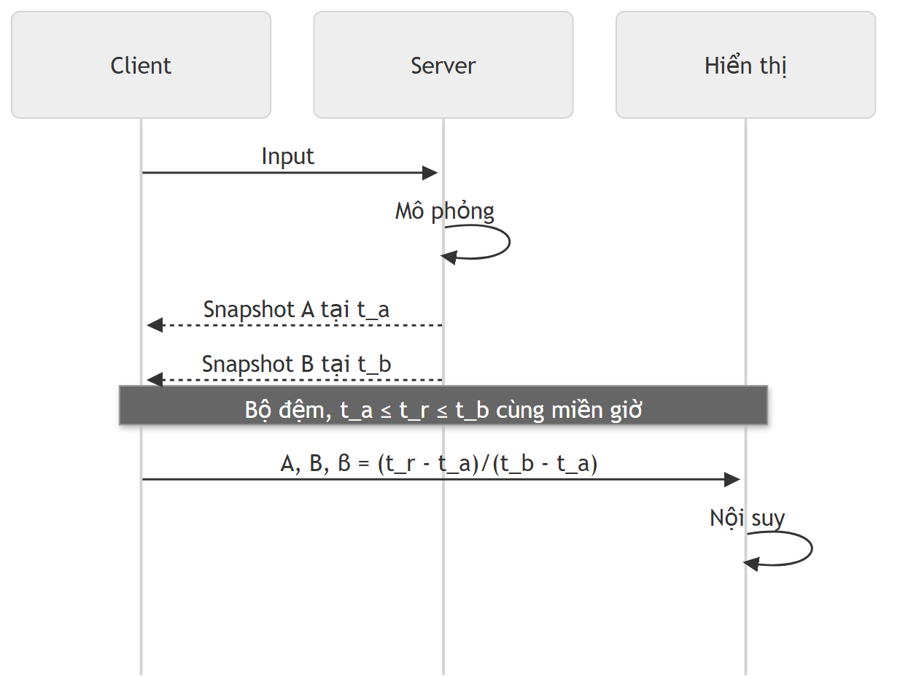

# Chương 2. Cơ sở lý thuyết

## 2.1. Các hệ thống tương tự

### 2.1.1. Engine và framework phát triển game

Game engine cung cấp những cơ chế dùng chung để tổ chức đối tượng, kết xuất, cập nhật trạng thái và xử lý tài nguyên. Framework thường cung cấp các thành phần để lập trình viên phối hợp thành ứng dụng. Ranh giới hai khái niệm phụ thuộc mức tích hợp của từng công cụ: một bộ công cụ có API dựng cảnh chưa nhất thiết đi kèm trình biên tập, hệ vật lý hoặc dịch vụ mạng. Vì vậy, khảo sát công cụ cần xét từng trách nhiệm thay vì chỉ so sánh tên gọi.

Godot là engine mã nguồn mở hỗ trợ nội dung 2D và 3D, với môi trường biên tập tích hợp. Cảnh và các node là thành phần tổ chức dự án; tài liệu cũng mô tả quy trình xuất ứng dụng Android cùng các điều kiện SDK. Godot đại diện cho hướng phát triển game trong một môi trường chuyên dụng, nơi biên tập cảnh và đóng gói sản phẩm thuộc cùng hệ công cụ. Điều này tạo một đối tượng đối chiếu về quy trình phát triển, nhưng chưa cung cấp cơ sở để kết luận hiệu năng cao hơn một giải pháp khác trên cùng điện thoại. [3], [4]

Flame thuộc hệ sinh thái Flutter và được dùng để xây dựng game dựa trên các thành phần. Bên cạnh hướng 2D của Flame cốt lõi, dự án có gói flame_3d ở trạng thái thử nghiệm. Khảo sát cần tách phạm vi của hai gói và điều kiện phiên bản tương ứng. Nhận định Flame chỉ có khả năng giả lập 2.5D bỏ qua sự tồn tại của gói 3D này. [5], [6]

Flutter Scene tổ chức nội dung 3D trong ứng dụng Flutter thông qua cảnh, node, mesh, vật liệu và camera. Flutter tiếp tục cung cấp lớp giao diện ứng dụng, còn Scene cung cấp mô hình biểu diễn và kết xuất thế giới ba chiều. Quan hệ này phù hợp với mục tiêu nghiên cứu sự kết hợp giữa mã Dart, giao diện Flutter và đồ họa 3D. Mức độ phù hợp với một sản phẩm cụ thể còn phụ thuộc việc tích hợp mô phỏng, tài nguyên, mạng và giới hạn thiết bị. [1], [7], [10]

Ba hướng trên khác nhau về môi trường phát triển, trách nhiệm tích hợp và phạm vi API. Một đánh giá công bằng phải xác định tiêu chí: khả năng biểu diễn cảnh, quy trình đưa tài nguyên vào ứng dụng, công cụ quan sát lỗi, nền tảng đích và khả năng tái hiện kết quả. Nếu so sánh hiệu năng, các bên cần dùng cảnh, độ phân giải, thiết bị và chế độ đo tương đương. Các mô tả tính năng hiện có chỉ hỗ trợ đối chiếu kiến trúc và quy trình.

| Tiêu chí công cụ | Godot | Flame và flame_3d | Flutter Scene |
|---|---|---|---|
| Vai trò khảo sát | Engine và môi trường biên tập game riêng | Framework trong Flutter; tách gói cốt lõi và gói 3D thử nghiệm | Tổ chức và kết xuất nội dung 3D trong Flutter |
| Cấu trúc cần đối chiếu | Scene/node và quy trình biên tập | Thành phần game và phạm vi riêng của flame_3d | Scene/node/component, mesh/material và camera |
| Quan hệ với ứng dụng Android | Quy trình xuất Android theo tài liệu | Cần xét gói và điều kiện phiên bản Flutter | Cần xét Flutter GPU, backend và phiên bản Scene |
| Mức bằng chứng hiện có | Tài liệu giới thiệu và export [3], [4] | Trang dự án và README gói 3D [5], [6] | Tài liệu khái niệm và gói Scene [7], [10] |
| Nội dung chưa được bảng chứng minh | Hiệu năng trên cùng điện thoại | Độ ổn định và hiệu năng 3D trên cùng điện thoại | Hiệu năng game hoàn chỉnh trên thiết bị đích |

Bảng sử dụng tiêu chí về cơ chế phát triển. Các tiêu chí của game cùng thể loại ở mục tiếp theo tập trung vào sản phẩm và tương tác, nên không dùng chung thang đánh giá với engine.

### 2.1.2. Game bóng rổ trên thiết bị di động

Basketball Stars của Miniclip là sản phẩm cùng chủ đề trên thiết bị di động. Trang giới thiệu của nhà phát hành mô tả hình thức nhiều người chơi và các hoạt động như dẫn bóng, ném, ghi điểm. Nguồn này xác nhận chủ đề và những tương tác được công bố; nó không công bố đủ thuật toán mô phỏng, cấu trúc máy chủ hoặc phương pháp đồng bộ để suy ra cách hiện thực bên trong. [8]

Khảo sát game cùng thể loại có giá trị ở mức tương tác: người chơi nhận biết quyền điều khiển qua đâu, hành động được phản hồi như thế nào và thông tin nào cần hiện trong một trận đấu. Những nội dung này khác với khảo sát engine, vốn giải thích cách xây dựng hệ thống. Hình ảnh quảng bá có thể cho thấy thành phần giao diện, nhưng chưa phản ánh thời gian đáp ứng, khả năng sử dụng khi thao tác thực tế hoặc tính nhất quán giữa hai thiết bị.

Basketball Arena được trang Miniclip giới thiệu là game bóng rổ nhiều người chơi, có khả năng thách đấu người chơi khác. Trang cung cấp liên kết tới kho ứng dụng, nhưng chưa đủ để xác định phương pháp mô phỏng hoặc đồng bộ của sản phẩm. Nguồn này mở rộng đối tượng khảo sát ở mức hình thức chơi do nhà phát hành công bố; chưa có quan sát chơi hoặc phân tích video trong phạm vi khảo sát. [36]

| Tiêu chí sản phẩm | Basketball Stars | Basketball Arena |
|---|---|---|
| Chủ đề được công bố | Bóng rổ trên mobile [8] | Bóng rổ nhiều người chơi [36] |
| Hình thức tương tác theo giới thiệu | Nhiều người chơi; các thao tác dẫn bóng, ném và ghi điểm [8] | Thách đấu người chơi khác [36] |
| Giá trị tham khảo | Xác định các nhóm thao tác cần khảo sát tiếp | Bổ sung ví dụ sản phẩm có tương tác giữa người chơi |
| Chưa có bằng chứng trong khảo sát này | Trải nghiệm sử dụng, độ trễ, thuật toán ném và kiến trúc mạng | Trải nghiệm sử dụng, độ trễ, thuật toán ném và kiến trúc mạng |

### 2.1.3. Nhận xét và phạm vi đối chiếu

Đối chiếu công cụ và đối chiếu sản phẩm giải quyết hai câu hỏi khác nhau. Công cụ cung cấp cơ chế kỹ thuật; sản phẩm cho thấy một cách tổ chức trải nghiệm. Mục tiêu nghiên cứu Flutter Scene yêu cầu làm rõ các cơ chế của engine trước khi lựa chọn cách áp dụng vào game. Các phần tiếp theo trình bày những nguyên lý dùng chung cho ứng dụng 3D thời gian thực; luật chơi và các lựa chọn riêng của hệ thống được dành cho chương thiết kế.

## 2.2. Nền tảng Flutter Scene và pipeline kết xuất

### 2.2.1. Phân lớp trách nhiệm

Trong ứng dụng tích hợp nội dung 3D, lớp giao diện, mô hình cảnh và API đồ họa có trách nhiệm khác nhau. Flutter quản lý cây widget, bố cục và tương tác của ứng dụng. Scene quản lý cấu trúc nội dung 3D cùng những thành phần phục vụ kết xuất. Flutter GPU cung cấp khả năng làm việc với tài nguyên và lệnh đồ họa ở mức thấp hơn. Tài liệu Scene xác định Flutter GPU và Impeller là nền tảng cho backend native; không nên đồng nhất các lớp này thành một đối tượng duy nhất. [7], [10]

Sự phân lớp cho phép một vùng 3D cùng tồn tại với văn bản, nút bấm và thông báo Flutter. Tuy nhiên, trạng thái của widget và trạng thái của thế giới 3D có nhịp thay đổi khác nhau. Bố cục giao diện có thể chỉ đổi khi người dùng chuyển màn hình, trong khi vị trí đối tượng được cập nhật liên tục. Nếu mọi thay đổi trong thế giới đều kéo theo xây dựng lại toàn bộ giao diện, chi phí điều phối có thể vượt nhu cầu hiển thị.

### 2.2.2. Từ dữ liệu cảnh đến ảnh

Pipeline kết xuất chuyển hình học thành ảnh. Trong rasterization, dữ liệu đỉnh tạo primitive; primitive được cắt và chuyển thành fragment. Fragment shader tính đầu ra, còn các phép kiểm tra và ghi framebuffer quyết định giá trị lưu. Fragment là ứng viên đóng góp vào ảnh, chưa phải pixel cuối cùng. [20]

CPU thường đảm nhiệm cập nhật logic, chuẩn bị danh sách đối tượng và lệnh vẽ; GPU xử lý những phép tính có tính song song trên đỉnh và fragment. Phân công cụ thể phụ thuộc engine và backend. Tăng số đối tượng có thể làm nặng phần quản lý và phát lệnh; tăng độ phân giải hoặc độ phức tạp shader có thể làm nặng phần xử lý fragment. Vì vậy, giảm số tam giác chưa chắc cải thiện một cảnh đang bị giới hạn bởi tải giao diện hoặc diện tích tô nhiều lần.

Đối với nội dung 3D trong Flutter, kết quả kết xuất còn tham gia quá trình trình bày của ứng dụng. Thời gian hoàn tất phép mô phỏng và thời điểm ảnh được đưa lên màn hình là hai mốc khác nhau. Sự tách biệt này giải thích vì sao trạng thái logic cập nhật đúng vẫn có thể xuất hiện giật hình hoặc chậm phản hồi.

Hình 2.1 phân biệt lớp tổ chức cảnh với lớp lệnh đồ họa và backend native khi nội dung 3D được kết xuất trong ứng dụng Flutter.



Hình 2.1. Các lớp kết xuất nội dung 3D trên nền tảng native[7],[9],[10].

Các mũi tên biểu diễn quan hệ giữa những lớp trách nhiệm; chúng không mô tả lịch thực thi thread hoặc độ dài từng giai đoạn. Hình giới hạn ở đường kết xuất native, không đại diện cho backend web.

Clipping giữ phần primitive nằm trong thể tích nhìn; nó có thể tạo đỉnh mới ở giao tuyến thay vì chỉ bỏ cả tam giác. Depth test so sánh độ sâu fragment với giá trị đã lưu để giải quyết che khuất. Blending kết hợp màu nguồn và màu đích, chẳng hạn theo alpha; nó không thay thế depth test. Bề mặt trong suốt có thể cần thứ tự vẽ riêng vì kết quả phép trộn phụ thuộc thứ tự. Ba cơ chế giải quyết ba vấn đề khác nhau trong quá trình tạo ảnh. [20]

### 2.2.3. Backend và điều kiện tương thích

Theo nguồn cài đặt đã khảo sát, Scene yêu cầu Flutter từ 3.47 và có cấu hình bật Flutter GPU trên Android. Đây là điều kiện phần mềm ban đầu. Tài liệu Flutter mô tả Impeller mặc định trên Android API 29 trở lên và cơ chế sử dụng bộ kết xuất OpenGL cũ trong những trường hợp không đáp ứng điều kiện backend. Bật Flutter GPU và sử dụng Impeller là hai vấn đề cần kiểm tra riêng. [2], [9]

Một backend dự phòng cho giao diện Flutter không tự chứng minh Flutter GPU hoặc toàn bộ Scene hoạt động trên thiết bị đó. Khả năng tương thích phải xét cùng phiên bản SDK, gói Scene, Android API, GPU và driver. Phần mô tả API trong chương đối chiếu với mốc Scene 0.24.3; các trang tài liệu trực tuyến không gắn tag vẫn cần được kiểm tra khi thay phiên bản. [7]

## 2.3. Cơ sở toán học của không gian 3D

Cơ sở hệ tọa độ và phép biến đổi tham khảo [28]; không áp miền depth OpenGL trực tiếp cho Scene.

### 2.3.1. Điểm, vector và hệ quy chiếu

Điểm mô tả vị trí, còn vector mô tả độ dời hoặc đại lượng có hướng. Trong một hệ trục Descartes, điểm p có các tọa độ (x, y, z). Hiệu của hai điểm tạo vector độ dời d = p₂ − p₁. Độ dài vector d = (dₓ, dᵧ, d_z) được tính bởi:

||d|| = √(dₓ² + dᵧ² + d_z²).

Vector đơn vị d̂ = d/||d|| biểu diễn hướng độc lập với độ lớn khi ||d|| khác 0. Trường hợp vector bằng 0 cần xử lý riêng vì phép chia không xác định. Phân biệt hướng với độ lớn cần thiết khi biến thao tác điều khiển thành vận tốc: hướng cho biết đi đâu, còn tốc độ quy định quãng đường trong một đơn vị thời gian.

Tích vô hướng a·b = ||a||||b||cosθ liên hệ hai vector với góc giữa chúng. Với hai vector đơn vị, kết quả trực tiếp bằng cosθ. Tích có hướng a×b tạo vector vuông góc với cả hai trong không gian ba chiều; thứ tự hai toán hạng quyết định chiều. Những phép tính này được dùng để biểu diễn hướng nhìn, xác định mặt trước và xây dựng cơ sở camera.

Một bộ tọa độ chỉ có ý nghĩa khi biết hệ quy chiếu và đơn vị. Vị trí trong hệ cục bộ của đối tượng khác vị trí trong hệ thế giới; cả hai lại khác tọa độ camera. Quy ước trục đứng, hướng phía trước và tỷ lệ cần nhất quán giữa mô hình nhập vào, mô phỏng và kết xuất. Tài liệu scene graph phân biệt transform cục bộ và transform thế giới; không thể thay thế hai loại giá trị cho nhau tùy ý. [11]

### 2.3.2. Ma trận biến đổi và tọa độ thuần nhất

Tọa độ thuần nhất biểu diễn điểm ba chiều bằng vector bốn thành phần p̃ = (x, y, z, 1)ᵀ. Nhờ đó, tịnh tiến có thể được viết bằng phép nhân ma trận giống phép xoay và co giãn. Với vector chỉ hướng, thành phần cuối bằng 0 để phép tịnh tiến không làm thay đổi hướng.

Trong quy ước vector cột, một phép biến đổi cục bộ có thể viết:

M = T R S,

trong đó T là ma trận tịnh tiến, R là ma trận xoay và S là ma trận co giãn. Khi tính p̃' = M p̃, phép ở bên phải tác động trước. Phép nhân ma trận không giao hoán; đổi thứ tự xoay và tịnh tiến có thể khiến đối tượng quay quanh chính nó hoặc quay quanh một điểm khác. Công thức phải được hiểu cùng quy ước vector và phép nhân của API.

Nếu một node có ma trận cục bộ M_local và node cha có ma trận thế giới M_parent, thì:

M_world = M_parent M_local.

Công thức thể hiện sự kế thừa không gian của cây cảnh. Một đối tượng con có thể giữ tọa độ cục bộ không đổi nhưng thay đổi vị trí thế giới khi cha di chuyển. Đây là cơ sở toán học của việc gắn vật thể vào một bộ phận đang chuyển động. Ngược lại, muốn đổi một điểm thế giới về hệ cục bộ, cần phép nghịch đảo M_world⁻¹ nếu ma trận khả nghịch. Co giãn bằng 0 theo một trục có thể khiến phép nghịch đảo không tồn tại.

Ví dụ dùng vector cột, hệ trục tay phải và phép quay chủ động +90° quanh z. Với p = (1,0,0), tọa độ thuần nhất là (1,0,0,1)ᵀ, S là ma trận đơn vị. Các ma trận R và T dưới đây lần lượt quay rồi tịnh tiến (2,0,0):

| Hàng | Ma trận R | Ma trận T |
|---|---|---|
| 1 | 0, −1, 0, 0 | 1, 0, 0, 2 |
| 2 | 1, 0, 0, 0 | 0, 1, 0, 0 |
| 3 | 0, 0, 1, 0 | 0, 0, 1, 0 |
| 4 | 0, 0, 0, 1 | 0, 0, 0, 1 |

TRp quay p thành (0,1,0), rồi tịnh tiến để được (2,1,0). RTp đưa p tới (3,0,0) trước rồi quay quanh gốc, cho (0,3,0). Vector tịnh tiến cũng bị quay trong RT. Row-major/column-major mô tả bố trí phần tử bộ nhớ, không tự quyết định thứ tự tác động. [28]

Hình 2.2 giữ nguyên dữ liệu và chỉ đổi thứ tự thao tác để đối chiếu hai kết quả.



Hình 2.2. Ảnh hưởng của thứ tự quay và tịnh tiến[28].

Hai nhánh là sơ đồ thao tác, không phải đồ thị tọa độ theo tỷ lệ hoặc ảnh render Scene.


### 2.3.3. Biểu diễn phép xoay

Góc Euler biểu diễn phép xoay qua các góc quanh những trục theo thứ tự xác định. Cách biểu diễn này trực quan khi thiết lập tư thế, nhưng thứ tự trục ảnh hưởng kết quả và một số cấu hình làm mất một bậc tự do trong tham số hóa. Quaternion đơn vị biểu diễn hướng xoay bằng bốn thành phần với ràng buộc chuẩn bằng 1, phù hợp cho phép hợp thành và nội suy hướng. [34]

Nội suy tuyến tính từng góc Euler có thể tạo chuyển động không mong muốn khi góc đi qua ranh giới biểu diễn, chẳng hạn từ gần một vòng đầy trở về gần 0. Nội suy quaternion cần xử lý tính chất q và −q biểu diễn cùng một hướng xoay, đồng thời duy trì chuẩn. Các công thức hướng trong phần này là mô hình toán học; tên hàm chuyển đổi hoặc nội suy phải được đối chiếu với thư viện toán của phiên bản triển khai.

### 2.3.4. Chuỗi biến đổi để tạo ảnh

Một điểm từ mô hình được đưa qua ma trận thế giới M, ma trận nhìn V và ma trận chiếu P:

p_clip = P V M p_model.

Ma trận nhìn đổi tọa độ thế giới sang hệ camera; ma trận chiếu tạo tọa độ clip. Với phép chiếu phối cảnh, bước chia cho thành phần w tạo tọa độ chuẩn hóa. Phép ánh xạ viewport tiếp tục đổi tọa độ đó sang vùng hiển thị. Điều kiện cắt và miền độ sâu phụ thuộc quy ước backend, nên không được dùng nguyên ma trận của một hệ đồ họa khác mà bỏ qua quy ước này.

Chuỗi biến đổi giải thích những lỗi hiển thị khác nhau: sai M làm đối tượng lệch vị trí hoặc tỷ lệ; sai V khiến camera nhìn sai hướng; sai P hoặc mặt phẳng cắt có thể loại đối tượng khỏi vùng quan sát. Việc phân tách các hệ tọa độ cũng là cơ sở chuyển một điểm chạm trên màn hình thành tia chọn đối tượng trong thế giới.

Chuỗi đổi hệ tọa độ của một đỉnh được tóm tắt ở Hình 2.3 theo quy ước vector cột.



Hình 2.3. Chuỗi biến đổi từ hệ mô hình đến tọa độ clip[28].

M, V và P lần lượt nối hệ mô hình với thế giới, hệ camera và tọa độ clip. Sau đầu ra clip còn có chia cho w và ánh xạ viewport; hình không quy định miền depth cụ thể của Scene bằng quy ước OpenGL.

## 2.4. Đồ thị cảnh, thành phần và vòng đời

### 2.4.1. Cấu trúc phân cấp của cảnh

Đồ thị cảnh tổ chức các đối tượng theo quan hệ không gian và trách nhiệm. Trong cây node của Scene, node có thể chứa node con cùng các thành phần liên quan đến hiển thị hoặc hành vi. Quan hệ cha–con xác định cách truyền biến đổi; nó không tự xác định quan hệ sở hữu logic của mọi dữ liệu trong ứng dụng. Hai đối tượng dùng chung một mesh hoặc vật liệu vẫn có thể thuộc các nhánh khác nhau. [10], [11]

Mô hình phân cấp làm giảm số phép cập nhật trực tiếp khi nhiều đối tượng cùng di chuyển. Tuy nhiên, phân cấp sâu cũng làm việc truy vết tọa độ và phụ thuộc phức tạp hơn. Một node được tổ chức thuận tiện cho hình ảnh chưa chắc tương ứng một thực thể mô phỏng độc lập. Vì vậy, trạng thái dùng cho luật có thể được lưu riêng rồi ánh xạ sang cây cảnh để hiển thị.

Quan hệ truyền transform giữa node cha và node con được biểu diễn trong Hình 2.4.



Hình 2.4. Tích lũy biến đổi trong cây node[11].

Biến đổi thế giới của node con được tính từ biến đổi thế giới của cha và biến đổi cục bộ của con. Node gốc được ký hiệu bằng W_root, không mặc định bằng ma trận đơn vị. Quan hệ này giải thích vì sao đổi transform của cha có thể đổi vị trí thế giới của con dù dữ liệu cục bộ của con giữ nguyên.

### 2.4.2. Component và vòng đời

Component đóng gói hành vi hoặc trách nhiệm được gắn vào node. Mã Scene 0.24.3 gọi onMount trước onLoad trên đường mount thành công, sau onAttach khi gắn node; update/fixedUpdate chờ mounted, enabled và loaded. Thứ tự này khác cách liệt kê trên web hiện hành. Khi _loaded chưa được đặt, mount gọi onLoad; tác vụ hoàn tất lúc còn mounted mới đặt _loaded = true. Do đó không suy ra chỉ có đúng một lời gọi trong mọi trường hợp unmount/remount khi đang tải. onMount và onUnmount liên quan việc tham gia hoặc rời cảnh, còn onAttach và onDetach liên quan quan hệ gắn với node. update theo nhịp khung hình, fixedUpdate theo bước mô phỏng vật lý. [35]

Phân biệt các thời điểm này giúp tránh sử dụng tài nguyên chưa sẵn sàng hoặc giữ callback sau khi đối tượng rời cảnh. Một tác vụ bất đồng bộ có thể hoàn tất sau khi màn hình đã bị đóng; khi đó, dữ liệu trả về không mặc nhiên còn được phép cập nhật giao diện. Đây là bài toán vòng đời tài nguyên và người sở hữu, cần được xét cùng vòng đời của Flutter.

Hình 2.5 thể hiện đường gắn và nạp thành công của Component theo mã nguồn Scene 0.24.3, cùng trách nhiệm sở hữu Scene.



Hình 2.5. Vòng đời Component và trách nhiệm sở hữu Scene trong Scene 0.24.3[35].

Mã mount gọi onMount trước khi khởi động onLoad. update chỉ được gọi khi component đồng thời mounted, enabled và loaded; việc nạp hoàn tất sau unmount không tự đặt loaded trong nhánh kiểm tra này. Quyền sở hữu Scene là trách nhiệm riêng: ứng dụng dispose Scene do mình tạo; SceneView.declarative chịu trách nhiệm với Scene nội bộ khi view được dispose. Đây không phải bước tiếp nối của mọi component. Hình không bao quát mọi trường hợp lỗi hoặc remount và không khẳng định mọi tài nguyên GPU dùng chung được hủy đồng bộ khi gọi dispose.

### 2.4.3. Quyền cập nhật và tài nguyên dùng chung

Một thuộc tính chuyển động cần có nguồn cập nhật được xác định. Nếu widget khai báo, component và hệ vật lý cùng ghi transform, kết quả phụ thuộc thứ tự cập nhật. Cách tổ chức khai báo trong Flutter có thể áp dụng lại giá trị khi rebuild; cách thao tác trực tiếp trên node lại duy trì thay đổi trong đối tượng cảnh. Hai cách có thể phối hợp nếu phạm vi sở hữu được phân định. [10]

Theo README Scene 0.24.3, các getter thành phần biến đổi trả về bản sao. Thay đổi thành phần của giá trị nhận được không phải cách cập nhật node; cần gán lại giá trị theo API tương ứng. Chi tiết này cho thấy mô hình toán học của transform và cách ghi trạng thái của thư viện là hai lớp cần phân biệt. [7], [11]

Tài nguyên dùng chung có vòng đời khác với một node hiển thị. Hủy một đối tượng không đồng nghĩa mọi tài nguyên nó từng dùng đều có thể giải phóng nếu đối tượng khác còn tham chiếu. Ngược lại, giữ tài nguyên không còn dùng làm tăng bộ nhớ. Kiến trúc cần xác định đơn vị nạp, sử dụng lại và giải phóng thay vì tạo tài nguyên đồ họa liên tục trong hàm cập nhật.

### 2.4.4. Biểu diễn khai báo và thao tác trực tiếp

Scene cung cấp hai cách điều khiển cây cảnh. Với cách thao tác trực tiếp, ứng dụng giữ Scene, tạo node và gọi API để thay đổi thuộc tính hoặc cấu trúc. Với cách khai báo, các widget như SceneNode và SceneMesh mô tả cấu trúc mong muốn theo trạng thái Flutter. Phần mô tả được đối chiếu với cây đối tượng engine còn được giữ lại, gọi là retained graph. Quá trình đối chiếu và áp dụng khác biệt này được gọi là reconciliation. [39], [41]

Widget là mô tả bất biến, còn State của widget cảnh giữ đối tượng engine và cập nhật nó khi cấu hình thay đổi. Vì vậy, một lần build không mặc nhiên tạo lại mọi node hoặc toàn bộ tài nguyên GPU. Identity của geometry và material có ý nghĩa khi đối chiếu; tạo một đối tượng tài nguyên mới trong mỗi build có thể làm mất lợi ích của việc giữ và tái sử dụng đối tượng. [39], [41]

| Trách nhiệm | Thao tác trực tiếp | Khai báo |
|---|---|---|
| Biểu diễn cấu trúc | Ứng dụng tạo, thêm và gỡ node | Widget và children mô tả cấu trúc theo state |
| Áp dụng thay đổi | Mã ghi thuộc tính hoặc cập nhật qua component | State đối chiếu cấu hình mới với đối tượng engine được giữ lại |
| Sở hữu Scene | Ứng dụng giải phóng Scene do mình tạo | SceneView.declarative tạo và giải phóng Scene nội bộ |
| Kết hợp hai cách | Có thể gắn cây con khai báo vào Scene của ứng dụng | Có cầu nối để truy cập node hoặc đặt cây con thao tác trực tiếp |
| Ranh giới cần giữ | Xác định một nơi chịu trách nhiệm cho mỗi thuộc tính | Không để mã khác đồng thời sửa cấu trúc hoặc thuộc tính do widget quản lý |

SceneNodeController cung cấp tham chiếu tới node do widget quản lý nhưng không chuyển quyền sở hữu cho mã gọi. Đối với một node được tạo theo khai báo, mã thao tác trực tiếp cần tránh sửa những thuộc tính mà widget cũng khai báo hoặc tự tổ chức lại cấu trúc của nó. SceneView nhận Scene từ ứng dụng không chịu trách nhiệm dispose Scene đó; SceneView.declarative chịu trách nhiệm cho Scene nội bộ của mình. Hai cách có thể phối hợp trong cùng hệ thống nếu ranh giới này được giữ rõ. [41]

## 2.5. Hình học, vật liệu và shader

### 2.5.1. Dữ liệu hình học và cấu trúc mesh

Hình học bề mặt thường được biểu diễn bằng các đỉnh và primitive. Một đỉnh có thể gồm vị trí, pháp tuyến, tọa độ texture và những thuộc tính khác phục vụ kết xuất. Index buffer cho phép primitive tham chiếu dữ liệu đỉnh thay vì lặp lại toàn bộ dữ liệu. Khi cùng một vị trí có pháp tuyến hoặc tọa độ texture khác nhau ở hai mặt, biểu diễn kết xuất có thể cần nhiều bản ghi đỉnh.

Mesh kết hợp dữ liệu hình học với vật liệu để tạo nội dung có thể vẽ. Geometry quyết định bề mặt nằm ở đâu, còn material quy định cách bề mặt tương tác với ánh sáng hoặc xuất hiện trong ảnh. Một geometry có thể được dùng lại với nhiều vật liệu; vật liệu cũng có thể dùng chung cho nhiều mesh. Scene biểu diễn các trách nhiệm này bằng những thành phần riêng. [10], [12]

Pháp tuyến biểu diễn hướng của bề mặt tại vị trí xét và ảnh hưởng phép tính chiếu sáng. Khi co giãn không đều, biến đổi pháp tuyến bằng cùng ma trận vị trí có thể làm sai hướng vuông góc. Với phần tuyến tính A khả nghịch của phép biến đổi, hướng pháp tuyến được biến đổi theo (A⁻¹)ᵀ rồi chuẩn hóa. Công thức này bắt nguồn từ yêu cầu pháp tuyến sau biến đổi vẫn vuông góc với tiếp tuyến bề mặt. [29]

### 2.5.2. Shader và mô hình vật liệu

Shader là chương trình thực hiện một phần công việc của pipeline trên GPU. Vertex shader xử lý dữ liệu theo đỉnh, còn fragment shader xác định các đại lượng đầu ra cho fragment. Material cung cấp tham số và lựa chọn biểu diễn bề mặt cho hệ shader; việc thay màu vật liệu thường là thay dữ liệu đầu vào, không phải viết lại một thuật toán kết xuất. Khả năng tùy biến shader được cung cấp tới đâu phải đối chiếu API của engine. [20], [12]

Vật liệu dựa trên vật lý, thường gọi PBR, mô tả phản xạ theo những tham số có ý nghĩa bề mặt. Tài liệu Scene có PhysicallyBasedMaterial với màu cơ sở, độ kim loại và độ nhám. Độ nhám thay đổi độ phân tán của phản xạ; độ kim loại ảnh hưởng cách phân chia phản xạ và màu bề mặt. UnlitMaterial biểu diễn nội dung không phụ thuộc mô hình chiếu sáng của cảnh. PBR tạo cơ sở để vật liệu phản ứng với môi trường, nhưng không bảo đảm hình ảnh giống thực tế nếu dữ liệu texture, tỷ lệ hoặc chiếu sáng sai. [12]

BRDF, ký hiệu f_r, mô tả quan hệ phản xạ theo hướng tới ω_i và hướng ra ω_o tại điểm x. Với bề mặt không phát sáng, phương trình phản xạ có dạng:

L_o(x,ω_o) = ∫_Ω f_r(x,ω_i,ω_o)L_i(x,ω_i)max(0,n·ω_i)dω_i

L_i và L_o là độ chói bức xạ tới/ra, n là pháp tuyến đơn vị, Ω là bán cầu phía trên bề mặt, dω_i là phần tử góc khối. Phương trình kết hợp ánh sáng môi trường với tính chất bề mặt. [31]

Trong mô hình vi bề mặt, roughness mô tả phân bố hướng phản xạ nhỏ. Nhánh diffuse mô tả ánh sáng tán xạ; nhánh specular mô tả phản xạ có hướng. Điện môi thường có cả hai, trong khi mô hình kim loại lý tưởng không có nhánh diffuse tương ứng. Metallic điều khiển quy ước vật liệu này, không phải độ sáng tổng thể. Đây là cơ sở PBR, không khẳng định một biến thể BRDF cụ thể của shader Scene 0.24.3. [31]

Để phân biệt tác dụng của roughness và metallic, có thể xét bốn cấu hình của cùng một mesh dưới cùng camera, nguồn sáng, môi trường, exposure và tone mapping. Giữ base color tuyến tính ở (0,8; 0,3; 0,1), không dùng texture hoặc normal map và chỉ thay hai tham số sau:

| Cấu hình | Metallic | Roughness | Đặc điểm dự kiến theo mô hình metallic–roughness |
|---|---:|---:|---|
| A | 0 | 0,2 | Điện môi có phản xạ specular tập trung hơn |
| B | 0 | 0,8 | Điện môi có phản xạ specular phân tán hơn A |
| C | 1 | 0,2 | Kim loại có phản xạ tập trung, mang màu base color |
| D | 1 | 0,8 | Kim loại có phản xạ phân tán hơn C |

So sánh A–B hoặc C–D làm rõ roughness; so sánh A–C hoặc B–D làm rõ metallic. Metallic không phải hệ số làm vật sáng lên, còn roughness không chỉ là độ mờ màu nền. Phản xạ thực tế còn phụ thuộc môi trường. Bảng nêu dự đoán lý thuyết, chưa có ảnh render đối chứng hoặc số đo của bốn cấu hình. [12], [31]

### 2.5.3. Texture và không gian biểu diễn

Texture là dữ liệu lấy mẫu trên một miền tọa độ. Tọa độ UV liên hệ điểm trên bề mặt với vị trí trong ảnh. Bộ lọc quyết định cách lấy giá trị giữa các texel; cách xử lý biên quyết định điều xảy ra khi tọa độ vượt miền texture. Texture có thể mô tả màu, pháp tuyến hoặc tham số vật liệu, nên các kênh không có cùng ý nghĩa.

Tài liệu Scene phân biệt các slot texture như base color, normal và metallic–roughness. Ảnh màu chứa thông tin phục vụ cảm nhận thị giác, trong khi ảnh tham số thường lưu đại lượng số. Đưa dữ liệu vào sai slot hoặc xử lý màu không phù hợp có thể làm vật liệu sai dù đường dẫn tài nguyên đúng. Bên cạnh độ phân giải, cần xét ý nghĩa kênh, UV và cách xuất từ công cụ tạo mô hình. [12]

Ảnh màu base color cần được diễn giải theo quy ước màu của asset; tham số roughness/metallic là dữ liệu số. Tính chiếu sáng cần miền tuyến tính, vì cộng trực tiếp giá trị mã hóa sRGB không tương đương cộng năng lượng. Tangent-space normal map mô tả hướng trong cơ sở tangent–bitangent–normal trên bề mặt; nó bổ sung chi tiết chiếu sáng mà không thêm tam giác silhouette. [21]

Chi phí vật liệu không chỉ phụ thuộc số lượng mesh. Shader phức tạp, nhiều lần lấy mẫu và bề mặt trong suốt chồng lớp có thể làm tăng công việc trên cùng một vùng ảnh. Tái sử dụng tài nguyên giảm sự lặp lại ở mức dữ liệu, nhưng mức giảm lệnh vẽ hoặc tải GPU phải được đo theo engine và cách tổ chức cảnh thực tế.

## 2.6. Camera, ánh sáng và môi trường

### 2.6.1. Camera và phép chiếu

Camera xác định hệ quy chiếu quan sát cùng thể tích có thể nhìn thấy. Vị trí và hướng tạo ma trận nhìn; phép chiếu quy định cách không gian ba chiều được đưa lên mặt phẳng. Với phối cảnh, kích thước biểu kiến của một đối tượng giảm khi khoảng cách tăng. Quan hệ giản lược x' = f x/z cho thấy vai trò của khoảng cách z và tiêu cự quy đổi f khi xét trong hệ camera theo quy ước minh họa chọn z > 0 theo hướng nhìn và f cùng hệ đơn vị ảnh quy đổi; đây không phải ma trận camera Scene.

Phép chiếu trực giao không tạo sự thu nhỏ theo khoảng cách. Hai phép chiếu phục vụ những cách biểu diễn khác nhau: phối cảnh cung cấp dấu hiệu chiều sâu, còn trực giao giữ tỷ lệ biểu kiến theo mặt phẳng quan sát. Lựa chọn phép chiếu ảnh hưởng nhận biết khoảng cách, mức che khuất và cách chuyển thao tác màn hình sang không gian.

Góc nhìn, tỷ lệ khung hình và mặt phẳng cắt cùng quyết định vùng quan sát. Mặt phẳng gần quá sát camera trong một khoảng nhìn rất rộng có thể làm phân bố độ chính xác chiều sâu kém thuận lợi. Camera có thể bỏ sót một vật thể vì nằm ngoài vùng cắt dù vị trí trong thế giới của nó hợp lệ. Tài liệu Scene mô tả PerspectiveCamera, cameraBuilder và CameraComponent cho những cách quản lý camera khác nhau. [13]

Gọi θᵥ là góc nhìn dọc, a = W/H là tỷ lệ chiều rộng trên chiều cao của viewport. Xét mặt phẳng vuông góc trục nhìn tại khoảng cách d > 0 tính dọc theo trục camera. Hình học tam giác vuông cho chiều cao vùng nhìn h và chiều rộng w:

h = 2 × d × tan(θᵥ / 2)

w = a × h

θₕ = 2 × arctan(a × tan(θᵥ / 2))

Tương đương, nếu biết góc nhìn ngang θₕ thì w = 2d tan(θₕ/2). Khoảng cách d ở đây không phải khoảng cách Euclid đến mọi điểm trong ảnh. Công thức xét một lát cắt của thể tích nhìn đối xứng; các mặt phẳng cắt gần và xa tiếp tục giới hạn miền có thể kết xuất.

Ví dụ chọn θᵥ = 60°, d = 5 đơn vị cảnh và a = 16/9. Khi đó h ≈ 5,77, w ≈ 10,26 và θₕ ≈ 91,49°. Nếu chỉ đổi viewport thành a = 1 mà giữ góc dọc và d, h vẫn khoảng 5,77 nhưng w còn khoảng 5,77. Vì vậy, một vật ở gần mép ngang có thể ra khỏi khung khi tỷ lệ màn hình thay đổi, dù camera không di chuyển. Những số này là kết quả hình học, không phải kích thước sân hoặc cấu hình đã đo.

Trong Scene 0.24.3, PerspectiveCamera dùng fovRadiansY cho góc dọc tính bằng radian; góc ngang được xác định từ góc dọc và aspect của render target. Hai thuộc tính fovNear và fovFar là khoảng cắt, không phải góc nhìn. Ví dụ trên giải thích các đại lượng của camera; hướng dẫn cuối chương có thể chọn tham số khác mà không thay đổi quan hệ hình học này. [13], [28], [35]

### 2.6.2. Ánh sáng và phản xạ

Chiếu sáng xác định cách năng lượng tới bề mặt đóng góp vào ảnh. Trong mô hình khuếch tán giản lược, một thành phần độ sáng phụ thuộc max(0, n·l), với n là pháp tuyến đơn vị và l là hướng đơn vị tới nguồn sáng. Công thức diễn tả việc bề mặt nhận ít ánh sáng trực tiếp hơn khi quay lệch khỏi hướng nguồn; nó chưa mô tả toàn bộ phản xạ PBR.

Ba loại nguồn sáng được phân biệt bởi vị trí, hướng và miền tác động. Những khác biệt này quyết định tham số nào có ý nghĩa khi di chuyển hoặc xoay node:

| Loại | Mô hình không gian | Tác động của node trong Scene 0.24.3 | Tham số cần phân biệt |
|---|---|---|---|
| Directional | Các tia có hướng gần song song, dùng để xấp xỉ nguồn ở rất xa | Với DirectionalLightComponent thông thường, hướng dựa trên phép xoay thế giới của node; tịnh tiến node không đưa nguồn sáng tới gần bề mặt | Hướng và intensity; không điều chỉnh khoảng cách bằng position |
| Point | Nguồn tại một vị trí, phát theo các hướng xung quanh và suy giảm theo khoảng cách | PointLightComponent lấy vị trí thế giới từ node sở hữu | intensity, range và falloffExponent |
| Spot | Nguồn tại một vị trí với miền phát hình nón | SpotLightComponent lấy vị trí từ node và biến đổi hướng cục bộ của light sang thế giới | direction, range, innerConeAngle và outerConeAngle |

Trong mã 0.24.3, PointLight mặc định dùng falloffExponent = 2; range là khoảng cách để ảnh hưởng giảm về 0, còn range = 0 biểu diễn không cắt hữu hạn theo range. Với SpotLight, hai góc nón là nửa góc tính bằng radian: vùng trong có cường độ đầy đủ theo mô hình góc, giảm về 0 ở biên nón ngoài. Các tham số này được đọc từ mã nguồn phiên bản, không suy ra từ tên biến trong một ví dụ. [35]

Nguồn sáng trong hướng dẫn 2.12 là PointLight(intensity: 25, range: 10) gắn vào node tại (−2,3,−2). Vì thế, nó minh họa nguồn có vị trí và tầm tác động hữu hạn, không phải directional light. Di chuyển node làm đổi vị trí nguồn so với bề mặt; không thể diễn giải intensity = 25 là độ sáng đo được hoặc range = 10 là thông số đã hiệu chỉnh cho thiết bị.

Ảnh môi trường biểu diễn đóng góp chiếu sáng từ nhiều hướng, còn skybox là phần nền nhìn thấy. Đổi nền không mặc nhiên thay đổi năng lượng tới bề mặt. Môi trường, nguồn sáng trực tiếp và vật liệu cần được xét cùng nhau khi giải thích hình ảnh. [14]


### 2.6.3. Bóng đổ và chuyển đổi màu đầu ra

Bóng đổ biểu diễn việc một bề mặt bị vật khác che khỏi nguồn sáng. Nó bổ sung thông tin tiếp xúc và vị trí tương đối, đồng thời có thể yêu cầu thêm dữ liệu hoặc lượt kết xuất. Độ phân giải bóng và phạm vi bao phủ ảnh hưởng chất lượng; tăng chất lượng có thể làm tăng chi phí, vì vậy cần xét cùng ngân sách khung hình.

Exposure điều chỉnh mức sáng biểu diễn, còn tone mapping ánh xạ miền cường độ rộng sang miền hiển thị. Các thao tác này nằm sau hoặc quanh quá trình tính chiếu sáng tùy pipeline. Chúng giúp kiểm soát ảnh đầu ra nhưng không thay cho dữ liệu vật liệu và ánh sáng đúng. Những lựa chọn chất lượng như bóng đổ hoặc hậu xử lý cần được kiểm tra trên thiết bị thay vì suy ra từ ảnh chụp tĩnh. [14]

## 2.7. Tài nguyên, mô hình và hoạt ảnh

### 2.7.1. Mô hình dữ liệu tài nguyên

Tài nguyên 3D có thể gồm phân cấp node, mesh, vật liệu, texture, dữ liệu xương và hoạt ảnh. Một mô hình nhìn như một vật thể duy nhất có thể tham chiếu nhiều phần dữ liệu với vòng đời khác nhau. glTF là định dạng trao đổi cho nội dung 3D; GLB là dạng đóng gói nhị phân. Việc hỗ trợ định dạng cần được xét cùng tập extension mà công cụ nhập thực sự xử lý. [21]

Scene có hai đường chuẩn bị mô hình: nhập GLB lúc chạy hoặc chuyển đổi nội dung biết trước khi build rồi nạp đầu ra đã tiền xử lý. Tiền xử lý chuyển một phần công việc chuẩn bị sang giai đoạn tạo sản phẩm; nó không loại bỏ mọi việc phải làm lúc chạy. Cả hai đường vẫn cần quản lý phiên bản dữ liệu nguồn, cấu hình chuyển đổi và tài nguyên đầu ra. [15]

Trong glTF, buffer chứa byte; bufferView chọn một vùng byte; accessor bổ sung kiểu thành phần, số phần tử và dạng scalar/vector/matrix. Primitive tham chiếu accessor cho vị trí, pháp tuyến hoặc chỉ số. Vì vậy đọc được byte chưa đồng nghĩa đã hiểu dữ liệu hình học: cần cả layout và kiểu dữ liệu. [32]

### 2.7.2. Nạp bất đồng bộ và quản lý bộ nhớ

Chuẩn bị tài nguyên cần được phân biệt theo loại công việc và thời điểm thực hiện. Các giai đoạn có thể đan xen; tiền xử lý khi build là một đường chuẩn bị thay thế cho một phần công việc runtime, không phải bước luôn diễn ra sau khi ứng dụng đã đọc GLB.

| Giai đoạn | Công việc chính | Giới hạn của dấu hiệu hoàn tất |
|---|---|---|
| I/O | Đọc byte từ bundle, tệp hoặc nguồn dữ liệu | Đọc xong chưa có nghĩa đã hiểu cấu trúc mô hình |
| Phân tích và chuyển đổi dữ liệu | Diễn giải mô hình, vật liệu, ảnh và quan hệ node | Cây dữ liệu chưa chứng minh các tài nguyên kết xuất đã sẵn sàng |
| Tiền xử lý khi build | Chuyển nội dung biết trước sang dạng chuẩn bị cho engine | Không thay cho mọi khởi tạo tại runtime |
| Chuẩn bị cho kết xuất | Tạo hoặc chuyển dữ liệu tới tài nguyên cần dùng để vẽ | Chưa bảo đảm mọi pipeline của khung hình đầu đã được chuẩn bị |
| Warm-up | Chuẩn bị pipeline cho các view và nội dung hiện có | Không bao phủ tự động mọi nội dung hoặc cấu hình sẽ thêm về sau |

Phân biệt các giai đoạn giúp giải thích vì sao hoàn tất đọc tệp và hiển thị khung hình đầu là hai mốc khác nhau. Khi đánh giá thời gian mở cảnh, cần chỉ rõ khoảng thời gian đo bắt đầu và kết thúc ở mốc nào. [15], [41]

Một tài nguyên nên có trạng thái chưa nạp, đang nạp, sẵn sàng hoặc lỗi để ứng dụng phản hồi có kiểm soát. Bộ nhớ cũng không được ước lượng chỉ từ dung lượng tệp nén. Chẳng hạn, một ảnh W×H với bốn kênh 8 bit có dữ liệu nền W×H×4 byte trước khi xét các mức ảnh phụ, cách nén GPU và chi phí quản lý. Công thức này cho thấy vì sao một tệp ảnh nhỏ trên đĩa vẫn có thể chiếm bộ nhớ đáng kể khi sử dụng.

Trong Scene 0.24.3, loading của SceneView nhận ResourceGroup để theo dõi nhóm tác vụ trước khi hiện cảnh; loadingBuilder tạo phần giao diện chờ. Cơ chế này khác với warmUp, có giá trị mặc định false và yêu cầu SceneView chuẩn bị pipeline trước khi cho thấy cảnh. Cây con khai báo vẫn được giữ mounted và tiếp tục tải khi view đang chờ; màn hình chờ không có nghĩa quá trình tạo nội dung phải dừng. [41]

Trong đường reveal đã đối chiếu, view chờ tài nguyên tĩnh dùng chung, nhóm tải được truyền vào, các tác vụ nạp của cây con và tài nguyên trì hoãn liên quan. Nếu warmUp được bật, nó tiếp tục gọi Scene.warmUp với các view sẽ dùng rồi mới cho hiện cảnh. Nội dung cần được đưa vào cảnh trước bước này. Scene.initializeStaticResources(), nhóm tải và warm-up vì thế phục vụ những phạm vi khác nhau. Việc bật các tùy chọn này chưa chứng minh thời gian mở cảnh, mức dùng bộ nhớ hoặc tốc độ hiển thị trên thiết bị cụ thể. [41]

### 2.7.3. Dữ liệu hoạt ảnh và trạng thái phát

Hoạt ảnh mô tả thuộc tính thay đổi theo thời gian. Keyframe ghi giá trị tại những thời điểm mốc; phép nội suy xác định giá trị giữa các mốc. Với hai giá trị vị trí a và b, nội suy tuyến tính có dạng p(α) = (1−α)a + αb, trong đó 0 ≤ α ≤ 1. Đối với phép xoay hoặc dữ liệu xương, phương pháp nội suy phải phù hợp kiểu dữ liệu để tránh biến dạng không mong muốn.

Dữ liệu Animation và trạng thái AnimationClip có vai trò khác nhau trong Scene. Animation mô tả nội dung, còn clip quản lý việc phát như thời gian, tốc độ và lặp. Việc tìm hoạt ảnh theo tên cần xử lý trường hợp không tồn tại. Theo tài liệu, clip không lặp tự tạm dừng ở keyframe cuối; vòng lặp do SceneView quản lý đã tiến clip đang phát, nên không cập nhật cùng clip lần thứ hai. [16]

Hòa trộn kết hợp ảnh hưởng của nhiều hoạt ảnh để chuyển tư thế. Kết quả phụ thuộc sự tương thích của mô hình và cách xác định trọng số. Một chuyển động được kết xuất không tự xác nhận một sự kiện logic: thời điểm hoàn tất clip và thời điểm một hành động được hệ mô phỏng chấp nhận có thể khác nhau. Tách hai loại trạng thái giúp giữ kết quả nhất quán khi ảnh hiển thị được nội suy hoặc điều chỉnh qua mạng.

### 2.7.4. Skeleton và skinning

Skeleton là phân cấp joint; skin liên kết mesh với các joint và dữ liệu trọng số trên từng đỉnh. Inverse bind matrix B_j đưa đỉnh từ tư thế gốc sang hệ joint j. Nếu G_j(t) là world transform joint hiện tại và M(t) là world transform node chứa mesh, ma trận joint trong hệ mesh là:

J_j(t) = M(t)⁻¹G_j(t)B_j

Phép nghịch đảo yêu cầu M khả nghịch. [33]

Với tọa độ thuần nhất p và trọng số w_j có tổng bằng 1, linear blend skinning tính:

p′ = Σ_j w_j J_j(t)p

Joint index chỉ định ma trận; weight chỉ định mức ảnh hưởng. Sau đó M đặt kết quả vào thế giới. Skinning khác việc gắn cả mesh vào một node: các đỉnh có thể chịu các joint khác nhau. Sai bind pose hoặc trọng số có thể gây biến dạng dù clip vẫn phát. Công thức là mô hình dữ liệu glTF, không chứng minh mọi asset hoặc extension đã chạy trong demo. [33]

Để tính thử với hai joint, chọn mesh world transform M = I, đỉnh p = (2,0,0), joint 0 ở gốc và joint 1 ở (1,0,0) trong bind pose. B₀ = I; B₁ = T(−1,0,0) là inverse bind. Ở pose hiện tại G₀ = I và G₁ = T(1,0,0)Rz(90°). Khi đó q₀ = G₀B₀p = (2,0,0), còn q₁ = G₁B₁p = (1,1,0). [33]

Với w₀ = 0,25 và w₁ = 0,75, kết quả là 0,25q₀ + 0,75q₁ = (1,25;0,75;0). Các đóng góp đều ở world space; world và mesh trùng nhau chỉ vì M = I. Nếu M khác đơn vị, công thức J = M⁻¹GB đưa đầu ra về mesh trước khi nhân M đúng một lần.



Hình 2.6. Một đỉnh chịu ảnh hưởng của hai joint[33].

Inverse bind đưa đỉnh về hệ joint ở tư thế gốc; G đưa mỗi đóng góp về cùng world space để trộn. Đây là phép tính minh họa, chưa kiểm chứng importer hoặc hoạt ảnh runtime.

## 2.8. Vòng lặp, nhập liệu và giao diện hiển thị

### 2.8.1. Thời gian mô phỏng và thời gian kết xuất

Mô phỏng cập nhật trạng thái thế giới, còn kết xuất tạo ảnh từ trạng thái đó. Hai công việc có thể chạy ở tần suất khác nhau. Nếu mỗi frame cộng một độ dời cố định, vận tốc thực sẽ phụ thuộc số frame trong một giây. Với vận tốc không đổi v và khoảng thời gian Δt, độ dời cần có là vΔt.

Bước thời gian biến thiên sử dụng thời gian đo giữa các frame. Bước cố định h tiến mô phỏng theo những khoảng bằng nhau, thường phối hợp một bộ tích lũy thời gian. Khi bộ tích lũy còn ít nhất h, mô phỏng thực hiện thêm một bước rồi giảm phần thời gian tương ứng. Cách tổ chức này tách nhịp mô phỏng khỏi nhịp vẽ, nhưng có nguy cơ quá tải nếu việc tính các bước bù chậm hơn thời gian thực. [22]

Giới hạn số bước bù hoặc giới hạn khoảng thời gian đầu vào làm thay đổi cách ứng dụng phản ứng khi quá tải. Những lựa chọn này cần được nêu rõ vì có thể ảnh hưởng tốc độ thế giới hoặc độ trễ. Bước cố định giúp kiểm soát điều kiện tính toán, nhưng tính tất định còn phụ thuộc số thực, thứ tự xử lý, dữ liệu đầu vào và trạng thái ngẫu nhiên.

Hình 2.7 tách bước mô phỏng cố định khỏi trạng thái được dùng để hiển thị nội suy.



Hình 2.7. Bước mô phỏng cố định và nội suy hiển thị[22].

Phần thời gian chưa đủ một bước h xác định hệ số nội suy giữa hai trạng thái mô phỏng gần nhau. Trạng thái nội suy chỉ phục vụ hiển thị; ghi ngược nó vào mô phỏng làm thay đổi bài toán tính bước cố định. Cách tổ chức này không tự chứng minh tất định giữa các nền tảng.

Ví dụ bộ tích lũy dùng h = 0,02 s. Nếu đang dư 0,005 s và frame mới kéo dài 0,032 s, tổng 0,037 s cho phép một bước, còn dư 0,017 s. Hệ số nội suy a/h = 0,85 đặt ảnh giữa hai trạng thái gần nhất; cách này chấp nhận hiển thị trễ một bước để không ngoại suy. Các số chỉ minh họa tính toán, không phải tick của game. [22]

### 2.8.2. Từ sự kiện thiết bị đến lệnh

Sự kiện thiết bị là dữ liệu thô như chạm, di chuyển ngón tay hoặc thả nút. Lệnh biểu diễn ý định ở mức ứng dụng, ví dụ một vector hướng hoặc yêu cầu hành động. Việc ánh xạ qua lớp lệnh giúp tách phương thức nhập với mô phỏng, đồng thời thuận lợi khi ghi lại thao tác hoặc truyền qua mạng.

Cần phân biệt trạng thái giữ và sự kiện cạnh. Một nút giữ có thể tạo lệnh trong nhiều bước mô phỏng; một lần nhấn chỉ nên tạo một yêu cầu nếu chức năng cần như vậy. Flutter cung cấp định danh pointer cho từng tương tác và các callback down, move, up, cancel qua Listener. Ứng dụng phải tự quy định pointer nào sở hữu từng điều khiển; cancel là kết thúc tương tác bị hủy, không được mặc định diễn giải như thả để thực hiện hành động. [42], [43]

Khi nhiều ngón hoạt động đồng thời, mỗi điều khiển cần kiểm tra định danh trước khi cập nhật hoặc kết thúc lệnh. Hủy thao tác ném không mặc nhiên xóa hướng di chuyển còn được pointer khác giữ. Khi reset hoặc mất khả năng tương tác, ứng dụng cần đưa đầu vào về trung tính và loại bỏ callback thuộc trạng thái cũ. Đây là chính sách của lớp nhập liệu, không phải quyền sở hữu do Listener tự thiết lập.

Với joystick tròn, độ dời so với tâm cần được chia cho bán kính hành trình để thu vector không thứ nguyên u. Có thể giới hạn vector vào đĩa đơn vị bằng u_c = u/max(1,||u||), rồi áp dụng vùng chết xuyên tâm δ với 0 ≤ δ < 1. Nếu r = ||u_c|| ≤ δ, đầu ra bằng 0; nếu r > δ, đầu ra là (u_c/r)(r−δ)/(1−δ). Cách ánh xạ này giữ hướng, tăng liên tục độ lớn từ 0 tới 1 ngoài vùng chết và không làm thao tác chéo có độ lớn vượt quá 1. Việc luôn chuẩn hóa mọi vector khác 0 thành độ dài 1 sẽ làm mất mức điều khiển analog. Dữ liệu không hữu hạn cần bị loại hoặc đưa về trung tính trước phép tính.

Với một điểm màn hình, picking đổi tọa độ đó thành tia trong thế giới. Tia có dạng r(t) = o + td, t ≥ 0, với o là gốc và d là hướng. Tài liệu Scene mô tả screenPointToRay và Scene.raycast cho truy vấn hình học render. Truy vấn này khác truy vấn collision shapes trong thế giới vật lý; vùng viewport và hệ tọa độ đầu vào phải tương ứng nhau. [18]

Với vector cột và w khác 0, p_ndc = p_clip.xyz/p_clip.w. Nếu viewport rộng W, cao H, gốc ảnh ở trên trái và trục NDC y hướng lên, ánh xạ 2D là x_pixel = (x_ndc+1)W/2 và y_pixel = (1−y_ndc)H/2. Chẳng hạn tâm NDC (0,0) ứng với (W/2,H/2). W,H cùng đơn vị tọa độ viewport, không trộn logical pixel với physical pixel. [28]

Chiều ngược bắt đầu bằng tọa độ chạm cục bộ: x_ndc = 2x/W−1, y_ndc = 1−2y/H. Chọn hai giá trị depth near/far theo backend, nhân các điểm thuần nhất với (PV)⁻¹ rồi chia w để thu hai điểm thế giới a,b. Tia có gốc a, hướng normalize(b−a). Cách dựng còn cần ma trận khả nghịch, viewport khác 0 và hai điểm phân biệt; miền depth OpenGL không mặc định là miền Scene. Với camera trực giao, hướng tia vẫn chung nhưng gốc thay đổi theo điểm chạm. [28]

### 2.8.3. HUD và quyền quản lý vòng lặp

HUD biểu diễn những thông tin lớp trên như trạng thái, thông báo và chỉ báo điều khiển. Nó thường cần dữ liệu đã rút gọn từ thế giới thay vì tham chiếu trực tiếp mọi đối tượng cảnh. Phân tách dữ liệu hiển thị giúp giới hạn phạm vi rebuild và tránh việc một thay đổi vị trí gây dựng lại những thành phần không liên quan.

SceneView quản lý vòng kết xuất trong cách tích hợp bằng widget. Khi dùng vòng lặp thủ công, ứng dụng phải chịu trách nhiệm tiến cảnh và render theo phương thức tương ứng. Ghép cả hai cách mà không phân định trách nhiệm có thể cập nhật trạng thái hai lần. Tài liệu Scene và ví dụ backend vật lý sử dụng các cách tổ chức cần được đọc trong đúng ngữ cảnh, không ghép những đoạn mã chỉ vì chúng cùng thao tác lên Scene. [10], [17]

Pause logic và vòng đời ticker cần được quản lý riêng. Một mô phỏng có thể ngừng nhận lệnh và không tiêu thụ thời gian khi ứng dụng không ở trạng thái tương tác, trong khi cấu trúc điều phối khung hình vẫn được giữ. Trong Scene 0.24.3, SceneView dùng SingleTickerProviderStateMixin; việc đổi autoTick có nhánh dispose và tạo ticker. Do đó, không nên dùng chu kỳ tắt–bật autoTick như một thay thế mặc định cho cơ chế pause mô phỏng. [41]

Khi nhận thay đổi vòng đời, ứng dụng cần xác định chính sách cho đầu vào đang giữ, bộ tích lũy thời gian và khoảng thời gian đầu tiên sau resume. Nếu bỏ hoặc giới hạn khoảng thời gian này, thời gian mô phỏng không còn đồng nhất với thời gian thực đã trôi qua. Flutter cũng không bảo đảm ứng dụng luôn nhận đủ mọi thông báo vòng đời, nên các callback đó không thay thế cơ chế lưu trạng thái khi tiến trình bị kết thúc. [44]

## 2.9. Chuyển động và mô phỏng vật lý

### 2.9.1. Động học và động lực học

Động học mô tả vị trí, vận tốc và gia tốc mà chưa xét nguyên nhân lực. Với gia tốc không đổi, chuyển động tịnh tiến có dạng:

p(t) = p₀ + v₀t + ½at²,
v(t) = v₀ + at.

Đây là nghiệm lý tưởng của một mô hình với giả thiết gia tốc không đổi. Nó phù hợp để giải thích chuyển động quỹ đạo đơn giản; sau một tiếp xúc làm thay đổi vận tốc hoặc khi có lực biến thiên, phải xét mô hình tiếp theo.

Với một bước nhảy lý tưởng bắt đầu và kết thúc ở cùng mặt phẳng, mô hình y(t) = v_jt − gt²/2, g > 0, cho thời điểm trở về mặt phẳng t_land = 2v_j/g khi v_j > 0. Phát hiện đã đến mốc này cho phép đưa trạng thái về tiếp đất một lần thay vì tiếp tục nhận độ cao âm. Đây là mô hình động học; nó chưa giải quyết bề mặt dốc hoặc tiếp xúc với vật cản.

Độ cao thả bóng là điều kiện đầu của quỹ đạo. Nếu cần bóng đi tới độ cao y_target sau khoảng T > 0, thành phần vận tốc đứng được giải từ cùng phương trình: v_y = (y_target − y_origin + gT²/2)/T. Khi y_origin thay đổi do nhân vật nhảy, phải tính lại vận tốc theo mô hình đã chọn; cộng thêm vận tốc nhảy vào một nghiệm đã được giải cho cùng mục tiêu sẽ làm thay đổi quỹ đạo đó. Các hệ thức là phép biến đổi từ mô hình gia tốc không đổi, không phải bằng chứng hệ vật lý đã được chạy.

Động lực học liên hệ chuyển động với lực. Đối với chuyển động tịnh tiến của vật có khối lượng không đổi, F = ma. Trong mô phỏng thời gian rời rạc, một cách tích phân là cập nhật vₙ₊₁ = vₙ + aₙh rồi pₙ₊₁ = pₙ + vₙ₊₁h. Đây là Euler bán ẩn cho phần chuyển động xét ở đây. [30] Sai số phụ thuộc bước h và tính chất hệ; giảm h tăng số lần tính chứ không tự loại hết sai số.

### 2.9.2. Rigid body, collider và loại điều khiển

Rigid body lưu trạng thái động học hoặc động lực học; collider mô tả hình dạng dùng cho tiếp xúc. Trong Rapier, rigid body đứng riêng không có hình dạng để phát hiện tiếp xúc. Vật dynamic chịu tác động lực và tiếp xúc, fixed đứng yên, còn kinematic được điều khiển theo quỹ đạo hoặc vận tốc do ứng dụng quy định. Điều khiển kinematic không tự tạo khả năng tránh mọi vật cản. [23]

Hình dạng va chạm có thể là gần đúng của mesh hiển thị. Gần đúng đơn giản giảm công việc tính nhưng có thể làm vùng tiếp xúc khác với bề mặt người chơi nhìn thấy. Với một hệ tương tác, cần xác định sai khác nào chấp nhận được thay vì dùng toàn bộ hình học render làm mặc định cho mọi collider.

Gói flutter_scene_rapier cung cấp backend vật lý cho hợp đồng trong hệ sinh thái Scene. Tài liệu phiên bản 0.5.2 mô tả khởi tạo RapierWorld, PhysicsWorld, body và collider. Những lời gọi này cho biết cách nối hệ vật lý với cảnh, chưa quyết định mô hình mô phỏng cuối cùng của ứng dụng. [17]

### 2.9.3. Phát hiện va chạm và xử lý tiếp xúc

Phát hiện va chạm thường tách thành tìm những cặp có thể tiếp xúc và kiểm tra hình học chi tiết của các cặp đó. Tiếp theo, bộ giải tiếp xúc điều chỉnh chuyển động theo mô hình và ràng buộc. Đối tượng có thể dùng vùng kích hoạt chỉ để báo giao nhau mà không tạo phản lực. Vai trò truy vấn, phát sự kiện và giải phản lực cần được phân biệt khi thiết kế tương tác.

Lấy mẫu rời rạc có thể bỏ qua tiếp xúc nếu đối tượng vượt qua một vùng hẹp giữa hai thời điểm cập nhật. Nguy cơ này phụ thuộc vận tốc, bước thời gian và hình dạng. Giảm bước hoặc dùng phát hiện liên tục là những hướng cần đánh giá theo backend; sự tồn tại của một kỹ thuật trong lý thuyết không chứng minh binding của một phiên bản đã cung cấp đủ API cần thiết.

Restitution biểu diễn mức phục hồi vận tốc theo pháp tuyến sau va chạm trong mô hình tiếp xúc; friction chống chuyển động tương đối theo tiếp tuyến. Hai tham số ảnh hưởng phản lực do solver tính, không phải chỉ thay màu hoặc phát sự kiện collider. Vùng trigger không tạo đáp ứng này. Việc kết hợp hệ số giữa hai vật và giới hạn giá trị phải theo backend cụ thể; BasicSimulation của ví dụ chỉ xử lý truy vấn/trigger, không minh họa solver đàn hồi. [23]

### 2.9.4. Sự kiện vật lý và quy tắc ứng dụng

Một tiếp xúc chỉ xác nhận quan hệ hình học hoặc phản ứng mô phỏng. Ứng dụng còn phải xác định nó có tạo sự kiện hợp lệ hay không, sự kiện đã xử lý chưa và những điều kiện logic nào đang có hiệu lực. Cùng một cặp collider có thể được báo ở nhiều bước liên tiếp; nếu mỗi thông báo đều tạo một tác dụng không kiểm soát thì kết quả có thể bị lặp.

Thiết kế có thể dùng trạng thái trước, trạng thái sau và định danh sự kiện để quyết định tác dụng. Đối với một vật đi qua một mặt có hướng, xét dấu khoảng cách có hướng ở hai thời điểm giúp phân biệt đi xuyên qua với chỉ nằm gần mặt. Điều kiện không gian còn cần kết hợp trạng thái của hành động và giới hạn thời gian. Đây là nguyên lý xây dựng luật trên kết quả vật lý, không phải chức năng mà engine tự biết cho mọi loại ứng dụng.

Với quỹ đạo giải tích, có thể giải thời điểm giao mặt phẳng trong khoảng giữa hai bước thay vì chỉ so khoảng cách tại cuối bước. Giao cắt theo chiều đi xuống còn yêu cầu vận tốc đứng tại thời điểm đó âm; chạm mặt phẳng ở nhánh đi lên không đáp ứng cùng điều kiện. Vùng giao cắt, hướng đi và cờ sự kiện đã xử lý cần được kiểm tra riêng để tránh cộng tác dụng nhiều lần. Cách này xử lý một điều kiện hình học trên quỹ đạo đã biết; nó không thay thế solver tiếp xúc, phản lực, bật nảy hoặc va chạm với bảng và vành.

## 2.10. Kết nối và đồng bộ trạng thái thời gian thực

### 2.10.1. Mô hình phân quyền trạng thái

Một hệ nhiều người chơi phải xác định thành phần được quyền quyết định trạng thái. Trong mô hình máy chủ có thẩm quyền, client gửi ý định, máy chủ kiểm tra và cập nhật thế giới rồi truyền kết quả. Cách phân quyền này giảm việc tin dữ liệu kết quả do client tự khai báo. Nó vẫn cần kiểm tra đầu vào và bảo vệ máy chủ; không thể suy ra khả năng chống mọi hình thức gian lận. [24]

Mô hình phân quyền khác với lựa chọn giao thức. Một kết nối WebSocket, UDP hoặc cơ chế truyền khác chỉ giải quyết một phần việc trao đổi dữ liệu. Quyền sở hữu đối tượng, trình tự áp dụng lệnh và điều kiện kết thúc phiên vẫn phải được ứng dụng định nghĩa.

### 2.10.2. Lệnh, snapshot và trình tự xử lý

Lệnh mô tả ý định cùng thông tin cần kiểm tra; snapshot mô tả trạng thái tại một mốc mô phỏng. Số thứ tự giúp liên hệ phản hồi với những lệnh đã gửi. Việc nhận một lệnh và việc áp dụng nó là hai thời điểm khác nhau, nên xác nhận xử lý cần phản ánh đúng mốc được dùng.

Tần suất mô phỏng, tần suất gửi snapshot và tần suất vẽ độc lập về vai trò. Tăng tần suất gửi có thể giảm khoảng trống giữa các mẫu nhưng làm tăng lượng dữ liệu và công việc xử lý. Với payload trung bình S byte và tần suất f lần/giây, tải payload của một luồng đầy đủ xấp xỉ Sf byte/giây, chưa gồm header, mã hóa và truyền lại. Công thức ước lượng này cho phép so sánh cấu hình mà không coi một tần suất cụ thể là tối ưu.

Một quy ước có thể dùng ackSeq làm mốc đã xử lý dứt điểm, gồm cả chấp nhận lẫn từ chối. Khi server trả trạng thái cùng ackSeq = 12 và client còn các input 10–15, client bỏ 10–12, khôi phục trạng thái xác nhận rồi phát lại 13–15. Ack đã xử lý không đồng nghĩa hành động được chấp nhận. Nếu input 11 bị thiếu, hệ thống phải quy định chờ, bỏ qua hay xử lý lại; không tăng mốc liên tục qua lỗ chưa giải quyết mà vẫn gọi đó là xác nhận liên tục. Đây là ví dụ giao thức khái niệm, không gán ý nghĩa này cho smoke vốn chỉ kiểm tra seq lớn hơn mốc cũ. [25]

Snapshot nên mang trạng thái cần duy trì như vị trí và kết quả; event chỉ kích hoạt tác dụng tức thời như âm thanh. Mất event không được làm mất trạng thái cuối; phát lại event cần nhận diện trùng. Seq/ack còn phải thuộc phiên hiện hành để dữ liệu trận trước không tác động phiên mới. [24], [25]

### 2.10.3. Prediction, reconciliation và interpolation

Prediction áp dụng lệnh cục bộ trước khi có phản hồi để giảm cảm giác chờ. Khi máy chủ trả trạng thái cùng mốc lệnh đã xử lý, reconciliation khôi phục trạng thái được xác nhận rồi áp dụng lại những lệnh còn chờ. Cơ chế này cần mô hình phía client đủ tương thích với máy chủ và phải quản lý các hiệu ứng để việc phát lại lệnh không tạo tác dụng lặp. [25]

Interpolation dùng các trạng thái đã nhận để hiển thị một thời điểm nằm giữa chúng. Với hai mẫu tại t₀ và t₁, hệ số α = (t_render − t₀)/(t₁ − t₀) xác định vị trí nội suy khi t₀ ≤ t_render ≤ t₁. Bộ đệm cho phép chờ đủ mẫu, đổi lại hình hiển thị chậm hơn trạng thái mới nhất. Nếu thiếu mẫu, hệ cần chính sách chờ hoặc ngoại suy; ngoại suy có thể sai khi chuyển động thay đổi bất ngờ. [26]

Gói flutter_scene_net mô tả replica gắn với node và nội suy transform. Những cơ chế này hỗ trợ biểu diễn trạng thái cảnh qua mạng; chúng chưa tự xác định toàn bộ luật, quyền điều khiển hoặc cách xử lý tranh chấp của ứng dụng. Tài liệu cũng mô tả SceneHost trong ứng dụng native, nhưng host chạy được trên một thiết bị chưa đồng nghĩa nó có địa chỉ mà mạng khác truy cập được. [19]

Hình 2.8 minh họa việc đệm hai snapshot để tạo trạng thái hiển thị tại một thời điểm ở giữa.



Hình 2.8. Đệm snapshot và nội suy trạng thái qua mạng[26].

Các mốc t_a, t_b và t_r phải được diễn giải trong cùng miền thời gian, với t_a ≤ t_r ≤ t_b. Hình không giả định mỗi input sinh đúng một snapshot hoặc client nhận gói theo nhịp đều. Khi không có hai mẫu bao quanh thời điểm cần vẽ, hệ phải áp dụng chính sách khác; hình không chứng minh độ trễ hoặc chất lượng kết nối thực tế.

### 2.10.4. Độ trễ, kết nối và tính nhất quán

RTT là thời gian khứ hồi đo tại một phía; nó khác thời gian từ thao tác đến khi kết quả xuất hiện trên màn hình. Jitter mô tả sự biến thiên thời gian truyền hoặc nhận, ảnh hưởng lượng dữ liệu cần đệm. Lấy hiệu timestamp từ hai máy đòi hỏi xử lý sai lệch đồng hồ; chia RTT cho hai chỉ tạo ước lượng trong giả thiết thích hợp về hai chiều.

Heartbeat có thể giúp phát hiện một kết nối không còn đáp ứng, nhưng ngưỡng timeout là chính sách của hệ thống. Mất phản hồi có thể do đường truyền hoặc ứng dụng xuống nền chứ chưa đủ phân biệt ngay mọi nguyên nhân. Định danh phiên và sự kiện giúp kiểm tra lệnh đến muộn, yêu cầu lặp và tác dụng đã thực hiện.

Kết nối qua Internet còn liên quan địa chỉ truy cập, NAT, firewall và vòng đời máy chủ. Việc thử trên loopback chỉ xác nhận trao đổi trong môi trường cục bộ của phép thử. Nó không chứng minh khả năng đi qua hai mạng thực, tính ổn định của phiên dài hoặc đồng bộ đúng toàn bộ game.

## 2.11. Hiệu năng và giới hạn đánh giá

### 2.11.1. Ngân sách khung hình

Tốc độ khung hình liên hệ với thời gian bằng quan hệ T = 1000/f khi T tính bằng mili giây và f tính bằng frame/giây. Ví dụ, 60 frame/giây tương ứng khoảng 16,67 ms mỗi frame. Đây là phép đổi đơn vị, không phải ngưỡng nghiệm thu đã được chọn.

CPU và GPU có thể chồng lấp công việc giữa các frame nên không luôn được mô hình hóa bằng phép cộng đơn giản mọi thời gian thành phần. Cần xác định phần việc đang giới hạn tiến độ: cập nhật logic, chuẩn bị lệnh, rebuild giao diện, xử lý GPU, nạp tài nguyên hay đồng bộ. Tối ưu một phần không nằm trên đường giới hạn có thể không làm thay đổi tốc độ quan sát được.

### 2.11.2. Các nguồn chi phí

Số đối tượng ảnh hưởng quản lý trạng thái và duyệt cảnh; số đỉnh ảnh hưởng dữ liệu và phép tính hình học; số fragment ảnh hưởng tô bóng và đọc texture. Kích thước màn hình lớn làm tăng số vị trí ảnh cần xử lý. Overdraw xảy ra khi nhiều bề mặt đóng góp công việc cho cùng vùng hiển thị, nên cảnh ít tam giác vẫn có thể nặng nếu nhiều lớp phủ hoặc hiệu ứng toàn màn hình.

Bộ nhớ gồm dữ liệu phía ứng dụng, tài nguyên GPU và các bộ đệm. Tạo đối tượng ngắn hạn liên tục có thể gây công việc cấp phát hoặc thu gom rác; nạp ảnh và mô hình trong lúc tương tác có thể tạo độ trễ khác với tải ổn định. Vì vậy, cần phân biệt thời gian khởi động, lần mở cảnh đầu, giai đoạn đã làm nóng và quá trình sử dụng kéo dài.

Draw call là một yêu cầu vẽ hình học với trạng thái kết xuất tương ứng. Nhiều draw call có thể tăng chi phí chuẩn bị phía CPU; một draw call vẫn có thể đắt ở GPU nếu tô quá nhiều fragment hoặc dùng shader nặng. Khi đọc metric cần phân biệt thời gian UI/raster của Flutter với thời gian GPU thực: một biểu đồ không tự mô tả toàn bộ pipeline Scene. [27]

### 2.11.3. Nguyên tắc đo và diễn giải

Tài liệu Flutter khuyến nghị phân tích hiệu năng trên thiết bị thật và dùng chế độ profile; các công cụ như DevTools và Performance Overlay hỗ trợ quan sát tải giao diện và kết xuất. Kết quả debug không đại diện trực tiếp cho hiệu năng bản phát hành. [27]

Một báo cáo cần nêu thiết bị, hệ điều hành, backend, phiên bản phần mềm, độ phân giải, chế độ build và tình huống đo. Giá trị trung bình cần đi cùng phân bố hoặc những frame chậm để tránh che khuất giật ngắn. Trên mobile, thời gian chạy và điều kiện nhiệt có thể ảnh hưởng trạng thái quan sát, nên những lần so sánh phải kiểm soát điều kiện tương ứng.

Phép phân tích tĩnh xác định một nhóm lỗi mã; build xác nhận quá trình biên dịch hoặc đóng gói; chạy và quan sát xác nhận những hành vi trong môi trường cụ thể. Ba loại bằng chứng hỗ trợ những kết luận khác nhau. Một bản build thành công chưa cho biết ảnh có hiển thị đúng, tương tác có nhất quán hoặc tốc độ có phù hợp khi nhiều hệ cùng hoạt động.

### 2.11.4. Hot reload và vòng phản hồi phát triển

Vòng chỉnh sửa–quan sát–kiểm chứng giúp liên hệ thay đổi trong mã hoặc tài nguyên với trạng thái ứng dụng. Cần phân biệt rebuild cây mô tả, hot reload mã Dart, reload tài nguyên và khởi động lại: chúng tác động tới các phạm vi trạng thái khác nhau.

| Cơ chế | Phạm vi cần xét | Điều không được suy ra |
|---|---|---|
| Rebuild widget | Đối chiếu lại mô tả với đối tượng được giữ lại | Mọi tài nguyên GPU đều bị tạo lại |
| Hot reload mã Dart | Áp dụng sửa mã trong phiên phát triển, liên quan vòng reassemble | Mọi bước khởi tạo ứng dụng đều đã chạy lại |
| Reload tài nguyên | Đọc lại và cập nhật tài nguyên có cơ chế theo dõi tương ứng | Mọi tệp ngoài đều được tự phát hiện |
| Khởi động lại | Tạo lại phiên chạy và trạng thái khởi tạo tương ứng | Kết quả giống một phiên được duy trì qua reload |
| Bản release | Kiểm chứng bản dựng và luồng nạp thực tế khi phát hành | Kết quả phiên debug tự đại diện cho bản release |

Trong nguồn 0.24.3, SceneView.reassemble gọi HotReloadCoordinator. Bộ điều phối có thể làm mới những scene, texture, môi trường và vật liệu đã đăng ký khi nội dung thay đổi. Các nhánh này được giới hạn bởi kDebugMode; chúng không phải cơ chế reload của bản release. Sự có mặt của hook cũng không bảo đảm một tài nguyên bất kỳ do ứng dụng tự đọc đã tham gia cơ chế theo dõi. [41]

Một lượt kiểm tra nên ghi nội dung trước sửa, chỉ thay một yếu tố, rồi đối chiếu ảnh và trạng thái sau cập nhật: node có bị nhân đôi không, thuộc tính nào cần giữ và tài nguyên mới có thay cho bản cũ không. Sau đó kiểm tra lại từ phiên khởi động mới và bản dựng tương ứng với mục tiêu đánh giá. Đây là nguyên tắc kiểm chứng quy trình phát triển, chưa phải kết quả đã thử của đề tài.

### 2.11.5. Vai trò của công cụ biên tập cảnh

Scene Editor là ứng dụng desktop phục vụ tạo, quan sát và chỉnh cảnh. Công cụ biên tập hỗ trợ vòng chuẩn bị nội dung, còn ứng dụng runtime sử dụng dữ liệu để xử lý và kết xuất. Tài liệu yêu cầu xét phiên bản editor cùng phiên bản package của dự án. Đề tài hiện chưa dùng editor để tạo sản phẩm; phần này chỉ giới thiệu vai trò, không xác nhận tính tương thích hoặc hiệu năng của một cấu hình editor cụ thể. [40]

Các phần trên tạo cơ sở giải thích việc tổ chức và đánh giá ứng dụng 3D thời gian thực. Phần hướng dẫn thực hành tiếp theo áp dụng các khái niệm vào một cảnh tối thiểu, tách các thao tác cụ thể khỏi định nghĩa và nguyên lý của chúng.

## 2.12. Hướng dẫn xây dựng một cảnh mẫu xuyên suốt

### 2.12.1. Mục tiêu và cách dùng các mốc

Bài thực hành dùng một project với sáu entrypoint A–F. Mỗi mốc gọi builder của mốc trước rồi chỉ bổ sung một nhóm thành phần. Import tệp có main() không chạy main() của tệp đó. Người đọc không phải ghép đồng thời vật lý, asset và mạng để thấy cảnh đầu tiên.

Mỗi mốc có mục tiêu, tiền đề, tệp, mã mới, lệnh và dấu hiệu dự kiến. Phân tích tĩnh không thay thế quan sát thiết bị. Kết quả kiểm chứng hiện có: A–F và toàn project qua analyze; bundle F tạo được; kiểm tra snapshot→node hai client đạt trong Flutter test headless. Chưa quan sát SceneView trên Android hoặc phát hoạt ảnh Fox thực tế.

### 2.12.2. Môi trường và cấu hình

Dùng Flutter 3.47.8, Dart 3.13.7, flutter_scene 0.24.3, scene 0.4.1 và vector_math 2.4.4 theo lockfile đi kèm. Không thay phiên bản giữa các mốc nếu muốn đối chiếu kết quả.

Có thể dùng bộ source game/tutorial-r3 trong repository của đề tài hoặc tạo project Android rồi đưa các tệp bài học vào. Bộ source đã kiểm tra bundle chưa chứa Android runner. Với project có sẵn chưa có runner, chạy lệnh tạo runner trong thư mục project trước khi sửa manifest:

```powershell
flutter create --platforms=android --project-name=scene_tutorial_r3 .
flutter pub get
```

Lệnh tạo runner này chưa được thực hiện trong lần kiểm tra bundle. Kiểm tra diff pubspec và lockfile sau khi tạo, giữ các phiên bản nêu trên. Với AndroidManifest.xml, thêm metadata vào application hiện có:

```xml
<meta-data android:name="io.flutter.embedding.android.EnableFlutterGPU"
           android:value="true" />
```

Chỉ chạy flutter run khi flutter devices nhận đúng Android và backend đáp ứng Flutter GPU. Nếu thiết bị không xuất hiện, kiểm tra cáp, USB debugging và ủy quyền ADB; không lấy client desktop hoặc bundle thành công làm kết quả Android. [2], [35]

### 2.12.3. Hạ tầng khởi tạo dùng chung

Tạo lib/lesson_host.dart trước A từ tệp cùng tên trong bộ source đi kèm. Đây là phần hạ tầng Flutter đầy đủ, được lưu riêng để không che mạch học Scene bằng một khối mã dài. Source đầy đủ: [lesson_host.dart](https://github.com/QHT2910/LuanVanTotNghiep/blob/main/game/tutorial-r3/lib/lesson_host.dart).

Host cung cấp startLesson(builder) và Lesson giữ root, actor, material, camera cùng overlay. Host đợi initializeStaticResources, gọi builder một lần, rồi đặt SceneView; khi màn hình đóng, nó thu hồi lesson/scene. Một future lưu trong initState tránh khởi tạo lại từ build. Nếu builder hoàn tất sau khi widget đã đóng, cảnh tạm được giải phóng. Đường tải lỗi và cleanup cần được kiểm tra runtime trên thiết bị; analyze không xác nhận toàn bộ vòng đời.

Tạo các thư mục lib/checkpoints/a đến f; mỗi tệp dưới đây lưu vào main.dart của đúng thư mục. Giữ toàn bộ tệp mốc trước vì builder ở mốc sau import chúng. Lỗi không tìm thấy lesson_host hoặc import mốc trước là lỗi thiếu source, chưa phải lỗi engine.

### 2.12.4. Mốc A — Scene và camera

Mục tiêu: hiển thị một khối hộp bằng SceneView với camera cố định. Chưa có component chuyển động, input, vật lý hoặc asset.

Tiền đề: đã lưu lesson_host.dart, resolve dependency và cấu hình GPU khi chạy Android.

Tệp lib/checkpoints/a/main.dart:

```dart
import 'package:flutter_scene/scene.dart' as fs;
import 'package:vector_math/vector_math.dart' as vm;

import '../../lesson_host.dart';

void main() => startLesson(buildLesson);

Lesson buildLesson(fs.Scene scene) {
  final material = fs.PhysicallyBasedMaterial();
  final actor = fs.Node(
    name: 'actor',
    mesh: fs.Mesh(
      fs.CuboidGeometry(vm.Vector3(0.5, 0.5, 0.5)),
      material,
    ),
  )..position = vm.Vector3(-1.5, 0.35, 0);
  final root = fs.Node(name: 'world')..add(actor);
  scene.add(root);

  return Lesson(
    root: root,
    actor: actor,
    material: material,
    camera: fs.PerspectiveCamera(
      position: vm.Vector3(3, 3, -6),
      target: vm.Vector3(0, 0.5, 0),
      fovNear: 0.1,
      fovFar: 50,
    ),
  );
}
```

Lệnh đề nghị:

```powershell
flutter analyze lib/checkpoints/a/main.dart
flutter run --target lib/checkpoints/a/main.dart
```

Kết quả dự kiến: một khối hộp nằm lệch trái trong cảnh, camera đứng yên. Scene dùng cấu hình môi trường mặc định; chưa thêm nguồn sáng riêng.

Nếu màn hình trống, kiểm tra exception khởi tạo, Flutter GPU, camera và thiết bị. Không thêm vật lý hoặc asset để xử lý lỗi của mốc A.

### 2.12.5. Mốc B — Transform và component

Mục tiêu: quan sát phép biến đổi cha–con và component cập nhật theo frame. Quả hộp chính của A giữ nguyên; thêm một khối hộp con quay quanh pivot riêng.

Tiền đề: checkpoint A đã analyze đạt; khi có thiết bị, cần quan sát được A trước khi đánh giá B.

Tệp lib/checkpoints/b/main.dart:

```dart
import 'package:flutter_scene/scene.dart' as fs;
import 'package:vector_math/vector_math.dart' as vm;

import '../../lesson_host.dart';
import '../a/main.dart' as a;

void main() => startLesson(buildLesson);

class Spin extends fs.Component {
  double angle = 0;

  @override
  void update(double deltaSeconds) {
    final dt = deltaSeconds.clamp(0.0, 0.05).toDouble();
    angle += 0.8 * dt;
    node.rotation = vm.Quaternion.axisAngle(
      vm.Vector3(0, 1, 0),
      angle,
    );
  }
}

Lesson buildLesson(fs.Scene scene) {
  final lesson = a.buildLesson(scene);
  final pivot = fs.Node(name: 'pivot')
    ..position = vm.Vector3(0, 1.2, 1)
    ..scale = vm.Vector3(1, 0.7, 1)
    ..addComponent(Spin());
  final marker = fs.Node(
    name: 'marker',
    mesh: fs.Mesh(
      fs.CuboidGeometry(vm.Vector3(0.4, 0.4, 0.4)),
      fs.PhysicallyBasedMaterial(),
    ),
  )..position = vm.Vector3(0.6, 0, 0);
  pivot.add(marker);
  lesson.root.add(pivot);
  return lesson;
}
```

Lệnh đề nghị:

```powershell
flutter analyze lib/checkpoints/b/main.dart
flutter run --target lib/checkpoints/b/main.dart
```

Kết quả dự kiến: marker quay quanh pivot và chịu scale theo trục Y của cha. Actor chính không quay.

position, rotation và scale trong Scene 0.24.3 trả bản sao. Để cập nhật vị trí phải gán lại:

```dart
final p = node.position;
node.position = vm.Vector3(p.x + 0.1, p.y, p.z);
```

Không dùng node.position.x += 0.1. Khi component không cập nhật, kiểm tra node đã nằm trong scene và component đã load/mount; không tự thêm ticker thứ hai.

Giới hạn delta 0.05 giây là quy ước minh họa, không phải timestep mạng hoặc ngưỡng nghiệm thu.

### 2.12.6. Mốc C — Material và ánh sáng

Mục tiêu: thay màu, độ nhám của actor, thêm nền và PointLight. Chưa dùng texture hoặc model ngoài.

Tiền đề: mốc B hoạt động; không thêm dependency mới.

Tệp lib/checkpoints/c/main.dart:

```dart
import 'package:flutter_scene/scene.dart' as fs;
import 'package:vector_math/vector_math.dart' as vm;

import '../../lesson_host.dart';
import '../b/main.dart' as b;

void main() => startLesson(buildLesson);

Lesson buildLesson(fs.Scene scene) {
  final lesson = b.buildLesson(scene);
  lesson.material
    ..baseColorFactor = vm.Vector4(0.9, 0.35, 0.1, 1)
    ..metallicFactor = 0
    ..roughnessFactor = 0.7;

  final floorMaterial = fs.PhysicallyBasedMaterial()
    ..baseColorFactor = vm.Vector4(0.25, 0.35, 0.3, 1)
    ..metallicFactor = 0
    ..roughnessFactor = 0.9;
  lesson.root.add(fs.Node(
    name: 'floor',
    mesh: fs.Mesh(
      fs.CuboidGeometry(vm.Vector3(5, 0.1, 3)),
      floorMaterial,
    ),
  )..position = vm.Vector3(0, -0.05, 0));

  lesson.root.add(fs.Node(name: 'lamp')
    ..position = vm.Vector3(-2, 3, -2)
    ..addComponent(fs.PointLightComponent(
      fs.PointLight(
        intensity: 25,
        range: 10,
        castsShadow: false,
      ),
    )));
  return lesson;
}
```

Lệnh đề nghị:

```powershell
flutter analyze lib/checkpoints/c/main.dart
flutter run --target lib/checkpoints/c/main.dart
```

Kết quả dự kiến: actor màu cam, nền xanh xám; thay đổi vị trí lamp hoặc intensity làm thay đổi phần chiếu sáng trực tiếp. Môi trường mặc định vẫn có thể đóng góp ánh sáng.

Nền dày 0.1, tâm tại y = -0.05, nên mặt trên nằm ở y = 0. Actor vẫn chưa có trọng lực.

Nếu bề mặt quá sáng, kiểm tra intensity, metallic và exposure trước khi đổi renderer. Mốc này tắt shadow; không dùng nó để dự đoán hiệu năng cảnh có bóng đổ.

### 2.12.7. Mốc D — Input và HUD

Mục tiêu: nút Flutter đổi hướng chuyển động; HUD hiển thị tọa độ. Chỉ Drive ghi vị trí actor trong mốc này.

Tiền đề: giữ source A–C và host chung. Không import physics.

Tệp lib/checkpoints/d/main.dart:

```dart
import 'package:flutter/material.dart';
import 'package:flutter_scene/scene.dart' as fs;
import 'package:vector_math/vector_math.dart' as vm;

import '../../lesson_host.dart';
import '../c/main.dart' as c;

void main() => startLesson(buildLesson);

class Drive extends fs.Component {
  Drive(this.onMove);

  final VoidCallback onMove;
  double direction = 0;

  @override
  void update(double deltaSeconds) {
    final dt = deltaSeconds.clamp(0.0, 0.05).toDouble();
    final p = node.position;
    final x = (p.x + direction * 1.2 * dt)
        .clamp(-2.0, 2.0)
        .toDouble();
    node.position = vm.Vector3(x, p.y, p.z);
    onMove();
  }
}

Lesson buildLesson(fs.Scene scene) {
  final lesson = c.buildLesson(scene);
  final hud = ValueNotifier<String>('x = -1.50');
  final drive = Drive(() {
    final x = lesson.actor.position.x.toStringAsFixed(2);
    hud.value = 'x = $x';
  });
  lesson.actor.addComponent(drive);
  lesson.cleanups.add(() {
    drive.enabled = false;
    hud.dispose();
  });

  lesson.overlay = Column(
    children: [
      ValueListenableBuilder<String>(
        valueListenable: hud,
        builder: (context, value, child) =>
            Card(child: Padding(
          padding: const EdgeInsets.all(8),
          child: Text(value),
        )),
      ),
      const Spacer(),
      Wrap(
        spacing: 8,
        children: [
          ElevatedButton(
            onPressed: () => drive.direction = -1,
            child: const Text('Trái'),
          ),
          ElevatedButton(
            onPressed: () => drive.direction = 0,
            child: const Text('Dừng'),
          ),
          ElevatedButton(
            onPressed: () => drive.direction = 1,
            child: const Text('Phải'),
          ),
        ],
      ),
    ],
  );
  return lesson;
}
```

Lệnh đề nghị:

```powershell
flutter analyze lib/checkpoints/d/main.dart
flutter run --target lib/checkpoints/d/main.dart
```

Kết quả dự kiến: chọn hướng làm actor chuyển động đến biên [-2, 2]; nút Dừng đặt vận tốc điều khiển về 0. Nút là chế độ chọn hướng, chưa phải nhấn giữ hoặc joystick đa chạm.

HUD được cập nhật qua notifier; không dựng Scene mới mỗi frame. Nếu vị trí không đổi, kiểm tra direction, lifecycle component và phép gán node.position.

Tốc độ 1.2 đơn vị/giây chưa phải tốc độ người chơi của game.

### 2.12.8. Mốc E — Trigger

Mục tiêu: thêm vùng giao nhau và đếm số lần actor đi vào. Actor đổi từ hộp sang cầu để hình học và collider cùng bán kính.

Tiền đề: D đã được kiểm tra. Backend chỉ là BasicSimulation, không cần Rapier và không mô phỏng bật nảy.

Tệp lib/checkpoints/e/main.dart:

```dart
import 'dart:async';

import 'package:flutter/material.dart';
import 'package:flutter_scene/scene.dart' as fs;
import 'package:flutter_scene/physics.dart' as ph;
import 'package:vector_math/vector_math.dart' as vm;

import '../../lesson_host.dart';
import '../d/main.dart' as d;

void main() => startLesson(buildLesson);

Lesson buildLesson(fs.Scene scene) {
  final lesson = d.buildLesson(scene);
  final physics = ph.PhysicsWorld(ph.BasicSimulation());
  lesson.root.addComponent(physics);

  lesson.actor.mesh = fs.Mesh(
    fs.SphereGeometry(radius: 0.25, segments: 24, rings: 12),
    lesson.material,
  );
  lesson.actor.addComponent(ph.RigidBody(
    type: ph.BodyType.kinematic,
    useGravity: false,
  ));
  lesson.actor.addComponent(ph.Collider(
    shape: const ph.SphereShape(radius: 0.25),
  ));

  final gateMaterial = fs.PhysicallyBasedMaterial()
    ..baseColorFactor = vm.Vector4(0.2, 0.5, 0.9, 1)
    ..metallicFactor = 0;
  final gate = fs.Node(
    name: 'gate',
    mesh: fs.Mesh(
      fs.CuboidGeometry(vm.Vector3(0.3, 0.7, 0.7)),
      gateMaterial,
    ),
  )..position = vm.Vector3(0, 0.35, 0);
  gate.addComponent(ph.Collider(
    shape: ph.BoxShape(
      halfExtents: vm.Vector3(0.15, 0.35, 0.35),
    ),
    isTrigger: true,
  ));
  lesson.root.add(gate);

  final count = ValueNotifier<int>(0);
  var closed = false;
  final subscription = physics.collisions.listen((event) {
    if (closed || event is! ph.TriggerEntered) return;
    final matches =
        (identical(event.nodeA, lesson.actor) &&
            identical(event.nodeB, gate)) ||
        (identical(event.nodeB, lesson.actor) &&
            identical(event.nodeA, gate));
    if (matches) count.value++;
  });
  lesson.cleanups.add(() {
    closed = true;
    unawaited(subscription.cancel());
    count.dispose();
  });

  final controls = lesson.overlay!;
  lesson.overlay = Column(
    children: [
      ValueListenableBuilder<int>(
        valueListenable: count,
        builder: (context, value, child) =>
            Card(child: Text('Số lần vào vùng: $value')),
      ),
      Expanded(child: controls),
    ],
  );
  return lesson;
}
```

Lệnh đề nghị:

```powershell
flutter analyze lib/checkpoints/e/main.dart
flutter run --target lib/checkpoints/e/main.dart
```

Kết quả dự kiến: cầu đi xuyên hộp xanh; counter tăng khi bắt đầu vào vùng, giữ nguyên khi đứng trong vùng, tăng tiếp sau khi ra rồi vào lại.

CuboidGeometry dùng kích thước đầy đủ; BoxShape dùng half extents. Hai bộ số trong code mô tả cùng thể tích.

BasicSimulation chỉ hỗ trợ query/trigger và chuyển động kinematic; không có solver, contact response hoặc dynamic body. Không gọi counter này là điểm bóng rổ. Không chọn fixed timestep hoặc solver của toàn game từ mốc này.

Nếu không có event, kiểm tra PhysicsWorld ở ancestor, collider và thể tích giao nhau. Actor được Drive di chuyển theo frame; pose kinematic được đưa vào bước vật lý, nên không mặc định event xảy ra đúng frame nút được nhấn.

### 2.12.9. Mốc F — Texture, model và animation

Mục tiêu: thêm texture tạo từ dữ liệu trước; sau đó bật nhánh model/texture ngoài khi có asset thật. Không cần đợi asset để analyze F hoặc kiểm tra nhánh mặc định.

Tiền đề: A–E và host đã tồn tại. Không import helper khác; hàm nạp asset được định nghĩa ngay trong checkpoint F.

Tệp lib/checkpoints/f/main.dart:

```dart
import 'dart:typed_data';

import 'package:flutter_scene/scene.dart' as fs;
import 'package:vector_math/vector_math.dart' as vm;

import '../../lesson_host.dart';
import '../e/main.dart' as e;

void main() => startLesson(buildLesson);

Future<Lesson> buildLesson(fs.Scene scene) async {
  final lesson = e.buildLesson(scene);
  try {
    lesson.material
      ..baseColorFactor = vm.Vector4(1, 1, 1, 1)
      ..baseColorTexture = fs.Texture2D.fromPixels(
        Uint8List.fromList([
          240, 120, 30, 255, 80, 30, 10, 255,
          80, 30, 10, 255, 240, 120, 30, 255,
        ]),
        2,
        2,
      );
    await loadAssets(lesson);
    return lesson;
  } catch (_) {
    lesson.close();
    rethrow;
  }
}

Future<void> loadAssets(Lesson lesson) async {
  const texturePath = String.fromEnvironment('TEXTURE_ASSET');
  const modelPath = String.fromEnvironment('MODEL_ASSET');
  const clipName = String.fromEnvironment('CLIP_NAME');

  if (clipName.isNotEmpty && modelPath.isEmpty) {
    throw StateError('CLIP_NAME cần MODEL_ASSET.');
  }
  if (texturePath.isNotEmpty) {
    lesson.material.baseColorTexture = await fs.Texture2D.fromAsset(
      texturePath,
      maxSize: 1024,
    );
  }
  if (modelPath.isEmpty) return;

  final model = await fs.Node.fromGlbAsset(
    modelPath,
    maxTextureSize: 1024,
  );
  model.position = vm.Vector3(-1, 0, 1);
  model.scale = vm.Vector3(0.01, 0.01, 0.01);
  lesson.root.add(model);

  final animations = model.parsedAnimations;
  if (animations.isEmpty) {
    if (clipName.isNotEmpty) {
      throw StateError('Model không chứa animation.');
    }
    return;
  }

  final animation = clipName.isEmpty
      ? animations.first
      : model.findAnimationByName(clipName);
  if (animation == null) {
    throw StateError('Không tìm thấy clip: $clipName');
  }

  final clip = model.createAnimationClip(animation)
    ..loop = true
    ..playbackTimeScale = 1;
  clip.play();
}
```

Lệnh cho nhánh không cần asset:

```powershell
flutter analyze lib/checkpoints/f/main.dart
flutter run --target lib/checkpoints/f/main.dart
```

Kết quả dự kiến: actor có texture bốn pixel; các hành vi input/trigger của E giữ nguyên.

Bộ source kèm Fox.glb từ Khronos, phiên bản commit 4995a638c96dbc94376d3d6164e70fee3ac7f7a2. Khai báo asset này trong pubspec:

```yaml
flutter:
  uses-material-design: true
  assets:
    - assets/Fox.glb
```

Lệnh đề nghị cho từng nhánh:

```powershell
flutter run --target lib/checkpoints/f/main.dart --dart-define=MODEL_ASSET=assets/Fox.glb --dart-define=CLIP_NAME=Walk
```

Nhánh TEXTURE_ASSET là bài mở rộng, chỉ chạy khi có ảnh thật đã khai báo và giấy phép phù hợp. Fox.glb đã chứa texture của model; không cần surface.png để thử Fox.

Chỉ truyền CLIP_NAME sau khi đã đọc tên clip thực từ:

```dart
model.parsedAnimations.map((animation) => animation.name).toList()
```

Không giả định model có clip Idle. Khi không truyền tên, code chọn clip đầu tiên nếu có; model không có animation được hiển thị tĩnh. Fox có ba clip Survey, Walk và Run theo JSON thực trong GLB; chỉ phát một clip tại một thời điểm. Scale 0,01 đưa kích thước asset về cỡ cảnh ví dụ, không khẳng định đơn vị xuất của mọi model là mét. [37]

Giới hạn 1024 là tham số minh họa giới hạn texture khi nạp, không phải ngân sách bộ nhớ đã đo. Placement model còn phụ thuộc đơn vị, gốc tọa độ và kích thước sample; không khẳng định mọi model sẽ vừa camera với vị trí mặc định.

Nếu load lỗi, kiểm tra asset bundle, định dạng, warning importer và tên clip. Không sửa A–E để che lỗi của asset F.

### 2.12.10. Asset Fox và phạm vi vật lý

Fox.glb lấy từ KhronosGroup/glTF-Sample-Assets ở commit 4995a638c96dbc94376d3d6164e70fee3ac7f7a2, tệp Models/Fox/glTF-Binary/Fox.glb. URL tải phiên bản cố định:

[Fox.glb](https://raw.githubusercontent.com/KhronosGroup/glTF-Sample-Assets/4995a638c96dbc94376d3d6164e70fee3ac7f7a2/Models/Fox/glTF-Binary/Fox.glb)

Đặt tệp tại assets/Fox.glb và khai báo trong pubspec trước khi chạy F. GLB thực được kiểm header phiên bản 2.0, có 162852 byte và ba clip Survey, Walk, Run. Attribution: model PixelMannen; rig/animation tomkranis; chuyển glTF @AsoboStudio và @scurest. README nguồn ghi model CC0, rig/animation và conversion CC BY 4.0; giữ attribution và điều kiện CC BY 4.0 cho asset hợp nhất. Bản phân phối kèm assets/ATTRIBUTION.md và README pháp lý, không sửa byte GLB. [37]

Nhánh GLB đã nằm trong mã được analyze và bundle, nhưng chưa có bằng chứng nạp, giải mã hoặc phát clip trên GPU. Nếu không thấy model, kiểm camera, scale, vị trí và warning importer; không kết luận chỉ từ tên clip tồn tại trong JSON.

Mốc E được gọi đúng là bài trigger với BasicSimulation. Nó không có solver phản lực, gravity/contact response hoặc bóng bật nảy. Bài thực hành động lực học bằng backend solver chưa được thực hiện trong hướng dẫn này; không suy ra Rapier đã được chọn cho game.

### 2.12.11. Từ smoke transport đến snapshot cập nhật node

tool/sync_smoke.dart giữ phép thử transport R2 như bài tiền đề: hai client trao đổi x/tick, input trùng không cộng lại. Nó không cập nhật node. Bài tích hợp kế tiếp dùng lib/snapshot_replica.dart và test/snapshot_replica_test.dart trong source R3, mỗi client có một fs.Node riêng không gắn Drive, RigidBody hoặc SceneView.

Adapter là nơi duy nhất được ghi node.position. Snapshot dùng schema/session/entity/tick và x,y,z; node nằm dưới parent identity hoặc không có parent nên tọa độ snapshot tương ứng local position. Nếu parent có transform, phải đổi hệ tọa độ trước khi gán; không gọi local position là world tùy ý.

```dart
import 'package:flutter_scene/scene.dart' as fs;
import 'package:vector_math/vector_math.dart' as vm;

class SnapshotReplica {
  SnapshotReplica({
    required this.node,
    required this.session,
    this.entity = 'ball',
  }) {
    if (session.isEmpty) {
      throw ArgumentError.value(session, 'session');
    }
  }

  final fs.Node node;
  final String session;
  final String entity;
  int _lastTick = -1;
  bool _closed = false;

  int get lastTick => _lastTick;

  bool apply(Object? raw) {
    if (_closed || raw is! Map) return false;
    if (raw['schema'] != 1 ||
        raw['session'] != session ||
        raw['entity'] != entity) {
      return false;
    }

    final tick = raw['tick'];
    if (tick is! int || tick < 0 || tick <= _lastTick) {
      return false;
    }

    final x = raw['x'];
    final y = raw['y'];
    final z = raw['z'];
    if (x is! num || y is! num || z is! num) {
      return false;
    }

    final px = x.toDouble();
    final py = y.toDouble();
    final pz = z.toDouble();
    if (!px.isFinite || !py.isFinite || !pz.isFinite) {
      return false;
    }

    // Chỉ ghi sau khi toàn bộ envelope đã hợp lệ.
    node.position = vm.Vector3(px, py, pz);
    _lastTick = tick;
    return true;
  }

  void close() {
    _closed = true;
  }
}
```

Session được xác lập từ bước tham gia phiên tin cậy, không lấy tùy ý từ packet đầu tiên. Tick là số thứ tự snapshot; không trừ timestamp hai đồng hồ. Adapter bỏ tick cũ/trùng, sai phiên/schema/entity và tọa độ không hữu hạn trước khi ghi node. Nó áp trực tiếp, chưa có interpolation, prediction hoặc handshake/xác thực.

Test headless tạo server loopback và hai WebSocket client, rồi truyền chuỗi (tick,x): (1,1), (1,99), (99,99) thuộc phiên khác, (3,3), (2,2). Lịch sử vị trí ở cả hai node phải là [1,1,1,3,3]; tick là [1,1,1,3,3]. Kiểm từng bước phát hiện cả trường hợp node nhảy sai rồi snapshot cuối sửa lại. Test cũng kiểm NaN, entity sai và adapter đóng. Sai số tọa độ y dùng 10⁻⁶ do lưu trữ Float32; việc so chuỗi tick và chấp nhận/từ chối vẫn chính xác.

```powershell
flutter test test/snapshot_replica_test.dart --reporter expanded
```

Test đã đạt trong Flutter test headless; nó xác nhận snapshot đi qua hai kết nối loopback rồi cập nhật hai đối tượng node. Nó chưa dựng hai cảnh có ảnh, chưa nhận input người chơi, chưa mô phỏng server authoritative đầy đủ, chưa TLS/Internet hoặc hai Android. Source đầy đủ test nằm trong bộ mã để người đọc chạy lại; không cần đưa toàn bộ harness socket vào chương.

### 2.12.12. Kiểm tra và chẩn đoán theo mốc

| Mức | Kiểm tra thực hiện | Kết luận giới hạn |
|---|---|---|
| A–F | Analyze từng entrypoint và toàn project đạt | Chữ ký API và phân tích tĩnh; chưa render |
| F | Build bundle Android arm64 đạt | Source và asset đóng gói; chưa APK/cài thiết bị |
| Snapshot | Hai WebSocket client và hai node, test headless đạt | Áp trạng thái và guard trong loopback; chưa SceneView/Internet |
| Fox | Header/JSON có clip, hash cố định | Không thay kiểm importer/animation runtime |
| Android | Chưa chạy | Chưa kết luận ảnh, input, trigger hoặc hiệu năng |

```powershell
flutter analyze
flutter build bundle --debug --target-platform android-arm64 --target lib/checkpoints/f/main.dart
flutter test test/snapshot_replica_test.dart --reporter expanded
```

Khi một mốc lỗi, quay lại mốc ngay trước đã đạt để khoanh phần thay đổi. Lỗi member/import cần đối chiếu lockfile/source 0.24.3; lỗi asset cần kiểm tệp thật và pubspec; màn hình trống cần kiểm GPU/camera/khởi tạo. Trigger không tạo phản lực là giới hạn backend, không phải lỗi solver cần che bằng tăng collider. Các nhận xét này là hướng chẩn đoán, không đảm bảo mọi lỗi thiết bị có cùng nguyên nhân.

### 2.12.13 Ví dụ khai báo tùy chọn

Mục tiêu của ví dụ là biểu diễn khối hộp tương tự bài A bằng SceneView.declarative, SceneNode và SceneMesh. Cảnh dùng geometry, material và camera được tạo một lần trong State. Một nút đếm giúp quan sát state và identity của node khi rebuild.

Tiền đề: dùng project hiện có với flutter_scene 0.24.3, scene 0.4.1 và vector_math 2.4.4 theo lockfile R3. Khi chạy Android, giữ cấu hình Flutter GPU đã hướng dẫn. Ví dụ không cần model, texture hoặc asset ngoài.

Tệp mới: lib/checkpoints/declarative/main.dart.

```dart
import 'package:flutter/material.dart';
import 'package:flutter_scene/scene.dart' as fs;
import 'package:vector_math/vector_math.dart' as vm;

void main() {
  runApp(const MaterialApp(home: DeclarativeLesson()));
}

class DeclarativeLesson extends StatefulWidget {
  const DeclarativeLesson({super.key});

  @override
  State<DeclarativeLesson> createState() =>
      _DeclarativeLessonState();
}

class _DeclarativeLessonState extends State<DeclarativeLesson> {
  final fs.SceneNodeController _controller =
      fs.SceneNodeController();

  late final Future<void> _ready;
  late final fs.CuboidGeometry _geometry;
  late final fs.PhysicallyBasedMaterial _material;
  late final fs.PerspectiveCamera _camera;

  fs.Node? _firstNode;
  int _counter = 0;
  String _identity = 'Chưa đánh dấu';

  @override
  void initState() {
    super.initState();
    _ready = _prepare();
  }

  Future<void> _prepare() async {
    await fs.Scene.initializeStaticResources();
    if (!mounted) return;

    _geometry = fs.CuboidGeometry(
      vm.Vector3(0.5, 0.5, 0.5),
    );
    _material = fs.PhysicallyBasedMaterial();
    _camera = fs.PerspectiveCamera(
      position: vm.Vector3(3, 3, -6),
      target: vm.Vector3(0, 0.5, 0),
      fovNear: 0.1,
      fovFar: 50,
    );
  }

  // Chỉnh thân hàm này trong bài thử hot reload.
  vm.Vector4 _tint() => vm.Vector4(0.9, 0.35, 0.1, 1);

  void _recordState() {
    final node = _controller.node;
    setState(() {
      _counter++;
      if (node == null) {
        _identity = 'Node chưa mount';
        return;
      }
      _firstNode ??= node;
      _identity = identical(_firstNode, node)
          ? 'Giữ nguyên'
          : 'Đã đổi';
    });
  }

  @override
  Widget build(BuildContext context) {
    return Scaffold(
      body: FutureBuilder<void>(
        future: _ready,
        builder: (context, snapshot) {
          if (snapshot.hasError) {
            return Center(
              child: Text('Lỗi chuẩn bị cảnh: ${snapshot.error}'),
            );
          }
          if (snapshot.connectionState != ConnectionState.done) {
            return const Center(child: CircularProgressIndicator());
          }

          // Cập nhật tham số trên material cũ, không tạo material mới.
          _material.baseColorFactor = _tint();

          return Stack(
            fit: StackFit.expand,
            children: [
              fs.SceneView.declarative(
                camera: _camera,
                warmUp: true,
                loadingBuilder: (context, progress) =>
                    const Center(
                  child: CircularProgressIndicator(),
                ),
                children: [
                  fs.SceneNode(
                    key: const ValueKey('actor'),
                    name: 'actor',
                    controller: _controller,
                    position: vm.Vector3(-1.5, 0.35, 0),
                    children: [
                      fs.SceneMesh(
                        key: const ValueKey('actorMesh'),
                        geometry: _geometry,
                        material: _material,
                      ),
                    ],
                  ),
                ],
              ),
              SafeArea(
                child: Align(
                  alignment: Alignment.topCenter,
                  child: Card(
                    child: Padding(
                      padding: const EdgeInsets.all(12),
                      child: Column(
                        mainAxisSize: MainAxisSize.min,
                        children: [
                          Text('Số lần nhấn: $_counter'),
                          Text('Identity node: $_identity'),
                          ElevatedButton(
                            onPressed: _recordState,
                            child: const Text('Ghi nhận state'),
                          ),
                        ],
                      ),
                    ),
                  ),
                ),
              ),
            ],
          );
        },
      ),
    );
  }
}
```

Trong project ví dụ, chạy từ game/tutorial-r3:

```powershell
flutter analyze lib/checkpoints/declarative/main.dart
```

```powershell
flutter build bundle --debug --target-platform android-arm64 --target lib/checkpoints/declarative/main.dart
```

Hai lệnh đã thực hiện ngày 07/11/2026 và đều kết thúc với mã 0. Analyze kiểm tra mã tĩnh; build bundle kiểm tra biên dịch và đóng gói kernel/assets, chưa tạo bằng chứng render trên Android.

Khi có thiết bị phù hợp:

```powershell
flutter run --debug --target lib/checkpoints/declarative/main.dart
```

Kết quả dự kiến là một khối hộp được tô màu, có camera và vị trí tương tự A. Nhấn nút làm tăng bộ đếm. Từ lần ghi nhận đầu, các lần rebuild thông thường được kỳ vọng vẫn tham chiếu cùng node; cần chạy thực tế để xác nhận.

### So sánh với bài A và quyền sở hữu

| Nội dung | Bài A | Ví dụ khai báo |
|---|---|---|
| Scene | Ứng dụng tạo và host quản lý cleanup | SceneView.declarative tạo và sở hữu scene nội bộ |
| Cấu trúc | Tạo Node, Mesh, gọi add | Mô tả bằng SceneNode, SceneMesh, children |
| Geometry/material | Builder tạo đối tượng | State giữ đối tượng ổn định qua rebuild |
| Node | Ứng dụng thao tác trực tiếp | Widget sở hữu node được giữ lại |
| Controller | Không cần cho bài A | Chỉ đọc node để so sánh identity |

Kích thước hộp, camera và vị trí actor được giữ tương ứng A. Ví dụ khai báo có thêm màu tint và HUD phục vụ bài thực hành. SceneMesh tạo một mesh node con dưới SceneNode; cây engine vì thế không hoàn toàn giống cấu trúc một node có mesh ở A.

SceneMesh đối chiếu geometry/material theo identity. Tạo hai đối tượng này trong mỗi lần build() sẽ làm mất sự ổn định cần minh họa. Mã trên chỉ tạo widget mô tả và giá trị vector nhỏ khi rebuild; không tạo lại geometry, material hoặc camera.

State là nơi duy nhất cập nhật baseColorFactor. Controller chỉ đọc node, không gán position hoặc thay cấu trúc cây. Không để mã khác đồng thời ghi thuộc tính mà SceneNode đã khai báo.

Khi view bị hủy, source của SceneView thu hồi ticker/listener và dispose scene nội bộ. Widget node chịu trách nhiệm detach node/component và bỏ liên kết controller. Ví dụ không giữ một Scene riêng để tự dispose và không gọi API controller.dispose() không có trong lớp này. Geometry/material là các payload được State giữ tham chiếu; không suy rằng việc bỏ widget bảo đảm GPU memory được trả đồng bộ ngay lập tức.

### Loading và warm-up

Future bên ngoài chờ static resources và tạo các đối tượng dùng lại. Bên trong, warmUp: true yêu cầu view chuẩn bị render pipelines trước khi reveal; loadingBuilder cung cấp giao diện chờ.

Trường loading của API là ResourceGroup?, không phải boolean hoặc future tùy ý. Ví dụ không có nhóm asset nên bỏ trường này. Loading, warm-up và hoàn tất I/O là các trạng thái khác nhau; không dùng spinner hoặc bật warm-up làm bằng chứng đã loại bỏ mọi stall.

Lỗi thường gặp

| Hiện tượng | Điều cần kiểm tra |
|---|---|
| Không nhận constructor/member | Import package:flutter_scene/scene.dart và lockfile đúng 0.24.3 |
| Không tìm thấy SceneScope | SceneNode/SceneMesh phải nằm dưới SceneView; không đặt cạnh nó trong Stack |
| Controller trả null | Node chưa mount hoặc đã unmount; không đọc một lần trong initState rồi mặc định luôn có |
| Assert transform | Không truyền đồng thời transform và bộ position/rotation/scale |
| Node bị đổi ngoài dự kiến | Kiểm tra key, kiểu widget, vị trí cây và thao tác remount |
| Màn hình trống/loading kéo dài | Đọc log static initialization, GPU và warm-up; analyze đạt không chứng minh runtime |
| Màu không đổi sau reload | Sửa thân _tint(), không chỉ sửa initializer hoặc _prepare() đã chạy một lần |

Trạng thái: đã đối chiếu source 0.24.3, analyze và build bundle đạt; chưa quan sát runtime.

### 2.12.14 Kiểm tra hot reload có điều kiện

Bài kiểm tra này chỉ thực hiện khi có thiết bị được nhận diện, ứng dụng debug đã mở cảnh thành công và công cụ phát triển vẫn kết nối. Nếu chưa có các điều kiện đó, ghi “chưa chạy”; không lấy log compile thay cho quan sát.

1. Chạy đúng entrypoint khai báo. Đợi cảnh xuất hiện, nhấn “Ghi nhận state” ba lần. Ghi lại màu, bộ đếm bằng 3 và trạng thái identity. Không ghi serial vào tài liệu công khai.

2. Chỉ sửa thân _tint():

   ```dart
   vm.Vector4 _tint() => vm.Vector4(0.1, 0.35, 0.9, 1);
   ```

   Không sửa key, tên lớp hoặc initializer trong lần thử này.

3. Thực hiện hot reload bằng nút của IDE hoặc r trong phiên flutter run tương tác. Không chạy thêm flutter run để thay thế thao tác reload.

4. Quan sát màu và bộ đếm trước khi nhấn tiếp. Sau đó nhấn nút một lần nữa để so identity với node đã đánh dấu trước reload.

   Kỳ vọng cần kiểm chứng: màu đổi, counter trước lần nhấn tiếp vẫn là 3; sau lần nhấn là 4 và identity vẫn “Giữ nguyên”. _ready, geometry và material được kỳ vọng giữ nguyên vì State không được tạo lại trong lần hot reload thông thường.

5. Thực hiện hot restart bằng IDE hoặc R trong phiên tương tác. Kỳ vọng State được khởi tạo lại: counter về 0, identity về “Chưa đánh dấu”, geometry/material được tạo lại. Không so identity xuyên hai lần restart bằng trường tham chiếu đã bị reset.

6. Ghi kết quả thực tế từng thao tác, kể cả lỗi. Nếu Flutter yêu cầu restart hoặc reload thất bại, ghi đúng thông báo; không sửa kết quả thành hành vi kỳ vọng.

| Thao tác | Nội dung quan sát |
|---|---|
| Rebuild do nhấn nút | Counter tăng; kiểm tra node còn cùng identity |
| Hot reload thân _tint() | Kiểm tra mã màu mới và State cũ |
| Hot restart | Kiểm tra khởi tạo lại State |
| Dừng rồi chạy lại | Phiên ứng dụng mới; không gọi là hot reload |

Bài này kiểm tra sửa mã Dart và tham số material trong bộ nhớ. Nó chưa kiểm chứng reload GLB, ảnh texture, .fmat, shader bundle hoặc tài nguyên tiền xử lý. Source có coordinator cho asset reload trong debug, nhưng mỗi đường nạp cần bài thử riêng. Không suy hành vi bản release từ kết quả hot reload.
