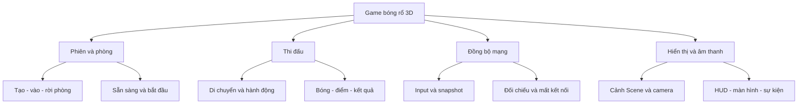
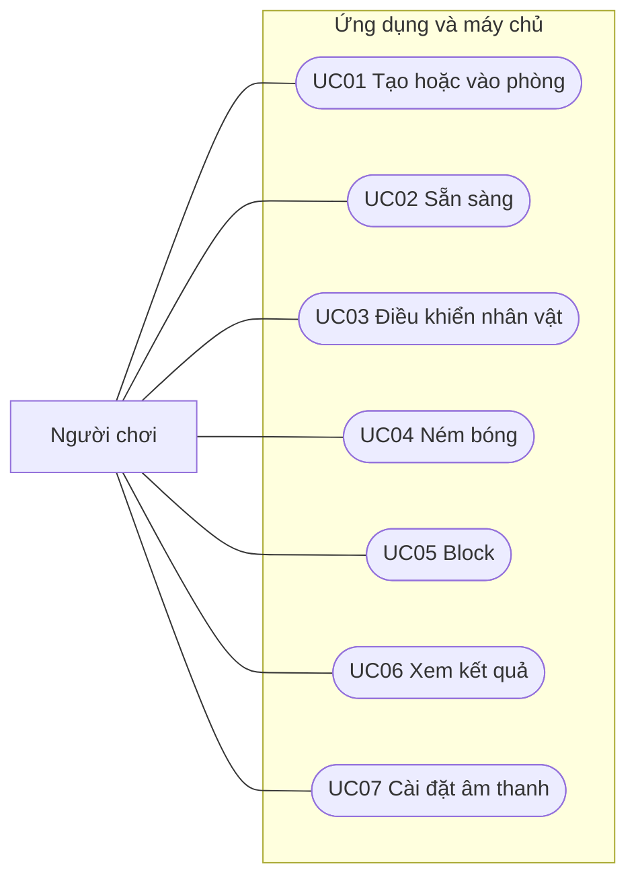
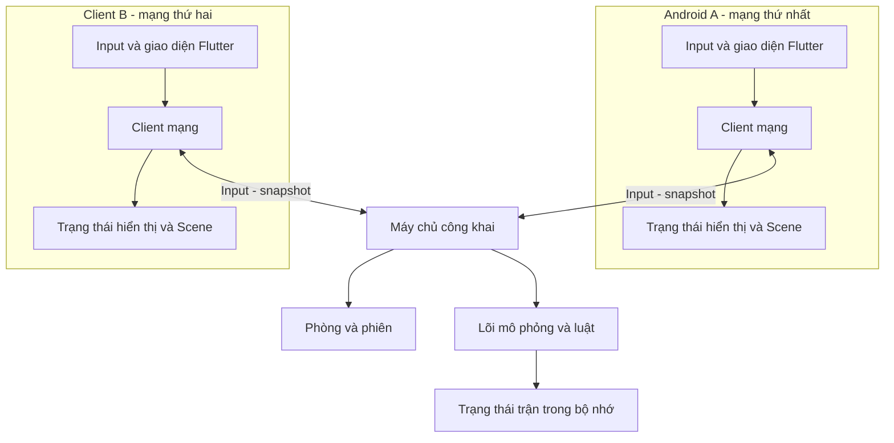
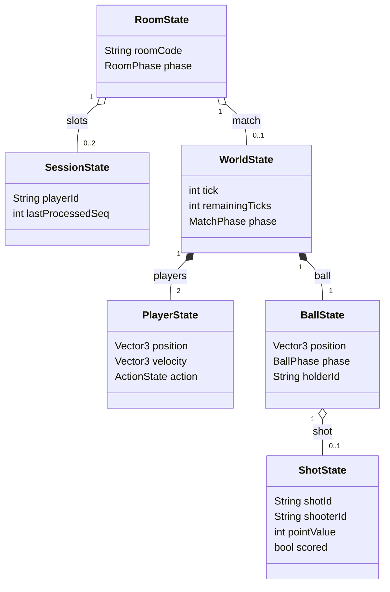
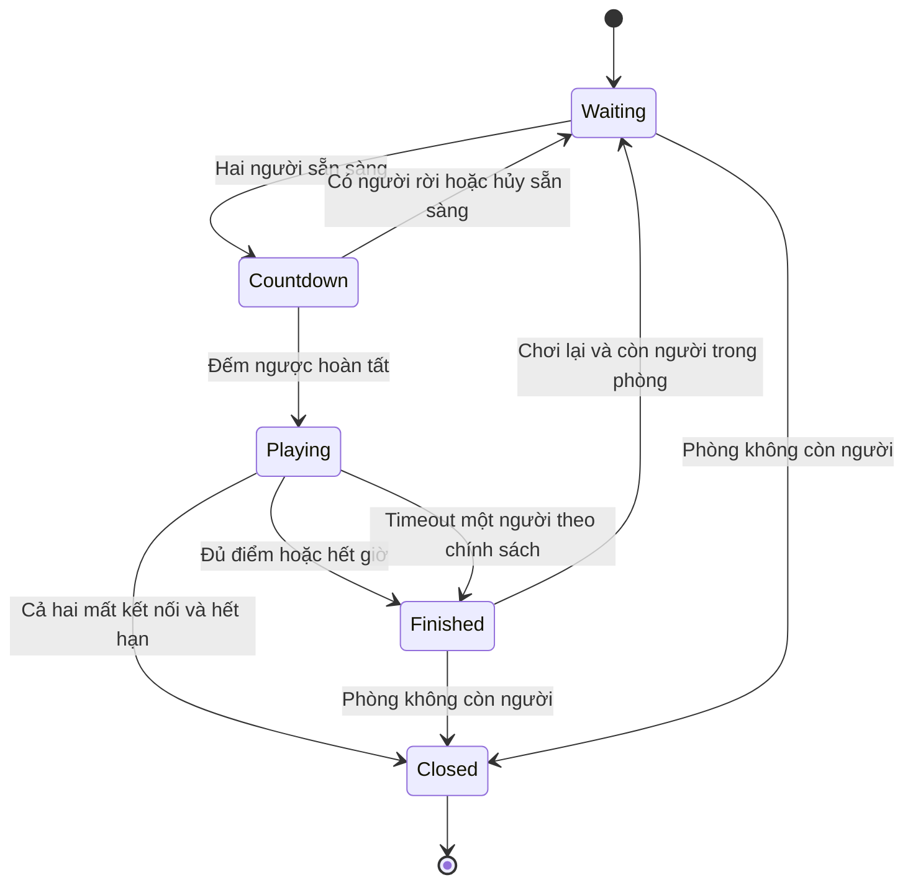
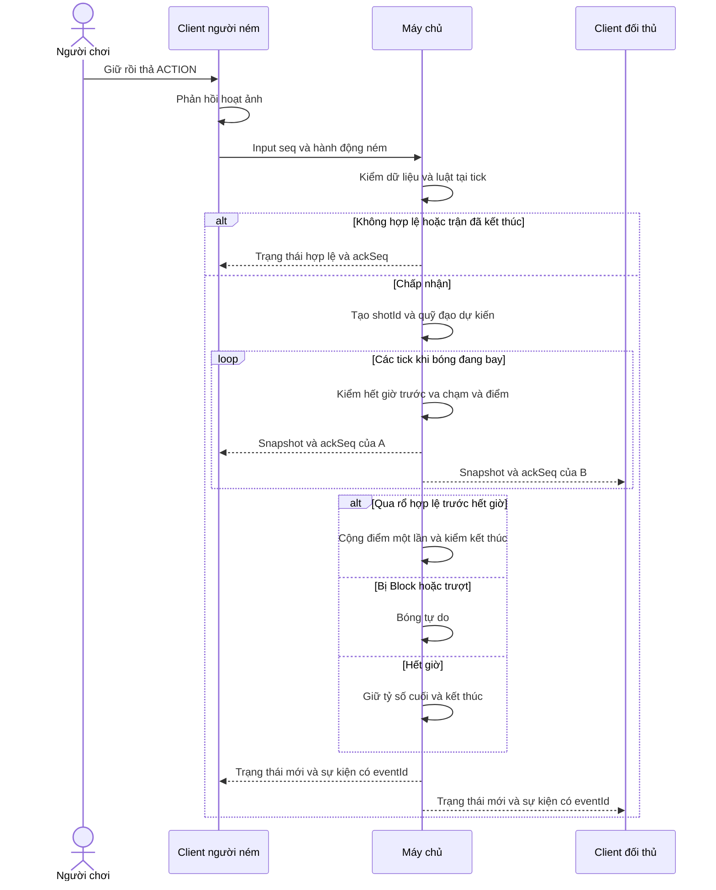
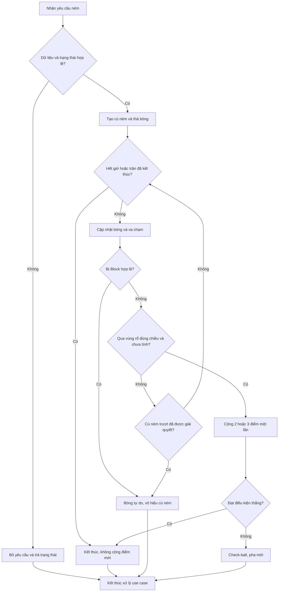
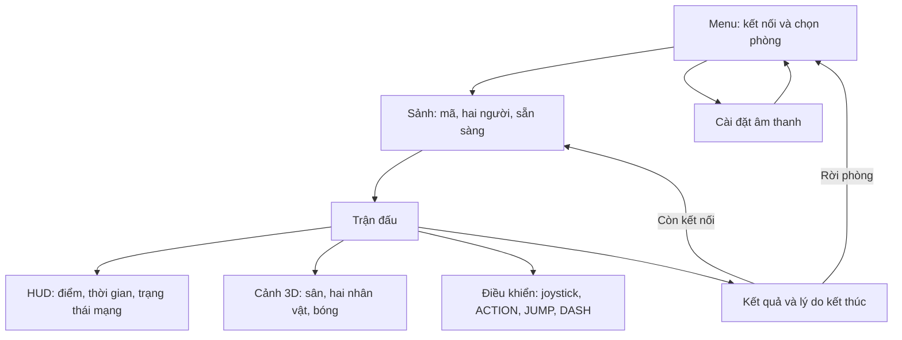

# Chương 3. XÂY DỰNG GAME [Tên game]

> Bản sơ bộ ngày 04/11/2026. Tên game chưa được lựa chọn. Toàn bộ kiến trúc, luật và hình minh họa trong chương này là **thiết kế đề xuất**, chưa phản ánh sản phẩm đã triển khai. Bố cục làm việc có thể được điều chỉnh theo thông báo của sinh viên và góp ý của người hướng dẫn. Các giá trị cấu hình được nêu để làm rõ thiết kế, không phải số liệu thực nghiệm.

## 3.1. Mô tả game

### 3.1.1. Ý tưởng, người chơi, bối cảnh và mục tiêu

[Tên game] được định hướng là demo bóng rổ đối kháng 3D giữa hai người trên thiết bị Android. Mỗi người điều khiển một nhân vật, phối hợp di chuyển, giữ bóng, ném và phòng thủ để đạt số điểm cao hơn đối thủ. Trọng tâm nghiên cứu là cách tổ chức cảnh, hiển thị và tương tác bằng Flutter Scene, đồng thời tích hợp luật chơi và đồng bộ trạng thái qua mạng. Demo không đặt mục tiêu tái hiện đầy đủ mọi quy định hoặc chuyển động của bóng rổ chuyên nghiệp.

Phương án ban đầu sử dụng nửa sân, một rổ, hai nhân vật và một quả bóng. Quy mô này tạo điều kiện khảo sát một vòng chơi đầy đủ mà không cần hệ thống đội hình, chiến thuật hoặc nhiều sân. Hai người kết nối đến cùng một máy chủ có địa chỉ tiếp cận được qua Internet. Khi được triển khai, mỗi ứng dụng hiển thị cùng diễn biến trận nhưng có thể có camera và giao diện điều khiển riêng. Yêu cầu ưu tiên chơi từ hai mạng khác nhau; phương án LAN chỉ phục vụ thử nghiệm bước đầu, không tự thay thế mục tiêu Internet.

Hiện có một Redmi Note 11 để chuẩn bị thử nghiệm. Chưa xác định phiên bản Android, đặc điểm GPU và kết quả chạy Scene trên thiết bị. Máy khách thứ hai trên máy tính hoặc giả lập có thể hỗ trợ phát triển; tuy nhiên, kết quả đó không tương đương nghiệm thu trên hai điện thoại thật. Giới hạn thiết bị phải được ghi lại khi đánh giá ở Chương 4.

### 3.1.2. Phạm vi, luật chơi và vòng chơi

Phạm vi đề xuất gồm tạo hoặc tham gia phòng hai người, xác nhận sẵn sàng, thi đấu, xem kết quả và quay lại sảnh. Ghép trận nhanh là chức năng bổ sung sau khi luồng phòng bằng mã ổn định. Tài khoản, bảng xếp hạng, giao dịch, cửa hàng, nhiều đội và chống gian lận nâng cao chưa thuộc phạm vi ban đầu.

Luật tham khảo từ bản nháp sử dụng 2 điểm cho cú ném trong vạch và 3 điểm cho cú ném ngoài vạch. Vị trí người ném trên mặt sân tại thời điểm thả bóng quyết định giá trị cú ném; vị trí nằm trên vạch được tính 2 điểm. Trận dự kiến kết thúc khi một người đạt ít nhất 11 điểm hoặc hết 3 phút; nếu hết giờ và bằng điểm thì hòa. Những con số này cần được thống nhất trước khi trở thành tiêu chí nghiệm thu.

Sau một lần ghi điểm, người bị ghi điểm nhận bóng ở vị trí bắt đầu pha mới; hai nhân vật được bố trí lại để tránh chồng lấn. Bóng trượt hoặc bị cản trở thành bóng tự do. Khi hai người cùng đủ điều kiện nhặt bóng, máy chủ ưu tiên khoảng cách gần hơn; trường hợp bằng nhau sử dụng thứ tự vị trí trong phòng. Đây là luật arcade giản lược, không được trình bày như luật bóng rổ chuẩn.

Một cú ném chỉ được tính khi bóng qua vùng ghi điểm từ trên xuống và sự kiện đó chưa được ghi nhận. Ở nhịp hết giờ, thiết kế đề xuất kiểm tra kết thúc trước xử lý ghi điểm mới; vì vậy bóng chưa qua rổ không được tính sau thời điểm kết thúc. Quy tắc ưu tiên này giúp mô tả hành vi biên rõ ràng, nhưng vẫn cần xác nhận khi chốt luật.

### 3.1.3. Điều khiển, kỹ năng và trạng thái

Giao diện đề xuất đặt ngang, gồm cần di chuyển bên trái và các nút ACTION, JUMP, DASH bên phải. ACTION đổi ý nghĩa theo trạng thái: giữ rồi thả để ném khi có bóng; thực hiện Block khi phòng thủ. JUMP cho phép bật cao, DASH tạo dịch chuyển nhanh có hồi chiêu. Nhân vật đang Dash không được thả bóng để ném. Các kỹ năng này là đề xuất trong bản nháp, chưa phải yêu cầu đã được phê duyệt.

Máy trạng thái giúp ngăn các hành động mâu thuẫn. Nhân vật có thể ở trạng thái di chuyển, bật cao, Dash hoặc Block; quyền giữ bóng được lưu riêng thay vì tạo mọi tổ hợp thành một trạng thái mới. Hệ thống kiểm tra trạng thái trận, quyền giữ bóng và hồi chiêu trước khi nhận hành động. Khi ứng dụng mất chạm hoặc xuống nền, lệnh điều khiển liên tục phải trở về trung tính để tránh nhân vật tiếp tục chạy ngoài ý muốn.

Phương án ném ban đầu sử dụng mô hình arcade: máy chủ tính xác suất từ cự ly, mức canh thời điểm và tình huống phòng thủ, sau đó dùng bộ sinh ngẫu nhiên có seed để chọn quỹ đạo dự kiến vào hoặc lệch rổ. Lựa chọn quỹ đạo không trực tiếp cộng điểm; bóng vẫn có thể bị Block hoặc trận hết giờ. Cách này cần được so sánh với backend vật lý như Rapier trước khi chốt. Không mặc định việc dùng cùng mã Dart, seed và bước thời gian cố định bảo đảm tính tất định trên mọi nền tảng.

### 3.1.4. Kết nối hai người, tình huống biên và giới hạn

Máy chủ trung tâm được đề xuất vì hai máy Android có thể nằm sau NAT hoặc dùng hai mạng di động khác nhau. Mỗi ứng dụng tạo kết nối đi ra đến máy chủ; thiết kế không yêu cầu điện thoại mở cổng nhận trực tiếp từ Internet. Khả năng triển khai, địa chỉ công khai, chứng chỉ và chi phí vận hành chưa được kiểm chứng hoặc lựa chọn.

Trong phòng, chỉ bắt đầu đếm ngược khi đủ hai người và cả hai sẵn sàng. Nếu có người rời khi đang đếm, phòng trở lại chờ. Khi mất kết nối giữa trận, máy chủ đưa input của người đó về trung tính, theo dõi thời hạn và xử kết quả theo chính sách đã chốt. Bản nháp gợi ý heartbeat mỗi giây và timeout hơn 10 giây; các mốc này chỉ là cấu hình thử ban đầu. Kết nối lại giữa trận là mở rộng, không được mặc định đã có.

## 3.2. Thiết kế game

### 3.2.1. Phân tích yêu cầu và quy trình nghiệp vụ

Các yêu cầu dưới đây dùng mã để truy vết thiết kế. Trạng thái của chúng là đề xuất triển khai, ngoại trừ định hướng Flutter Scene, Android, hai người và ưu tiên Internet đã được sinh viên xác nhận.

| Mã | Yêu cầu | Điều kiện quan sát dự kiến |
|---|---|---|
| F01 | Tạo, tham gia và rời phòng hai người | Không nhận người thứ ba; báo mã sai hoặc phòng đầy |
| F02 | Sẵn sàng và bắt đầu trận | Chỉ đếm ngược khi cả hai sẵn sàng |
| F03 | Điều khiển và ném bóng | Máy chủ kiểm tra tính hợp lệ của hành động |
| F04 | Tính điểm và kết thúc | Mỗi cú ném cộng điểm tối đa một lần; hai máy cùng kết quả |
| F05 | Đồng bộ và báo mất kết nối | Nhận diện trạng thái chờ, chơi, kết thúc và lỗi mạng |
| F06 | Cài đặt âm thanh | Chỉ ảnh hưởng thiết bị hiện tại |
| N01 | Tái lập môi trường | Lưu SDK, package, cấu hình và hướng dẫn chạy |
| N02 | Khả năng sử dụng trên mobile | Nút dễ chạm, vùng an toàn, phản hồi trạng thái rõ |
| N03 | Hiệu năng và mạng có thể đo | Lưu frame time, độ trễ và cấu hình thử; chưa đặt ngưỡng duyệt |

Quy trình chính là kết nối, chọn phòng, sẵn sàng, thi đấu rồi nhận kết quả. Các quy trình ngoại lệ gồm phòng không tồn tại, hết chỗ, người chơi rời sảnh, ứng dụng xuống nền và mất mạng. Mỗi ngoại lệ cần có thông báo và chuyển trạng thái xác định, thay vì chỉ ngắt màn hình trận đấu.

### 3.2.2. Sơ đồ chức năng

Hình 3-1 phân chia trách nhiệm để tránh trộn luật chơi vào phần hiển thị. Các nhánh là nhóm chức năng, không phải cấu trúc lớp đã được lập trình.

<!-- diagram: 3-1-chuc-nang.mmd -->

### 3.2.3. Tác nhân và use case tổng quát

Tác nhân chính là Người chơi. Ranh giới hệ thống bao gồm ứng dụng và máy chủ; do đó máy chủ không được vẽ như tác nhân bên ngoài. Hai người cùng sử dụng vai trò này. Hình 3-2 là sơ đồ ánh xạ use case bằng flowchart Mermaid, **không phải sơ đồ use case UML chuẩn**; khi định dạng bản chính thức có thể chuyển sang công cụ UML thích hợp mà giữ nguyên ý nghĩa.

<!-- diagram: 3-2-usecase-tong-quat.mmd -->

Ghép trận nhanh có thể bổ sung thành use case sau khi duyệt phạm vi. Kiểm tra dữ liệu, cộng điểm và gửi snapshot là xử lý nội bộ, không tách thành mục tiêu độc lập của tác nhân.

### 3.2.4. Đặc tả use case chi tiết

| Thuộc tính UC01 | Nội dung |
|---|---|
| Mục tiêu | Hai người vào cùng một phòng |
| Tiền điều kiện | Kết nối máy chủ còn hoạt động |
| Luồng chính | Người chơi tạo phòng, nhận mã; đối thủ nhập mã; máy chủ kiểm tra và gửi trạng thái hai vị trí |
| Ngoại lệ | Mã sai, phòng đầy hoặc kết nối mất: báo lý do, không tạo phiên trùng |
| Hậu điều kiện | Phòng có tối đa hai người và chưa tự bắt đầu trận |

| Thuộc tính UC04 | Nội dung |
|---|---|
| Mục tiêu | Ném bóng về phía rổ |
| Tiền điều kiện | Trận đang chạy; có bóng; trạng thái cho phép ném |
| Luồng chính | Giữ/thả ACTION; gửi input; máy chủ kiểm tra; tạo shotId/quỹ đạo; mô phỏng bóng; xác nhận ghi điểm hoặc bóng tự do |
| Ngoại lệ | Input cũ/trùng/sai bị bỏ; hết giờ kết thúc; Block đổi trạng thái bóng; không cộng điểm khi chỉ tạo quỹ đạo |
| Hậu điều kiện | Bóng bay, tự do hoặc trận kết thúc; cú ném chỉ cộng điểm một lần |

UC05 Block chỉ nhận khi trạng thái và hồi chiêu hợp lệ. Khi vùng Block hợp lệ chạm bóng đang bay, máy chủ đổi vận tốc, phát sự kiện và chuyển bóng thành tự do. Giá trị phạm vi, thời gian hiệu lực và hồi chiêu chưa chốt. UC02 cần hủy đếm ngược nếu thiếu người; UC06 hiển thị kết quả đã xác nhận, không tự suy luận thắng từ điểm cục bộ.

### 3.2.5. Kiến trúc hệ thống và thiết kế mạng

Phương án đề xuất gồm ứng dụng Flutter, máy chủ Dart và lõi mô phỏng độc lập giao diện. Client gửi thao tác, máy chủ quyết định trạng thái chung. Scene chỉ nhận trạng thái để dựng cảnh; không tự phán định điểm. Đây là hướng thiết kế để đánh giá, chưa quyết định loại bỏ `flutter_scene_net` hoặc chọn dịch vụ hosting cụ thể.

<!-- diagram: 3-3-kien-truc.mmd -->

Client B trong hình biểu diễn vai trò logic; hiện chưa có điện thoại thứ hai. Phương án WebSocket/JSON được chọn làm ứng viên vì dễ theo dõi thông điệp trong giai đoạn nghiên cứu. Kết nối triển khai công khai dự kiến dùng WSS và chứng chỉ hợp lệ; chưa có endpoint hoặc dịch vụ trả phí nào được tạo.

Input dự kiến chứa số thứ tự, hướng di chuyển và cờ hành động. Máy chủ lấy danh tính người gửi từ phiên kết nối, kiểm tra kiểu, miền giá trị, tần suất và điều kiện luật. Không tin điểm hoặc vị trí người chơi tự khai báo. Snapshot mang tick, trạng thái và ackSeq riêng cho người nhận; sự kiện có eventId để tránh phát âm thanh hoặc cộng hiệu ứng lặp.

Các giá trị 60 nhịp mô phỏng/giây, 20 snapshot/giây và bộ đệm nội suy khoảng 100 ms từ bản nháp chỉ là thông số khởi tạo để thử. Prediction và reconciliation tập trung vào nhân vật cục bộ; bóng nhận trạng thái được máy chủ xác nhận. Không có cơ sở kết luận các giá trị này phù hợp Redmi Note 11 trước khi đo.

### 3.2.6. Mô hình dữ liệu và sơ đồ lớp

Dữ liệu kết nối tách khỏi dữ liệu mô phỏng. Phòng lưu mã, hai vị trí và trạng thái sẵn sàng; trận lưu tick, thời gian, điểm, hai nhân vật và bóng. Cấu trúc này không đòi hỏi cơ sở dữ liệu quan hệ khi chưa có tài khoản hoặc lịch sử lâu dài. Nếu tiến trình máy chủ dừng, trận trong bộ nhớ không tự được khôi phục.

| Cấu trúc dự kiến | Dữ liệu chính và bất biến |
|---|---|
| RoomState | Mã phòng, phase, tối đa hai phiên, trạng thái sẵn sàng |
| SessionState | playerId, kết nối, lastSeen, thứ tự input đã xử lý |
| WorldState | tick, phase, thời gian còn lại, hai player, một ball, score, result |
| PlayerState | Vị trí, vận tốc, hướng, hành động, hồi chiêu |
| BallState | Vị trí, vận tốc, phase, holderId, shot hiện tại |
| ShotState | shotId, shooterId, vị trí/thời điểm ném, giá trị điểm, cờ đã tính |

Hình 3-4 mô tả cấu trúc lớp dự kiến, không phải API Flutter Scene hoặc mã đã có. Liên kết lớp với Scene được đặt ở lớp hiển thị để lõi không phụ thuộc node GPU.

<!-- diagram: 3-4-lop.mmd -->

### 3.2.7. Mô hình xử lý

Hình 3-5 xác định trạng thái phòng/trận và nhánh thoát. Mất kết nối khi chơi không lập tức kết thúc nếu chính sách có timeout; sự kiện hết hạn được máy chủ tạo sau kiểm tra kết nối. Việc người chơi đồng thời rời hoặc đã kết thúc phải được xử lý một lần.

<!-- diagram: 3-5-trang-thai.mmd -->

Hình 3-6 tách phản hồi giao diện khỏi xác nhận của máy chủ. Thông báo “không hợp lệ” được biểu diễn logic, không bắt buộc tạo gói lỗi riêng cho từng input; snapshot cũng có thể sửa lại trạng thái dự đoán.

<!-- diagram: 3-6-tuan-tu-nem.mmd -->

Hình 3-7 giữ đầy đủ vòng lặp xử lý bóng và nhánh kết thúc. “Trượt đã giải quyết” nghĩa là cú ném không còn khả năng ghi điểm theo quy tắc mô phỏng, không chỉ là bóng chưa đến rổ trong tick hiện tại.

<!-- diagram: 3-7-hoat-dong-nem.mmd -->

### 3.2.8. Thiết kế cảnh 3D, tài nguyên và giao diện

Cảnh đề xuất có nhóm sân cố định, hai nhóm nhân vật, bóng và camera. Biến đổi nhân vật được cập nhật từ trạng thái hiển thị; mô hình, vật liệu và hoạt ảnh gắn vào node tương ứng. Giai đoạn đầu có thể dùng khối cơ bản để tách lỗi rendering khỏi lỗi tải tài nguyên. Asset chính thức cần ghi tác giả, URL, giấy phép và quyền chỉnh sửa; chưa có asset nào được xác nhận chỉ từ bản thiết kế này.

Hình 3-8 là cấu trúc giao diện, không phải ảnh chụp màn hình sản phẩm. HUD đọc điểm và thời gian từ trạng thái máy chủ; nội suy vị trí không được làm thay đổi kết quả trận. Chỉ dùng số ping khi phương pháp đo đã xác định, không trừ trực tiếp hai timestamp của hai đồng hồ chưa đồng bộ.

<!-- diagram: 3-8-giao-dien.mmd -->

Các nút phải tôn trọng vùng an toàn và kích thước màn hình, không che bóng hoặc nhân vật. Âm thanh được phát theo eventId duy nhất; tắt âm thanh không làm mất thông báo quan trọng. Khi xuống nền hoặc mất mạng, giao diện báo rõ tình trạng thay vì tạo cảm giác trận đã tạm dừng, vì máy chủ có thể vẫn tiếp tục mô phỏng.

**Hình 3-9. Bố cục màn hình trận đấu đề xuất.** Bản wireframe được tạo bằng đồ họa vector, không phải ảnh chạy game. Các vị trí điều khiển và thông tin chỉ minh họa thiết kế; chưa được kiểm chứng khả năng chạm hoặc mức che khuất trên Redmi Note 11. Nguồn SVG có thể chỉnh sửa được lưu cùng ảnh PNG.

### 3.2.9. Truy vết và quyết định còn mở

| Yêu cầu | Thiết kế đối chiếu | Bằng chứng cần có sau triển khai |
|---|---|---|
| F01–F02 | UC01–UC02, Hình 3-5 | Luồng tạo/vào/sẵn sàng và phòng đầy |
| F03 | UC03–UC05, Hình 3-6–3-7 | Input hợp lệ, sai, trùng và hồi chiêu |
| F04 | ShotState, vòng xử lý điểm | Không cộng lặp; hết giờ; hai client cùng kết quả |
| F05 | Kiến trúc, phiên và heartbeat | Hai mạng thực, timeout, ngắt mạng |
| F06/N02 | Hệ thống màn hình | Thao tác mobile, âm thanh và vùng an toàn |
| N01/N03 | Cấu hình build và phép đo | Phiên bản, thiết bị, log và dữ liệu gốc |

Các quyết định cần thống nhất gồm tên game, phạm vi kỹ năng, luật thắng, hướng màn hình, phương án vật lý và mạng, cấu hình mô phỏng, nơi chạy máy chủ và chính sách mất kết nối. Trước mắt, việc mô tả đầy đủ thiết kế hỗ trợ bản thảo Chương 1–3; nó không thay thế kiểm chứng kỹ thuật. Chương 4 chỉ được bổ sung kết quả sau khi có bản dựng, thiết bị và phép đo thực tế; Chương 5 phải đối chiếu những kết quả đó với mục tiêu ở Chương 1.

**Căn cứ nội bộ:** yêu cầu sinh viên ngày 04/11/2026 trong `PROJECT_BRIEF.md`, bố cục làm việc `OUTLINE.md`, nội dung tham khảo từ `LuanVan_Ch1-3_FlutterScene_reviewed.docx`. Các sơ đồ của chương là đề xuất do nhóm xây dựng từ những đầu vào này, chưa phải mô tả mã nguồn. Các khái niệm và API nền tảng cần dẫn nguồn kỹ thuật ở Chương 2; chương này không tuyên bố đã thực nghiệm chúng.
