# Chương 3. Xây dựng game Bóng rổ đối kháng 3D

## 3.1. Mô tả game

### 3.1.1. Ý tưởng, người chơi, bối cảnh và mục tiêu

Game Bóng rổ đối kháng 3D dành cho hai người trên thiết bị Android. Mỗi người điều khiển một nhân vật, phối hợp di chuyển, giữ bóng, ném và phòng thủ để đạt số điểm cao hơn đối thủ. Trọng tâm nghiên cứu là cách tổ chức cảnh, hiển thị và tương tác bằng Flutter Scene, đồng thời tích hợp luật chơi và đồng bộ trạng thái qua mạng. Demo sử dụng luật giản lược phù hợp với phạm vi nghiên cứu.

Game sử dụng nửa sân, một rổ, hai nhân vật và một quả bóng. Quy mô này tạo điều kiện khảo sát một vòng chơi đầy đủ mà không cần hệ thống đội hình, chiến thuật hoặc nhiều sân. Hai người kết nối đến cùng một máy chủ có địa chỉ tiếp cận được qua Internet. Khi được triển khai, mỗi ứng dụng hiển thị cùng diễn biến trận nhưng có thể có camera và giao diện điều khiển riêng. Yêu cầu ưu tiên chơi từ hai mạng khác nhau; phương án LAN chỉ phục vụ thử nghiệm bước đầu, không tự thay thế mục tiêu Internet.

Hiện có một Redmi Note 11 để chuẩn bị thử nghiệm. Chưa xác định phiên bản Android, đặc điểm GPU và kết quả chạy Scene trên thiết bị. Máy khách thứ hai trên máy tính hoặc giả lập có thể hỗ trợ phát triển; tuy nhiên, kết quả đó không tương đương nghiệm thu trên hai điện thoại thật. Giới hạn thiết bị phải được ghi lại khi đánh giá ở Chương 4.

### 3.1.2. Phạm vi, luật chơi và vòng chơi

Các chức năng gồm tạo hoặc tham gia phòng hai người, xác nhận sẵn sàng, thi đấu, xem kết quả và quay lại sảnh. Ghép trận nhanh là chức năng bổ sung sau khi luồng phòng bằng mã ổn định. Tài khoản, bảng xếp hạng, giao dịch, cửa hàng, nhiều đội và chống gian lận nâng cao chưa thuộc phạm vi ban đầu.

Luật chơi sử dụng 2 điểm cho cú ném trong vạch và 3 điểm cho cú ném ngoài vạch. Vị trí người ném trên mặt sân tại thời điểm thả bóng quyết định giá trị cú ném; vị trí nằm trên vạch được tính 2 điểm. Trận kết thúc khi một người đạt ít nhất 11 điểm hoặc hết 3 phút; nếu hết giờ và bằng điểm thì hòa. Các quy tắc này là cơ sở xây dựng ca kiểm thử luật chơi.

Sau một lần ghi điểm, người bị ghi điểm nhận bóng ở vị trí bắt đầu pha mới; hai nhân vật được bố trí lại để tránh chồng lấn. Bóng trượt hoặc bị cản trở thành bóng tự do. Khi hai người cùng đủ điều kiện nhặt bóng, máy chủ ưu tiên khoảng cách gần hơn; trường hợp bằng nhau sử dụng thứ tự vị trí trong phòng. Đây là luật arcade giản lược, không được trình bày như luật bóng rổ chuẩn.

Một cú ném chỉ được tính khi bóng qua vùng ghi điểm từ trên xuống và sự kiện đó chưa được ghi nhận. Ở nhịp hết giờ, thiết kế đề xuất kiểm tra kết thúc trước xử lý ghi điểm mới; vì vậy bóng chưa qua rổ không được tính sau thời điểm kết thúc. Quy tắc ưu tiên này giúp mô tả hành vi biên rõ ràng, nhưng vẫn cần xác nhận khi chốt luật.

### 3.1.3. Điều khiển, kỹ năng và trạng thái

Giao diện đề xuất đặt ngang, gồm cần di chuyển bên trái và các nút ACTION, JUMP, DASH bên phải. ACTION đổi ý nghĩa theo trạng thái: giữ rồi thả để ném khi có bóng; thực hiện Block khi phòng thủ. JUMP cho phép bật cao, DASH tạo dịch chuyển nhanh có hồi chiêu. Nhân vật đang Dash không được thả bóng để ném. Các kỹ năng này thuộc phạm vi demo, còn tham số hồi chiêu và phạm vi tác dụng sẽ được xác định khi triển khai.

Máy trạng thái giúp ngăn các hành động mâu thuẫn. Nhân vật có thể ở trạng thái di chuyển, bật cao, Dash hoặc Block; quyền giữ bóng được lưu riêng thay vì tạo mọi tổ hợp thành một trạng thái mới. Hệ thống kiểm tra trạng thái trận, quyền giữ bóng và hồi chiêu trước khi nhận hành động. Khi ứng dụng mất chạm hoặc xuống nền, lệnh điều khiển liên tục phải trở về trung tính để tránh nhân vật tiếp tục chạy ngoài ý muốn.

Phương án ném ban đầu sử dụng mô hình arcade: máy chủ tính xác suất từ cự ly, mức canh thời điểm và tình huống phòng thủ, sau đó dùng bộ sinh ngẫu nhiên có seed để chọn quỹ đạo dự kiến vào hoặc lệch rổ. Lựa chọn quỹ đạo không trực tiếp cộng điểm; bóng vẫn có thể bị Block hoặc trận hết giờ. Cách này cần được so sánh với backend vật lý như Rapier trước khi chốt. Không mặc định việc dùng cùng mã Dart, seed và bước thời gian cố định bảo đảm tính tất định trên mọi nền tảng.

### 3.1.4. Kết nối hai người, tình huống biên và giới hạn

Máy chủ trung tâm được đề xuất vì hai máy Android có thể nằm sau NAT hoặc dùng hai mạng di động khác nhau. Mỗi ứng dụng tạo kết nối đi ra đến máy chủ; thiết kế không yêu cầu điện thoại mở cổng nhận trực tiếp từ Internet. Khả năng triển khai, địa chỉ công khai, chứng chỉ và chi phí vận hành chưa được kiểm chứng hoặc lựa chọn.

Trong phòng, chỉ bắt đầu đếm ngược khi đủ hai người và cả hai sẵn sàng. Nếu có người rời khi đang đếm, phòng trở lại chờ. Khi mất kết nối giữa trận, máy chủ đưa input của người đó về trung tính, theo dõi thời hạn và xử kết quả theo chính sách đã chốt. Bản nháp gợi ý heartbeat mỗi giây và timeout hơn 10 giây; các mốc này chỉ là cấu hình thử ban đầu. Kết nối lại giữa trận là mở rộng, không được mặc định đã có.

## 3.2. Thiết kế game

### 3.2.1. Phân tích yêu cầu và quy trình nghiệp vụ

Các mã yêu cầu được dùng để đối chiếu chức năng với thiết kế và ca kiểm thử. Luật chơi và các thao tác nằm trong phạm vi demo; kiến trúc chi tiết và tham số kỹ thuật còn cần được kiểm chứng khi triển khai.

| Mã | Yêu cầu | Điều kiện quan sát dự kiến |
|---|---|---|
| F01 | Tạo, tham gia và rời phòng hai người | Không nhận người thứ ba; báo mã sai hoặc phòng đầy |
| F02 | Sẵn sàng và bắt đầu trận | Chỉ đếm ngược khi cả hai sẵn sàng |
| F03 | Điều khiển và ném bóng | Máy chủ kiểm tra tính hợp lệ của hành động |
| F04 | Tính điểm và kết thúc | Mỗi cú ném cộng điểm tối đa một lần; hai máy cùng kết quả |
| F05 | Đồng bộ và báo mất kết nối | Nhận diện trạng thái chờ, chơi, kết thúc và lỗi mạng |
| F06 | Cài đặt âm thanh | Chỉ ảnh hưởng thiết bị hiện tại |
| N01 | Tái lập môi trường | Lưu SDK, package, cấu hình và hướng dẫn chạy |
| N02 | Khả năng sử dụng trên mobile | Nút dễ chạm, vùng an toàn, phản hồi trạng thái rõ |
| N03 | Hiệu năng và mạng có thể đo | Lưu frame time, độ trễ và cấu hình thử; chưa đặt ngưỡng duyệt |

Quy trình chính là kết nối, chọn phòng, sẵn sàng, thi đấu rồi nhận kết quả. Các quy trình ngoại lệ gồm phòng không tồn tại, hết chỗ, người chơi rời sảnh, ứng dụng xuống nền và mất mạng. Mỗi ngoại lệ cần có thông báo và chuyển trạng thái xác định, thay vì chỉ ngắt màn hình trận đấu.

### 3.2.2. Sơ đồ chức năng

Hai panel thuộc cùng một sơ đồ phân rã; nút Game bóng rổ 3D được lặp lại để nối các nhóm chức năng. Hình 3.1 phân chia trách nhiệm để tránh trộn luật chơi vào phần hiển thị. Các nhánh là nhóm chức năng, không phải cấu trúc lớp đã được lập trình.

<!-- diagram: 3-1a-chuc-nang-v06.mmd -->
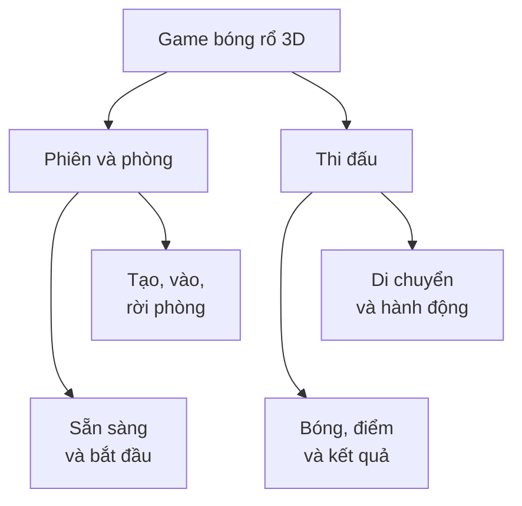

Hình 3.1(a). Phân rã chức năng phiên, phòng và thi đấu. Nguồn: thiết kế đề xuất của tác giả.

<!-- diagram: 3-1b-chuc-nang-v06.mmd -->
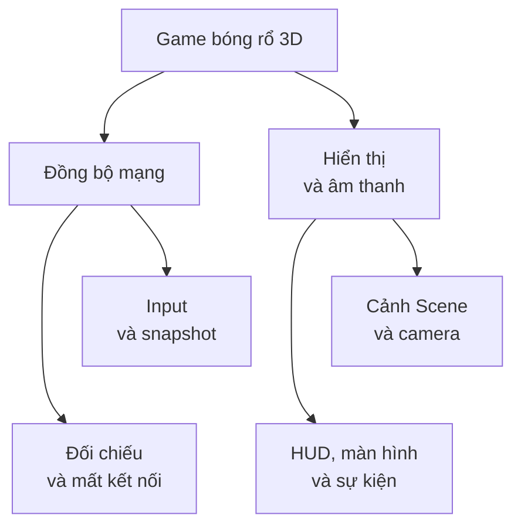

Hình 3.1(b). Phân rã chức năng đồng bộ, hiển thị và âm thanh. Nguồn: thiết kế đề xuất của tác giả.

### 3.2.3. Tác nhân và use case tổng quát

Tác nhân Người chơi đại diện cho vai trò của mỗi người trong hai người tham gia. Ranh giới hệ thống gồm ứng dụng và máy chủ, vì vậy máy chủ là thành phần bên trong. Hình 3.2 sử dụng ký hiệu UML: actor hình người, use case hình ellipse và association nét liền. UC08 Rời phòng thể hiện thao tác đã có trong yêu cầu F01; sơ đồ không dùng quan hệ include hoặc extend khi chưa có nhu cầu tương ứng.

<!-- diagram-svg: 3-2-usecase-uml.svg -->
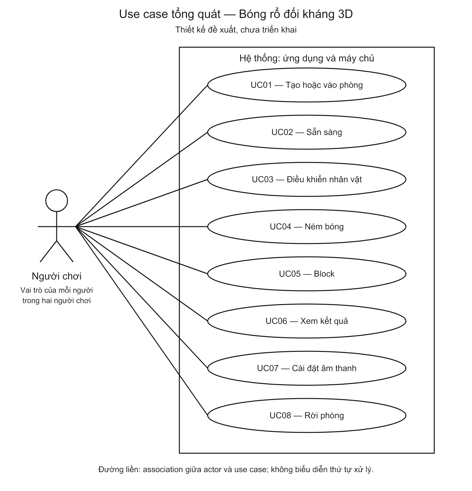

Hình 3.2. Use case tổng quát của hệ thống đề xuất. Nguồn: tác giả thiết kế theo ký pháp UML.

Ghép trận nhanh là chức năng bổ sung sau khi luồng phòng bằng mã ổn định. Kiểm tra dữ liệu, cộng điểm và gửi snapshot là xử lý nội bộ, không tách thành mục tiêu độc lập của tác nhân.

### 3.2.4. Đặc tả use case chi tiết

| Thuộc tính UC01 | Nội dung |
|---|---|
| Mục tiêu | Hai người vào cùng một phòng |
| Tiền điều kiện | Kết nối máy chủ còn hoạt động |
| Luồng chính | Người chơi tạo phòng, nhận mã; đối thủ nhập mã; máy chủ kiểm tra và gửi trạng thái hai vị trí |
| Ngoại lệ | Mã sai, phòng đầy hoặc kết nối mất: báo lý do, không tạo phiên trùng |
| Hậu điều kiện | Phòng có tối đa hai người và chưa tự bắt đầu trận |

| Thuộc tính UC04 | Nội dung |
|---|---|
| Mục tiêu | Ném bóng về phía rổ |
| Tiền điều kiện | Trận đang chạy; có bóng; trạng thái cho phép ném |
| Luồng chính | Giữ/thả ACTION; gửi input; máy chủ kiểm tra; tạo shotId/quỹ đạo; mô phỏng bóng; xác nhận ghi điểm hoặc bóng tự do |
| Ngoại lệ | Input cũ/trùng/sai bị bỏ; hết giờ kết thúc; Block đổi trạng thái bóng; không cộng điểm khi chỉ tạo quỹ đạo |
| Hậu điều kiện | Bóng bay, tự do hoặc trận kết thúc; cú ném chỉ cộng điểm một lần |

UC05 Block chỉ nhận khi trạng thái và hồi chiêu hợp lệ. Khi vùng Block hợp lệ chạm bóng đang bay, máy chủ đổi vận tốc, phát sự kiện và chuyển bóng thành tự do. Giá trị phạm vi, thời gian hiệu lực và hồi chiêu chưa chốt. UC02 cần hủy đếm ngược nếu thiếu người; UC06 hiển thị kết quả đã xác nhận, không tự suy luận thắng từ điểm cục bộ.

UC08 Rời phòng thuộc nhóm chức năng F01 và áp dụng khi người chơi rời sảnh hoặc rời trận đang diễn ra.

| Thuộc tính UC08 | Nội dung |
|---|---|
| Mục tiêu | Rời phòng hiện tại và kết thúc tham gia theo chính sách của phiên |
| Tiền điều kiện | Người chơi đang thuộc một phòng ở sảnh hoặc trong trận |
| Luồng chính | Người chơi yêu cầu rời; máy chủ kiểm tra phiên và trạng thái phòng; cập nhật thành viên; gửi trạng thái cho người còn lại; ứng dụng chuyển về màn hình phù hợp |
| Rời sảnh | Bỏ trạng thái sẵn sàng của người rời; hủy đếm ngược nếu thiếu người; không tự bắt đầu trận |
| Rời trận | Cần thống nhất chính sách kết thúc, xử kết quả hoặc cho phép chờ; chưa mặc định người rời bị xử thua |
| Ngoại lệ | Mất kết nối, yêu cầu lặp, cả hai cùng rời hoặc yêu cầu đến sau kết thúc cần xử lý nhất quán; timeout và khả năng quay lại chưa chốt |
| Hậu điều kiện | Phiên đã rời không tiếp tục điều khiển nhân vật; trạng thái phòng và kết quả chỉ thay đổi theo chính sách được máy chủ áp dụng |

### 3.2.5. Kiến trúc hệ thống và thiết kế mạng

Phương án đề xuất gồm ứng dụng Flutter, máy chủ Dart và lõi mô phỏng độc lập giao diện. Client gửi thao tác, máy chủ quyết định trạng thái chung. Scene chỉ nhận trạng thái để dựng cảnh; không tự phán định điểm. Đây là hướng thiết kế để đánh giá, chưa quyết định loại bỏ `flutter_scene_net` hoặc chọn dịch vụ hosting cụ thể.

<!-- diagram: 3-3-kien-truc.mmd -->
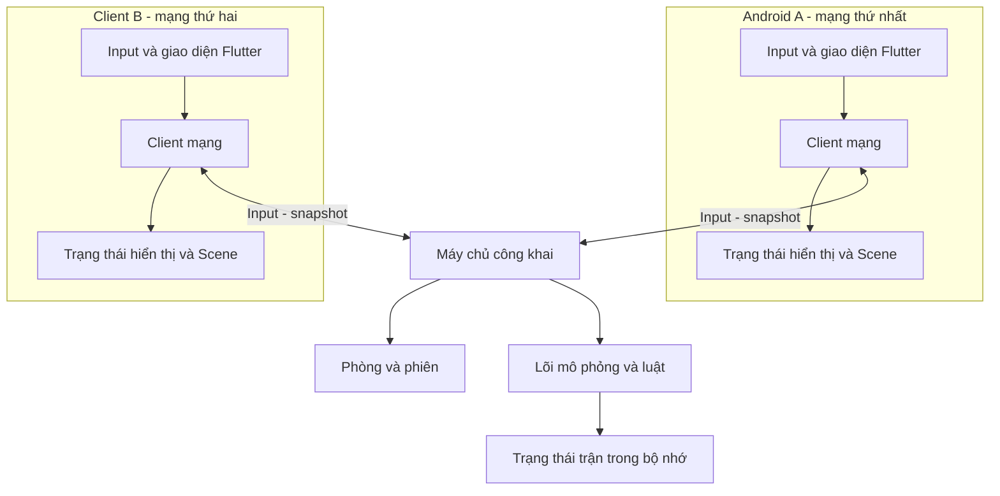

Hình 3.3. Kiến trúc kết nối dự kiến. Nguồn: thiết kế đề xuất của tác giả.

Client B trong hình biểu diễn vai trò logic; hiện chưa có điện thoại thứ hai. Phương án WebSocket/JSON được chọn làm ứng viên vì dễ theo dõi thông điệp trong giai đoạn nghiên cứu. Kết nối triển khai công khai dự kiến dùng WSS và chứng chỉ hợp lệ; chưa có endpoint hoặc dịch vụ trả phí nào được tạo.

Input dự kiến chứa số thứ tự, hướng di chuyển và cờ hành động. Máy chủ lấy danh tính người gửi từ phiên kết nối, kiểm tra kiểu, miền giá trị, tần suất và điều kiện luật. Không tin điểm hoặc vị trí người chơi tự khai báo. Snapshot mang tick, trạng thái và ackSeq riêng cho người nhận; sự kiện có eventId để tránh phát âm thanh hoặc cộng hiệu ứng lặp.

Trong thiết kế, ackSeq của một client là số thứ tự input cuối cùng đã được máy chủ tiêu thụ theo luồng có thứ tự của phiên, kể cả hành động bị từ chối sau khi kiểm tra luật. Việc mới nhận một thông điệp chưa đủ để xác nhận; dữ liệu sai định dạng hoặc sai phiên không được làm tiến ackSeq. Máy khách loại các input đã được xác nhận rồi mới đối chiếu các input còn lại. Định danh phiên lấy từ kết nối, không lấy từ mã người chơi tự khai báo trong gói tin.

Snapshot cũ không ghi đè trạng thái mới hơn của cùng một trận. Mã sự kiện phải được xét cùng mã trận để tránh nhầm khi chơi lại; thời hạn lưu sự kiện và quy tắc đặt lại bộ nhớ đệm sẽ được xác định khi cụ thể hóa giao thức.

Các giá trị 60 nhịp mô phỏng/giây, 20 snapshot/giây và bộ đệm nội suy khoảng 100 ms từ bản nháp chỉ là thông số khởi tạo để thử. Prediction và reconciliation tập trung vào nhân vật cục bộ; bóng nhận trạng thái được máy chủ xác nhận. Không có cơ sở kết luận các giá trị này phù hợp Redmi Note 11 trước khi đo.

### 3.2.6. Mô hình dữ liệu và sơ đồ lớp

Dữ liệu kết nối tách khỏi dữ liệu mô phỏng. Phòng lưu mã, hai vị trí và trạng thái sẵn sàng; trận lưu tick, thời gian, điểm, hai nhân vật và bóng. Cấu trúc này không đòi hỏi cơ sở dữ liệu quan hệ khi chưa có tài khoản hoặc lịch sử lâu dài. Nếu tiến trình máy chủ dừng, trận trong bộ nhớ không tự được khôi phục.

| Cấu trúc dự kiến | Dữ liệu chính và bất biến |
|---|---|
| RoomState | Mã phòng, phase, tối đa hai phiên; trạng thái sẵn sàng lấy từ các phiên |
| SessionState | playerId, slotIndex ổn định, ready, kết nối, lastSeen, thứ tự input đã xử lý |
| WorldState | tick, phase, thời gian còn lại, hai player, một ball, score, result |
| PlayerState | Vị trí, vận tốc, hướng, hành động, hồi chiêu |
| BallState | Vị trí, vận tốc, phase, holderId, shot hiện tại |
| ShotState | shotId, shooterId, vị trí/thời điểm ném, giá trị điểm, cờ đã tính |

Hình 3.4 mô tả cấu trúc lớp dự kiến, không phải API Flutter Scene hoặc mã đã có. Liên kết lớp với Scene được đặt ở lớp hiển thị để lõi không phụ thuộc node GPU.

<!-- diagram: 3-4a-phong-phien-v06.mmd -->
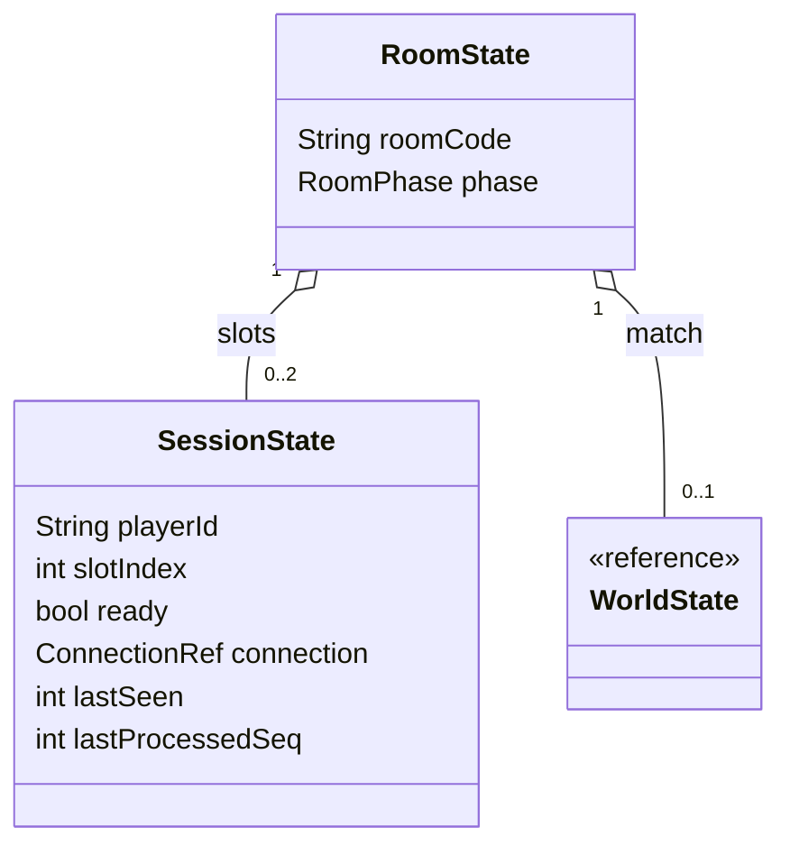

Hình 3.4(a). Cấu trúc phòng và phiên kết nối. Nguồn: thiết kế đề xuất của tác giả.

WorldState trong panel (a) được khai triển tại (b). slotIndex ổn định trong phòng, là 0 hoặc 1 và không trùng; chỉ số này còn dùng phân xử nhặt bóng khi bằng khoảng cách.

<!-- diagram: 3-4b-tran-nhan-vat-v06.mmd -->
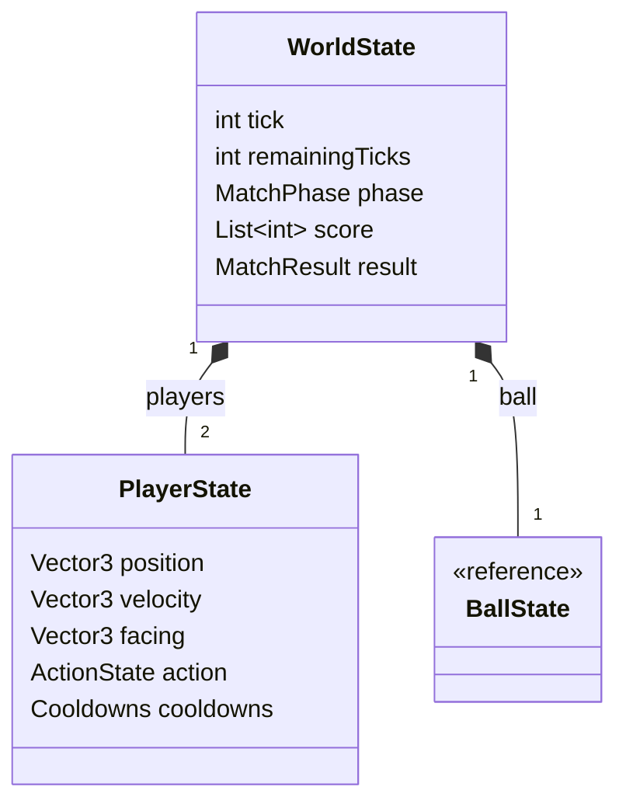

Hình 3.4(b). Trạng thái trận và hai nhân vật. Nguồn: thiết kế đề xuất của tác giả.

score có hai phần tử theo slotIndex; result biểu diễn thắng/thua/hòa và lý do khi trận kết thúc. BallState được khai triển tại panel (c); đó là cùng lớp tham chiếu trong panel (b).

<!-- diagram: 3-4c-bong-cu-nem-v06.mmd -->
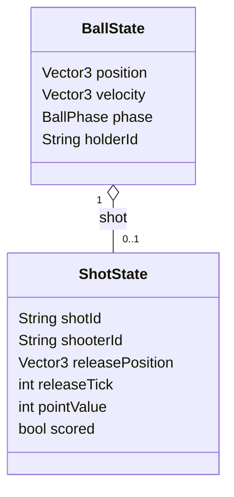

Hình 3.4(c). Trạng thái bóng và dữ liệu cú ném. Nguồn: thiết kế đề xuất của tác giả.

Các lớp mang nhãn reference được khai triển ở panel kế tiếp. pointValue được chốt từ releasePosition tại releaseTick; vị trí trên vạch tính 2 điểm. scored ngăn cộng điểm lặp. holderId chỉ có nghĩa khi bóng được giữ và shot có thể vắng. Kiểu giá trị và đơn vị thời gian còn cần cụ thể hóa khi triển khai.

### 3.2.7. Mô hình xử lý

Hình 3.5 xác định trạng thái phòng/trận và nhánh thoát. Mất kết nối khi chơi không lập tức kết thúc nếu chính sách có timeout; sự kiện hết hạn được máy chủ tạo sau kiểm tra kết nối. Việc người chơi đồng thời rời hoặc đã kết thúc phải được xử lý một lần.

<!-- diagram: 3-5-trang-thai.mmd -->
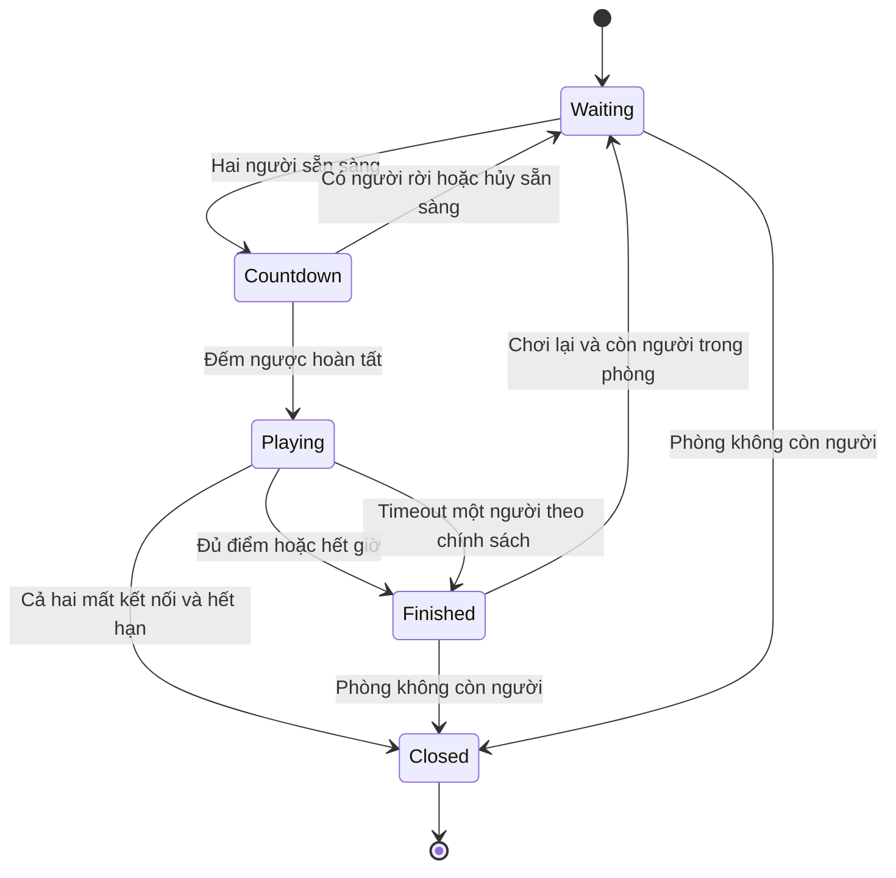

Hình 3.5. Trạng thái phòng và trận. Nguồn: thiết kế đề xuất của tác giả.

Hình 3.6 tách phản hồi giao diện khỏi xác nhận của máy chủ. Thông báo “không hợp lệ” được biểu diễn logic, không bắt buộc tạo gói lỗi riêng cho từng input; snapshot cũng có thể sửa lại trạng thái dự đoán.

<!-- diagram: 3-6a-nhan-input-v06.mmd -->
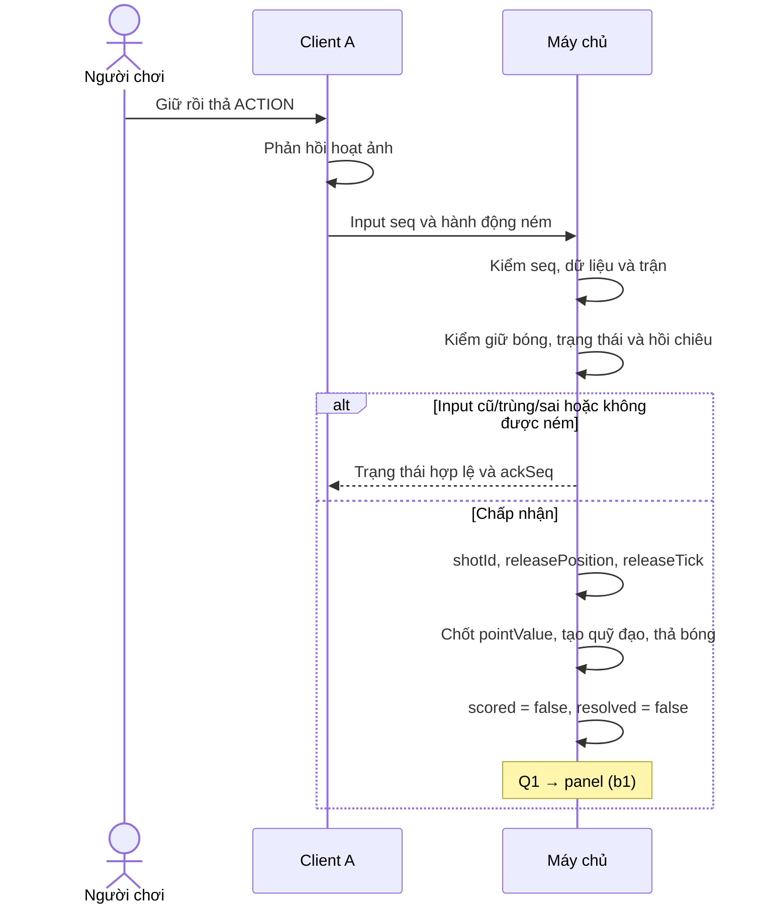

Hình 3.6(a). Nhận input và kiểm tra tạo cú ném. Nguồn: thiết kế đề xuất của tác giả.

<!-- diagram: 3-6b1-thoi-gian-block-v06.mmd -->
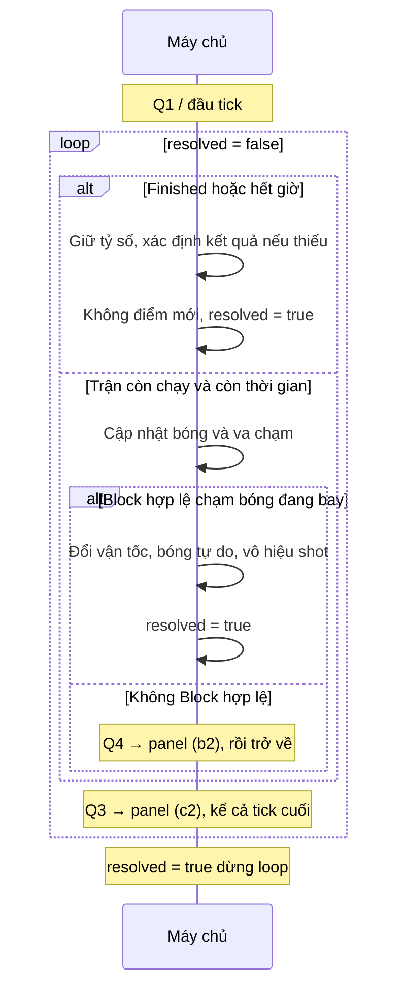

Hình 3.6(b1). Vòng tick, thời gian và Block. Nguồn: thiết kế đề xuất của tác giả.

<!-- diagram: 3-6b2-ro-truot-v06.mmd -->
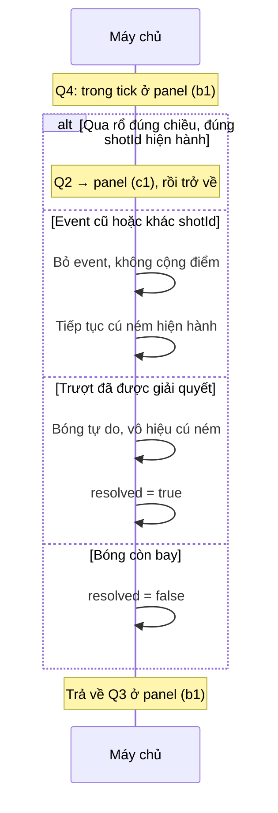

Hình 3.6(b2). Các nhánh qua rổ, sự kiện cũ và trượt. Nguồn: thiết kế đề xuất của tác giả.

<!-- diagram: 3-6c1-diem-v06.mmd -->
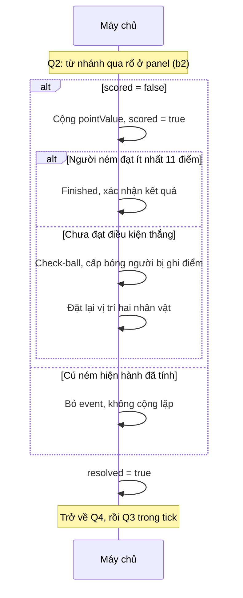

Hình 3.6(c1). Xử lý điểm và check-ball. Nguồn: thiết kế đề xuất của tác giả.

<!-- diagram: 3-6c2-snapshot-v06.mmd -->
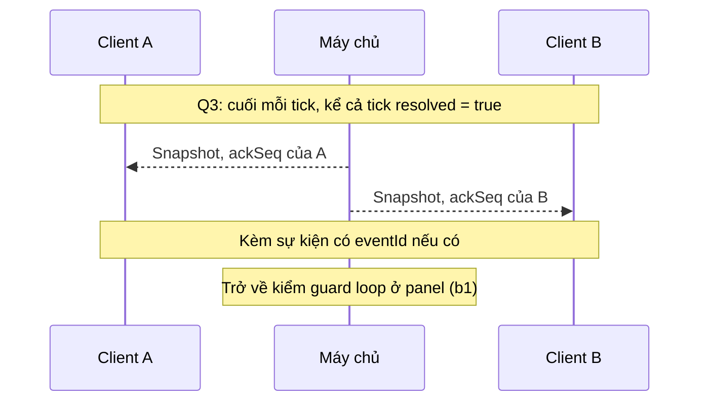

Hình 3.6(c2). Gửi snapshot cho hai client. Nguồn: thiết kế đề xuất của tác giả.

Client A là người ném, Client B là đối thủ. Q1 nối tạo cú ném với vòng tick tại (b1); Q4 khai triển nhánh không Block tại (b2); Q2 khai triển ghi điểm ở (c1); Q3 gửi trạng thái ở (c2) cuối mọi tick, kể cả tick resolved = true, rồi kiểm lại guard loop. Các tham chiếu cùng nằm trong vòng tick, không thêm API hoặc gói tin mới. ackSeq thuộc riêng từng phiên; dữ liệu sai định dạng hoặc sai phiên không làm tiến ackSeq.

Máy chủ quyết định điểm, quyền bóng và kết quả. Thứ tự hết giờ trước ghi điểm giữ từ thiết kế gốc. Block trước qua rổ trong cùng tick vẫn là đề xuất cần xác nhận hoặc thay bằng đối chiếu thời điểm va chạm; việc chia panel không phê duyệt chính sách này.

Hình 3.7 giữ đầy đủ vòng lặp xử lý bóng và nhánh kết thúc. “Trượt đã giải quyết” nghĩa là cú ném không còn khả năng ghi điểm theo quy tắc mô phỏng, không chỉ là bóng chưa đến rổ trong tick hiện tại.

<!-- diagram: 3-7a-nhan-yeu-cau-v06.mmd -->
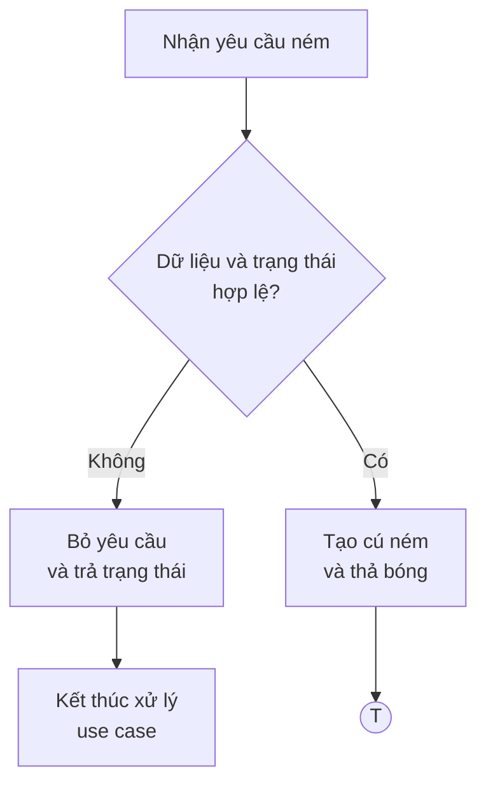

Hình 3.7(a). Tiếp nhận yêu cầu ném. Nguồn: thiết kế đề xuất của tác giả.

<!-- diagram: 3-7b1-thoi-gian-v06.mmd -->
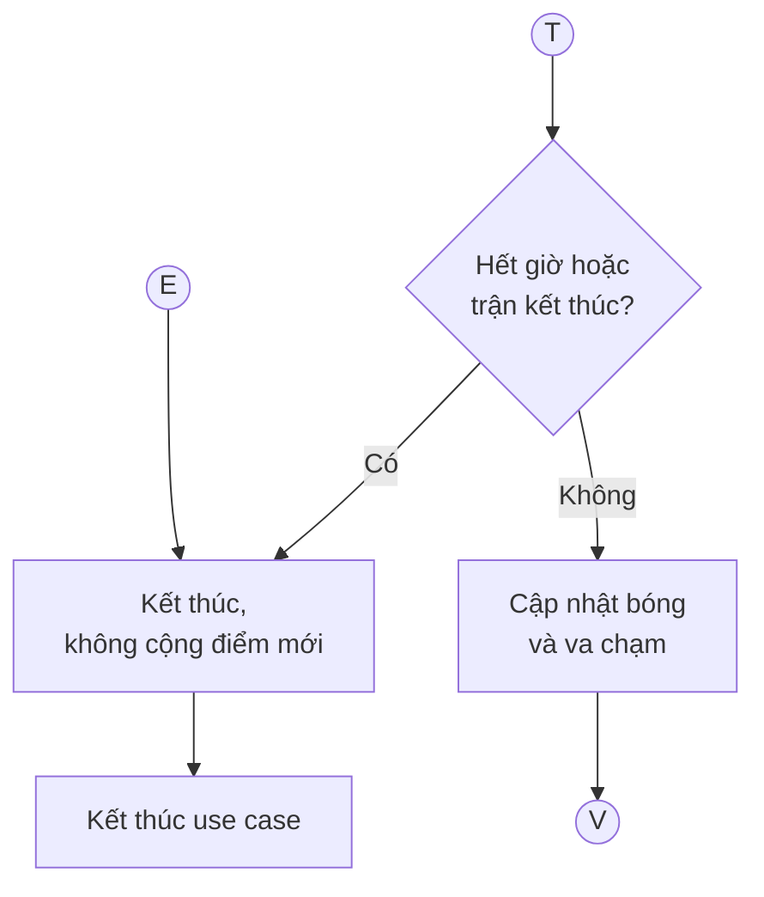

Hình 3.7(b1). Kiểm tra thời gian và cập nhật bóng. Nguồn: thiết kế đề xuất của tác giả.

<!-- diagram: 3-7b2-block-v06.mmd -->
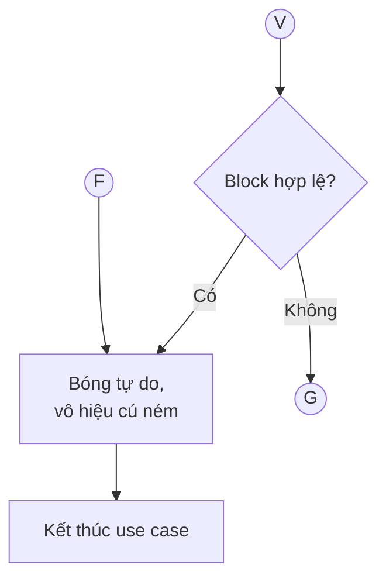

Hình 3.7(b2). Xử lý Block. Nguồn: thiết kế đề xuất của tác giả.

<!-- diagram: 3-7c1-diem-v06.mmd -->
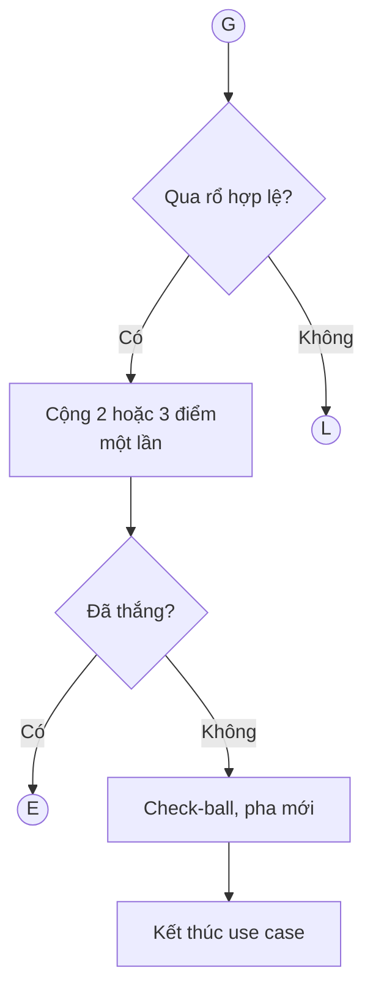

Hình 3.7(c1). Xử lý ghi điểm và chuyển pha. Nguồn: thiết kế đề xuất của tác giả.

Trong panel này, “Qua rổ hợp lệ” giữ điều kiện qua vùng rổ đúng chiều và chưa tính; “Đã thắng” là đạt điều kiện thắng trong thiết kế. Nhãn rút gọn không thay đổi các guard.

<!-- diagram: 3-7c2-truot-v06.mmd -->
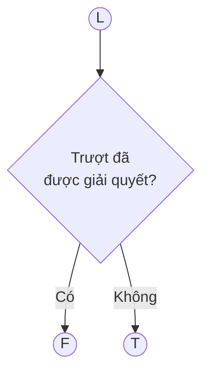

Hình 3.7(c2). Kiểm tra trượt và lặp lại. Nguồn: thiết kế đề xuất của tác giả.

Trong sơ đồ tuần tự, cờ resolved điều khiển việc dừng xử lý cú ném sau hết giờ, Block, ghi điểm hoặc ném trượt. Nhánh ghi điểm thực hiện check-ball khi trận chưa kết thúc. Thứ tự hết giờ trước ghi điểm kế thừa luật đang mô tả; thứ tự Block và bóng qua rổ trong cùng một tick hiện là đề xuất cần xác nhận hoặc thay bằng đối chiếu thời điểm va chạm. Sơ đồ chưa chứng minh tính đúng của phép phân xử này trên sản phẩm.

Các trạng thái logic dự kiến của nhân vật và bóng được mô tả dưới đây để đối chiếu luật với xử lý. Tên trạng thái không phải API đã triển khai; các guard về phạm vi, thời gian và hồi chiêu còn cần thống nhất.

| Đối tượng / trạng thái | Chuyển trạng thái và guard | Ngoại lệ, giới hạn |
|---|---|---|
| Player: đứng yên / di chuyển | Input hướng hợp lệ và trận đang diễn ra; trở về trung tính khi thả thao tác | Input sai/cũ/trùng bị bỏ; mất chạm hoặc xuống nền phải xóa nút giữ |
| Player: nhảy | Yêu cầu JUMP và trạng thái cho phép | Điều kiện tiếp đất, nhảy lại và tham số chưa chốt |
| Player: Dash | Yêu cầu DASH, trạng thái và hồi chiêu hợp lệ | Không nhận ném khi đang Dash; thời gian và hồi chiêu chưa chốt |
| Player: ném | Có bóng, trận còn diễn ra và trạng thái cho phép; giữ rồi thả ACTION | Chỉ tạo cú ném khi máy chủ chấp nhận; không tự cộng điểm |
| Player: Block | ACTION khi phòng thủ; trạng thái, vùng và hồi chiêu hợp lệ | Phạm vi và thời gian hiệu lực chưa chốt |
| Ball: được giữ | holderId xác định người giữ; cú ném hợp lệ chuyển bóng sang đang bay | Không lưu thêm cờ có bóng độc lập gây mâu thuẫn |
| Ball: đang bay | Máy chủ cập nhật; qua vùng rổ hợp lệ, đúng chiều và chưa tính thì cộng điểm một lần | Hết giờ không cộng điểm mới; Block hợp lệ vô hiệu cú ném và chuyển bóng tự do |
| Ball: tự do | Sau cú ném trượt hoặc Block; người chơi có thể tranh bóng | Guard nhận bóng và xử lý tranh chấp đồng thời chưa chốt |
| Ball: sau ghi điểm / kết thúc | Chưa đủ điều kiện thắng thì check-ball; đủ điểm hoặc hết giờ thì kết thúc | Không tạo check-ball chỉ vì rebound/Block; không tiếp tục xử cú ném sau kết thúc |

Đi theo connector cùng nhãn để tiếp tục: T vào kiểm tra thời gian ở (b1), V nối cập nhật bóng với kiểm Block ở (b2), G vào kiểm qua rổ ở (c1), L vào kiểm trượt ở (c2), E đến kết thúc không điểm mới ở (b1), F đến bóng tự do ở (b2). Z là kết thúc xử lý use case, không mặc định kết thúc trận. Nhánh trượt–Không quay về T, bảo toàn vòng cập nhật. Trượt đã giải quyết nghĩa là không còn khả năng ghi điểm theo mô phỏng, không chỉ là chưa tới rổ ở tick này. Thứ tự Block/qua rổ còn chịu giới hạn phân xử cùng tick của thiết kế.

### 3.2.8. Thiết kế cảnh 3D và tài nguyên

Cảnh gồm sân, rổ, hai nhân vật và bóng. Mỗi đối tượng cần thống nhất tỷ lệ, hệ tọa độ và quyền cập nhật transform. Lõi mô phỏng cung cấp trạng thái; lớp hiển thị ánh xạ sang node của Scene. Tài nguyên mô hình, texture, hoạt ảnh và âm thanh phải có nguồn và giấy phép sử dụng rõ ràng.

Cần kiểm chứng đường nạp tài nguyên và clip hoạt ảnh trước khi sử dụng nhân vật hoàn chỉnh. Với cảnh thử ban đầu, hình học cơ bản giúp kiểm tra camera, phép biến đổi và thao tác. Chất lượng hình ảnh và mức độ phức tạp cảnh được điều chỉnh theo kết quả đo trên thiết bị.

### 3.2.9. Truy vết và quyết định còn mở

| Yêu cầu | Thiết kế đối chiếu | Bằng chứng cần có sau triển khai |
|---|---|---|
| F01–F02 | UC01–UC02, UC08, Hình 3.5 | Luồng tạo/vào/sẵn sàng và phòng đầy |
| F03 | UC03–UC05, Hình 3.6–3.7 | Input hợp lệ, sai, trùng và hồi chiêu |
| F04 | ShotState, vòng xử lý điểm | Không cộng lặp; hết giờ; hai client cùng kết quả |
| F05 | Kiến trúc, phiên và heartbeat | Hai mạng thực, timeout, ngắt mạng |
| F06/N02 | Hệ thống màn hình | Thao tác mobile, âm thanh và vùng an toàn |
| N01/N03 | Cấu hình build và phép đo | Phiên bản, thiết bị, log và dữ liệu gốc |

Các quyết định còn mở gồm tham số kỹ năng, phương án vật lý, giao thức, cấu hình mô phỏng, nơi chạy máy chủ và chính sách mất kết nối. Các mô hình hiện mô tả thiết kế dự kiến; chúng sẽ được đối chiếu với mã và kết quả kiểm thử khi có bản dựng.

## 3.3. Hệ thống màn hình

### 3.3.1. Danh sách màn hình và luồng chuyển

Giao diện game Bóng rổ đối kháng 3D được đề xuất theo hướng ngang. Bố cục dự kiến dành vùng giữa cho sân và nhân vật, hai bên cho điều khiển cảm ứng. Bảng dưới mô tả các màn hình cần thiết kế; chúng chưa phải giao diện đã triển khai.

| Mã | Màn hình | Thông tin và thao tác chính | Màn hình tiếp theo |
|---|---|---|---|
| UI01 | Menu chính | Tên game, trạng thái kết nối, tạo phòng, nhập mã phòng, ghép trận nhanh và cài đặt | Tạo/vào phòng hoặc Cài đặt |
| UI02 | Tạo/vào phòng | Mã phòng, ô nhập mã, thông báo mã sai hoặc phòng đầy, nút xác nhận và quay lại | Sảnh chờ hoặc Menu |
| UI03 | Sảnh chờ | Mã phòng, hai vị trí người chơi, trạng thái sẵn sàng, đếm ngược và rời phòng | Trận đấu hoặc Menu |
| UI04 | Trận đấu | Cảnh 3D, người giữ bóng, điểm, thời gian, thông tin mạng, cần di chuyển và ACTION/JUMP/DASH | Kết quả |
| UI05 | Kết quả | Tỷ số, thắng/thua/hòa, lý do kết thúc, trở lại sảnh hoặc Menu | Sảnh chờ hoặc Menu |
| UI06 | Cài đặt | Bật/tắt âm thanh, âm lượng và quay lại | Menu chính trong phương án đầu |

Ghép trận nhanh là chức năng bổ sung sau; khi triển khai cần có trạng thái chờ đối thủ và thao tác hủy. Việc vào đủ phòng không tự bắt đầu trận; hai người phải xác nhận sẵn sàng. Khi trở lại sảnh sau trận, trạng thái sẵn sàng được đặt lại để tránh khởi động trận ngoài ý muốn.

Hình 3.8 mô tả luồng chuyển giữa sáu màn hình, bao gồm bước Tạo/vào phòng trước Sảnh chờ. Sơ đồ luồng không thay thế thiết kế giao diện.

<!-- diagram: 3-8-giao-dien-r1.mmd -->
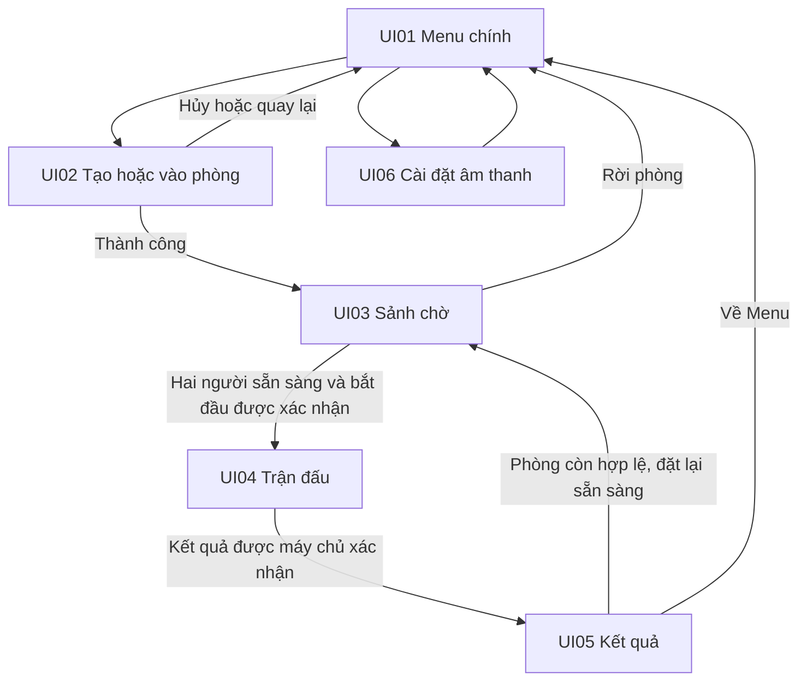

Hình 3.8. Luồng chuyển màn hình dự kiến. Nguồn: thiết kế đề xuất của tác giả.

### 3.3.2. Thiết kế giao diện

Các màn hình sẽ được thiết kế trong phần mềm thiết kế giao diện và lưu tệp nguồn có thể chỉnh sửa. Mỗi màn hình cần có kích thước khung, vị trí thành phần, nội dung nhãn, kiểu chữ và các trạng thái tương tác. Hình xuất để đưa vào luận văn phải tương ứng với một phiên bản của tệp thiết kế. Phần mềm sử dụng chưa được lựa chọn; bản thảo hiện chưa có bộ hình giao diện đáp ứng yêu cầu này.

Đối với màn hình trận đấu, cần bố trí cần di chuyển bên trái và các nút ACTION, JUMP, DASH bên phải. ACTION hiển thị chức năng ném khi người chơi có bóng và Block khi phòng thủ. Thanh canh ném xuất hiện trong lúc giữ ACTION. Điểm và đồng hồ đặt ở vùng dễ quan sát; thông báo kết nối tránh che nhân vật, bóng và các nút điều khiển.

Trong phương án đầu, Cài đặt được mở từ Menu chính; chưa thiết kế lớp phủ cài đặt trong trận online.

Ngoài trạng thái bình thường, bộ thiết kế cần thể hiện nút bị vô hiệu hóa hoặc đang hồi chiêu, chờ kết nối, chờ đối thủ, phòng đầy, mã không hợp lệ và mất kết nối trong trận. Mỗi trạng thái phải có nội dung thông báo và hành động tiếp theo. Không đưa nút tạm dừng vào trận online khi luật không hỗ trợ dừng mô phỏng.

### 3.3.3. Quy tắc cập nhật và phản hồi

Giao diện sảnh chờ cập nhật theo trạng thái phòng do máy chủ gửi. Trong trận, bảng điểm, thời gian và kết quả lấy từ trạng thái đã được máy chủ xác nhận. Máy khách có thể phản hồi thao tác sớm bằng chuyển động hoặc hoạt ảnh, sau đó đối chiếu với dữ liệu nhận được. Nội suy vị trí chỉ ảnh hưởng phần hiển thị.

Âm thanh và hiệu ứng được phát theo sự kiện có mã định danh để tránh lặp khi nhiều snapshot chứa cùng một sự kiện. Cài đặt âm thanh chỉ có tác dụng trên thiết bị hiện tại. Khi tắt âm thanh, điểm số và thông báo vẫn phải thể hiện đầy đủ diễn biến cần thiết.

Khi ứng dụng xuống nền hoặc mất chạm, điều khiển liên tục trở về trung tính. Nếu mạng bị gián đoạn, màn hình hiển thị tình trạng kết nối và hành động được phép theo trạng thái trận. Việc tiếp tục mô phỏng hoặc xử kết quả thuộc quy tắc của máy chủ; giao diện không tự coi trận đã tạm dừng.
