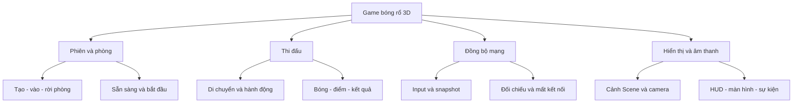
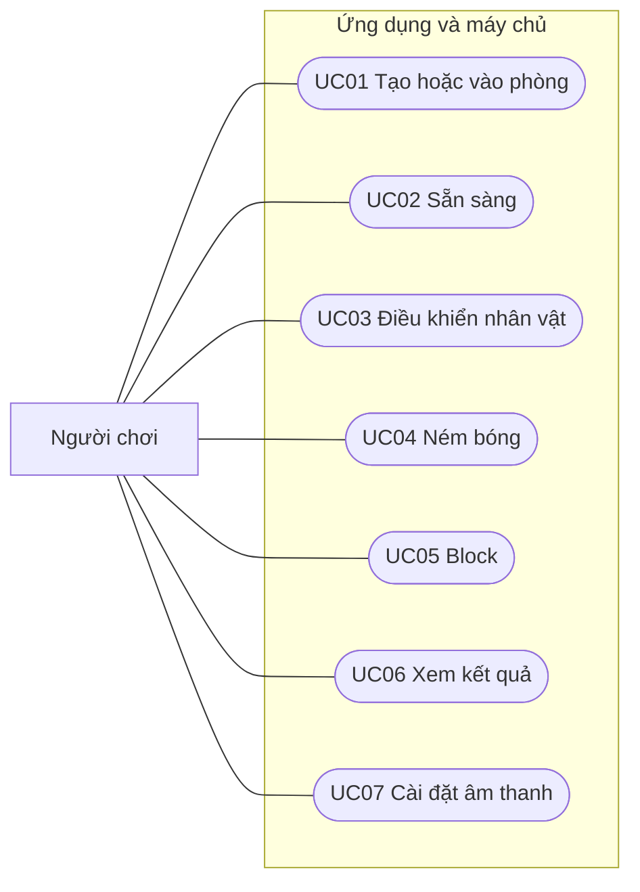
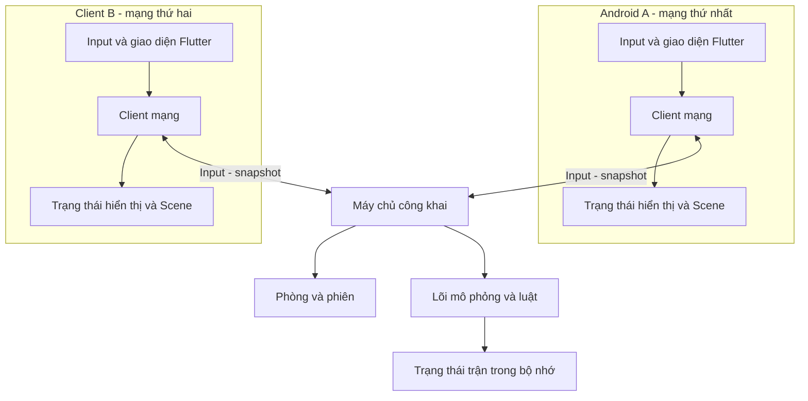
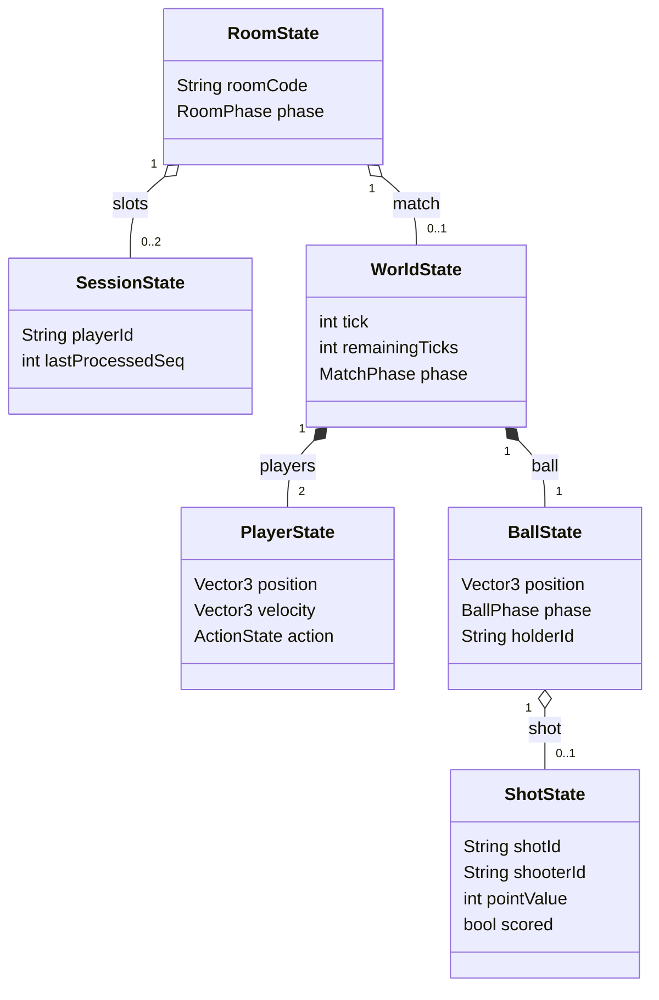
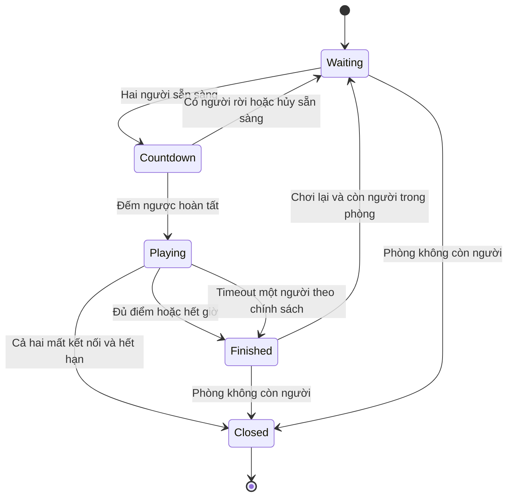
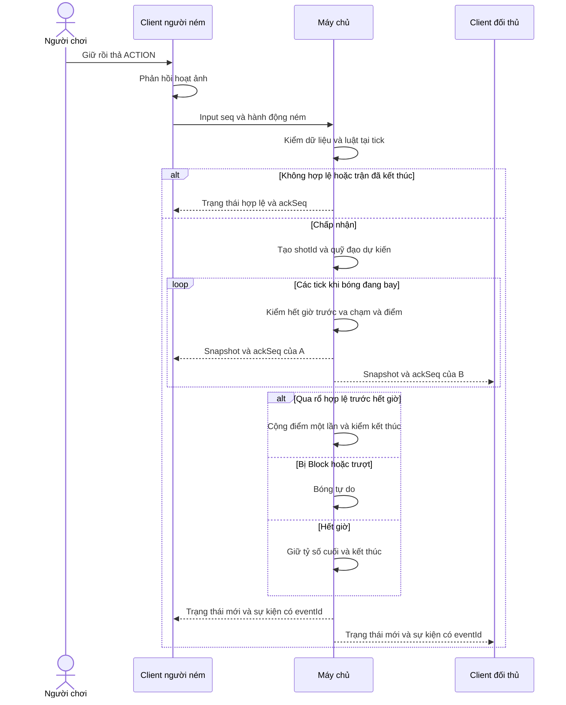
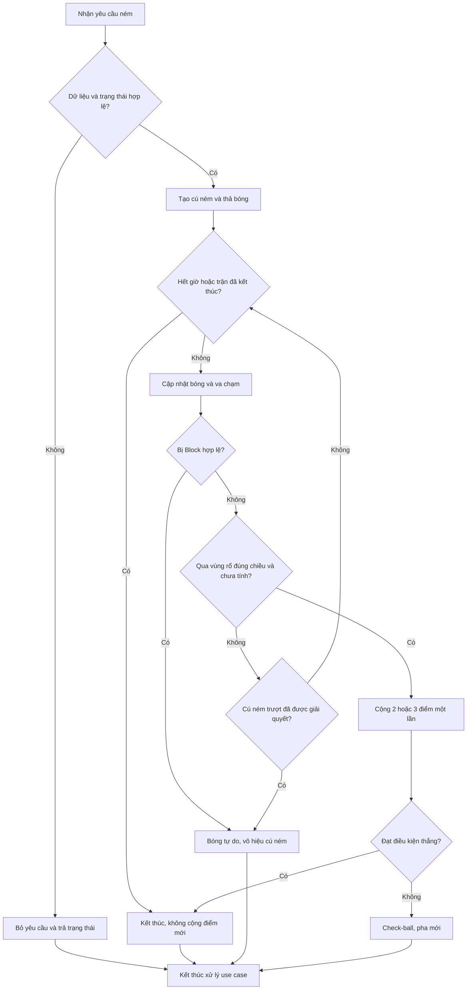
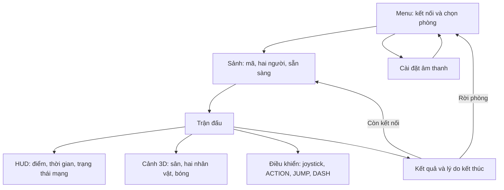
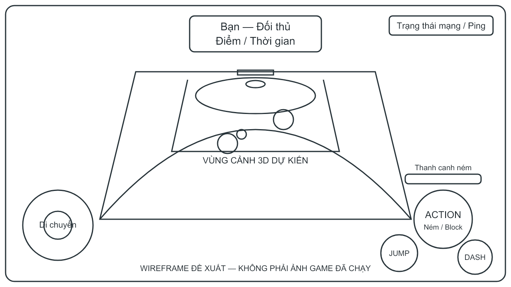

> **BẢN THẢO SƠ BỘ — 04/11/2026.** Bố cục theo điều chỉnh ban đầu của sinh viên, có thể thay đổi. Chương 4–5 chờ sản phẩm. Hướng dẫn chưa thực thi; kiến trúc và hình là đề xuất. Tên game chưa chốt.

# Chương 1. GIỚI THIỆU

> **Trạng thái bản thảo:** sơ bộ ngày 04/11/2026, giữ bốn mục chính của mẫu luận văn. Nội dung trình bày mục tiêu và phương án nghiên cứu; chưa phải báo cáo về sản phẩm đã hoàn thành. Những lựa chọn gameplay, kiến trúc và chỉ tiêu định lượng còn mở sẽ được thống nhất trước khi triển khai.

## 1.1. Đặt vấn đề, mục tiêu luận văn

### 1.1.1. Đặt vấn đề

Game 3D trên mobile cần phối hợp cảnh, kết xuất, nhập liệu, chuyển động, luật và tài nguyên. Khi chơi qua mạng, các thiết bị phải thống nhất diễn biến dù thông điệp đến không đồng thời. Vì vậy, nghiên cứu engine cần xem xét từng thành phần lẫn cách tích hợp trong ứng dụng.

Flutter Scene, được phân phối qua gói `flutter_scene`, là một engine 3D dành cho Flutter. Tài liệu của dự án giới thiệu việc tổ chức đồ thị cảnh, mô hình, vật liệu, ánh sáng, camera và hoạt ảnh trong môi trường Flutter, dựa trên Flutter GPU và Impeller ở các nền tảng native [SCENE-01], [SCENE-02]. Hướng tiếp cận này cho phép nghiên cứu sự kết hợp giữa giao diện Flutter và nội dung 3D trong cùng một ứng dụng Dart. Tuy nhiên, việc một thành phần được giới thiệu trong tài liệu không đồng nghĩa toàn bộ game dự kiến sẽ hoạt động phù hợp trên thiết bị và cấu hình mạng của đề tài.

Đề tài lựa chọn game bóng rổ đối kháng 3D làm tình huống ứng dụng để nghiên cứu Flutter Scene. Không gian sân, nhân vật, quả bóng và rổ giúp minh họa rõ vai trò của hình học, phép biến đổi, camera và chuyển động. Các hành động di chuyển, giữ bóng, ném và tranh bóng tạo điều kiện khảo sát mối liên hệ giữa trạng thái logic với hình ảnh hiển thị. Khi hai người chơi tham gia từ hai thiết bị, bài toán còn mở rộng sang trao đổi thao tác, đồng bộ bóng, cập nhật điểm và kết thúc trận nhất quán.

Luận văn nghiên cứu công nghệ qua một demo có phạm vi kiểm soát được. Các luật giản lược phải được phân biệt với luật thể thao chính thức. Hai người chơi từ hai mạng khác nhau qua Internet là hướng ưu tiên, cần kiểm chứng cùng phương án máy chủ và điều kiện triển khai.

### 1.1.2. Mục tiêu luận văn

Mục tiêu tổng quát là nghiên cứu các thành phần và cách sử dụng Flutter Scene, ứng dụng để thiết kế và xây dựng demo game bóng rổ đối kháng 3D trên Android, từ đó đánh giá mức độ phù hợp của công nghệ đối với phạm vi đã chọn.

Các mục tiêu cụ thể gồm:

- Làm rõ vai trò của Flutter Scene trong hệ thống, quan hệ với Flutter GPU/Impeller và cách tổ chức cảnh 3D.
- Trình bày chức năng, cách phối hợp và hướng dẫn sử dụng từng bước đối với các thành phần cần thiết cho demo.
- Đặc tả gameplay, thao tác, trạng thái và tình huống biên; xây dựng các mô hình thiết kế có thể đối chiếu với yêu cầu.
- Lựa chọn cách xử lý chuyển động, ném bóng và ghi điểm phù hợp với quy mô nghiên cứu; tách trạng thái gameplay khỏi phần trình bày.
- Thiết kế kết nối hai người và cơ chế thống nhất trạng thái; ưu tiên khả năng chơi qua Internet nếu đáp ứng điều kiện kỹ thuật.
- Xây dựng demo, thu thập bằng chứng thực nghiệm và phân tích kết quả theo môi trường thực tế, không khái quát vượt quá phạm vi kiểm tra.

## 1.2. Những thách thức cần giải quyết

Thách thức đầu tiên là trình bày quy trình có thể tái hiện: điều kiện chuẩn bị, thứ tự tạo đối tượng, thiết lập tham số và dấu hiệu kiểm tra. Ví dụ phải ghi rõ phiên bản và trạng thái đã hoặc chưa chạy thử.

Thứ hai, API cần được xem xét theo phiên bản. Đề tài dự kiến cố định Flutter và dependency sau khi xác minh tương thích. Không coi tính năng trong nhánh phát triển hoặc pull request là đã có trong SDK tại máy.

Thứ ba là lựa chọn cách mô phỏng. Backend vật lý 3D và quỹ đạo điều khiển bằng thuật toán đều cần kết hợp luật ném, quyền giữ bóng, va chạm và ghi điểm. Hai hướng được so sánh theo mục tiêu demo, khả năng kiểm thử và công sức tích hợp.

Thứ tư là phân xử thống nhất khi chơi qua mạng. Hệ thống cần kiểm tra thao tác và định danh sự kiện để tránh cộng điểm lặp hoặc tranh chấp quyền giữ bóng. Máy chủ quyết định trạng thái là phương án cần đánh giá cùng điều kiện triển khai Internet.

Thứ năm là cân bằng phản hồi với tính nhất quán. Nội suy hoặc phản hồi sớm không được tự quyết định điểm. Mất kết nối, xuống nền, rời phòng và hành động đến sau kết thúc trận cần quy tắc và ca thử tương ứng.

Cuối cùng là giới hạn thiết bị: hiện có một Redmi Note 11, chưa có Android thứ hai hoặc kết quả chạy game. Client trên máy tính/giả lập hỗ trợ phát triển nhưng không thay bằng chứng thử hai điện thoại. Cần bố trí việc bổ sung thiết bị phù hợp tiến độ.

**Bảng 1-1. Thách thức và hướng xử lý dự kiến**

| Nhóm | Hướng xử lý | Bằng chứng cần bổ sung |
|---|---|---|
| Thành phần Scene | Giải thích vai trò, trình tự sử dụng và ví dụ nhỏ | Nguồn chính thức, cấu hình, ảnh hoặc log khi chạy |
| Tương thích phiên bản | Ghi nhận môi trường và cố định dependency phù hợp | Phiên bản, lockfile, hướng dẫn tái lập |
| Ném và va chạm | So sánh mô phỏng vật lý với quỹ đạo điều khiển | Đặc tả, tình huống biên, kết quả thử |
| Đồng bộ mạng | Xác định quyền phân xử và dữ liệu trao đổi | Thiết kế thông điệp, log và trạng thái hai phía |
| Thiết bị di động | Giảm độ phức tạp cảnh theo kết quả đo | Thiết bị/OS, chế độ build, dữ liệu hiệu năng |
| Phạm vi và tiến độ | Hoàn thiện bản thảo nghiên cứu, cập nhật theo sản phẩm | Bản thảo có nguồn, quyết định thiết kế, bằng chứng thực tế |

## 1.3. Nội dung, phạm vi thực hiện

### 1.3.1. Nội dung thực hiện

Phần nghiên cứu trình bày đồ thị cảnh, hệ tọa độ, phép biến đổi, hình học, vật liệu, ánh sáng, camera, tài nguyên và hoạt ảnh: tác dụng, cách dùng, giới hạn và thực hành từng bước. Lý thuyết mô phỏng và đồng bộ mạng phục vụ giải thích các quyết định thiết kế.

Phần ứng dụng mô tả game, phân tích yêu cầu và xây dựng mô hình chức năng, use case, dữ liệu, lớp, tuần tự, hoạt động và giao diện. Các sơ đồ hiện là thiết kế dự kiến, cần đối chiếu với code sau triển khai; tránh lặp cùng thông tin ở nhiều hình.

Quá trình xây dựng dự kiến đi từ cảnh nhỏ và thao tác đơn giản đến một vòng chơi hoàn chỉnh. Cơ chế ném, tính điểm và kết thúc trận được kiểm tra trước khi bổ sung kỹ năng hoặc hiệu ứng. Kết nối hai người được đánh giá riêng rồi tích hợp với gameplay. Chương kiểm thử và kết luận chỉ được hoàn thiện khi có sản phẩm, môi trường và bằng chứng tương ứng.

### 1.3.2. Phạm vi thực hiện

Phạm vi đã xác nhận gồm Android, nội dung bóng rổ đối kháng 3D, hai người trên hai thiết bị qua mạng và sử dụng Flutter Scene làm công nghệ nghiên cứu. Hướng ưu tiên là kết nối qua Internet giữa hai mạng khác nhau. Trường hợp phải thu hẹp khả năng kết nối cần được trình bày cùng lý do và thống nhất lại, không tự coi kết nối cùng Wi-Fi là đã đáp ứng mục tiêu Internet.

Phạm vi gameplay làm cơ sở thiết kế được đề xuất ở mức một sân, hai nhân vật, một bóng và các thao tác thiết yếu để thi đấu. Nửa sân, một rổ, quy tắc 2/3 điểm, giới hạn điểm/thời gian, Dash/Jump/Block, ghép trận nhanh và phòng bằng mã là các phương án từ bản nháp tham khảo; chưa phải toàn bộ yêu cầu đã được duyệt. Chúng chỉ trở thành phạm vi triển khai khi đã đánh giá tính khả thi và thống nhất trong thiết kế.

Đề tài không đặt mục tiêu xây dựng nền tảng phát hành game thương mại, hệ thống kinh tế vật phẩm hoặc giải đấu quy mô lớn. Các chức năng bổ sung như tài khoản, bảng xếp hạng và chống gian lận nâng cao chỉ được xem xét nếu cần cho phạm vi được thống nhất. Không mặc định sử dụng cơ sở dữ liệu quan hệ khi dữ liệu của demo chỉ cần tồn tại trong phiên chơi; quyết định lưu trữ phải xuất phát từ yêu cầu thực tế.

## 1.4. Kết quả cần đạt và tiêu chí đánh giá

Kết quả nghiên cứu được đánh giá bằng mức độ giải thích và khả năng truy vết, còn kết quả sản phẩm được đánh giá bằng hành vi quan sát được và dữ liệu kiểm tra. Việc mô tả một cơ chế trong thiết kế không thay thế bằng chứng cơ chế đó đã được triển khai. Tương tự, thông tin hỗ trợ nền tảng trong tài liệu không chứng minh hiệu năng trên Redmi Note 11.

**Bảng 1-2. Kết quả cần đạt và tiêu chí đánh giá dự kiến**

| Kết quả | Tiêu chí đối chiếu | Cách đánh giá |
|---|---|---|
| Báo cáo nghiên cứu Flutter Scene | Nêu thành phần, tác dụng, cách dùng và giới hạn; có nguồn đúng ngữ cảnh | Rà soát Chương 2 và tài liệu tham khảo |
| Hướng dẫn thực hành | Các bước có đầu vào, thao tác và dấu hiệu kiểm tra; ghi rõ phiên bản và trạng thái thực nghiệm | Đối chiếu hướng dẫn với môi trường khi chạy thử |
| Mô tả và thiết kế game | Yêu cầu, luật, use case, dữ liệu, xử lý và giao diện nhất quán | Ma trận yêu cầu–thiết kế và rà soát sơ đồ |
| Cảnh 3D và điều khiển | Hiển thị và thao tác đúng phạm vi đã chốt trên thiết bị đích | Build, quan sát và lưu ảnh/log thực tế |
| Vòng chơi hai người | Hai client tham gia cùng trận, thống nhất bóng, điểm và kết quả | Thử luồng hoàn chỉnh, đối chiếu sự kiện hai phía |
| Kết nối Internet | Kiểm chứng từ hai mạng khác nhau khi điều kiện triển khai cho phép | Ghi mô hình mạng, môi trường và cách tái hiện |
| Luật và tình huống biên | Không tính điểm lặp; xử lý hành động sai, hết giờ và mất kết nối theo đặc tả | Ca thử logic và tích hợp |
| Hiệu năng, ổn định | Chỉ kết luận theo thiết bị, chế độ build và ngưỡng đã thống nhất | Thu dữ liệu đo gốc và báo cáo giới hạn |

Các giá trị như FPS mục tiêu, độ trễ chấp nhận, số trận lặp và thời lượng đo sẽ được chốt sau khi xác định môi trường và phạm vi sản phẩm. Những con số trong bản nháp cũ chỉ là đầu vào tham khảo, không được đưa thành kết quả đạt. Nếu chưa có đủ thiết bị hoặc chưa hoàn thành một phép thử, báo cáo phải ghi rõ phần chưa kiểm chứng.

Trong giai đoạn hiện tại, ưu tiên là hoàn thành sơ bộ Chương 1–3 trước đợt giữa kỳ, bảo đảm nội dung có nguồn và các quyết định còn mở được nhận diện. Sau khi có demo, các mô tả thiết kế sẽ được cập nhật theo sản phẩm; Chương 4 trình bày kiểm thử thực tế và Chương 5 kết luận trên những kết quả đã thu thập.

### Nguồn dẫn trong bản thảo Chương 1

- **[SCENE-01]** Flutter Scene, *Welcome to Scene*, https://fscene.dev/getting-started/ . Nguồn đã được nhóm đọc ngày 03/11/2026; hỗ trợ nhận diện engine và các thành phần, không chứng minh kết quả demo.
- **[SCENE-02]** Flutter Scene, *Installation*, https://fscene.dev/getting-started/installation/ . Nguồn đã được nhóm đọc ngày 03/11/2026; hỗ trợ mô tả nền tảng và điều kiện cấu hình. Cần đối chiếu lại khi chọn phiên bản triển khai.

Các mã nguồn trên là định danh nội bộ để tích hợp vào danh mục tài liệu tham khảo thống nhất; không phải xác nhận đã áp dụng một chuẩn trích dẫn cuối cùng.


---

# CHƯƠNG 2. CƠ SỞ LÝ THUYẾT

> Bản thảo nghiên cứu sơ bộ, cập nhật ngày 04/11/2026. API được đối chiếu với tài liệu chính thức đang công bố; các lệnh, đoạn mã và quy trình dưới đây chưa được thực thi trong dự án. Những khác biệt giữa tài liệu, phiên bản gói và thiết bị sẽ được kiểm chứng khi xây dựng sản phẩm. Danh mục nguồn ở cuối chương và `research/ch02-sources.md`.

## 2.1. Tổng quan Flutter Scene và nền tảng Flutter GPU/Impeller

Flutter Scene là bộ công cụ xây dựng nội dung ba chiều trong ứng dụng Flutter. Thay vì chỉ mô tả các thành phần giao diện hai chiều, lập trình viên tổ chức đối tượng trong một không gian có vị trí, hướng, kích thước và góc quan sát. Cảnh ba chiều sau khi kết xuất vẫn tham gia bố cục ứng dụng thông qua widget, nên màn hình có thể kết hợp vùng hiển thị thế giới 3D với nút bấm, thông báo và bảng thông tin Flutter.

Trong kiến trúc này, cần phân biệt ba lớp trách nhiệm. Flutter quản lý ứng dụng và giao diện. Flutter GPU cung cấp khả năng sử dụng tài nguyên và lệnh đồ họa ở mức thấp. Scene tổ chức những khái niệm thuận tiện hơn như cảnh, đối tượng, lưới, vật liệu và camera. Trên nền tảng native, tài liệu Scene xác định Flutter GPU và Impeller là nền tảng kết xuất; trên web sử dụng backend riêng. Vì vậy, mã điều khiển game không cần tự xây dựng toàn bộ đường ống đồ họa, nhưng vẫn phải quan tâm giới hạn tài nguyên và tương thích thiết bị. [LT01, LT02]

Quy trình tìm hiểu gồm: xác định phiên bản Flutter yêu cầu; chọn phiên bản Scene; đọc API tương ứng; dựng ví dụ nhỏ; sau đó mới bổ sung tài nguyên phức tạp. Hướng dẫn hiện yêu cầu Flutter 3.47 stable trở lên và bật Flutter GPU cho Android. Phiên bản Flutter cục bộ đã ghi nhận là 3.47.8, nhưng con số này chỉ chứng minh điều kiện phiên bản ban đầu, không chứng minh ứng dụng đã chạy trên Redmi Note 11. Scene còn trước phiên bản 1.0, nên phải lưu phiên bản dependency, lockfile và thay đổi API liên quan. [LT01]

## 2.2. Đồ thị cảnh, node, hệ tọa độ và phép biến đổi

### 2.2.1. Scene và Node

`Scene` là đối tượng quản lý cảnh. Bên dưới cảnh là cây các `Node`; một node có thể chứa phần hiển thị, node con và hành vi. Cách tổ chức phân cấp giúp biểu diễn những quan hệ như vật thể được gắn vào tay nhân vật hoặc camera đi theo một điểm điều khiển. Di chuyển node cha làm thay đổi vị trí thế giới của các node con mà không cần cập nhật từng đối tượng riêng. [LT03, LT04]

Vị trí cục bộ được hiểu theo hệ tọa độ của cha, còn vị trí thế giới được hiểu theo toàn cảnh. Với một node con, ma trận biến đổi thế giới được tính từ ma trận thế giới của cha nhân với ma trận cục bộ. Do phép nhân ma trận không giao hoán, thay đổi thứ tự tịnh tiến, xoay và co giãn có thể tạo kết quả khác nhau. Khi nhập tài nguyên từ phần mềm dựng hình, cần thống nhất chiều cao, hướng nhìn và tỷ lệ thay vì sửa bằng nhiều phép xoay rời rạc không có quy ước.

### 2.2.2. Cách sử dụng từng bước

1. Tạo một `Scene` và node đại diện cho đối tượng.
2. Gắn hình học, vật liệu hoặc hành vi cần thiết vào node.
3. Gắn node vào cảnh bằng `scene.add`, hoặc vào node cha bằng `node.add`.
4. Gán vị trí, góc xoay và tỷ lệ theo hệ tọa độ đã chọn.
5. Quan sát riêng từng phép biến đổi trước khi ghép thành một phân cấp phức tạp.

Tài liệu cung cấp thuộc tính `position`, `rotation`, `scale` và `localTransform`. Các getter biến đổi có thể trả về bản sao; sửa trực tiếp một thành phần trên giá trị trả về không nhất thiết sửa node. Cách an toàn theo ví dụ tài liệu là tạo giá trị mới rồi gán trở lại, chẳng hạn `node.position = vm.Vector3(0, 1, 0)`. Với hành vi liên tục, nên gom cập nhật vào một nơi, tránh widget và logic mô phỏng đồng thời ghi cùng thuộc tính. [LT02, LT04]

### 2.2.3. Component và quyền sở hữu

`Component` đóng gói hành vi gắn với node. Vòng đời được tài liệu mô tả gồm gắn thành phần, nạp bất đồng bộ, tham gia cảnh, cập nhật và rời cảnh. Việc gom chuyển động hoặc tương tác vào component giúp giảm mã cập nhật phân tán. Scene hỗ trợ cả khai báo cấu trúc bằng widget và thao tác cây cảnh trực tiếp. Hai cách cùng sử dụng đối tượng bên dưới, nhưng phải rõ bên nào sở hữu cấu trúc và thuộc tính: một giá trị do widget khai báo có thể được áp dụng lại khi widget rebuild. [LT03]

## 2.3. Hình học, mesh và vật liệu

### 2.3.1. Vai trò từng thành phần

Hình học mô tả hình dạng thông qua đỉnh, chỉ số nối đỉnh và các thuộc tính phục vụ tô bóng. Vật liệu mô tả phản ứng của bề mặt với ánh sáng. `Mesh` ghép hình học với vật liệu để tạo phần có thể được kết xuất. Một khối cầu giống nhau có thể được biểu diễn như nhựa, kim loại hoặc bề mặt màu phẳng khi thay vật liệu; ngược lại, cùng một vật liệu có thể dùng cho nhiều hình dạng. [LT03, LT05]

Scene cung cấp hình học cơ bản, phù hợp để học API và tạo nguyên mẫu. Ưu điểm của nguyên mẫu từ các khối là không phụ thuộc quy trình nhập mô hình và dễ nhận biết lỗi tỷ lệ. Tuy nhiên, số node và lưới vẫn cần kiểm soát; chia một vật thể đơn giản thành quá nhiều đối tượng độc lập có thể làm tăng chi phí quản lý và vẽ.

### 2.3.2. Vật liệu PBR và vật liệu không chiếu sáng

`PhysicallyBasedMaterial` sử dụng những tham số như màu cơ sở, độ kim loại và độ nhám. Độ kim loại ảnh hưởng cách phản xạ, còn độ nhám điều chỉnh độ sắc của phản chiếu. Không nên xem tăng độ sáng màu cơ sở là cách thay thế ánh sáng, vì hai thao tác giải quyết hai vấn đề khác nhau. `UnlitMaterial` hiển thị bề mặt không phụ thuộc hệ chiếu sáng, thuận tiện cho đánh dấu, kiểm tra hình học hoặc phong cách giản lược. [LT05]

Để sử dụng, trước hết chọn hình học; tiếp theo tạo vật liệu, điều chỉnh một nhóm tham số và ghép thành mesh; cuối cùng gắn mesh vào node. Nên thay một tham số mỗi lần để nhận biết tác động. Khi dùng texture, phải kiểm tra đường dẫn, tọa độ UV, độ phân giải và thông tin màu của tài nguyên. Tài liệu phân biệt texture màu cơ sở, normal, metallic–roughness và các kênh khác; chúng không thể thay thế tùy ý cho nhau. Vật liệu và hình học gắn với tài nguyên GPU nên cần tái sử dụng, tránh tạo lại liên tục trong mỗi khung hình. [LT03, LT05]

## 2.4. Camera và ánh sáng

### 2.4.1. Camera

Camera quyết định vùng thế giới được chiếu lên màn hình. Phép chiếu phối cảnh làm vật ở xa có kích thước biểu kiến nhỏ hơn vật ở gần, hỗ trợ nhận biết chiều sâu. Các tham số quan trọng gồm vị trí, điểm nhìn, hướng lên, góc nhìn và mặt phẳng cắt. Mặt phẳng gần hoặc xa đặt không hợp lý có thể cắt mất vật thể hoặc làm việc phân biệt độ sâu kém hiệu quả. [LT06]

Quy trình thiết lập bắt đầu bằng một camera cố định nhìn vào gốc tọa độ. Sau khi xác nhận đối tượng hiển thị đúng, mới thay đổi độ cao, khoảng cách và góc nhìn. Trong Scene, có thể truyền `PerspectiveCamera` trực tiếp vào `SceneView`, hoặc dùng `cameraBuilder` để tạo góc quan sát thay đổi theo thời gian. Với camera thuộc phân cấp cảnh, tài liệu giới thiệu `CameraComponent` và camera chính của scene. Chọn cách nào phụ thuộc việc camera chỉ quan sát cố định hay cần gắn vào cấu trúc chuyển động. [LT06]

### 2.4.2. Ánh sáng và môi trường

Ánh sáng giúp người quan sát nhận biết hình khối, vật liệu và độ cao. Chiếu sáng dựa trên ảnh môi trường mô phỏng ánh sáng tới từ nhiều hướng; nguồn sáng có hướng bổ sung đặc tính như mặt trời và bóng đổ. Skybox là phần nền nhìn thấy, không đồng nhất với nguồn chiếu sáng. Chỉ đổi nền chưa chắc làm đối tượng sáng lên, và đổi môi trường chiếu sáng cũng không tự bảo đảm nền tương ứng được vẽ. [LT07]

Tài liệu Scene mô tả môi trường mặc định cho cảnh mới, giúp bắt đầu với vật liệu PBR mà chưa phải dựng hệ đèn riêng. Quy trình học nên giữ môi trường mặc định, xác nhận vật liệu, rồi mới thử panorama hoặc đèn có hướng. Nếu thêm bóng đổ, cần so sánh cả hình ảnh lẫn thời gian khung hình. Hậu xử lý, phơi sáng và tone mapping là những bước điều chỉnh đầu ra; không nên bật hàng loạt hiệu ứng trước khi có một cấu hình cơ sở để đối chiếu. [LT07]

## 2.5. Tài nguyên, mô hình và hoạt ảnh

### 2.5.1. Nạp mô hình

Một mô hình có thể chứa phân cấp node, lưới, vật liệu, texture và hoạt ảnh. Định dạng glTF/GLB giúp trao đổi những dữ liệu này, nhưng việc một engine hỗ trợ định dạng không đồng nghĩa hỗ trợ mọi extension hoặc mọi cấu hình xuất. Cần kiểm tra bằng mô hình nhỏ trước, ghi công cụ xuất, tỷ lệ, giấy phép và những tính năng đã dùng. [LT08]

Scene có hai đường nạp chính. `Node.fromGlbAsset` nạp GLB trong asset bundle tại runtime; sau khi hoàn tất, node được thêm vào cảnh. Đường còn lại chuyển tài nguyên khi build rồi dùng `loadScene` theo đường dẫn nguồn. Tiền xử lý giúp chuyển công việc khỏi thời điểm mở cảnh, nhưng đầu ra phụ thuộc quy trình build và phải được quản lý cùng nguồn tài nguyên. [LT08]

Các bước sử dụng gồm: chuẩn bị mô hình có quyền sử dụng; khai báo hoặc đưa vào pipeline phù hợp; nạp bất đồng bộ; hiển thị trạng thái chờ hoặc lỗi; đặt tỷ lệ và vị trí; cuối cùng kiểm tra hình ảnh trên thiết bị. Không nên bỏ qua trạng thái lỗi rồi xem mô hình không hiển thị như một lỗi camera. Khi tài nguyên lớn, thời gian nạp, bộ nhớ và khung hình đầu đều là các khía cạnh cần ghi nhận riêng. [LT08]

### 2.5.2. Hoạt ảnh

Hoạt ảnh mô tả sự thay đổi theo thời gian của tư thế hoặc thuộc tính mô hình. Clip phát lại là đối tượng có trạng thái riêng: thời gian phát, lặp, dừng, tốc độ và trọng số hòa trộn. Tài liệu Scene cho phép duyệt `parsedAnimations`, tìm animation theo tên và tạo clip bằng `createAnimationClip`. Engine cập nhật clip đang phát, nên không được vừa để engine điều khiển vừa tự tăng thời gian của cùng clip mà không có chủ đích. [LT09]

Quy trình hợp lý là liệt kê tên clip, thử một clip, kiểm tra lặp và sau đó thử chuyển trạng thái. Hòa trộn giúp giảm thay đổi tư thế đột ngột, nhưng phải bảo đảm các clip được tác giả tạo cho cùng cấu trúc xương. Một hoạt ảnh ném bóng chỉ mô tả hình ảnh; thời điểm bóng rời tay, quyền giữ bóng và kết quả cú ném vẫn thuộc logic game. Không dùng việc một clip đã chạy xong làm bằng chứng bóng hợp lệ vào rổ.

## 2.6. Vòng lặp, nhập liệu và tích hợp giao diện Flutter

### 2.6.1. Cập nhật và hiển thị

Game cần nhận thao tác, cập nhật trạng thái và vẽ trạng thái đó. Thời gian khung hình không cố định, nên chuyển động dựa trên cộng một lượng vị trí mỗi frame sẽ phụ thuộc tốc độ máy. Cần sử dụng thời gian đã trôi qua hoặc một bước mô phỏng cố định phù hợp. Tài liệu Scene mô tả `update` theo frame và `fixedUpdate` theo bước vật lý. Việc chọn đồng hồ nào phải gắn với loại hành vi: hiệu ứng thị giác có thể theo frame, còn mô phỏng cần quy tắc tiến thời gian rõ ràng. [LT03]

`SceneView` quản lý vòng kết xuất khi dùng widget. Nếu lập trình viên tự quản lý render loop, trách nhiệm tiến cảnh phải được xác định riêng. Không gọi thêm cập nhật thủ công chỉ vì một ví dụ sử dụng `CustomPainter` có làm như vậy; trộn hai cách có thể tiến mô phỏng hai lần. Đây là điểm cần kiểm tra khi chuyển ví dụ tài liệu thành cấu trúc ứng dụng. [LT03, LT11]

### 2.6.2. Nhập liệu và giao diện

Thao tác cảm ứng ban đầu là tọa độ trên widget. Muốn chọn đối tượng trong cảnh, phải chuyển điểm chạm thành tia trong không gian rồi kiểm tra giao cắt. Tài liệu hướng dẫn dùng `screenPointToRay` của camera và `scene.raycast`; kết quả chứa node và thông tin điểm chạm. Kích thước dùng chuyển đổi phải là kích thước vùng SceneView, không mặc định là toàn bộ màn hình. [LT10]

Đối với điều khiển nhân vật, lớp nhập liệu nên biến cử chỉ thành lệnh có ý nghĩa, thay vì sửa trực tiếp điểm số hay vị trí từ mọi callback. Có thể bố trí HUD Flutter trên vùng kết xuất bằng cơ chế bố cục thông thường. Cần tách tần suất cập nhật HUD với chuyển động 3D để hạn chế rebuild không cần thiết. Khi mất chạm, ứng dụng vào nền hoặc người chơi mở màn hình khác, trạng thái nút giữ cần được xóa theo quy tắc, tránh hành động tiếp tục ngoài ý muốn. Những quy tắc này thuộc thiết kế ứng dụng, không phải tính năng tự động được bảo đảm bởi engine.

## 2.7. Chuyển động, va chạm và tính điểm

### 2.7.1. Vật thể và thế giới vật lý

Vật thể đồ họa và vật thể va chạm có vai trò khác nhau. Mesh phục vụ hiển thị, collider phục vụ phát hiện hoặc giải quyết tiếp xúc. Rigid body lưu cách vật thể tham gia mô phỏng, chẳng hạn đứng yên hoặc chuyển động dưới tác động vật lý. Collider đơn giản có thể gần đúng hình dạng phức tạp để giảm chi phí, nhưng độ gần đúng phải đủ cho tương tác cần mô phỏng.

`flutter_scene_rapier` triển khai hợp đồng vật lý của hệ sinh thái Scene thông qua Rapier; tài liệu mô tả rigid body, collider, joint, truy vấn và sự kiện. Quy trình bắt đầu bằng khởi tạo backend, gắn `PhysicsWorld` vào gốc cảnh, tạo body rồi collider cho node, thiết lập trọng lực và theo dõi sự kiện. Không nên đồng thời gán transform đồ họa theo một logic độc lập và yêu cầu rigid body động điều khiển cùng đối tượng. [LT11]

### 2.7.2. Trình tự nghiên cứu chuyển động

Để kiểm chứng một quả bóng, trước hết dùng mặt sàn và hình cầu đơn giản; kiểm tra rơi, chạm sàn và độ nảy; tiếp theo thêm bảng hoặc vật cản; cuối cùng mới xét vùng rổ. Bóng chuyển động nhanh có thể đi qua vùng hẹp giữa hai bước mô phỏng, nên cần kiểm tra kích thước collider, bước thời gian và giải pháp liên tục mà backend thực sự hỗ trợ. Không khẳng định API chống xuyên vật thể sẵn có khi chưa đối chiếu phiên bản.

Phát hiện va chạm chưa đủ để tính điểm. Logic cần phân biệt bóng chạm vành với bóng đi qua vùng hợp lệ, hướng đi, trạng thái cú ném và việc đã cộng điểm. Đây là ví dụ của sự phân chia giữa dịch vụ engine và quy tắc nghiệp vụ game. Với game arcade, quỹ đạo có thể được điều khiển theo công thức; với mô phỏng động lực học, vận tốc và tiếp xúc tác động liên tục. Hai cách cần được so sánh theo mục tiêu nghiên cứu, không tự coi là tương đương hoặc bảo đảm tất định giữa các máy.

## 2.8. Kết nối và đồng bộ game thời gian thực

Mạng truyền thông điệp giữa các tiến trình; engine kết xuất không tự giải quyết toàn bộ luật phiên chơi. Cần xác định nơi quyết định trạng thái, nơi gửi thao tác và cách xử lý khi thông điệp đến muộn. Mô hình máy chủ quyết định trạng thái giúp tập trung việc kiểm tra luật; máy khách có thể làm mượt hiển thị, nhưng kết quả cuối vẫn phải theo nguồn được giao quyền. Đây là nguyên tắc thiết kế của một giải pháp, chưa phải kiến trúc đã triển khai của đề tài.

Tài liệu `flutter_scene_net` mô tả việc gắn replica với node, tạo hoặc xóa node theo trạng thái máy chủ và nội suy transform. Nội suy hiển thị vị trí ở một thời điểm trước hiện tại để giảm giật do nhịp nhận không đều; đổi lại có độ trễ hình ảnh. Nó không tự quyết định quyền sở hữu bóng, điểm hay điều kiện thắng. `SceneHost` hỗ trợ listener WebSocket trong ứng dụng native, nhưng việc host chạy trên điện thoại không đồng nghĩa điện thoại ở mạng khác sẽ kết nối được. [LT12]

Đối với Internet, cần một điểm kết nối có thể tiếp cận, hoặc cơ chế chuyển tiếp phù hợp. NAT, firewall, chứng chỉ, địa chỉ máy chủ, vòng đời ứng dụng và bảo vệ dữ liệu đầu vào là những phần cần đánh giá riêng. Hiện chỉ có một điện thoại, nên một client trên máy tính hỗ trợ thử trao đổi thông điệp; kết quả đó không thay thế kiểm chứng hai Android từ hai mạng khác nhau.

Quy trình nghiên cứu gồm: thử kết nối và ngắt kết nối; truyền một trạng thái nhỏ; gắn mã phiên và số thứ tự; đồng bộ một đối tượng; sau đó mới thêm nội suy, lệnh game và xử lý ngoại lệ. Độ trễ khứ hồi khác độ trễ từ thao tác tới hiển thị, nên báo cáo phải nêu cách đo. Không lấy timestamp của hai máy trừ trực tiếp khi chưa giải quyết sai lệch đồng hồ. Các thông số tick, snapshot và bộ đệm là tham số cần thử, không có một giá trị tối ưu mặc định cho mọi thiết bị.

## 2.9. Hướng dẫn từng bước dựng cảnh mẫu và tích hợp các thành phần

Quy trình dưới đây là hướng dẫn để thực hiện sau, chưa phải biên bản chạy thành công. Nên dùng một project thử riêng để lỗi API không ảnh hưởng nội dung luận văn hoặc mã demo chính.

**Bước 1 — ghi môi trường.** Thu thập `flutter --version`, `flutter doctor -v` và `flutter devices`. Ghi model, Android và chế độ build của điện thoại khi có kết nối. Không đưa số định danh hoặc dữ liệu cá nhân vào báo cáo công khai.

**Bước 2 — tạo ứng dụng mẫu.** Tạo Flutter project với Android, thêm dependency `flutter_scene` theo phiên bản được chọn và lưu lockfile. Lệnh tài liệu là `flutter pub add flutter_scene`; với nghiên cứu cần ghi lại phiên bản resolve thay vì chỉ nói dùng bản mới nhất. Không nâng SDK giữa quá trình đo nếu chưa ghi nhận thay đổi. [LT01]

**Bước 3 — bật GPU.** Theo hướng dẫn hiện hành, Android có thể bật Flutter GPU qua metadata `io.flutter.embedding.android.EnableFlutterGPU` bên trong `application` của manifest; khi phát triển có cờ `--enable-flutter-gpu`. Kiểm tra đúng cú pháp tài liệu và phiên bản trước khi chạy. [LT01]

**Bước 4 — dựng hình học.** Tạo `Scene`, chờ tài nguyên engine cần thiết sẵn sàng, tạo một mesh từ hình học đơn giản và vật liệu, thêm node rồi hiển thị bằng `SceneView`. Khởi đầu chỉ với một đối tượng giúp phân biệt lỗi khởi tạo, camera và vật liệu. Dưới đây là mã giả tổ chức công việc, không phải API Dart có thể chạy trực tiếp:

```text
khởi tạo scene và tài nguyên dùng chung
tạo geometry → material → mesh → node
đặt node gần gốc tọa độ và thêm vào scene
tạo camera nhìn vào node
hiển thị SceneView cùng vùng thông báo trạng thái
```

**Bước 5 — thử biến đổi và quan sát.** Thay đổi vị trí theo từng trục; thêm một node con và di chuyển node cha; điều chỉnh camera. Kiểm tra vật thể bị cắt, nằm sau camera hoặc bị che trước khi kết luận không render. Sau đó thêm component chuyển động sử dụng thời gian trôi qua. [LT04, LT06]

**Bước 6 — thử vật liệu và ánh sáng.** So sánh một vật liệu màu phẳng với PBR; giữ hình học và camera không đổi. Điều chỉnh độ nhám, sau đó mới thêm texture hoặc nguồn sáng. Lưu ảnh minh họa thật khi đã chạy; không dùng ảnh thiết kế thay cho bằng chứng hiệu năng. [LT05, LT07]

**Bước 7 — thay mô hình và hoạt ảnh.** Nạp một GLB có giấy phép rõ ràng, kiểm tra tên node và animation; thử clip lặp trước rồi chuyển clip. Sau khi đường runtime hoạt động, đánh giá tiền xử lý asset và trạng thái loading. Tách lỗi đường dẫn, định dạng và thiếu clip thành các tình huống khác nhau. [LT08, LT09]

**Bước 8 — bổ sung tương tác.** Gắn cử chỉ với chọn đối tượng hoặc lệnh chuyển động, kiểm tra kích thước vùng chạm và việc thả tay. Sau đó mới thêm vật lý hoặc mạng, mỗi lần một cơ chế. Với Rapier, xác nhận body/collider bằng một vật rơi đơn giản; với mạng, xác nhận trạng thái một đối tượng trước khi ghép luật trận. [LT10–LT12]

**Bước 9 — ghi lại kết quả.** Lưu phiên bản, cấu hình, lệnh, log, ảnh và giới hạn của từng lần chạy. Chỉ sau khi có sản phẩm mới đưa số đo và kết luận đạt vào Chương 4. Chương này cung cấp nền tảng và cách thao tác để xây dựng; những lựa chọn riêng cho game sẽ được trình bày ở Chương 3.

## Tài liệu tham khảo của Chương 2

Các nguồn được đọc ngày 04/11/2026; đánh số LT là mã làm việc, sẽ thống nhất với danh mục toàn luận văn. Những trang hướng dẫn trực tuyến không có phiên bản cố định phải được đối chiếu lại với dependency đã chọn.

- [LT01] Flutter Scene, *Installation*: https://fscene.dev/getting-started/installation/ (đã đọc ngày 03/11/2026 trong khảo sát ban đầu; yêu cầu phiên bản cần kiểm tra khi triển khai).
- [LT02] Flutter Scene, gói `flutter_scene`, 0.24.3: https://pub.dev/packages/flutter_scene.
- [LT03] Flutter Scene, *Core concepts*: https://fscene.dev/getting-started/core-concepts/.
- [LT04] Flutter Scene, *Scene graph*: https://fscene.dev/guides/scene-graph/.
- [LT05] Flutter Scene, *Materials*: https://fscene.dev/guides/materials/.
- [LT06] Flutter Scene, *Cameras*: https://fscene.dev/guides/cameras/.
- [LT07] Flutter Scene, *Lighting and environment*: https://fscene.dev/guides/lighting-and-environment/.
- [LT08] Flutter Scene, *Assets and loading*: https://fscene.dev/guides/assets-and-loading/.
- [LT09] Flutter Scene, *Animation*: https://fscene.dev/guides/animation/.
- [LT10] Flutter Scene, *Picking and input*: https://fscene.dev/guides/picking-and-input/.
- [LT11] Gói `flutter_scene_rapier`, 0.5.2: https://pub.dev/packages/flutter_scene_rapier.
- [LT12] Gói `flutter_scene_net`, 0.2.2: https://pub.dev/packages/flutter_scene_net.


---

# Chương 3. XÂY DỰNG GAME [Tên game]

> Bản sơ bộ ngày 04/11/2026. Tên game chưa được lựa chọn. Toàn bộ kiến trúc, luật và hình minh họa trong chương này là **thiết kế đề xuất**, chưa phản ánh sản phẩm đã triển khai. Bố cục làm việc có thể được điều chỉnh theo thông báo của sinh viên và góp ý của người hướng dẫn. Các giá trị cấu hình được nêu để làm rõ thiết kế, không phải số liệu thực nghiệm.

## 3.1. Mô tả game

### 3.1.1. Ý tưởng, người chơi, bối cảnh và mục tiêu

[Tên game] được định hướng là demo bóng rổ đối kháng 3D giữa hai người trên thiết bị Android. Mỗi người điều khiển một nhân vật, phối hợp di chuyển, giữ bóng, ném và phòng thủ để đạt số điểm cao hơn đối thủ. Trọng tâm nghiên cứu là cách tổ chức cảnh, hiển thị và tương tác bằng Flutter Scene, đồng thời tích hợp luật chơi và đồng bộ trạng thái qua mạng. Demo không đặt mục tiêu tái hiện đầy đủ mọi quy định hoặc chuyển động của bóng rổ chuyên nghiệp.

Phương án ban đầu sử dụng nửa sân, một rổ, hai nhân vật và một quả bóng. Quy mô này tạo điều kiện khảo sát một vòng chơi đầy đủ mà không cần hệ thống đội hình, chiến thuật hoặc nhiều sân. Hai người kết nối đến cùng một máy chủ có địa chỉ tiếp cận được qua Internet. Khi được triển khai, mỗi ứng dụng hiển thị cùng diễn biến trận nhưng có thể có camera và giao diện điều khiển riêng. Yêu cầu ưu tiên chơi từ hai mạng khác nhau; phương án LAN chỉ phục vụ thử nghiệm bước đầu, không tự thay thế mục tiêu Internet.

Hiện có một Redmi Note 11 để chuẩn bị thử nghiệm. Chưa xác định phiên bản Android, đặc điểm GPU và kết quả chạy Scene trên thiết bị. Máy khách thứ hai trên máy tính hoặc giả lập có thể hỗ trợ phát triển; tuy nhiên, kết quả đó không tương đương nghiệm thu trên hai điện thoại thật. Giới hạn thiết bị phải được ghi lại khi đánh giá ở Chương 4.

### 3.1.2. Phạm vi, luật chơi và vòng chơi

Phạm vi đề xuất gồm tạo hoặc tham gia phòng hai người, xác nhận sẵn sàng, thi đấu, xem kết quả và quay lại sảnh. Ghép trận nhanh là chức năng bổ sung sau khi luồng phòng bằng mã ổn định. Tài khoản, bảng xếp hạng, giao dịch, cửa hàng, nhiều đội và chống gian lận nâng cao chưa thuộc phạm vi ban đầu.

Luật tham khảo từ bản nháp sử dụng 2 điểm cho cú ném trong vạch và 3 điểm cho cú ném ngoài vạch. Vị trí người ném trên mặt sân tại thời điểm thả bóng quyết định giá trị cú ném; vị trí nằm trên vạch được tính 2 điểm. Trận dự kiến kết thúc khi một người đạt ít nhất 11 điểm hoặc hết 3 phút; nếu hết giờ và bằng điểm thì hòa. Những con số này cần được thống nhất trước khi trở thành tiêu chí nghiệm thu.

Sau một lần ghi điểm, người bị ghi điểm nhận bóng ở vị trí bắt đầu pha mới; hai nhân vật được bố trí lại để tránh chồng lấn. Bóng trượt hoặc bị cản trở thành bóng tự do. Khi hai người cùng đủ điều kiện nhặt bóng, máy chủ ưu tiên khoảng cách gần hơn; trường hợp bằng nhau sử dụng thứ tự vị trí trong phòng. Đây là luật arcade giản lược, không được trình bày như luật bóng rổ chuẩn.

Một cú ném chỉ được tính khi bóng qua vùng ghi điểm từ trên xuống và sự kiện đó chưa được ghi nhận. Ở nhịp hết giờ, thiết kế đề xuất kiểm tra kết thúc trước xử lý ghi điểm mới; vì vậy bóng chưa qua rổ không được tính sau thời điểm kết thúc. Quy tắc ưu tiên này giúp mô tả hành vi biên rõ ràng, nhưng vẫn cần xác nhận khi chốt luật.

### 3.1.3. Điều khiển, kỹ năng và trạng thái

Giao diện đề xuất đặt ngang, gồm cần di chuyển bên trái và các nút ACTION, JUMP, DASH bên phải. ACTION đổi ý nghĩa theo trạng thái: giữ rồi thả để ném khi có bóng; thực hiện Block khi phòng thủ. JUMP cho phép bật cao, DASH tạo dịch chuyển nhanh có hồi chiêu. Nhân vật đang Dash không được thả bóng để ném. Các kỹ năng này là đề xuất trong bản nháp, chưa phải yêu cầu đã được phê duyệt.

Máy trạng thái giúp ngăn các hành động mâu thuẫn. Nhân vật có thể ở trạng thái di chuyển, bật cao, Dash hoặc Block; quyền giữ bóng được lưu riêng thay vì tạo mọi tổ hợp thành một trạng thái mới. Hệ thống kiểm tra trạng thái trận, quyền giữ bóng và hồi chiêu trước khi nhận hành động. Khi ứng dụng mất chạm hoặc xuống nền, lệnh điều khiển liên tục phải trở về trung tính để tránh nhân vật tiếp tục chạy ngoài ý muốn.

Phương án ném ban đầu sử dụng mô hình arcade: máy chủ tính xác suất từ cự ly, mức canh thời điểm và tình huống phòng thủ, sau đó dùng bộ sinh ngẫu nhiên có seed để chọn quỹ đạo dự kiến vào hoặc lệch rổ. Lựa chọn quỹ đạo không trực tiếp cộng điểm; bóng vẫn có thể bị Block hoặc trận hết giờ. Cách này cần được so sánh với backend vật lý như Rapier trước khi chốt. Không mặc định việc dùng cùng mã Dart, seed và bước thời gian cố định bảo đảm tính tất định trên mọi nền tảng.

### 3.1.4. Kết nối hai người, tình huống biên và giới hạn

Máy chủ trung tâm được đề xuất vì hai máy Android có thể nằm sau NAT hoặc dùng hai mạng di động khác nhau. Mỗi ứng dụng tạo kết nối đi ra đến máy chủ; thiết kế không yêu cầu điện thoại mở cổng nhận trực tiếp từ Internet. Khả năng triển khai, địa chỉ công khai, chứng chỉ và chi phí vận hành chưa được kiểm chứng hoặc lựa chọn.

Trong phòng, chỉ bắt đầu đếm ngược khi đủ hai người và cả hai sẵn sàng. Nếu có người rời khi đang đếm, phòng trở lại chờ. Khi mất kết nối giữa trận, máy chủ đưa input của người đó về trung tính, theo dõi thời hạn và xử kết quả theo chính sách đã chốt. Bản nháp gợi ý heartbeat mỗi giây và timeout hơn 10 giây; các mốc này chỉ là cấu hình thử ban đầu. Kết nối lại giữa trận là mở rộng, không được mặc định đã có.

## 3.2. Thiết kế game

### 3.2.1. Phân tích yêu cầu và quy trình nghiệp vụ

Các yêu cầu dưới đây dùng mã để truy vết thiết kế. Trạng thái của chúng là đề xuất triển khai, ngoại trừ định hướng Flutter Scene, Android, hai người và ưu tiên Internet đã được sinh viên xác nhận.

| Mã | Yêu cầu | Điều kiện quan sát dự kiến |
|---|---|---|
| F01 | Tạo, tham gia và rời phòng hai người | Không nhận người thứ ba; báo mã sai hoặc phòng đầy |
| F02 | Sẵn sàng và bắt đầu trận | Chỉ đếm ngược khi cả hai sẵn sàng |
| F03 | Điều khiển và ném bóng | Máy chủ kiểm tra tính hợp lệ của hành động |
| F04 | Tính điểm và kết thúc | Mỗi cú ném cộng điểm tối đa một lần; hai máy cùng kết quả |
| F05 | Đồng bộ và báo mất kết nối | Nhận diện trạng thái chờ, chơi, kết thúc và lỗi mạng |
| F06 | Cài đặt âm thanh | Chỉ ảnh hưởng thiết bị hiện tại |
| N01 | Tái lập môi trường | Lưu SDK, package, cấu hình và hướng dẫn chạy |
| N02 | Khả năng sử dụng trên mobile | Nút dễ chạm, vùng an toàn, phản hồi trạng thái rõ |
| N03 | Hiệu năng và mạng có thể đo | Lưu frame time, độ trễ và cấu hình thử; chưa đặt ngưỡng duyệt |

Quy trình chính là kết nối, chọn phòng, sẵn sàng, thi đấu rồi nhận kết quả. Các quy trình ngoại lệ gồm phòng không tồn tại, hết chỗ, người chơi rời sảnh, ứng dụng xuống nền và mất mạng. Mỗi ngoại lệ cần có thông báo và chuyển trạng thái xác định, thay vì chỉ ngắt màn hình trận đấu.

### 3.2.2. Sơ đồ chức năng

Hình 3-1 phân chia trách nhiệm để tránh trộn luật chơi vào phần hiển thị. Các nhánh là nhóm chức năng, không phải cấu trúc lớp đã được lập trình.

<!-- diagram: 3-1-chuc-nang.mmd -->


### 3.2.3. Tác nhân và use case tổng quát

Tác nhân chính là Người chơi. Ranh giới hệ thống bao gồm ứng dụng và máy chủ; do đó máy chủ không được vẽ như tác nhân bên ngoài. Hai người cùng sử dụng vai trò này. Hình 3-2 là sơ đồ ánh xạ use case bằng flowchart Mermaid, **không phải sơ đồ use case UML chuẩn**; khi định dạng bản chính thức có thể chuyển sang công cụ UML thích hợp mà giữ nguyên ý nghĩa.

<!-- diagram: 3-2-usecase-tong-quat.mmd -->


Ghép trận nhanh có thể bổ sung thành use case sau khi duyệt phạm vi. Kiểm tra dữ liệu, cộng điểm và gửi snapshot là xử lý nội bộ, không tách thành mục tiêu độc lập của tác nhân.

### 3.2.4. Đặc tả use case chi tiết

| Thuộc tính UC01 | Nội dung |
|---|---|
| Mục tiêu | Hai người vào cùng một phòng |
| Tiền điều kiện | Kết nối máy chủ còn hoạt động |
| Luồng chính | Người chơi tạo phòng, nhận mã; đối thủ nhập mã; máy chủ kiểm tra và gửi trạng thái hai vị trí |
| Ngoại lệ | Mã sai, phòng đầy hoặc kết nối mất: báo lý do, không tạo phiên trùng |
| Hậu điều kiện | Phòng có tối đa hai người và chưa tự bắt đầu trận |

| Thuộc tính UC04 | Nội dung |
|---|---|
| Mục tiêu | Ném bóng về phía rổ |
| Tiền điều kiện | Trận đang chạy; có bóng; trạng thái cho phép ném |
| Luồng chính | Giữ/thả ACTION; gửi input; máy chủ kiểm tra; tạo shotId/quỹ đạo; mô phỏng bóng; xác nhận ghi điểm hoặc bóng tự do |
| Ngoại lệ | Input cũ/trùng/sai bị bỏ; hết giờ kết thúc; Block đổi trạng thái bóng; không cộng điểm khi chỉ tạo quỹ đạo |
| Hậu điều kiện | Bóng bay, tự do hoặc trận kết thúc; cú ném chỉ cộng điểm một lần |

UC05 Block chỉ nhận khi trạng thái và hồi chiêu hợp lệ. Khi vùng Block hợp lệ chạm bóng đang bay, máy chủ đổi vận tốc, phát sự kiện và chuyển bóng thành tự do. Giá trị phạm vi, thời gian hiệu lực và hồi chiêu chưa chốt. UC02 cần hủy đếm ngược nếu thiếu người; UC06 hiển thị kết quả đã xác nhận, không tự suy luận thắng từ điểm cục bộ.

### 3.2.5. Kiến trúc hệ thống và thiết kế mạng

Phương án đề xuất gồm ứng dụng Flutter, máy chủ Dart và lõi mô phỏng độc lập giao diện. Client gửi thao tác, máy chủ quyết định trạng thái chung. Scene chỉ nhận trạng thái để dựng cảnh; không tự phán định điểm. Đây là hướng thiết kế để đánh giá, chưa quyết định loại bỏ `flutter_scene_net` hoặc chọn dịch vụ hosting cụ thể.

<!-- diagram: 3-3-kien-truc.mmd -->


Client B trong hình biểu diễn vai trò logic; hiện chưa có điện thoại thứ hai. Phương án WebSocket/JSON được chọn làm ứng viên vì dễ theo dõi thông điệp trong giai đoạn nghiên cứu. Kết nối triển khai công khai dự kiến dùng WSS và chứng chỉ hợp lệ; chưa có endpoint hoặc dịch vụ trả phí nào được tạo.

Input dự kiến chứa số thứ tự, hướng di chuyển và cờ hành động. Máy chủ lấy danh tính người gửi từ phiên kết nối, kiểm tra kiểu, miền giá trị, tần suất và điều kiện luật. Không tin điểm hoặc vị trí người chơi tự khai báo. Snapshot mang tick, trạng thái và ackSeq riêng cho người nhận; sự kiện có eventId để tránh phát âm thanh hoặc cộng hiệu ứng lặp.

Các giá trị 60 nhịp mô phỏng/giây, 20 snapshot/giây và bộ đệm nội suy khoảng 100 ms từ bản nháp chỉ là thông số khởi tạo để thử. Prediction và reconciliation tập trung vào nhân vật cục bộ; bóng nhận trạng thái được máy chủ xác nhận. Không có cơ sở kết luận các giá trị này phù hợp Redmi Note 11 trước khi đo.

### 3.2.6. Mô hình dữ liệu và sơ đồ lớp

Dữ liệu kết nối tách khỏi dữ liệu mô phỏng. Phòng lưu mã, hai vị trí và trạng thái sẵn sàng; trận lưu tick, thời gian, điểm, hai nhân vật và bóng. Cấu trúc này không đòi hỏi cơ sở dữ liệu quan hệ khi chưa có tài khoản hoặc lịch sử lâu dài. Nếu tiến trình máy chủ dừng, trận trong bộ nhớ không tự được khôi phục.

| Cấu trúc dự kiến | Dữ liệu chính và bất biến |
|---|---|
| RoomState | Mã phòng, phase, tối đa hai phiên, trạng thái sẵn sàng |
| SessionState | playerId, kết nối, lastSeen, thứ tự input đã xử lý |
| WorldState | tick, phase, thời gian còn lại, hai player, một ball, score, result |
| PlayerState | Vị trí, vận tốc, hướng, hành động, hồi chiêu |
| BallState | Vị trí, vận tốc, phase, holderId, shot hiện tại |
| ShotState | shotId, shooterId, vị trí/thời điểm ném, giá trị điểm, cờ đã tính |

Hình 3-4 mô tả cấu trúc lớp dự kiến, không phải API Flutter Scene hoặc mã đã có. Liên kết lớp với Scene được đặt ở lớp hiển thị để lõi không phụ thuộc node GPU.

<!-- diagram: 3-4-lop.mmd -->


### 3.2.7. Mô hình xử lý

Hình 3-5 xác định trạng thái phòng/trận và nhánh thoát. Mất kết nối khi chơi không lập tức kết thúc nếu chính sách có timeout; sự kiện hết hạn được máy chủ tạo sau kiểm tra kết nối. Việc người chơi đồng thời rời hoặc đã kết thúc phải được xử lý một lần.

<!-- diagram: 3-5-trang-thai.mmd -->


Hình 3-6 tách phản hồi giao diện khỏi xác nhận của máy chủ. Thông báo “không hợp lệ” được biểu diễn logic, không bắt buộc tạo gói lỗi riêng cho từng input; snapshot cũng có thể sửa lại trạng thái dự đoán.

<!-- diagram: 3-6-tuan-tu-nem.mmd -->


Hình 3-7 giữ đầy đủ vòng lặp xử lý bóng và nhánh kết thúc. “Trượt đã giải quyết” nghĩa là cú ném không còn khả năng ghi điểm theo quy tắc mô phỏng, không chỉ là bóng chưa đến rổ trong tick hiện tại.

<!-- diagram: 3-7-hoat-dong-nem.mmd -->


### 3.2.8. Thiết kế cảnh 3D, tài nguyên và giao diện

Cảnh đề xuất có nhóm sân cố định, hai nhóm nhân vật, bóng và camera. Biến đổi nhân vật được cập nhật từ trạng thái hiển thị; mô hình, vật liệu và hoạt ảnh gắn vào node tương ứng. Giai đoạn đầu có thể dùng khối cơ bản để tách lỗi rendering khỏi lỗi tải tài nguyên. Asset chính thức cần ghi tác giả, URL, giấy phép và quyền chỉnh sửa; chưa có asset nào được xác nhận chỉ từ bản thiết kế này.

Hình 3-8 là cấu trúc giao diện, không phải ảnh chụp màn hình sản phẩm. HUD đọc điểm và thời gian từ trạng thái máy chủ; nội suy vị trí không được làm thay đổi kết quả trận. Chỉ dùng số ping khi phương pháp đo đã xác định, không trừ trực tiếp hai timestamp của hai đồng hồ chưa đồng bộ.

<!-- diagram: 3-8-giao-dien.mmd -->


Các nút phải tôn trọng vùng an toàn và kích thước màn hình, không che bóng hoặc nhân vật. Âm thanh được phát theo eventId duy nhất; tắt âm thanh không làm mất thông báo quan trọng. Khi xuống nền hoặc mất mạng, giao diện báo rõ tình trạng thay vì tạo cảm giác trận đã tạm dừng, vì máy chủ có thể vẫn tiếp tục mô phỏng.

**Hình 3-9. Bố cục màn hình trận đấu đề xuất.** Bản wireframe được tạo bằng đồ họa vector, không phải ảnh chạy game. Các vị trí điều khiển và thông tin chỉ minh họa thiết kế; chưa được kiểm chứng khả năng chạm hoặc mức che khuất trên Redmi Note 11. Nguồn SVG có thể chỉnh sửa được lưu cùng ảnh PNG.



### 3.2.9. Truy vết và quyết định còn mở

| Yêu cầu | Thiết kế đối chiếu | Bằng chứng cần có sau triển khai |
|---|---|---|
| F01–F02 | UC01–UC02, Hình 3-5 | Luồng tạo/vào/sẵn sàng và phòng đầy |
| F03 | UC03–UC05, Hình 3-6–3-7 | Input hợp lệ, sai, trùng và hồi chiêu |
| F04 | ShotState, vòng xử lý điểm | Không cộng lặp; hết giờ; hai client cùng kết quả |
| F05 | Kiến trúc, phiên và heartbeat | Hai mạng thực, timeout, ngắt mạng |
| F06/N02 | Hệ thống màn hình | Thao tác mobile, âm thanh và vùng an toàn |
| N01/N03 | Cấu hình build và phép đo | Phiên bản, thiết bị, log và dữ liệu gốc |

Các quyết định cần thống nhất gồm tên game, phạm vi kỹ năng, luật thắng, hướng màn hình, phương án vật lý và mạng, cấu hình mô phỏng, nơi chạy máy chủ và chính sách mất kết nối. Trước mắt, việc mô tả đầy đủ thiết kế hỗ trợ bản thảo Chương 1–3; nó không thay thế kiểm chứng kỹ thuật. Chương 4 chỉ được bổ sung kết quả sau khi có bản dựng, thiết bị và phép đo thực tế; Chương 5 phải đối chiếu những kết quả đó với mục tiêu ở Chương 1.

**Căn cứ nội bộ:** yêu cầu sinh viên ngày 04/11/2026 trong `PROJECT_BRIEF.md`, bố cục làm việc `OUTLINE.md`, nội dung tham khảo từ `LuanVan_Ch1-3_FlutterScene_reviewed.docx`. Các sơ đồ của chương là đề xuất do nhóm xây dựng từ những đầu vào này, chưa phải mô tả mã nguồn. Các khái niệm và API nền tảng cần dẫn nguồn kỹ thuật ở Chương 2; chương này không tuyên bố đã thực nghiệm chúng.
